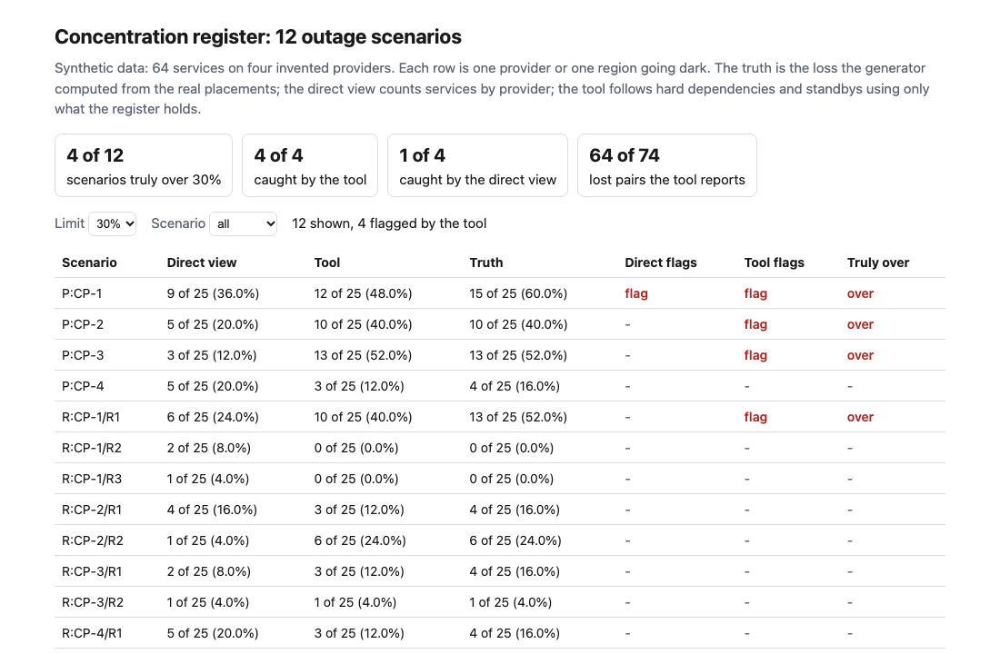
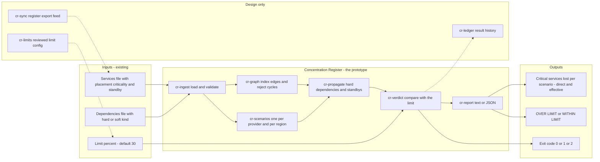
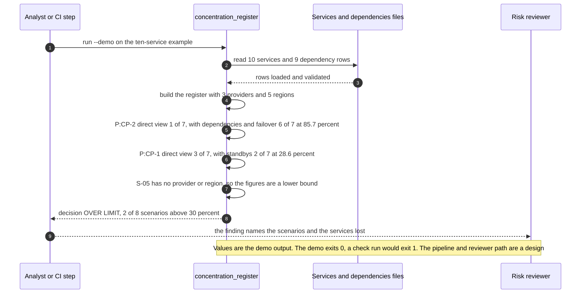

# 🧭 Concentration Register (VendorLens extension): which critical services sit on one cloud provider or one region

**I wanted to know how much of the critical estate goes dark when one cloud provider or one region fails, and I did not trust a count of services per provider to tell me. This is a command-line tool that reads a register of services and the dependencies between them, takes each provider and each region out in turn, and prints how many critical services are left standing, next to what a direct count would have said.** It extends the upstream-provider view in [18 VendorLens](../18-vendorlens-ai-vendor-due-diligence/): that project counts critical use cases per model provider; this one follows hard dependencies and standbys, and scores the answer against a world whose truth is known.

**▶ Static demo, no install:** [open demo.html](./demo.html)

[](./demo.html)

## Executive summary (90 seconds)

**Problem.** A technology risk team (modeled here, not a real one) keeps a register of critical services with the provider and region each one runs in, and the reviewer who has to say whether the estate is concentrated reads a count per provider. That count says nothing about what depends on a provider or what a standby would carry, so a provider that hosts one service can sit under most of the others. 🟢 In the synthetic register of 64 services, 25 of them critical, a provider and region are listed for 55 of 64 and 96 hard dependencies are listed, yet the process measures 0 of 12 outage scenarios, while 4 of 12 would lose more than 30% of the critical services (`step_01_status_quo.py`). The first time anyone adds it up may be an outage.

**Product.** Concentration Register is a command that reads a services file (provider, region, criticality, an optional standby) and an optional dependencies file (each row hard or soft), then runs one outage scenario per provider and per provider-region. A service is lost when its placement is hit and no second placement survives, or when a hard dependency is lost; a soft dependency does not take a service down. It prints the critical services lost per scenario next to the direct count, flags any scenario above the limit (30% by default, my assumption, because the guidance I read names no number), lists critical services with no placement as a lower-bound warning, and names standbys that share the primary's provider and region. It exits 1 when a scenario is over the limit and 2 for malformed input. There is no model call; the loss is plain set propagation you can read.

**Measured and modeled performance.**

- 🟢 **Status quo: 0 of 12 outage scenarios measured.** The register lists a provider and region for 55 of 64 services and 96 hard dependencies, and 4 of 12 scenarios truly lose more than 30% of critical services (`step_01_status_quo.py`).
- 🟢 **A direct share by provider flags 1 of 12 scenarios** (`P:CP-1`, 36.0%) and so catches 1 of the 4 that truly cross the limit; it counts 44 critical pairs, 31 real and 13 that survive on a standby (`step_02_direct_share.py`).
- 🟢 **The misses are dependency-driven:** `P:CP-3` shows 12.0% and loses 52.0%, and `R:CP-1/R1` shows 24.0% and loses 52.0%. Counting a soft dependency as hard flags 5 of 12 scenarios, 1 of them not over in truth (`step_03_deficiencies_exposed.py`).
- 🟢 **Together: 4 of the 4 scenarios that truly cross 30% flagged,** 0 false flags, and 64 of the 74 lost pairs found, all of them real (`step_04_with_register_model.py`).
- 🟢 **Known miss: 10 of 74 lost pairs are not found (recall 86.5%).** Supplying what the register lacks, one thing at a time, takes the misses from 10 to 4 to 2 to 0 (`step_04_with_register_model.py`).
- 🟢 **The limit changes the answer:** at a 40% limit 3 scenarios truly cross it and the tool flags 2; at 50% it flags 1 of 3 (`step_04_with_register_model.py`).
- 🟡 **Utility: (4/4 − 1/4) × 4 = 3 over-limit scenarios a review finds that a direct count would miss,** assuming 4 truly over-limit scenarios in one register.
- 🔴 **Design target: the concentration view refreshed within 10 minutes of a register export landing.** Designed in [`ARCHITECTURE.md`](./ARCHITECTURE.md), never built or timed.

**What I would ask a head of operations to decide.** Whether a provider or region outage that takes out more than a set share of critical services should be a finding the register owner must answer, and what that share is. My recommendation is to adopt the dependency and standby rule as written, run it in advisory mode on one real register export whose dependency list the platform team will vouch for, and set the limit against your own risk appetite: here the answer moves with it, since the tool flags 2 of 3 scenarios at 40% and 1 of 3 at 50%.

**Call to action.** Fork the repo. Swap `data/services.csv` and `data/dependencies.csv` for your own exports and keep the columns listed in the header of `src/concentration_register.py`, then run `check` with your limit. To call it from code, import `load_services`, `load_deps`, `make_register` and `analyze` from that file. Fill the placement for every critical service and list the hard dependencies before you read the output, since the figures are a lower bound. Send findings by opening an issue: say which scenario crossed and how many critical services had no placement, not the register itself.

_A portfolio prototype on synthetic data. Nothing here is deployed, load-tested or used by anyone._

## Run one now

```bash
cd 45-concentration-register/src && python3 concentration_register.py --demo
```

It prints:

```text
register: 10 services (7 critical), 3 providers, 5 regions; 7 hard and 2 soft dependencies
critical services lost per outage scenario (limit 30%)
  scenario     direct view      with dependencies and failover
  P:CP-2       1 of 7 (14.3%)   6 of 7 (85.7%)  OVER
  R:CP-2/R1    1 of 7 (14.3%)   6 of 7 (85.7%)  OVER
  P:CP-1       3 of 7 (42.9%)   2 of 7 (28.6%)
  R:CP-1/R1    2 of 7 (28.6%)   2 of 7 (28.6%)
  P:CP-3       2 of 7 (28.6%)   1 of 7 (14.3%)
  R:CP-3/R1    1 of 7 (14.3%)   1 of 7 (14.3%)
  (2 more scenarios; --format json lists all)
unplaced: 1 critical service with no provider or region (S-05 fraud screening engine); the figures above are a lower bound
standby in the same provider and region as the primary: 1 service (S-06 statement delivery batch)
decision: OVER LIMIT (2 of 8 scenarios lose more than 30% of critical services)
```

The example is ten hand-written services. `CP-2` hosts one critical service, so a count says 14.3%. That service is the identity platform, and the others hard-depend on it, so a `CP-2` outage costs 6 of 7. `CP-1` looks worst by count (42.9%) and is fine once its standbys are counted (28.6%).

Standard library only, Python 3.9 or newer. To check your own files: `python3 concentration_register.py check services.csv --deps dependencies.csv --limit-pct 30`. It exits 1 when a scenario loses more than the limit, 2 on malformed input; `--format json` prints every scenario. `--demo` always exits 0.

## What the numbers say

**What it shows** (🟢 measured on synthetic data: 64 services, 25 of them critical, 4 invented providers, 12 outage scenarios; the script is named in brackets):

- 🟢 The register lists a provider and region for 55 of 64 services, lists 96 hard dependencies, and measures 0 of 12 outage scenarios; in the generator's world 4 of 12 lose more than 30% of the critical services (`step_01`)
- 🟢 A direct share by provider flags 1 of 12 scenarios (`P:CP-1`, 36.0%) and so catches 1 of the 4 that truly cross the limit; it counts 44 critical (scenario, service) pairs, 31 of them real and 13 that survive on a standby (`step_02`)
- 🟢 The misses are dependency-driven: `P:CP-3` shows 12.0% by count and loses 52.0%; `P:CP-2` shows 20.0% and loses 40.0%; `R:CP-1/R1` shows 24.0% and loses 52.0% (`step_03`)
- 🟢 Walking the dependencies but counting a soft one as hard flags 5 of 12 scenarios, 1 of them not over the limit in truth, and counts 17 pairs that are not lost (`step_03`)
- 🟢 Following hard dependencies and standbys flags 4 of the 4 scenarios that truly cross 30%, with 0 false flags, and reports 64 of the 74 lost pairs, all of them real (`step_04`)

**Assumed, not measured:**

- 🟡 The 30% limit is mine. The guidance I read names no number (see Aligned to), so every flag in this README depends on that choice. `step_04` reruns it from 20% to 50%.

**Not tested:**

- 🔴 A real environment will have far more unlisted dependencies than the 6 planted here, and its placement data will be wrong in ways this generator does not draw. I have not run the tool on a real register.

## What it still gets wrong

- 🟢 It understates and never overstates: 10 of the 74 lost pairs are missed (recall 86.5%). Supplying what the register lacks, one thing at a time, takes the misses from 10 to 4 (true placement of the 3 critical services with no placement), to 2 (the 6 unlisted hard dependencies), to 0 (the 1 standby that does not take over). The last step landing on 0 is also a check that the generator's loss and the tool's loss agree where the register is complete (`step_04`).
- 🟢 The understatement can move a decision. `P:CP-1` is 48.0% by the tool against 60.0% in truth, and `R:CP-1/R1` is 40.0% against 52.0%. At a 40% limit 3 scenarios truly cross it and the tool flags 2; at a 50% limit it flags 1 of 3 (`step_04`).
- **Same author.** I wrote the world and the rules. The two propagation routines are separate code, but they share the idea, so agreement where the register is complete is by construction. The numbers are a ceiling for these rules on data I drew, not a rate on a real bank.
- **The failover result rests on one service.** The generator makes a warm standby fail to take over with probability 0.30; this draw produced 1 among 15 and I kept it (see [data/README.md](./data/README.md)).
- The model is binary and static: a service is up or lost. It has no capacity check on a standby, no recovery time, no shared control plane between regions of one provider, and nothing outside the register (a shared DNS or payment network is invisible unless it is a row). Provider and region names are compared exactly, so `CP-1` and `cp-1` count as two providers.
- A region outage is a whole region of one provider. Partial failures, a single availability zone and a provider-wide control-plane event are not modeled.

## How the four steps fit

| Step | Question | Script |
|---|---|---|
| 1 | What does a register hold when nothing adds it up? | `step_01_status_quo.py` |
| 2 | What does a count of critical services per provider say? | `step_02_direct_share.py` |
| 3 | Where does that count fail, and what is left in on purpose? | `step_03_deficiencies_exposed.py` |
| 4 | What do hard dependencies and standbys add, and what do they still miss? | `step_04_with_register_model.py` |

Run any of them from `src/`. Data is generated by [`data/_generate.py`](./data/README.md); `tools/check_repo.py` confirms that a rerun reproduces every file and that the green numbers above appear in a script's output. `python3 _build_demo.py` rebuilds `demo.html` from what step 4 writes to `src/out/`.

## Utility delivered

The way I price product impact: **utility = (my solution − current state of the art) × the number of people or items it affects.**

Here the item is an outage scenario that truly loses more than the limit of critical services. Each one lands on the register owner who has to answer for it and the reviewer who signs the concentration view. The common basic approach is a direct share of critical services by provider; the table prices the register model against it.

| Term | Value | Where it comes from |
| --- | --- | --- |
| Current state of the art (direct share by provider, flag above 30%), over-limit scenarios flagged | 🟢 **1 of 4** | `step_02_direct_share.py`; it flags `P:CP-1` and nothing else, with 0 false flags |
| My solution (hard dependencies and standbys followed), over-limit scenarios flagged | 🟢 **4 of 4** | `step_04_with_register_model.py`; 0 false flags |
| Lift per over-limit scenario | 🟢 4 of 4 minus 1 of 4 | The direct view misses `P:CP-2` (20.0% against 40.0%), `P:CP-3` (12.0% against 52.0%) and `R:CP-1/R1` (24.0% against 52.0%) (`step_03_deficiencies_exposed.py`) |
| Number it affects: truly over-limit scenarios in one real register | 🟡 **4** | **Assumption, not a statistic.** Replace it with the count of provider and region outages that you believe lose more than your limit; the planted set has 4 of 12 |
| Assumption that makes the lift real | 🟡 The register lists the hard dependencies and the standbys that exist, and the placement of the critical services | As registered here the tool still misses 🟢 10 of 74 lost pairs (recall 86.5%) because of gaps the register does not show (`step_04_with_register_model.py`) |
| **Utility** | 🟡 **(4/4 − 1/4) × 4 = 3 over-limit scenarios found that a direct count would miss** | Assumes the 4 behave like the 4 planted ones |

Sensitivity to the count assumption (🟡, same lift): 2 over-limit scenarios gives 1.5, 4 gives 3.0, 8 gives 6.0.

🔴 What I have not measured: what finding a concentration is worth, what moving a service costs, how fast a real register goes stale, or how many dependencies a real register leaves out compared with the 6 planted here. The 30% limit is mine. Treat the result as a property of this planted world, not a forecast.

---

## Architecture and call flow

Component names match [`ARCHITECTURE.md`](./ARCHITECTURE.md). GitHub renders the diagrams natively.


**System topology:**



**Per-run sequence** (the `--demo` run on the ten-service example):



**Interlocks (all red, designed, none built):**

- [18 VendorLens](../18-vendorlens-ai-vendor-due-diligence/) counts critical use cases per model provider. A designed link would put that upstream-provider view and this cloud-provider view in one concentration register. This folder does not import or read its files.
- [65 Failover Scorecard](../65-failover-scorecard/) scores whether a service has a tested way back from the loss of its primary region. Its drill evidence would feed a tested-failover field here, so a claimed standby is not taken on trust (`cr-sync`).
- [44 Inventory Check](../44-inventory-check/) runs completeness and staleness tests on an inventory. A check of that kind could run on this register's placement fields before `cr-ingest` reads it.

---

## PM artifacts

The PM artifacts that show how I would run this product if I owned the seat. This README is the walkthrough; the rest of the folder holds:

- [`PRD.md`](./PRD.md): the product requirements doc, with users, backlog, KPIs, rollout and open questions.
- [`ARCHITECTURE.md`](./ARCHITECTURE.md): the systems doc, with components, data model, security, failure behavior and operations. A design, not deployed.
- [`demo.html`](./demo.html): clickable, no-install walkthrough, built from the step outputs by `src/_build_demo.py`.
- [`data/`](./data/): the synthetic register of 64 services, its dependencies, the planted truth and the seeded generator. `data/README.md` explains how the truth is set.
- [`src/`](./src/): `concentration_register.py`, `common.py`, the four step scripts and the demo builder.
- [`tests/`](./tests/): 31 unittest tests, including a golden test that pins the numbers above and tests for bad input and hostile strings.

Run the four steps end to end:

```bash
cd src
python3 step_01_status_quo.py
python3 step_02_direct_share.py
python3 step_03_deficiencies_exposed.py
python3 step_04_with_register_model.py
```

---

## Aligned to

The interagency [Guidance on Third-Party Relationships: Risk Management](https://www.federalreserve.gov/supervisionreg/srletters/SR2304.htm) (SR 23-4, issued 7 June 2023). I read the text as published in the Federal Register on 9 June 2023 ([govinfo copy](https://www.govinfo.gov/content/pkg/FR-2023-06-09/html/2023-12340.htm)) on 24 October 2026, through a fetch tool that answers questions about the page, so I checked only the passages this project leans on, not the whole document. Among the factors a bank weighs, the guidance lists dependence on a single provider for several activities (under operational resilience and under reliance on subcontractors) and the geographic location of subcontractors. It names no numeric concentration limit, which is why the limit here is an assumption. The Fed's PDF of the guidance is a scan that the fetch could not read. I did not read the 2021 proposal, so I do not cite it. This is a prototype, aligned to that guidance. It makes no claim of conformity to that guidance.

## Data and limits

Synthetic, seeded, byte-for-byte reproducible. Nothing comes from any employer, bank or real cloud provider; provider codes are invented. A prototype on synthetic data, not a production case study.

## Fork it

Swap `data/services.csv` and `data/dependencies.csv` for your own exports and keep the columns (listed in the header of [`src/concentration_register.py`](./src/concentration_register.py)), or write the two files by hand and run `check`. Read the [PRD](./PRD.md) for the scope I held to.

## Prereqs to run this on your laptop

You need Python 3.9 or newer and nothing else. The tool, the four step scripts and the data generator use only the standard library, so there is nothing to install. There is no API key, no network call and no model call anywhere in the folder. To run the tests, use `python3 -m unittest discover -s tests` from this folder. The production pieces in [`ARCHITECTURE.md`](./ARCHITECTURE.md) (the register export feed, the reviewed limit config, the result ledger) are a design, not something you need or can run.

## Author

**Vijay Saharan**, Sr Product / Program Manager · AI in BFSI · Enterprise AI Platforms

[LinkedIn](https://www.linkedin.com/in/vijaysaharan/)
