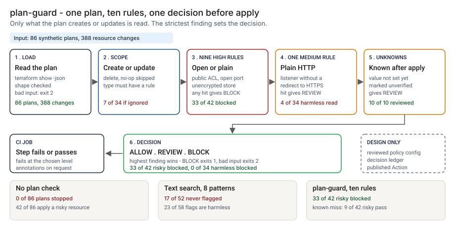

# Architecture: plan-guard

> **Status.** This is the design for a production shape. The repo implements the product mechanic as a prototype: a command, `src/plan_guard.py`, that reads the JSON form of a Terraform plan, keeps the resource changes that create or update, applies ten rules chosen by resource type and prints ALLOW, REVIEW or BLOCK, run here over 86 synthetic plans. A GitHub Action is staged in `action/` and has not been published or run on GitHub. Nothing below is claimed as deployed or load-tested. Where a figure is a design target, it says so.

GCP is primary; AWS and Azure sit beside it.



---

## 1. Logical architecture

plan-guard is a function between `terraform plan` and `terraform apply`: one plan file in, a decision out. It does not run Terraform, read a cloud account or call a model.

Eight components: five decide the outcome (one as config), three carry or record it.

| Component | Responsibility | Language or framework | Decides the outcome? | Stateful? |
| --- | --- | --- | --- | --- |
| `pg-ingest` | Loads the plan and checks its shape. Rejects bad input with a one-line message. | Python 3.9+, standard library. Prototype: `load_plan`, `check_shape` in `src/plan_guard.py` | Yes, by refusing: exit 2 | No |
| `pg-scope` | Picks the changes read: create or update, not a data source, of a type with a rule. Says when nothing was checked, and sends a plan that creates or updates only unruled types to REVIEW (PG00). | Python. Prototype: `check_plan`, `CHANGING`, `_scope_line` | Yes | No |
| `pg-rules` | Ten rules tied to exact types. A value known only after apply is `unverified`. | Python. Prototype: `RULES`, the `rule_*` functions, `_has_unknown` | Yes | No |
| `pg-verdict` | Highest class wins; `--fail-on` maps the decision to an exit code. | Python. Prototype: `decide`, `DECISION_RANK`, `run_check` | Yes | No |
| `pg-report` | Prints text or GitHub annotations. Escapes plan strings. | Python. Prototype: `render`, `visible`, `escape_annotation` | No | No |
| `pg-action` | Runs the command in a CI job, inputs through environment variables. | Composite GitHub Action, staged in `action/action.yml`, not published | No | No |
| `pg-policy` | Port lists, ACLs, severities and dated exceptions, changed by review (design). Prototype: constants `ADMIN_PORTS`, `DB_PORTS`, `PUBLIC_ACLS` | Reviewed config in the infrastructure repo | Yes, config | Stateful, in git |
| `pg-ledger` | One record per decision (design). Prototype analog: `src/out/step_04_decisions.csv` | PostgreSQL and object storage (design) | No | Stateful |

**What decides the outcome.** The input check, the scope, the rules with their lists, and the verdict. The report, the Action wrapper and the ledger carry or record the decision. The rules read one resource at a time and never join two.

**Repo structure** (production shape):

```
plan-guard/
├── guard/      # ingest, scope, rules, verdict, report
├── action/     # composite Action wrapper
├── policy/     # ports, ACLs, severities, exceptions, by pull request
├── ledger/     # decision record writer
├── docs/runbooks/
└── tests/      # unit, golden (planted-set numbers), hostile (injection strings)
```

---

## 2. Physical and deployment architecture

One short-lived process in the pipeline that already runs `terraform plan`. There is no server to keep warm.

| Component | GCP (primary) | AWS | Azure | Why |
| --- | --- | --- | --- | --- |
| Gate process | Cloud Build step or Cloud Run job | CodeBuild step or ECS Fargate task | Azure Pipelines step or Container Apps job | Stateless, one pass, runs where the plan runs |
| Plan file | Pipeline workspace, removed at job end | Same | Same | Not an artifact: it can carry sensitive values |
| `pg-ledger` | Cloud SQL for PostgreSQL | RDS for PostgreSQL | Azure Database for PostgreSQL | Already run by the platform team |

**Failure behavior (the decision that matters most).** The gate must never silently pass. A plan it cannot read does not become ALLOW: it exits 2 with a one-line reason, even with `--fail-on never`. A plan it reads but cannot check says so.

| Failure | Behavior | Alert |
| --- | --- | --- |
| Plan missing, empty, truncated, not an object, `format_version` not 1.x, or a change missing `address`, `type` or `actions` | Exit 2, one line on stderr, CI step fails | P2 if repeated on one repo, else P3 |
| Deeply nested JSON | Exit 2, no traceback | P3 |
| A plan with nothing to create or update | Output says nothing was checked and nothing needed checking; the decision is ALLOW | P4 |
| A plan that creates or updates only types with no rule | Finding PG00 and decision REVIEW: nothing in the plan was read. In the design a run that reads nothing on a production plan also raises an alert | P3 |
| A value known only after apply | Finding `unverified`: REVIEW | P4 digest |
| Ledger unavailable (design) | The decision and exit code stand; the record queues locally and the gap is listed | P3 |

**Latency.** The prototype is untimed. 🔴 Design target: a decision within 30 seconds of the plan file landing.

---

## 3. Data architecture

| Entity | Key | What it holds | Real columns in the prototype |
| --- | --- | --- | --- |
| Plan | plan hash (design) | `format_version`, `terraform_version`, `resource_changes` | `data/plans.csv`: `plan_id`, `plan_json` |
| Resource change | `address` | `mode`, `type`, `name`, `provider_name`, and `change` with `actions`, `before`, `after`, `after_unknown` | Inside `plan_json`; the rules read `type`, `actions`, `after` and `after_unknown` |
| Finding | `rule`, `address` | `name`, `class`, `kind`, `reason` | Returned by `check_plan`; in `src/out/step_04_decisions.csv` |
| Decision record | `decision_id` | Design: plan hash, rules version, policy version, tool version, decision, findings, time | Prototype: `src/out/step_04_decisions.csv` |
| Planted truth | `plan_id` | The planted change and the decision it deserves | `data/plan_truth.csv`: `kind`, `truth_class`, `target_address`, `expected_rule`. Exists only because the data is synthetic |

**Retention** is a design choice, not a measurement; confirm it against the bank's own record-retention schedule. 🔴 Design default: decision records and findings for 7 years in PostgreSQL archived with a retention lock. The plan file is not retained: the record holds its hash.

**Lineage.** A decision traces back in three hops: the record names the plan hash, rules version and policy version; the finding names the rule and the `address` in the plan; and the rules are deterministic, so re-running `check_plan` on the same plan reproduces the findings. In the prototype the trace is a row of `step_04_decisions.csv`.

**Deliberately not stored.** The plan file, attribute values other than the one a finding quotes, and any account identifier beyond what the address carries. A plan can carry values you would not want in a log, and the tool prints only the value it flags.

---

## 4. Security architecture

**Identity and roles.** The gate runs under the CI platform's workload identity and has no user account of its own. `pg:runner` reads the plan from the workspace and the policy file, and writes a decision record. `pg:approver` approves a rule, list or exception change, never for their own change. `pg:auditor` reads decisions and config history. `pg:admin` manages roles and the ledger.

**Secrets.** The gate holds none, calls no cloud account and no model. The CI identity reaches the ledger through workload identity, with no static keys. The Action passes inputs through environment variables, with `--` before the plan path.

**Data classification and what leaves the boundary.** A plan may carry sensitive values: treat it as confidential. In the prototype nothing leaves the machine. In the design three things leave the job: the exit code, the annotations and the ledger write.

| Threat | Example | Mitigation in the design |
| --- | --- | --- |
| Hostile string in an address or attribute echoed into a log or annotation | A resource address holding a newline and text that looks like a workflow command | `visible` writes control characters as escapes and cuts long text; `escape_annotation` rewrites `%`, carriage return and newline. `tests/test_cli.py` covers a hostile address, attribute value and file name |
| A rule is weakened to make a BLOCK go away | A port removed from `ADMIN_PORTS`, a severity lowered | The lists live in `pg-policy`, change by pull request with a different approver, and the golden numbers show the move |
| The plan checked is not the plan applied | A second plan run after the gate | Apply only the saved plan file whose hash the decision stored |
| A resource named to look harmless | An address that says `test` | The `type` field picks the rules; the address is a label |
| A plan with a secret is kept | A plan uploaded as a build artifact | Not retained; the printed value is cut at 60 characters; the Action README says to keep the file out of artifacts |

---

## 5. Operational architecture

**SLIs.** Decisions per level per repo per week (prototype baseline on harmless synthetic plans: 🟢 4 of 34 sent to review, `step_04_with_guard.py`); input rejections; changes checked over changes in the plan; runs that checked nothing; findings of kind `unverified`; time to decision.

**SLOs (all 🔴 design targets, none measured).**
- A decision within 30 seconds of the plan file landing.
- Every production apply preceded by a decision record.
- Every BLOCK read by a named person within one business day (planning estimate).
- 99.9 percent of decisions written to the ledger.

**Alerts.** P2: repeated input rejections on one repo, or the ledger down for more than a day. P3: a BLOCK on a production plan, or a plan applied with no matching decision record. P4: a daily digest of REVIEW decisions and runs that checked nothing.

**Runbooks** (one page each, in `docs/runbooks/`):
- `blocked-plan.md`: read the rule and resource, fix the change or request a dated exception.
- `unknown-value-review.md`: check the value after apply and record the result.
- `adding-an-exception.md`: the pull request, the approver, the expiry.
- `changing-a-rule.md`: propose, re-run the planted set, compare, approve.

**On-call and ownership.** The pipeline owner owns the runner, the Action wrapper and the runbooks. The cloud security reviewer owns the rules, lists and exceptions. Nobody is paged for a REVIEW.

**Change control for rules and thresholds.** Rules and lists are versioned in the repo. A change needs a proposer and a different approver. Before merge, the planted set is re-run and compared with the numbers pinned in `tests/test_golden.py`, so a change that moves the blocked count shows in the diff.

---

## 6. Alignment and posture

Alignment, not certification. The README's "Aligned to" section cites one source, restated with the same wording about what was read: the [Cloud Security Alliance Cloud Controls Matrix](https://cloudsecurityalliance.org/research/cloud-controls-matrix). By my own reading, the ten rules touch these of its domain names: Change Control and Configuration Management, Cryptography, Encryption and Key Management, Data Security and Privacy, Infrastructure and Virtualization Security, and Identity and Access Management. The page does not assign rules to domains. I read the matrix page on 2026-10-24: it names version 4.1, 197 control objectives and 17 domains, and shows no release date. I did not read the control text, so there is no control-by-control mapping. The FFIEC cloud statement and handbook booklet returned HTTP 403 to my fetch, so I cite neither.

- **What the design does.** It checks a planned change against ten rules, which I placed near those domain names by my own reading, before apply and records the decision.
- **What it does not claim.** It makes no claim of conformity to the matrix, maps no control, and I have not read or mapped any other source.

---

## 7. What is deliberately not here

- **Anything but AWS.** Other providers, module configuration, `planned_values` and values Terraform marks sensitive are not read. Only `resource_changes` is.
- **Resources already deployed.** A resource the plan does not touch is outside it, and so is any account-wide default.
- **Joins between resources.** 🟢 4 of 34 harmless plans go to review: three because a listener is never joined to its load balancer, one because the plan holds nothing the rules can read (`step_04_with_guard.py`).
- **The three hard misses.** 🟢 9 of 42 risky plans pass: a split CIDR, a condition that matches everything and a queue policy with no rule (`step_04_with_guard.py`).
- **A plan from a real Terraform run.** The data follows the shape I know; how a real provider reports an unset attribute varies, and the three forms are in the data.
- **Standards-derived parameters.** Port lists, ACLs and severities are my assumptions. A bucket ACL granted through `access_control_policy` is not read; RDS is single-instance only.
- **Hosting, a model call, or a rate on real plans.** The author wrote both the plans and the rules, so the numbers are a ceiling for these rules.

---

## Appendix: sample contract

```bash
terraform show -json tfplan > plan.json
python3 plan_guard.py check plan.json --fail-on block --format github
```

A finding is `rule`, `name`, `class` (block or review), `kind` (violation or unverified), `address` and `reason`. In annotation form it is `::error title=plan-guard PG04::<address>: <reason>` for a block and `::warning` for a review. Exit status: 0 below `--fail-on`, 1 at or above it, 2 for bad input.
