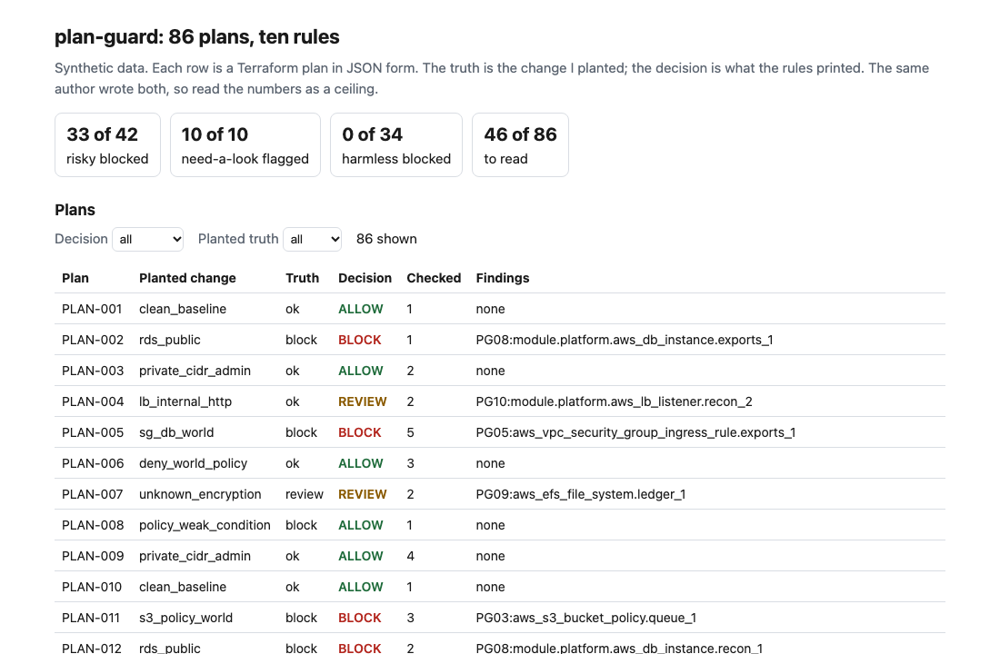
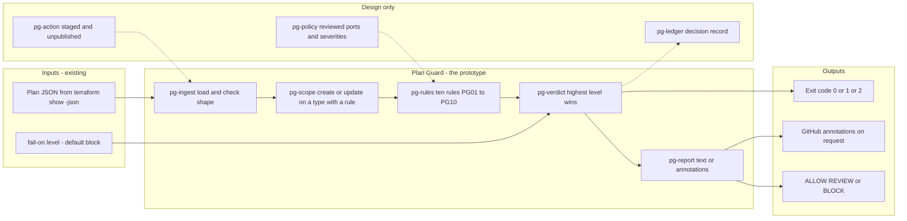
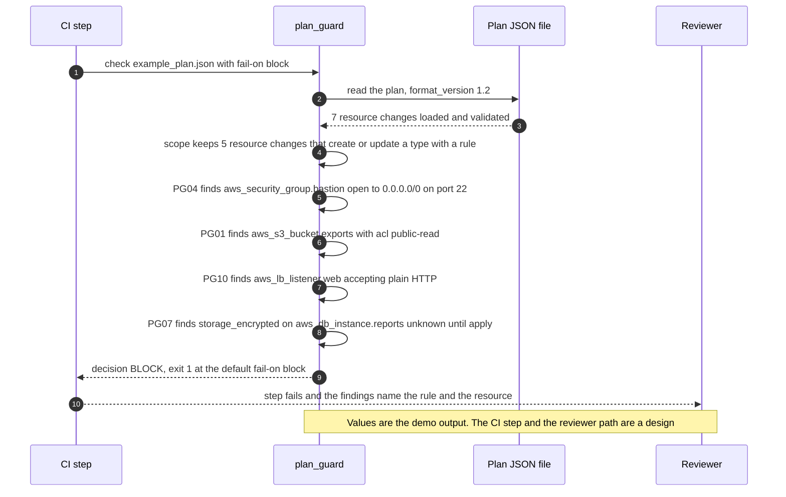

# 🚧 plan-guard (plan JSON policy checks): a gate between `terraform plan` and apply

**I wanted to know how much cloud change risk is already visible in a Terraform plan before anything is applied, and what a text search, a parser and ten rules each stop. This is a command-line check and a staged GitHub Action: it reads the JSON form of a plan, applies ten rules to what the plan creates or updates, and prints ALLOW, REVIEW or BLOCK.** It uses the ALLOW, REVIEW, BLOCK gate shape and exit codes of [28 Tool Schema Drift](../28-tool-schema-drift/), on a different input.

**▶ Static demo, no install:** [open demo.html](./demo.html)

[](./demo.html)

## Executive summary (90 seconds)

**Problem.** The engineer who owns the pipeline that applies infrastructure changes, and the reviewer who approves them, are handed a Terraform plan that is valid. A plan can create a public bucket, open a database port to the internet or leave storage unencrypted, and `terraform validate` and the plan itself pass. 🟢 On 86 synthetic plans with 388 resource changes, a pipeline with no plan check stops 0 of 86, and 42 of 86 apply a risky resource unchecked (`step_01_no_gate.py`). The risk is found by a scanner after apply or by a person reading plan text under time pressure.

**Product.** Plan Guard is a command that reads the JSON form of a plan (`terraform show -json`), keeps the resource changes whose actions include create or update, and applies ten rules chosen by the exact `type` field: `PG01` public bucket ACL, `PG02` public access block off, `PG03` bucket policy open to everyone, `PG04` world-open admin port, `PG05` world-open database port, `PG06` unencrypted volume, `PG07` unencrypted database, `PG08` public database, `PG09` unencrypted file system and `PG10` plain HTTP listener. Nine are high and give BLOCK; `PG10` is medium and gives REVIEW. A value that is only known after apply is marked unverified and also gives REVIEW. The highest level wins. The command exits 1 at the level you choose (BLOCK by default) and 2 for malformed input. There is no model call; the rules are plain code you can read.

**Measured and modeled performance.**

- 🟢 **No plan check: 0 of 86 plans stopped.** 42 of 86 apply a risky resource unchecked (`step_01_no_gate.py`).
- 🟢 **A text search with 8 patterns flags 58 of 86 plans.** 23 of those 58 flags (39.7%) are harmless, and 17 of the 52 plans that should be blocked or sent to review are never flagged (`step_02_text_search.py`).
- 🟢 **Each half of the parser fails alone:** rules that ignore each resource's action block 7 of 34 harmless plans, and rules that treat an unknown value as fine flag only 3 of 10 plans that need a look (`step_03_deficiencies_exposed.py`).
- 🟢 **Together: 33 of 42 risky plans blocked,** each on the planted resource with the expected rule (33 of 33), 10 of 10 need-a-look plans sent to review, 0 of 34 harmless plans blocked. A person reads 46 of 86 plans where the text search sent 58 (`step_04_with_guard.py`).
- 🟢 **Known miss: 9 of 42 risky plans pass,** three split-CIDR plans, three with a permissive condition and three with a queue policy that has no rule. 3 of 34 harmless plans go to review (`step_04_with_guard.py`).
- 🟢 **The decision matches the planted truth on 74 of 86 plans** (`step_04_with_guard.py`).
- 🟡 **Utility: (17/52 − 9/52) × 50 = 7.7 plans a year that a text search would pass and the guard stops or sends to review,** assuming 50 plans a year that should be blocked or reviewed reach the gate.
- 🔴 **Design target: a decision within 30 seconds of the plan file landing.** Designed in [`ARCHITECTURE.md`](./ARCHITECTURE.md), never built or timed.

**What I would ask a head of operations to decide.** Whether a plan that creates a world-open port or an unencrypted store should stop the pipeline by default, and whether a value Terraform cannot know until apply should send the plan to a person. I set both as my policy, not as a measurement. My recommendation is to adopt the nine blocking rules as written, run the command in advisory mode (`--fail-on never`) on one real plan stream first, and set the port lists and severities against your own cloud standard, since they are my assumptions.

**Call to action.** Fork the repo. Swap `data/plans.csv` and `data/plan_truth.csv` for your own exports and keep the columns, or skip the data and point `check` at a plan file from your pipeline. To call it from code, import `check_plan` and `decide` from `src/plan_guard.py`. To add a rule, write a function that returns `("violation", text)` or `("unverified", text)` hits and add a row to `RULES`. Check one real plan against the shape in `data/README.md` first, since no plan here came from a Terraform run. Send findings by opening an issue: say which rule fired and on which resource type, not the plan itself.

_A portfolio prototype on synthetic data. Nothing here is deployed, load-tested or used by anyone, and the Action is staged and has not run on GitHub._

## Run one now

```bash
cd 46-plan-guard/src && python3 plan_guard.py --demo
```

It prints:

```text
plan: example_plan.json   format_version 1.2   7 resource changes, 5 checked
  [block ] PG04 sg_world_admin_port         aws_security_group.bastion: ingress from 0.0.0.0/0 reaches admin port 22
  [block ] PG01 s3_public_acl               aws_s3_bucket.exports: acl is public-read, a canned ACL that opens the bucket beyond its owner
  [review] PG10 lb_plain_http_listener      aws_lb_listener.web: the listener accepts plain HTTP and its default action does not redirect to HTTPS
  [review] PG07 rds_unencrypted             aws_db_instance.reports: `storage_encrypted` is not known until apply, so database storage encryption cannot be checked in the plan
decision: BLOCK
```

Standard library only, Python 3.9 or newer. To check your own plan: `terraform show -json tfplan > plan.json`, then `python3 plan_guard.py check plan.json`. It exits 1 on BLOCK, so a CI step fails; `--fail-on review` also fails on REVIEW, and `--format github` prints annotations. Bad or malformed input exits 2 with one line on stderr.

## What the numbers say

**What it shows** (🟢 measured on synthetic data: 86 planted plans with 388 resource changes; the script is named in brackets):

- 🟢 No plan check: 0 of 86 plans stopped, and 42 of 86 apply a risky resource unchecked (`step_01`)
- 🟢 A text search with 8 patterns flags 58 of 86 plans; 23 of those 58 flags (39.7%) are harmless, and 17 of the 52 plans that should be blocked or sent to review are never flagged (`step_02`)
- 🟢 Rules that ignore each resource's action block 7 of 34 harmless plans, all deleted or unchanged resources; rules that treat a value unknown until apply as fine flag only 3 of 10 plans that need a look (`step_03`)
- 🟢 Parser, ten rules and unknown handling together: 33 of 42 risky plans blocked, each on the planted resource with the expected rule; 10 of 10 need-a-look plans sent to review; 0 of 34 harmless plans blocked; a person reads 46 of 86 plans where the text search sent 58 (`step_04`)

## What it still gets wrong

- 🟢 9 of 42 risky plans pass (`step_04` prints each one). Three split the open internet into two half-range CIDRs (PLAN-019, PLAN-042 and PLAN-059): the rule reads exact world CIDRs, and the two halves together are the whole internet. Three allow a wildcard principal behind a condition that matches everything (PLAN-008, PLAN-029 and PLAN-057): any condition passes. Three are a world-open queue policy (PLAN-041, PLAN-049 and PLAN-060): there is no rule for that resource type. The text search from step 2 flags 6 of these 9 (`step_03`).
- 🟢 3 of 34 harmless plans go to review (`step_04`). They are plain HTTP listeners on an internal load balancer. The rules look at one resource at a time and never join the listener to its load balancer.
- **The plans and the rules share an author.** I planted the changes and wrote the rules, so 33 of 42 shows the rules cover what I planted. The nine hard misses and the harmless look-alikes (a Deny policy for `*`, a deleted public bucket, port 443 open to the world, an unchanged risky resource) are in the data on purpose, so the score is not a clean sweep. Treat the result as a ceiling for these rules, not a rate on real plans, which I have not tested.
- 🔴 **No plan here came from a Terraform run.** `data/_generate.py` writes plans in the shape of `terraform show -json` as I know it: `resource_changes`, each with `type`, `address` and a `change` holding `actions`, `before`, `after` and `after_unknown`. I did not check them against real output. How a real provider reports an unset attribute (absent, null or unknown) varies, so the three forms are all in the data.
- 🟡 The parameters are my assumptions: admin ports 22 and 3389; database ports 1433, 1521, 3306, 5432, 6379 and 27017; three canned ACLs counted as public; an unset encryption flag read as off; one medium rule (a plain HTTP listener) and nine high. None is taken from a standard or a regulation. Account-wide defaults, such as default encryption set outside the plan, are not visible to the rules.
- Scope: AWS provider, 12 resource types behind ten rules. Single-instance RDS only, not clusters. A bucket ACL granted through `access_control_policy` is not read. Only `resource_changes` is read, not `configuration` or `planned_values`. A plan file can carry values you would not want in a log; the tool prints only the value it flags, but keep the file out of build artifacts.

## Use it in CI

[`action/`](./action/README.md) holds a staged GitHub Action and the steps to publish it from its own repository, which a Marketplace listing requires. It has not been published and has not run on GitHub. What is tested is the command it wraps (`tests/test_cli.py`; the folder holds 46 tests across the rules, the command line and the golden numbers).

## How the four steps fit

| Step | Question | Script |
|---|---|---|
| 1 | What reaches apply when nothing reads the plan? | `step_01_no_gate.py` |
| 2 | What does a text search for known-bad strings cost and miss? | `step_02_text_search.py` |
| 3 | Where does a parser fail when it ignores the action or the unknowns? | `step_03_deficiencies_exposed.py` |
| 4 | What do the ten rules catch with both handled? | `step_04_with_guard.py` |

Run any of them from `src/`. Data is generated by [`data/_generate.py`](./data/README.md); the check in `tools/check_repo.py` confirms that a rerun reproduces every file and that the green numbers above appear in a script's output.

## Utility delivered

The way I price product impact: **utility = (my solution − current state of the art) × the number of people or items it affects.**

Here the item is a plan that should have been blocked or sent to a person. Each one lands on the engineer who owns the pipeline, the reviewer who approves the change, and whoever finds the resource after apply. The common basic approach is a text search for known-bad strings; the table prices the guard against it.

| Term | Value | Where it comes from |
| --- | --- | --- |
| Current state of the art (text search, 8 patterns), plans that should be blocked or reviewed and never flagged | 🟢 **17 of 52** | `step_02_text_search.py`; it also flags 23 harmless plans |
| My solution (Plan Guard), risky plans that still pass | 🟢 **9 of 42** | `step_04_with_guard.py`; 10 of 10 need-a-look plans reach review and 0 of 34 harmless plans are blocked |
| Lift per plan that should be stopped or reviewed | 🟢 17 missed against 9 missed, of the 52 | The 9 are all risky plans: `policy_weak_condition` 3, `queue_policy_world` 3, `split_world_cidr` 3 (`step_04_with_guard.py`) |
| Number it affects: plans a year that should be blocked or reviewed and reach the gate | 🟡 **50** | **Assumption, not a statistic.** Replace it with your own count of plans in a year that carried a change you would have wanted stopped or read |
| Assumption that makes the lift real | 🟡 Real `terraform show -json` output resembles the synthetic plans, and the pipeline step fails on BLOCK | No plan here came from a Terraform run. If real values reach the rules in a form they read as known, the unknown handling falls to what step 3 shows for a parser that lets unknowns pass: 🟢 3 of 10 need-a-look plans flagged (`step_03_deficiencies_exposed.py`) |
| **Utility** | 🟡 **(17/52 − 9/52) × 50 = 7.7 plans a year that a text search would pass and the guard stops or sends to review** | Assumes the 50 behave like the 52 planted ones |

Sensitivity to the count assumption (🟡, same lift): 20 plans a year gives 3.1, 50 gives 7.7, 100 gives 15.4. Not priced: a person reads 🟢 46 of 86 plans against 58 for the text search (`step_04_with_guard.py`).

🔴 What I have not measured: what a stopped plan is worth in money or in incidents avoided, how long a finding takes to read and clear, what a false review costs a release, or how often real plans carry these changes. The planted set is dense on purpose, 42 of 86 should be blocked and 10 more read by a person (`step_01_no_gate.py`); a real pipeline sees far fewer. Treat the result as a property of this mix of cases, not a forecast.

---

## Architecture and call flow

Component names match [`ARCHITECTURE.md`](./ARCHITECTURE.md). GitHub renders the diagrams natively.


**System topology:**



**Per-run sequence** (the `--demo` run on the bundled example plan):



**Interlocks (all red, designed, none built):**

- [28 Tool Schema Drift](../28-tool-schema-drift/) is where the ALLOW, REVIEW, BLOCK gate shape and the exit codes come from. They are reimplemented here, and this folder does not import or read its files.
- [40 Eval Gate](../40-eval-gate/) is a gate of the same family for a model deploy. A release that needs both a plan check and an eval check would run the two as separate steps in one pipeline; neither reads the other.
- [34 Audit Chain](../34-audit-chain/) is a possible home for the decision record (`pg-ledger`): an append-only log with a hash chain.

---

## PM artifacts

The PM artifacts that show how I would run this product if I owned the seat. This README is the walkthrough; the rest of the folder holds:

- [`PRD.md`](./PRD.md): the product requirements doc, with users, backlog, KPIs, rollout and open questions.
- [`ARCHITECTURE.md`](./ARCHITECTURE.md): the systems doc, with components, data model, security, failure behavior and operations. A design, not deployed.
- [`demo.html`](./demo.html): clickable, no-install walkthrough, built from the step outputs by `src/_build_demo.py`.
- [`data/`](./data/): the 86 synthetic plans, their planted truth, the worked example and the seeded generator. `data/README.md` explains how the truth is set.
- [`src/`](./src/): `plan_guard.py`, `common.py`, the four step scripts and the demo builder.
- [`tests/`](./tests/): 46 unittest tests, including a golden test that pins the numbers above and tests for bad input and hostile strings.
- [`action/`](./action/README.md): the staged GitHub Action and the steps to publish it. Not published, not run on GitHub.

Run the four steps end to end:

```bash
cd src
python3 step_01_no_gate.py
python3 step_02_text_search.py
python3 step_03_deficiencies_exposed.py
python3 step_04_with_guard.py
```

---

## Aligned to

The ten rules sit in the subject areas of the [Cloud Security Alliance Cloud Controls Matrix](https://cloudsecurityalliance.org/research/cloud-controls-matrix): Change Control and Configuration Management, Cryptography, Encryption and Key Management, Data Security and Privacy, Infrastructure and Virtualization Security, and Identity and Access Management. I read the matrix page on 2026-10-24: it names version 4.1, 197 control objectives and 17 domains, and shows no release date. I did not read the control text, so there is no control-by-control mapping.

I also tried to read the FFIEC statement on security in a cloud computing environment and the FFIEC IT Handbook booklet on architecture, infrastructure and operations on 2026-10-24. The site returned HTTP 403 to my fetch, so I cite neither. This is a prototype, aligned to the CSA matrix's subject areas. It makes no claim of conformity to that guidance.

## Data and limits

Synthetic, seeded, byte-for-byte reproducible. Nothing comes from any employer, customer or real cloud account. A prototype on synthetic data, not a production case study.

## Fork it

Swap `data/plans.csv` and `data/plan_truth.csv` for your own exports and keep the columns, or skip the data and point `check` at a plan file from your pipeline. To add a rule, write a function that returns `("violation", text)` or `("unverified", text)` hits and add a row to `RULES` in `src/plan_guard.py`. Read the [PRD](./PRD.md) for the scope I held to.

## Prereqs to run this on your laptop

You need Python 3.9 or newer and nothing else. The tool, the four step scripts and the data generator use only the standard library, so there is nothing to install. There is no API key, no cloud account, no Terraform install, no network call and no model call anywhere in the folder. To run the tests, use `python3 -m unittest discover -s tests` from this folder. To check your own plan you need Terraform to write `plan.json`; the tool only reads that file. The production pieces in [`ARCHITECTURE.md`](./ARCHITECTURE.md) (the reviewed policy config, the decision ledger, a published Action) are a design, not something you need or can run.

## Author

**Vijay Saharan**, Sr Product / Program Manager · AI in BFSI · Enterprise AI Platforms

[LinkedIn](https://www.linkedin.com/in/vijaysaharan/)
