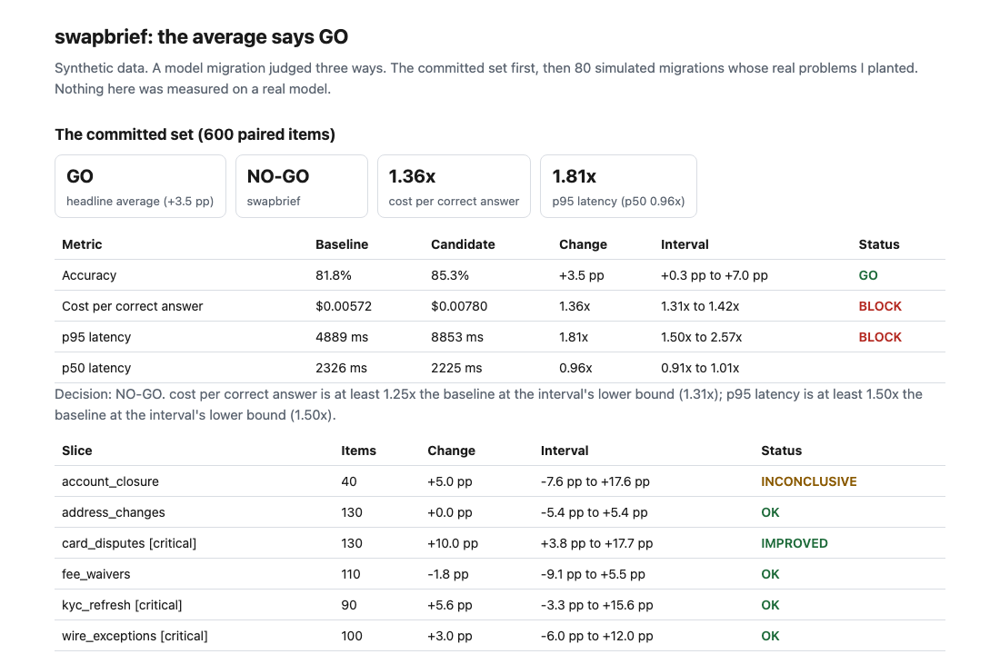
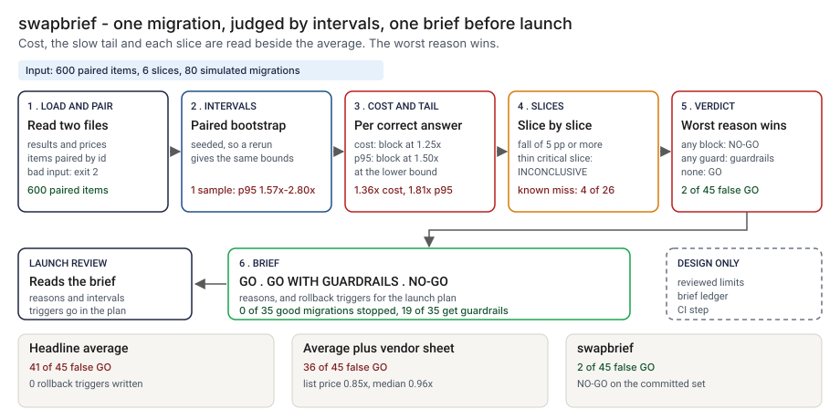
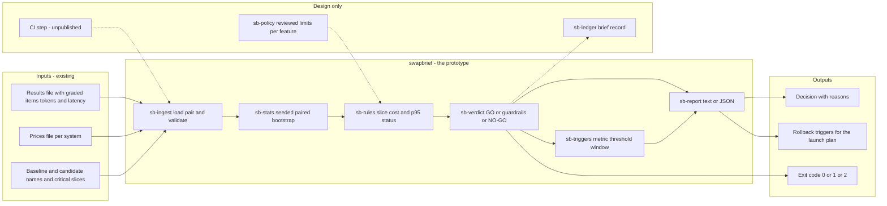
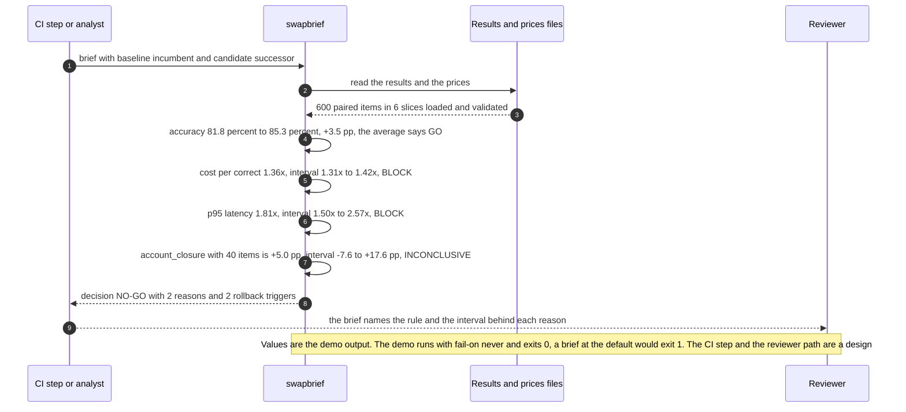

# 🧾 swapbrief: a go or no-go brief for a model migration, from two files

**A vendor retires the model behind a production feature. The successor scores higher on the team's evaluation set, so the team moves. I wanted one command that reads the evaluation results and the price table and says what the average does not: what a correct answer now costs, how bad the slow tail is, which slice fell, and what to write down as a rollback trigger before launch.** This is a command-line tool with a fixed two-file input contract. It extends [13 SwapBrief](../13-swapbrief-model-migration/), which walks the same idea through four scripts and a Streamlit app; here the idea is a tool you can point at your own export.

**▶ Static demo, no install:** [open demo.html](./demo.html)

[](./demo.html)

## Executive summary (90 seconds)

**Problem.** A vendor retires the model behind a production feature. The AI platform lead who owns the move, the model risk reviewer who has to accept the evidence and the finance partner who asks what a correct answer costs are shown one number: the successor's average accuracy on the team's evaluation set, and it is higher. That average does not show what a correct answer now costs, whether the slow tail got worse while the median improved, or which slice fell, and nobody writes down what would send traffic back. 🟢 Across 80 simulated migrations, 45 carry a real problem, and the headline average gives GO to 41 of 45 (91.1%) of them with 0 rollback triggers written down (`step_01_headline_average.py`). The first signal is then a complaint.

**Product.** swapbrief is a command that reads two files, one row per item and system of graded results with tokens and latency, and a price table. It pairs the items and computes seeded paired bootstrap intervals, then applies fixed rules. Cost per correct answer blocks at 1.25x the baseline and p95 latency at 1.50x, each judged at the interval's lower bound, with a watch level at 1.05x and 1.10x. A slice that falls 5 pp or more is a regression, and a critical slice too thin to rule a loss out is INCONCLUSIVE and costs a guardrail. It prints GO, GO WITH GUARDRAILS or NO-GO with the reasons, and writes the rollback triggers (metric, threshold, window) to put in the launch plan. It exits 1 at NO-GO by default and 2 for input it cannot use. There is no model call; the thresholds are assumptions copied from project 13.

**Measured and modeled performance.**

- 🟢 **The headline average gives GO to 41 of 45 migrations with a real problem (91.1%), and adding the vendor's list price and median latency still gives GO to 36 of 45 (80.0%).** Neither stops a good migration: 0 of 35 (`step_01_headline_average.py`, `step_02_average_plus_vendor_sheet.py`).
- 🟢 **On the committed set the average says GO: accuracy 81.8% to 85.3%, +3.5 pp.** Cost per correct answer is 1.36x (interval 1.31x to 1.42x) and p95 latency is 1.81x (interval 1.50x to 2.57x), so swapbrief says NO-GO and writes 2 rollback triggers (`step_04_with_swapbrief.py`).
- 🟢 **One sample is a noisy witness:** across 20 fresh samples of the committed world the p95 ratio runs from 1.57x to 2.80x (`step_03_deficiencies_exposed.py`).
- 🟢 **swapbrief gives GO to 2 of 45 migrations with a real problem (4.4%).** 0 of 26 cost problems lack a cost flag and 1 of 11 p95 problems lacks a p95 flag (`step_04_with_swapbrief.py`).
- 🟢 **The cost of caution:** 0 of 35 good migrations are stopped and 19 of 35 (54.3%) get GO WITH GUARDRAILS, 14 of them because a critical slice is too thin to rule a loss out (`step_04_with_swapbrief.py`).
- 🟢 **Known miss: 4 of 26 true slice regressions pass unflagged** (`step_04_with_swapbrief.py` prints each).
- 🟡 **Utility: (36/45 − 2/45) × 3 = 2.3 migrations a year with a real problem that are stopped or guarded where the average plus the vendor sheet would say GO,** assuming 3 migrations a year with a real problem.
- 🔴 **Design target: a brief within 5 minutes of an evaluation export landing.** Designed in [`ARCHITECTURE.md`](./ARCHITECTURE.md), never built or timed.

**What I would ask a head of operations to decide.** Whether a model move with a higher average should still stop when cost per correct answer or the p95 tail crosses a limit, and whether a thin critical slice earns a written rollback trigger instead of a plain GO. I set both as my policy, not as a measurement. My recommendation is to adopt the brief as written, run it in advisory mode (`--fail-on never`) on one real evaluation export, and set the cost, p95 and slice limits for that feature, accepting that over half of good moves get guardrails at these evaluation sizes.

**Call to action.** Fork the repo. Swap `data/results.csv` and `data/prices.csv` for your own export and keep the columns listed in the input contract below, then run `brief` with your two system names. To call it from code, import `read_results`, `read_prices` and `analyze` from `src/swapbrief.py`. Edit `POLICY` and `WINDOWS` at the top of that file for your own limits. Send findings by opening an issue: say which rule fired and on how many items, not the export itself.

_A portfolio prototype on synthetic data. Nothing here is deployed, load-tested or used by anyone._

## Run one now

```bash
cd 47-swapbrief/src && python3 swapbrief.py --demo
```

It prints:

```text
swapbrief: incumbent -> successor   600 paired items, 6 slices
  accuracy          81.8% -> 85.3%   +3.5 pp   interval +0.3 to +7.0 pp   the average says GO
  cost per correct  $0.00572 -> $0.00780   1.36x   interval 1.31x to 1.42x   BLOCK
  p95 latency       4889 ms -> 8853 ms   1.81x   interval 1.50x to 2.57x   BLOCK   (p50 0.96x)
  slices            1 inconclusive, 4 ok, 1 improved
    account_closure (40 items): +5.0 pp, interval -7.6 to +17.6 pp   INCONCLUSIVE
decision: NO-GO
  because: cost per correct answer is at least 1.25x the baseline at the interval's lower bound (1.31x)
  because: p95 latency is at least 1.50x the baseline at the interval's lower bound (1.50x)
rollback triggers (write these down before launch):
  - cost per correct answer >= 1.25x baseline over 24 hours: send traffic back to the baseline
  - p95 latency >= 1.50x baseline over 1 hour, 3 windows in a row: send traffic back to the baseline
```

Standard library only, Python 3.9 or newer. For your own files:

```bash
python3 swapbrief.py brief results.csv prices.csv --baseline current-model --candidate successor-model \
    --critical card_disputes,wire_exceptions
```

It exits 0 for GO and GO WITH GUARDRAILS, 1 for NO-GO (`--fail-on guardrails` also fails on guardrails, `--fail-on never` never fails) and 2 for input it cannot use. `--format json` prints the whole brief as JSON.

## The two-file input contract

The tool reads exactly two files. Both are UTF-8 CSV with a header row. Columns are matched by name, so order does not matter and extra columns are ignored.

**`results.csv`**: one row per (item, system).

| Column | Type | Meaning |
|---|---|---|
| `item_id` | text, not empty | The evaluation item. Every item must appear once for the baseline and once for the candidate. |
| `slice` | text, not empty | The group the item belongs to. It must be the same for both systems of an item. |
| `system` | text | Which model and prompt produced the row. Matched by exact text to `--baseline` and `--candidate`. Rows of any other system are ignored, and the brief says how many. |
| `correct` | `0` or `1` | The grade from your own evaluation harness. The tool does not judge answers. |
| `input_tokens`, `output_tokens` | whole number, 0 or more | Tokens billed for the call. |
| `latency_ms` | number above 0 | Time to the full answer, in milliseconds. |

**`prices.csv`**: one row per system.

| Column | Type | Meaning |
|---|---|---|
| `system` | text | Same text as in `results.csv`. A system with two rows is an error. |
| `input_usd_per_1k`, `output_usd_per_1k` | number, 0 or more | Price per 1,000 tokens. Both zero for one system is an error: cost per correct answer would be undefined. |

What it refuses, with exit status 2 and one line on stderr: an empty file, a header with no rows, a missing column, a row with too few or too many fields, a value of the wrong type, a duplicate (item, system) row, an item that is missing for one of the two systems, an item whose slice differs between systems, a system name that matches no row, fewer than 30 paired items, a system with fewer than 5 correct answers, and a `--critical` slice that does not exist. Names taken from your files are escaped (`%` to `%25`, carriage return to `%0D`, newline to `%0A`) before they reach a log line or a workflow command.

To compare more than two systems, run it once per pair; the file can hold all of them. To compare model B under the old prompt and under a retuned prompt, give each its own `system` value.

## What the numbers say

**What it shows** (🟢 measured on synthetic data: one committed set of 600 paired items and 80 simulated migrations with planted problems; the script is named in brackets):

- 🟢 On the committed set the headline average says GO: accuracy 81.8% to 85.3%, +3.5 pp (`step_01_headline_average.py`). A vendor-sheet check says GO too: list price per token 0.85x, median latency 0.96x (`step_02_average_plus_vendor_sheet.py`)
- 🟢 Cost per correct answer on the same set is 1.36x (interval 1.31x to 1.42x) and p95 latency is 1.81x (interval 1.50x to 2.57x). swapbrief says NO-GO and writes 2 rollback triggers (`step_04_with_swapbrief.py`)
- 🟢 Across 80 simulated migrations, 45 carry a real problem. A migration with a real problem gets GO from the headline average 41 of 45 times (91.1%), from the average plus the vendor sheet 36 of 45 (80.0%), and from swapbrief 2 of 45 (4.4%) (`step_01_headline_average.py`, `step_02_average_plus_vendor_sheet.py`, `step_04_with_swapbrief.py`)
- 🟢 Of the migrations with a real cost problem, 0 of 26 lacked a cost flag; of those with a real p95 problem, 1 of 11 lacked a p95 flag (`step_04_with_swapbrief.py`)
- 🟢 One sample is a noisy witness: across 20 fresh samples of the committed world the p95 ratio runs from 1.57x to 2.80x, so a single p95 number is not a finding (`step_03_deficiencies_exposed.py`)
- 🟢 The cost of caution: 0 of 35 good migrations were stopped, and 19 of 35 (54.3%) got GO WITH GUARDRAILS, 14 of them because a critical slice was too thin to rule a loss out. Of 8 planted good migrations whose true cost per correct answer sits just under the line (1.06x to 1.09x), 7 got guardrails (`step_04_with_swapbrief.py`)

## What it still gets wrong

- 🟢 Known limit, left in on purpose: 4 of 26 true slice regressions pass unflagged (`step_04_with_swapbrief.py` prints each). In scenario 7 (`card_disputes`, 98 items) the planted change is -11.7 pp, the sample shows -4.1 pp and the interval runs -12.2 to +4.1 pp. Scenario 74 (`fee_waivers`, 110 items) is the same story: planted -7.0 pp, sample -2.7 pp. Scenarios 15 and 55 are planted hard misses, a real fall in the 30-item `account_closure` slice: the samples show +20.0 pp and +10.0 pp, and in scenario 15 the interval (+6.7 to +33.3 pp) sits wholly above zero.
- 🟢 2 migrations with a real problem still get GO: scenarios 5 and 74. Of 8 planted hard misses, 1 got GO and 7 got guardrails.
- 🟢 1 of 11 real p95 problems gets no p95 flag. p95 needs a lot of items: the p95 interval on a few hundred calls is wide (the committed set's interval runs from 1.50x to 2.57x).
- **The data and the rules share an author.** I planted the problems and I wrote the thresholds, so 2 of 45 is a ceiling for these rules on worlds I defined, not a rate on a real migration. The mix of worlds (how often a slice regresses, how verbose the successor is, how often it hits a slow path) is my assumption. I changed two generator settings after a first look at the results, the size of the slow-path spike and the range of evaluation sizes, and then kept the seeds. The hard cases are planted on a schedule (every fifth scenario), which makes them more common than they would be by chance.
- 🟡 The thresholds are assumptions copied from [13 SwapBrief](../13-swapbrief-model-migration/data/policy.csv), not taken from any rule: a slice tolerance of 5 pp, cost per correct answer watched at 1.05x and blocking at 1.25x, p95 watched at 1.10x and blocking at 1.50x, a 95% interval, and the rollback windows (24 hours, 1 hour three times in a row, 7 days). Change them for your feature; `--tolerance-pp` is the only one on the command line.
- 🟡 "A real problem" in the simulation means a slice down 5 pp or more, cost per correct answer up 10% or more, or p95 up 25% or more in the true world. Those levels are mine.
- The headline rule here is "accuracy not lower". A team that requires a margin would behave differently; I did not test that.
- A file cut exactly between two items looks complete. The tool checks pairing, not completeness.
- It does not judge answers, compare prompts for you, check that latency is measured the same way for both systems, or wire the triggers to a monitor. The triggers are text to put in the launch plan.
- 🔴 Not tested on a real evaluation export.

## How the four steps fit

| Step | Question | Script |
|---|---|---|
| 1 | What does the headline average decide? | `step_01_headline_average.py` |
| 2 | What do the average, the list price per token and the median add? | `step_02_average_plus_vendor_sheet.py` |
| 3 | What do they miss? | `step_03_deficiencies_exposed.py` |
| 4 | What does the brief change? | `step_04_with_swapbrief.py` |

Run any of them from `src/`. The tool is `src/swapbrief.py`; step 4 runs the same code as the command line. Data is generated by [`data/_generate.py`](./data/README.md); `tools/check_repo.py` confirms that a rerun reproduces every file and that the green numbers above appear in a script's output. There are 51 tests in `tests/`, including a golden test that pins the numbers in this README.

## Utility delivered

The way I price product impact: **utility = (my solution − current state of the art) × the number of people or items it affects.**

Here the item is a model migration that carries a real problem. Each one lands on the platform lead who owns the move, the model risk reviewer who accepts the evidence, and the finance partner who sees the bill. The common basic approach is the average plus the vendor's list price and median latency; the table prices the brief against it.

| Term | Value | Where it comes from |
| --- | --- | --- |
| Current state of the art (average, list price per token, median latency), migrations with a real problem that still get GO | 🟢 **36 of 45** | `step_02_average_plus_vendor_sheet.py`; the headline average alone gives GO to 41 of 45 |
| My solution (swapbrief), migrations with a real problem that still get GO | 🟢 **2 of 45** | `step_04_with_swapbrief.py`; 32 get GO WITH GUARDRAILS and 11 get NO-GO |
| Lift per migration with a real problem | 🟢 36 of 45 minus 2 of 45 | The basic rule lets these through by kind of problem: cost only 10, p95 only 1, slice only 17, two or more 8 (`step_03_deficiencies_exposed.py`) |
| Number it affects: migrations a year with a real problem | 🟡 **3** | **Assumption, not a statistic.** Replace it with your own count of model moves in a year that carried a cost, tail or slice problem |
| Assumption that makes the lift real | 🟡 The evaluation set resembles production traffic, the harness grades `correct` honestly, and the limits fit the feature | 🟢 Slices under 50 items are the weak spot: of 10 true regressions there, 6 are flagged, 2 inconclusive and 2 missed (`step_04_with_swapbrief.py`) |
| **Utility** | 🟡 **(36/45 − 2/45) × 3 = 2.3 migrations a year with a real problem stopped or guarded that the basic rule would pass** | Assumes the 3 behave like the 45 simulated ones |

Sensitivity to the count assumption (🟡, same lift): 1 migration a year gives 0.8, 3 gives 2.3, 6 gives 4.5.

The price is on the other side: 🟢 19 of 35 good migrations get GO WITH GUARDRAILS (54.3%) and 0 of 35 are stopped (`step_04_with_swapbrief.py`). I have not priced what a guardrail costs a launch.

🔴 What I have not measured: what a stopped or guarded migration is worth in money, how long a brief takes to read and clear, how often a real vendor retires a model, or how a real evaluation set differs from the simulated one. The mix of 80 migrations is dense with problems on purpose, 45 of 80 (`step_01_headline_average.py`); a real team sees few. Treat the result as a property of this mix, not a forecast.

---

## Architecture and call flow

Component names match [`ARCHITECTURE.md`](./ARCHITECTURE.md). GitHub renders the diagrams natively.



**System topology:**



**Per-run sequence** (the `--demo` run on the committed set):



**Interlocks (all red, designed, none built):**

- [13 SwapBrief](../13-swapbrief-model-migration/) is the project this one extends. The thresholds in `POLICY` are copied from its policy file; this folder does not read its files.
- [66 Deprecation Impact](../66-deprecation-impact/) builds a retirement calendar and a hit list of the features that call a retiring model. A retirement notice there would start the migration this brief decides.
- [40 Eval Gate](../40-eval-gate/) watches for a snapshot change behind a name. After a GO here, the pin it holds would move through its reviewed change.

---

## PM artifacts

The PM artifacts that show how I would run this product if I owned the seat. This README is the walkthrough; the rest of the folder holds:

- [`PRD.md`](./PRD.md): the product requirements doc, with users, backlog, KPIs, rollout and open questions.
- [`ARCHITECTURE.md`](./ARCHITECTURE.md): the systems doc, with components, data model, security, failure behavior and operations. A design, not deployed.
- [`demo.html`](./demo.html): clickable, no-install walkthrough, built from the step outputs by `src/_build_demo.py`.
- [`data/`](./data/): the committed set of 600 paired items, the price table, the 80 simulated migrations with planted truth, and the seeded generator. `data/README.md` explains how the truth is set.
- [`src/`](./src/): `swapbrief.py`, `common.py`, the four step scripts and the demo builder.
- [`tests/`](./tests/): 51 unittest tests, including a golden test that pins the numbers above and tests for bad input and hostile strings.

Run the four steps end to end:

```bash
cd src
python3 step_01_headline_average.py
python3 step_02_average_plus_vendor_sheet.py
python3 step_03_deficiencies_exposed.py
python3 step_04_with_swapbrief.py
```

---

## Aligned to

The FSB's [Sound Practices for Responsible Adoption of Artificial Intelligence](https://www.fsb.org/uploads/P151026-1.pdf) (final report, 15 October 2026; I read it on 24 October 2026). Sound Practice 9 on performance management asks institutions to assess AI performance over time and lists recent changes to the model or system among the factors that set how often and how hard to assess; it also describes results that can indicate contingency plans should be triggered. Sound Practice 12 covers third-party AI providers and business continuity. A model migration is such a change, and this brief is one input to that assessment: it compares the two versions on paired items and writes the contingency trigger down before launch. The report does not mention cost per correct answer or p95 latency; those are my additions. This is a prototype, aligned to that guidance. It makes no claim of conformity to that guidance.

## Data and limits

Synthetic, seeded, byte-for-byte reproducible. Nothing comes from any employer, customer or real bank, and no model was called. The prices are parameters, not any vendor's prices. A prototype on synthetic data, not a production case study. See [`data/README.md`](./data/README.md) for the files and the planted truth.

## Fork it

Export your evaluation results to the `results.csv` columns, put your price list in `prices.csv`, and run `brief`. Edit `POLICY` and `WINDOWS` at the top of `src/swapbrief.py` for your own thresholds. Read the [PRD](./PRD.md) for the scope I held to.

## Prereqs to run this on your laptop

You need Python 3.9 or newer and nothing else. The tool, the four step scripts and the data generator use only the standard library, so there is nothing to install. There is no API key, no network call and no model call anywhere in the folder. To run the tests, use `python3 -m unittest discover -s tests` from this folder. To brief your own migration you need two CSV files in the contract above. The production pieces in [`ARCHITECTURE.md`](./ARCHITECTURE.md) (the reviewed limits per feature, the brief ledger, a CI step) are a design, not something you need or can run.

## Author

**Vijay Saharan**, Sr Product / Program Manager · AI in BFSI · Enterprise AI Platforms

[LinkedIn](https://www.linkedin.com/in/vijaysaharan/)
