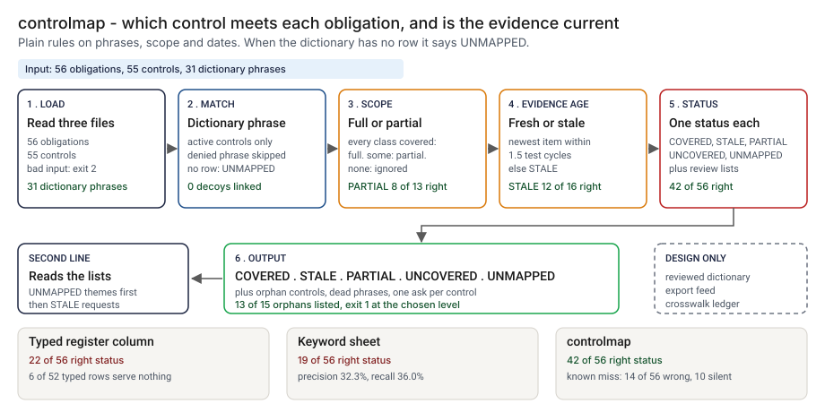

# Architecture: controlmap

> **Status.** This is the design for a production shape. The repo implements the product mechanic as a prototype: a command, `src/controlmap.py`, that reads an obligations file, a controls file and a theme dictionary, matches on phrases, checks scope and evidence age and prints COVERED, STALE, PARTIAL, UNCOVERED or UNMAPPED for each obligation, run here over 56 synthetic obligations and 55 controls. Nothing below is claimed as deployed or load-tested. Where a figure is a design target, it says so.

GCP is primary; AWS and Azure sit beside it.



---

## 1. Logical architecture

controlmap is a function between a register of obligations, a control library and a reviewer: three files and an as-of date in, a status per obligation and three review lists out. It does not read obligation text, test a control or call a model.

Eight components: five decide the outcome (one as config), three feed or record it.

| Component | Responsibility | Language or framework | Decides the outcome? | Stateful? |
| --- | --- | --- | --- | --- |
| `cm-ingest` | Loads the three files. Rejects bad input. | Python 3.9+, standard library. Prototype: `load_obligations`, `load_controls`, `load_terms`, `_read_table`, `parse_date` in `src/controlmap.py` | Yes, by refusing: exit 2 | No |
| `cm-match` | Active control, dictionary phrase for the theme in its name or description, no negator within three words before it. | Python. Prototype: `find_phrase`, `tokens`, `NEGATORS` | Yes | No |
| `cm-evidence` | Full or partial by scope; fresh or not by evidence age against the grace multiple of the test cycle. | Python. Prototype: `_coverage`, the freshness test in `analyze` | Yes | No |
| `cm-status` | One status per obligation; orphans, dead phrases, one evidence request per control. | Python. Prototype: `_status`, `analyze` | Yes | No |
| `cm-report` | Text or CSV. Control characters made visible, formula cells defused. | Python. Prototype: `render_text`, `render_csv`, `clean`, `csv_safe` | No | No |
| `cm-dictionary` | Phrases per theme and the grace multiple, by review (design). Prototype: `data/terms.csv`, `GRACE_DEFAULT`, `--grace` | Reviewed config in the governance repo | Yes, config | Stateful, in git |
| `cm-feed` | Scheduled exports of the register and library (design). | Read-only adapters to the systems of record | No | No |
| `cm-ledger` | One record per run (design). Prototype analog: `src/out/step_04_rows.csv` | PostgreSQL and object storage (design) | No | Stateful |

**What decides the outcome.** The input check, the dictionary, the negation window, the scope and freshness rules and the status function. The report, the feed and the ledger carry or record the result. The tool reads the files as given: the theme is what the analyst assigned, scope is an exact class name, evidence is the newest date on file.

**Repo structure** (production shape):

```
controlmap/
├── crosswalk/  # ingest, match, evidence, status, report
├── dictionary/ # phrases per theme and the grace rule, by pull request
├── ledger/     # run record writer
├── docs/runbooks/
└── tests/      # unit, golden (planted-set numbers), hostile (injection strings)
```

---

## 2. Physical and deployment architecture

One short-lived process, run after an export lands or on a monthly schedule. There is no server to keep warm.

| Component | GCP (primary) | AWS | Azure | Why |
| --- | --- | --- | --- | --- |
| Run process | Cloud Run job | ECS Fargate task | Container Apps job | Stateless, one pass |
| `cm-dictionary` | A file in the governance repo | Same | Same | Phrase changes share history with the results |
| `cm-ledger` | Cloud SQL for PostgreSQL | RDS for PostgreSQL | Azure Database for PostgreSQL | Already run by the platform team |

**Failure behavior (the decision that matters most).** The tool must never silently pass. A file it cannot read does not become COVERED, and a theme it cannot judge does not become UNCOVERED: it says UNMAPPED. A control with no evidence on file is not fresh, and a retired control is skipped and noted.

| Failure | Behavior | Alert |
| --- | --- | --- |
| A file missing, empty, header only, a column missing, a wrong field count, a duplicate id | Exit 2, one line naming the file | P2 if repeated, else P3 |
| A bad status, test cycle, class list or date, evidence dated after the as-of date, or `--grace` not a positive number | Exit 2 with the reason | P3 |
| A theme with no dictionary row | UNMAPPED, listed in the output | P4 digest |
| No usable control for a theme | UNCOVERED, with any negated phrase noted in the reason | P3 when the count rises |
| `--as-of` omitted | Today's date is used and a note on stderr names it, so a log shows which date a status was counted to. In the design a scheduled run always records the date it used | None |
| Ledger unavailable (design) | The result and exit code stand; the record queues locally and the gap is listed | P3 |

**Latency.** The prototype is untimed. 🔴 Design target: a crosswalk within 10 minutes of an export landing. Recovery is a re-run on the same files and as-of date.

---

## 3. Data architecture

| Entity | Key | What it holds | Real columns in the prototype |
| --- | --- | --- | --- |
| Obligation | `obligation_id` | Theme, use-case classes it applies to | `data/obligations.csv`: `obligation_id`, `source`, `theme`, `statement`, `applies_to`, `claimed_controls`. The tool reads `obligation_id`, `theme`, `applies_to` and `statement`; `claimed_controls` is the typed column it ignores |
| Control | `control_id` | Scope, test cycle, newest evidence date, active or retired | `data/controls.csv`: `control_id`, `name`, `description`, `owner`, `scope`, `test_cycle_days`, `last_evidence_on`, `status` |
| Dictionary row | `theme`, `phrase` | A phrase that says a control serves a theme | `data/terms.csv` |
| Status row | `obligation_id`, run | Status, links with phrase, coverage, age and limit, skipped controls | Returned by `analyze`; `src/out/step_04_rows.csv` |
| Planted truth | `obligation_id`, `control_id` | The theme a control serves, true pairs and true statuses | `data/control_truth.csv`, `data/truth_pairs.csv`, `data/truth_status.csv`. Exist only because the data is synthetic |

**Retention** is a design choice, not a measurement; confirm it against the bank's own record-retention schedule. 🔴 Design default: run records, the dictionary version, the grace value and the as-of date for 7 years in PostgreSQL archived with a retention lock; the exports a run used for as long as the run.

**Lineage.** A status traces back in three hops: the record names the as-of date, the grace value, the dictionary version and the hash of each file; the row names the control, the phrase that matched, the scope gap and the evidence age against its limit; and the rules are deterministic given the as-of date, so re-running `analyze` reproduces the status. The printed reason carries the same facts.

**Deliberately not stored.** Control test results, evidence documents and the text of any rule: the tool needs a date, not the evidence.

---

## 4. Security architecture

**Identity and roles.** The tool runs under the platform's workload identity and has no user account of its own. `cm:runner` reads the exports and the dictionary and writes a run record. `cm:approver` approves a dictionary or grace change, never for their own control. `cm:auditor` reads records and config history. `cm:admin` manages roles, buckets and the ledger.

**Secrets.** The tool holds none and calls no model. Store and ledger access is by workload identity, with no static keys. Feed adapters in `feed/` (design) use read-only access.

**Data classification and what leaves the boundary.** A map of which obligations lack a control or rest on stale evidence is sensitive: treat the files and results as confidential. In the prototype nothing leaves the machine. In the design three things leave the job: the exit code, the report and the ledger write.

| Threat | Example | Mitigation in the design |
| --- | --- | --- |
| Hostile string in a control name or description echoed into a log or a spreadsheet | A description with a newline, or a cell starting with `=` | `clean` writes control and non-printable characters as escapes; `csv_safe` puts an apostrophe before `=`, `+`, `-` and `@`. `tests/test_cli.py` covers hostile input |
| The dictionary is edited to turn a gap into COVERED | A generic phrase added to a theme | Dictionary changes go by pull request with a different approver; a diff lists the controls each new phrase links |
| Evidence dates are edited to look fresh | `last_evidence_on` moved forward | Versioned exports and stored hashes; the feed reads dates from the system of record, not a hand-kept file |
| The as-of date or grace is moved | `--as-of` set back, `--grace` raised | The run record stores both values |
| A phrase used in another sense | A drift dashboard for network switches linked as model monitoring | The tool cannot see this. The design asks a reviewer to read any control linked to many unrelated themes |

---

## 5. Operational architecture

**SLIs.** Statuses per run; obligations UNMAPPED (prototype baseline: 🟢 4, `step_04_controlmap.py`); dictionary phrases that match no active control (prototype: 🟢 5 of 31, `step_04_controlmap.py`); orphan controls; evidence requests outstanding; input rejections; export age.

**SLOs (all 🔴 design targets, none measured).**
- A crosswalk within 10 minutes of an export landing.
- Every UNMAPPED theme gets a dictionary decision within one business week (planning estimate).
- 99.9 percent of runs written to the ledger.

**Alerts.** P2: repeated input rejections, or the ledger down over a day. P3: a rise in UNCOVERED, or a changed hash for a finished run. P4: a weekly digest of UNMAPPED themes, dead phrases and orphans.

**Runbooks** (one page each, in `docs/runbooks/`):
- `unmapped-theme.md`: write the dictionary row, re-run, read the new links.
- `stale-evidence-request.md`: send one request per control, record the reply.
- `orphan-control.md`: check the wording against the dictionary first.
- `changing-the-dictionary.md`: propose, re-run the planted set, compare, approve.

**On-call and ownership.** The governance analyst owns the runner, the feed and the runbooks. The second-line reviewer owns the dictionary and the grace rule. Control owners answer evidence requests. Nobody is paged for a status.

**Change control for rules and thresholds.** Rules, dictionary and grace value are versioned in the repo. A change needs a proposer and a different approver. Before merge, the planted set is re-run against `tests/test_golden.py`, so a change that moves the right-status count shows in the diff.

---

## 6. Alignment and posture

Alignment, not certification. The README's "Aligned to" section cites three sources, read on 2026-10-24 for the shape of the problem, not any identifier or text; the design makes no claim of conformity to any of the three.

- **[NIST AI Risk Management Framework](https://www.nist.gov/itl/ai-risk-management-framework):** voluntary; AI RMF 1.0 released January 26, 2023. The themes in the sample register are my own labels, and I did not map any of them to a category or subcategory.
- **[CSA AI Controls Matrix](https://cloudsecurityalliance.org/artifacts/ai-controls-matrix):** version 1 released 07/09/2025 and updated 10/30/2025 (the page says v1.1 is newer), with 243 control objectives in 18 domains. I read the landing page, not the spreadsheet.
- **[FINOS AI Governance Framework](https://air-governance-framework.finos.org/):** version 2 dated October 20, 2025; a catalogue of risks and mitigations for generative AI in financial services. I read the first part of the page, not the mitigations.

**What the design does.** It does the join between obligations and controls at small scale, from a bank's own lists, with a status added. **What it does not claim.** It maps no obligation to a framework identifier, and I have read or mapped no other source.

---

## 7. What is deliberately not here

- **Reading obligation text.** The theme is an input that someone assigns. The tool does not read the statement.
- **Testing a control.** Fresh evidence shows that someone collected something recently, not that the control is well designed or works.
- **Controls worded outside the dictionary.** 🟢 14 of 56 statuses are wrong and 10 are silent (`step_04_controlmap.py`); 6 controls worded outside the dictionary leave 30 true pairs missed.
- **A phrase used in another sense.** It is linked and the tool cannot see it; two such controls are left in on purpose.
- **Fine matching.** Phrases match whole words, case-insensitive; scope is an exact class name; freshness uses the newest evidence date only; the negation rule is a three-word window.
- **A real library.** The data and the rules share an author, so 42 of 56 is a ceiling for this method, not a rate on a real library.
- **Hosting, a model call, or a framework mapping.**

---

## Appendix: sample contract

```bash
python3 controlmap.py check obligations.csv controls.csv --terms terms.csv --as-of 2026-09-30 --fail-on uncovered --format csv
```

The CSV has one row per obligation with the columns `obligation_id`, `theme`, `status`, `controls` and `reason`. Exit status: 0 below `--fail-on`, 1 at or above it (`uncovered` counts UNCOVERED and UNMAPPED, `gap` counts anything but COVERED), 2 for bad input.
