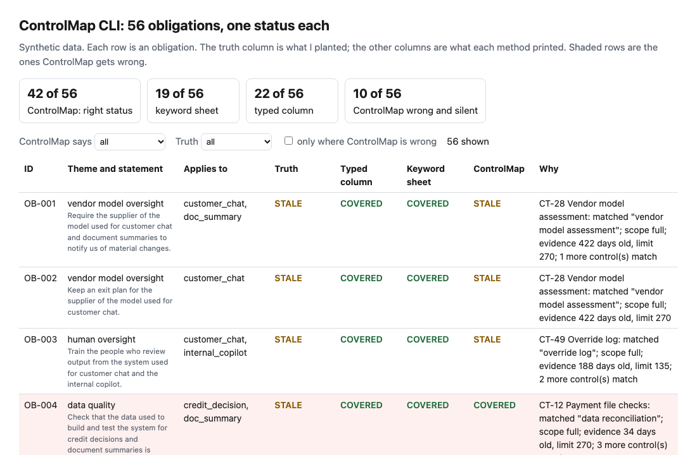
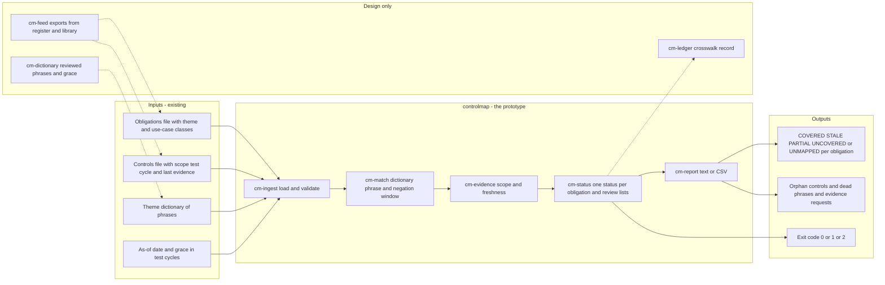
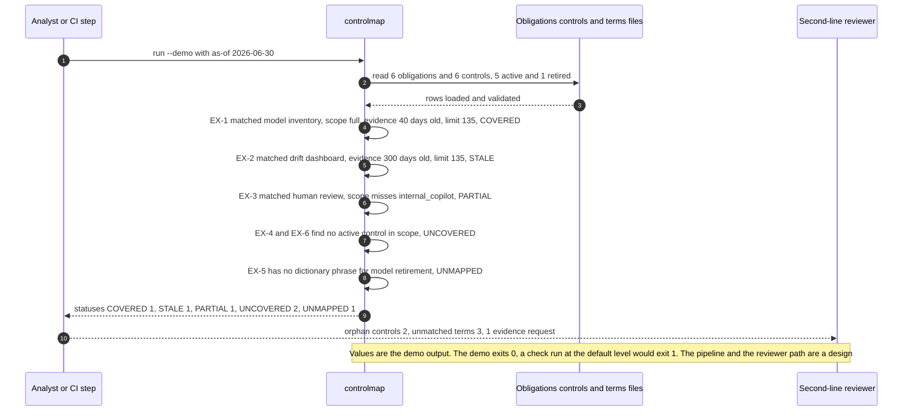

# 🧭 controlmap: an obligation-to-control crosswalk that says when it cannot decide

**I wanted to know how far a short list of plain rules gets when someone has to say, for each AI obligation, which control meets it and whether the evidence is current, and which answers it still gets wrong without saying so. This is a command-line tool over an obligations CSV and a controls CSV: it matches on a phrase dictionary, ignores retired controls and denied phrases, checks scope and evidence age, and prints COVERED, STALE, PARTIAL, UNCOVERED or UNMAPPED for each obligation.** It extends [16 ControlMap](../16-controlmap-ai-obligation-crosswalk/), a four-step walkthrough with a Streamlit app, into a command-line tool you can point at your own files, and scores it against a hand-typed register column and a keyword sheet.

**▶ Static demo, no install:** [open demo.html](./demo.html)

[](./demo.html)

## Executive summary (90 seconds)

**Problem.** The model risk or AI governance analyst has to show, for each AI obligation, which control meets it and whether the evidence is current, and the second-line reviewer has to defend the answer. The answer lives in a register column someone typed, or in a sheet that links rows by shared words. Neither knows a control's scope or evidence date, and neither says when it cannot decide. 🟢 On 56 synthetic obligations and 55 controls, 52 of 56 obligations carry a typed id and 6 of those 52 have no id that serves them. Of 129 ids typed, 7 point at retired controls and 6 at ids that are not in the library, and reading the column as covered or uncovered gives the right status for 22 of 56 (`step_01_register_as_it_stands.py`). The gap is found when an examiner or an audit asks.

**Product.** controlmap is a command that reads an obligations file, a controls file and a theme dictionary, and applies plain rules. A control matches an obligation when it is active and its name or description holds a phrase the dictionary lists for the obligation's theme, unless a negator sits within three words before the phrase. The match is full when the control's scope includes every class the obligation applies to and partial when it includes some. Evidence is fresh when the newest item is no older than 1.5 test cycles at the as-of date (my assumption). Each obligation gets COVERED, STALE, PARTIAL, UNCOVERED or UNMAPPED, the last when the dictionary has no phrase for the theme and the tool cannot tell a gap from a missing row. It also lists controls that serve nothing, dictionary phrases that matched no active control, and one evidence request per control. It exits 1 at the level you choose (UNCOVERED and UNMAPPED by default) and 2 for malformed input. There is no model call.

**Measured and modeled performance.**

- 🟢 **A hand-typed column of control ids gives the right status for 22 of 56 obligations (39.3%),** and a keyword sheet for 19 of 56, with precision 32.3% and recall 36.0% on the pairs (`step_01_register_as_it_stands.py`, `step_02_keyword_sheet.py`).
- 🟢 **The sheet shows 12 of 13 PARTIAL obligations, 16 of 16 STALE ones and 7 of 8 UNCOVERED ones as covered** (`step_03_deficiencies_exposed.py`).
- 🟢 **controlmap gives the right status for 42 of 56 obligations (75.0%),** with pair precision 93.0% and recall 75.4%. Dictionary alone earns 27, negation 27, scope 34, freshness and UNMAPPED 42 (`step_04_controlmap.py`).
- 🟢 **Hard negatives are not linked:** 3 controls that only deny a phrase, 4 lookalikes, 6 orphans and 4 retired controls are linked 0 times, where the sheet links 2, 3, 1 and 2 of them (`step_04_controlmap.py`).
- 🟢 **Known miss: 14 of 56 statuses are wrong and 10 are silent.** 4 are UNMAPPED, said out loud, and 2 controls that use a dictionary phrase in another sense are linked (`step_04_controlmap.py`).
- 🟢 **Review lists:** 13 of 15 true orphan controls are listed, with 9 others listed wrongly, and 9 controls cover the asks for 16 STALE obligations, one ask per control (`step_04_controlmap.py`).
- 🟡 **Utility: (42/56 − 22/56) × 120 = 42.9 obligations a year with the right status that the typed column would get wrong,** assuming 120 obligations in a real register behave like the planted ones.
- 🔴 **Design target: a crosswalk refreshed within 10 minutes of a register or control-library export landing.** Designed in [`ARCHITECTURE.md`](./ARCHITECTURE.md), never built or timed.

**What I would ask a head of operations to decide.** Whether the second line should accept a crosswalk computed from a dictionary of phrases that its own reviewers own, with UNMAPPED and wrong-sense links kept as named exceptions, in place of a typed column. My recommendation is to pilot it on one real register and control library, give the dictionary an owner and a change history, read the UNMAPPED, STALE and "matched no control" lists before the statuses, and set the evidence-age rule per control family instead of using my 1.5 test cycles everywhere.

**Call to action.** Fork the repo. Swap `data/obligations.csv`, `data/controls.csv` and `data/terms.csv` for exports from your register, your control library and a dictionary you write, and keep the columns listed at the top of `src/controlmap.py`. To call it from code, import `load_obligations`, `load_controls`, `load_terms` and `analyze` from that file. Write the theme rows for whatever comes back UNMAPPED before you read anything else. Send findings by opening an issue: say which status was wrong and which cause fits, not the register itself.

_A portfolio prototype on synthetic data. Nothing here is deployed, load-tested or used by anyone._

## Run one now

```bash
cd 48-controlmap/src && python3 controlmap.py --demo
```

It prints:

```text
controlmap  as of 2026-06-30  6 obligations, 6 controls (5 active, 1 retired)
EX-1    COVERED    CT-A1 Model inventory attestation: matched "model inventory"; scope full; evidence 40 days old, limit 135
EX-2    STALE      CT-B1 Drift dashboard: matched "drift dashboard"; scope full; evidence 300 days old, limit 135
EX-3    PARTIAL    CT-C1 Chat answer review: matched "human review"; scope misses internal_copilot; evidence 20 days old, limit 270
EX-4    UNCOVERED  no active control in scope matches the theme "incident response"
EX-5    UNMAPPED   the terms file has no phrase for the theme "model retirement"
EX-6    UNCOVERED  no active control in scope matches the theme "change management" (CT-D1 negated phrase "change approval")
statuses: COVERED 1, STALE 1, PARTIAL 1, UNCOVERED 2, UNMAPPED 1
orphan controls: 2 (CT-D1 Call recording retention; CT-E1 Data centre badge review)
terms that matched no active control: 3 (change management: change approval; incident response: incident playbook; ongoing monitoring: performance monitoring)
evidence requests: 1 control(s) for 1 stale obligation(s) (CT-B1 Model Risk Management)
```

Standard library only, Python 3.9 or newer. On your own files:

```bash
python3 controlmap.py check obligations.csv controls.csv --terms terms.csv --as-of 2026-09-30
```

Columns are listed at the top of [`src/controlmap.py`](./src/controlmap.py). Options: `--as-of` (default: today; the run then prints a note on stderr with the date it used), `--grace` (evidence is fresh up to this many test cycles old), `--format text|csv`, and `--fail-on uncovered|gap|never`. It exits 1 when the chosen level is reached (`uncovered`, the default, counts UNCOVERED and UNMAPPED; `gap` counts anything but COVERED) and 2 on malformed input, with a one-line message on stderr. Text and CSV output escape control characters in your data, and CSV cells that start with `=`, `+`, `-` or `@` get a leading apostrophe.

## What the numbers say

**What it shows** (🟢 measured on synthetic data: 56 obligations, 55 controls and 175 planted pairs; the script is named in brackets):

- 🟢 Right status: 42 of 56 (75.0%) with the tool, against 19 of 56 for the keyword sheet and 22 of 56 for the typed register column (`step_04`, `step_02`, `step_01`)
- 🟢 What each rule earns: dictionary alone 27, with negation 27, with scope 34, with freshness and UNMAPPED 42 (`step_04`)
- 🟢 Pairs: precision 93.0% and recall 75.4% for the tool; 32.3% and 36.0% for the sheet (`step_04`, `step_02`)
- 🟢 The sheet shows 12 of 13 PARTIAL obligations, 16 of 16 STALE ones and 7 of 8 UNCOVERED ones as covered (`step_03`)
- 🟢 The typed column: 52 of 56 obligations carry an id, 6 of those 52 have no id that serves them, and of 129 ids typed 7 point at retired controls and 6 at ids that are not in the library (`step_01`)
- 🟢 Hard negatives the tool must not link: 3 controls that only deny a phrase, 4 lookalikes, 6 orphans and 4 retired controls are linked 0 times; the sheet links 2, 3, 1 and 2 of them (`step_04`)
- 🟢 The negation rule drops 20 links, 5 of them true pairs; right status is 42 of 56 with it and 41 of 56 without (`step_04`)
- 🟢 Orphan controls: 13 of 15 listed (`step_04`)
- 🟢 Evidence requests: 9 controls to ask for 16 STALE obligations, one ask per control (`step_04`)
- 🟡 Modeled: evidence is fresh up to 1.5 test cycles old, and the as-of date is 2026-06-30. Both are my assumptions, not values from any rule; `--grace` changes the first.
- 🔴 Hypothetical: that a second-line reviewer reads the UNMAPPED, STALE and "matched no control" lists faster than a spreadsheet filter. Not timed, not tested with anyone.

## What it still gets wrong

- 🟢 14 of 56 statuses are wrong and 10 of them are silent (`step_04` prints each with its cause). Causes: 5 obligations from controls worded outside the dictionary (6 controls, 30 true pairs missed); 1 from a control that says "no exception to human review", which the negation rule drops; 4 from two controls that use a dictionary phrase in another sense (a drift dashboard for network switches, a data reconciliation for payment files); and 4 from a theme with no dictionary row, which the tool reports as UNMAPPED instead of guessing.
- The negation rule is a window of three words before the phrase. It removes 15 false links and costs 5 true ones. A real library will phrase denials in ways it does not see.
- **The data and the rules share an author.** I planted the controls, wrote the dictionary after reading them, and chose the rules. The tool misses what I planted as misses and catches what I planted as catchable, so 42 of 56 is a ceiling for this method, not a rate on a real library. Scope and freshness are definitions the generator and the tool share, so their agreement (132 of 132 on the scope label) is by construction.
- The orphan list shows 9 controls that do serve a theme (the 6 off-dictionary ones, the denied one and 2 on the theme with no dictionary row), so an orphan is a prompt to check the wording, not a verdict (`step_04`).
- A phrase used in another sense is linked, and nothing in the tool can see it. That is the known limit left in on purpose in steps 3 and 4.
- The tool does not read the obligation statement. The theme is an input, and someone has to assign it. The keyword sheet does read statements.
- Phrases match whole words, case-insensitive: "override log" does not match "overrides logged". Scope is an exact class name. Freshness uses the newest evidence date only.
- Fresh evidence shows that someone collected something recently. It does not show that the control is well designed or that it works.

## How the four steps fit

| Step | Question | Script |
|---|---|---|
| 1 | What does a hand-typed column of control ids give a reader? | `step_01_register_as_it_stands.py` |
| 2 | What does a keyword sheet add? | `step_02_keyword_sheet.py` |
| 3 | Where do the sheet and a bare dictionary fail? | `step_03_deficiencies_exposed.py` |
| 4 | What do negation, scope, freshness and UNMAPPED earn together? | `step_04_controlmap.py` |

Run any of them from `src/`. Step 4 calls the same `analyze()` the command line calls. Data is generated by [`data/_generate.py`](./data/README.md); the check in `tools/check_repo.py` confirms that a rerun reproduces every file and that the green numbers above appear in a script's output. `python3 _build_demo.py` rebuilds `demo.html` from the files step 4 writes to `src/out/`.

## Utility delivered

The way I price product impact: **utility = (my solution − current state of the art) × the number of people or items it affects.**

Here the item is an obligation whose status a reviewer has to state. Each one lands on the analyst who prepares the answer and the second-line reviewer who defends it. The current state is a hand-typed register column; the keyword sheet is the common basic approach and does worse, so the table prices controlmap against the better of the two.

| Term | Value | Where it comes from |
| --- | --- | --- |
| Current state of the art (typed register column), right status | 🟢 **22 of 56** | `step_01_register_as_it_stands.py`; the keyword sheet gets 19 of 56 (`step_02_keyword_sheet.py`) |
| My solution (controlmap), right status | 🟢 **42 of 56** | `step_04_controlmap.py` |
| Lift per obligation | 🟢 42 of 56 minus 22 of 56 | By true status the tool is right on COVERED 14 of 19, STALE 12 of 16, PARTIAL 8 of 13 and UNCOVERED 8 of 8 (`step_04_controlmap.py`) |
| Number it affects: obligations in a real register | 🟡 **120** | **Assumption, not a statistic.** Replace it with the count of AI obligations in your register |
| Assumption that makes the lift real | 🟡 The library words its controls in phrases the dictionary lists, and every theme has a dictionary row | If not, the lift shrinks: 🟢 6 controls worded outside the dictionary leave 30 true pairs missed, and 4 obligations come back UNMAPPED (`step_04_controlmap.py`) |
| **Utility** | 🟡 **(42/56 − 22/56) × 120 = 42.9 obligations with the right status that the typed column would get wrong** | Assumes the 120 behave like the 56 planted ones |

Sensitivity to the count assumption (🟡, same lift): 60 obligations gives 21.4, 120 gives 42.9, 240 gives 85.7.

🔴 What I have not measured: how much reviewer time the lists save, what a right status is worth in an audit, how a real library words its controls, or how often evidence goes stale in practice. 🟢 14 of 56 statuses are still wrong and 10 of them are silent (`step_04_controlmap.py`). The dictionary and the controls were written by one author, so 42 of 56 is a ceiling for this method, not a rate on a real library.

---

## Architecture and call flow

Component names match [`ARCHITECTURE.md`](./ARCHITECTURE.md). GitHub renders the diagrams natively.


**System topology:**



**Per-run sequence** (the `--demo` run on the six-obligation example):



**Interlocks (all red, designed, none built):**

- [16 ControlMap](../16-controlmap-ai-obligation-crosswalk/) is the walkthrough this tool extends. The status vocabulary, the full and partial scope idea and the 1.5-cycle freshness rule come from it; I read its code and data and wrote this version and this data from scratch. This folder does not import or read its files.
- [56 AIGF Checks](../56-aigf-checks/) tests whether a crosswalk row of the form "this check covers this framework risk" stays true after the check changes. A designed link would check the rows this tool produces the same way.
- [44 Inventory Check](../44-inventory-check/) runs completeness and staleness tests on an inventory. A check of that kind could run on the controls file before `cm-ingest` reads it.

---

## PM artifacts

The PM artifacts that show how I would run this product if I owned the seat. This README is the walkthrough; the rest of the folder holds:

- [`PRD.md`](./PRD.md): the product requirements doc, with users, backlog, KPIs, rollout and open questions.
- [`ARCHITECTURE.md`](./ARCHITECTURE.md): the systems doc, with components, data model, security, failure behavior and operations. A design, not deployed.
- [`demo.html`](./demo.html): clickable, no-install walkthrough, built from the step outputs by `src/_build_demo.py`.
- [`data/`](./data/): the synthetic obligations, controls, dictionary, the planted truth and the seeded generator. `data/README.md` explains how the truth is set.
- [`src/`](./src/): `controlmap.py`, `common.py`, the four step scripts and the demo builder.
- [`tests/`](./tests/): 48 unittest tests, including a golden test that pins the numbers above and tests for bad input and hostile strings.

Run the four steps end to end:

```bash
cd src
python3 step_01_register_as_it_stands.py
python3 step_02_keyword_sheet.py
python3 step_03_deficiencies_exposed.py
python3 step_04_controlmap.py
```

---

## Aligned to

I read these three public pages on 2026-10-24 and took from them the shape of the problem, not any identifier or text. This is a prototype, aligned to that shape. It makes no claim of conformity to any of the three.

- [NIST AI Risk Management Framework](https://www.nist.gov/itl/ai-risk-management-framework): voluntary; four core functions, Govern, Map, Measure and Manage; AI RMF 1.0 released January 26, 2023. The themes in my sample register are my own labels. I did not map any of them to an RMF category or subcategory.
- [CSA AI Controls Matrix](https://cloudsecurityalliance.org/artifacts/ai-controls-matrix): version 1 released 07/09/2025 and updated 10/30/2025 (the page says v1.1 is newer), with 243 control objectives in 18 domains and mappings to ISO 42001, ISO 27001, NIST AI RMF 1.0 and BSI AIC4. I read the landing page, not the spreadsheet. A matrix that publishes mappings between its objectives and other frameworks is doing the join this project does at small scale, starting from a bank's own obligations and its own controls, with a status added.
- [FINOS AI Governance Framework](https://air-governance-framework.finos.org/): version 2 dated October 20, 2025; a catalogue of risks and mitigations for generative AI in financial services, with risk identifiers such as AIR-OP-004 and a regulatory references index. I read the first part of the page, not the mitigations. The catalogue is what an obligation list would be mapped from; the bank's controls are what it would be mapped to.

## Data and limits

Synthetic, seeded, byte-for-byte reproducible. Nothing comes from any employer, customer or real bank, and the obligation statements are sentences I wrote, not the text of a rule. The set is dense on purpose: it plants six off-dictionary controls, one denied-phrase true control, three denied-phrase decoys, two wrong-sense controls, four lookalikes, six orphans and four retired controls, so every effect appears often enough to count. It is a test set, not an estimate of how often these failures occur. A prototype on synthetic data, not a production case study.

## Fork it

Swap `data/obligations.csv`, `data/controls.csv` and `data/terms.csv` for exports from your register, your control library and a dictionary you write, and keep the columns. Start with the lists the tool prints rather than the statuses: UNMAPPED themes need a dictionary row, and phrases that matched no active control are dead rows. [`16-controlmap-ai-obligation-crosswalk`](../16-controlmap-ai-obligation-crosswalk/) is where the status vocabulary, the full and partial scope idea and the 1.5-cycle freshness rule come from; I read its code and data and wrote this version and this data from scratch. Read the [PRD](./PRD.md) for the scope I held to.

## Prereqs to run this on your laptop

You need Python 3.9 or newer and nothing else. The tool, the four step scripts and the data generator use only the standard library, so there is nothing to install. There is no API key, no network call and no model call anywhere in the folder. To run the tests, use `python3 -m unittest discover -s tests` from this folder. To map your own register you need three CSV files in the columns listed at the top of `src/controlmap.py`. The production pieces in [`ARCHITECTURE.md`](./ARCHITECTURE.md) (the reviewed dictionary, the export feed, the crosswalk ledger) are a design, not something you need or can run.

## Author

**Vijay Saharan**, Sr Product / Program Manager · AI in BFSI · Enterprise AI Platforms

[LinkedIn](https://www.linkedin.com/in/vijaysaharan/)
