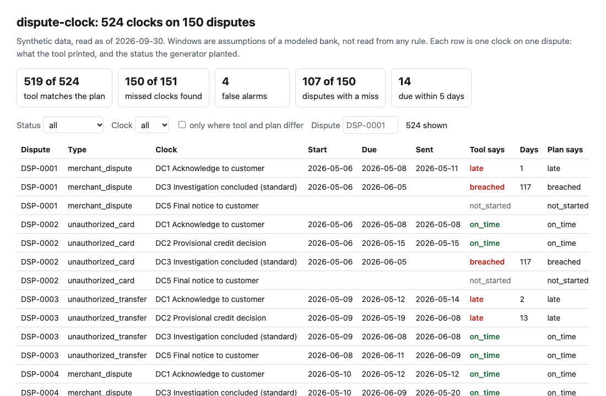
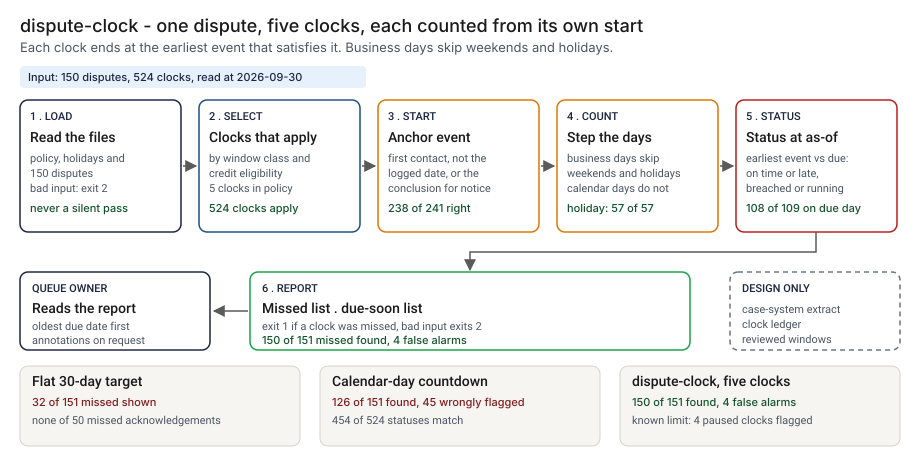
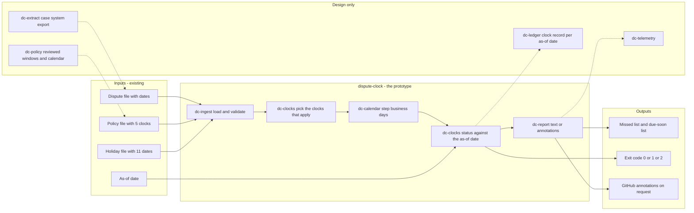
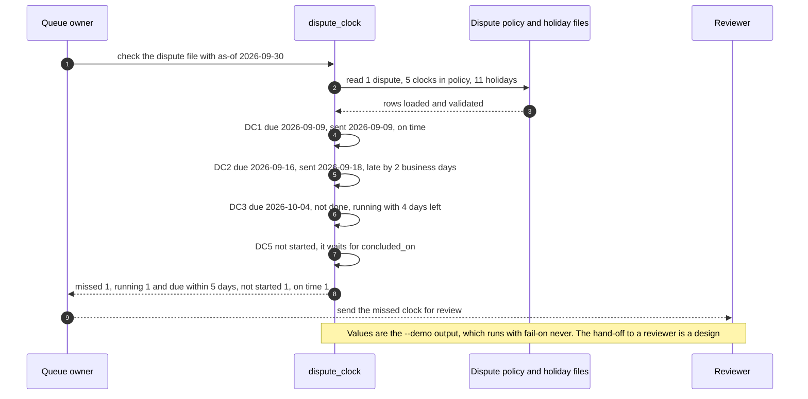

# ⏳ dispute-clock (Reg E style clocks): the deadlines of a dispute, counted in business days

**I wanted to know how many dispute deadlines a bank misses when its case system holds one flat target date, and what it takes to count the right days from the right start. This is a command-line tool that puts each step of a dispute (acknowledge, decide on provisional credit, investigate, send the final notice) on its own clock, counts business days against a holiday file, and prints which clocks were missed and which are about to be.** It carries over the clock idea from [19 IncidentLedger](../19-incidentledger-ai-incident-response/) and adds business-day arithmetic, clocks that start at an event, and a window class per case.

**▶ Static demo, no install:** [open demo.html](./demo.html)

[](./demo.html)

The windows are assumptions of a modeled bank (🟡). I did not read Regulation E or any other rule for this project, so I claim no alignment with one.

## Executive summary (90 seconds)

**Problem.** A dispute is not one deadline. The bank owes the customer an acknowledgement, a decision on provisional credit, an investigation result and a final notice, each with its own window and its own start, and the operations lead who owns the queue and the second-line reviewer see them through one flat target date per case. 🟢 On 150 synthetic disputes and 524 clocks, a flat 30-day target flags 40 of 150 disputes and shows 32 of the 151 missed clocks; it shows none of the 50 missed acknowledgements, none of the 34 missed credit decisions and none of the 30 missed final notices (`step_01_flat_target.py`). The deadline is missed and nobody sees it, and a calendar-day countdown that fixes part of that still gets the due date wrong whenever a weekend or a holiday falls inside the window.

**Product.** dispute-clock is a command that reads a policy file of clocks, a holiday file and a dispute file, and prints one of five statuses for every clock at an as-of date: on time, late, breached, running or not started. A policy row names the anchor event, a window in business or calendar days, and the events that satisfy it, the earliest one counting. The five modeled clocks are: acknowledge within 2 business days of first contact; decide on provisional credit within 7 business days (also met by finishing the investigation, and only for the two unauthorized types); conclude the investigation within 30 calendar days, or 60 for the extended class; send the final notice within 3 business days of the conclusion. Business days skip weekends and the holiday file. The command exits 1 when a clock was missed and 2 for input it cannot read. There is no model call, and the windows are assumptions of a modeled bank, not read from any rule.

**Measured and modeled performance.**

- 🟢 **Flat target: 32 of 151 missed clocks shown.** It flags 40 of 150 disputes and flags 3 disputes none of whose clocks was missed (`step_01_flat_target.py`).
- 🟢 **Calendar-day countdown: 454 of 524 statuses match (86.6%).** It finds 126 of 151 missed clocks, calls 45 clocks missed that were not and calls 25 missed clocks fine or not due (`step_02_calendar_countdown.py`).
- 🟢 **Each fix alone:** business-day counting leaves 37 wrong of 524, a first-contact start leaves 76, and both together leave 5 (`step_03_deficiencies_exposed.py`).
- 🟢 **Together: 519 of 524 statuses match (99.0%),** 150 of 151 missed clocks found, 4 false alarms (`step_04_business_day_clocks.py`).
- 🟢 **Hard cases:** right on 108 of 109 clocks that land on the due day, 57 of 57 across a holiday and 238 of 241 logged after first contact (`step_04_business_day_clocks.py`).
- 🟢 **Known limit: 4 clocks on paused investigations are called missed** (DSP-0036, DSP-0051, DSP-0079 and DSP-0103), and DSP-0092 passes because its window class was recorded wrong (`step_03_deficiencies_exposed.py`, `step_04_business_day_clocks.py`).
- 🟡 **Utility: (150/151 − 126/151) × 100 = 15.9 missed clocks a year found that a calendar-day countdown would miss,** assuming 100 missed clocks reach the report each year.
- 🔴 **Design target: a clock report within 5 minutes of the case-system extract landing.** Designed in [`ARCHITECTURE.md`](./ARCHITECTURE.md), never built or timed.

**What I would ask a head of operations to decide.** Whether the queue's report of record should count each step from its own start in business days, and who confirms the windows and the holiday calendar, since all five windows here are mine. My recommendation is to run it beside the case system's flat target on one real export, take the windows from counsel's reading of the rule that governs your products, and decide separately whether a paused investigation stops its clock.

**Call to action.** Fork the repo. Swap `data/disputes.csv`, `data/policy.csv` and `data/holidays.csv` for your own and keep the columns `dispute_id, dispute_type, window_class, credit_eligible` plus the date columns your policy names, then point `check` at them with an `--as-of` date. To call it from code, load the three files with `load_policy`, `load_holidays` and `load_disputes` and pass them to `evaluate_all` in `src/dispute_clock.py`. Make sure the first-contact date is the day the customer first told the bank and not the day the case was opened. Send findings by opening an issue: say which clock and how many, not the dispute data itself.

_A portfolio prototype on synthetic data. Nothing here is deployed, load-tested or used by anyone, and I have not run it on a real dispute export._

## Run one now

```bash
cd 49-dispute-clock/src && python3 dispute_clock.py --demo
```

It prints:

```text
as of 2026-09-30: 1 dispute, 4 clocks apply (5 clocks in policy, 11 holidays loaded)
missed 1 (late 1, breached 0); running 1, of which 1 due within 5 days; not started 1; on time 1
DSP-EX1  unauthorized_card
  DC1 Acknowledge to customer                due 2026-09-09  sent 2026-09-09  on time
  DC2 Provisional credit decision            due 2026-09-16  sent 2026-09-18  late by 2 business days
  DC3 Investigation concluded (standard)     due 2026-10-04  sent not done    running, 4 days left
  DC5 Final notice to customer               not started (waits for concluded_on)
```

The customer first reported on Friday 4 September. The Monday after is a holiday in the modeled calendar, so an acknowledgement sent on the 9th is on its last allowed day; a calendar-day count would have called it late. The final notice clock has not started because it begins at the conclusion, and the investigation is still open.

Standard library only, Python 3.9 or newer. To check your own file: `python3 dispute_clock.py check disputes.csv --as-of 2026-09-30`. It reads `data/policy.csv` and `data/holidays.csv` unless you pass `--policy` and `--holidays`. `--all` prints every clock; `--due-soon` (default 5 days) and `--limit` (default 20 lines) shape the lists. It exits 1 when a clock was missed and 2 when the input cannot be read. `--format github` prints workflow annotations with the input text escaped; that format has been tested against the documented syntax and has not run in a real workflow.

## What the numbers say

**What it shows** (🟢 measured on synthetic data: 150 disputes and 524 clocks, read at one as-of date; the script is named in brackets):

- 🟢 One flat 30-day target flags 40 of 150 disputes and shows 32 of the 151 missed clocks. Of the 50 missed acknowledgements, 34 missed credit decisions and 30 missed final notices, it shows none (`step_01`)
- 🟢 A calendar-day countdown from the logged date matches the planted status on 454 of 524 clocks (86.6%), calls 45 clocks missed that were not, and calls 25 missed clocks fine or not due (`step_02`)
- 🟢 Business-day counting alone leaves 37 wrong of 524, a first-contact start alone leaves 76, and both together leave 5 (`step_03`)
- 🟢 The tool matches 519 of 524 (99.0%), finds 150 of the 151 missed clocks and raises 4 false alarms. On the planted hard cases it is right on 108 of 109 clocks that land on the due day, 57 of 57 across a holiday and 238 of 241 logged after first contact (`step_04`)
- 🟢 At the as-of date 14 running clocks are due within 5 days, on 14 disputes, and 107 of 150 disputes have at least one missed clock (`step_04`)

**Modeled** (🟡): the windows (2 business days to acknowledge, 7 to decide on a credit, 30 calendar days to investigate, 60 for the extended class, 3 business days to send the final notice), the holiday calendar, the rule that clocks start at first contact, and the rule that the credit clock is also met by finishing the investigation. They are in `data/policy.csv` and `data/holidays.csv`; change one and the numbers above will differ.

**Hypothetical** (🔴): that a real queue misses clocks at anything like this rate, or that business-day counting would move a real queue's numbers by this much. I have not run it on a real dispute export.

## What it still gets wrong

- 🟢 Four clocks on paused investigations are called missed when the plan says they were not (DSP-0036, DSP-0051, DSP-0079 and DSP-0103, all on the investigation clock), and 18 of the 22 paused clocks are right. The bank asked the customer for information and waited; the tool does not read `info_requested_on` or `info_received_on`, so the clock keeps running (`step_03`, `step_04`). This is the known limit I left in on purpose.
- 🟢 One missed clock passes: DSP-0092 was recorded as extended, so the tool gave it 60 days, but the longer window never applied. The tool trusts the recorded window class. Of the 6 such disputes it is right on 5 (`step_04`)
- **The data and the tool share an author.** I planted the dates and wrote the rules. The truth file is labelled by counting elapsed days and the tool steps to a due date, which are two formulations, but both use my holiday list. A closure missing from `holidays.csv` would make both wrong in the same way, so the match rate is a ceiling, not a rate on real disputes. The first version of the data had no wrongly recorded window class; I added it after asking where the tool could pass a late clock.
- **Dates, not times.** A clock is counted in whole days. There is no cut-off hour, so a notice sent after close of business counts for that day.
- **No pauses, restarts or rollover.** A calendar-day due date that lands on a weekend or a holiday stays there (business-day windows always end on a business day). A customer who adds facts mid-investigation does not restart anything.
- **Events are taken as recorded.** `acknowledged_on` is the date someone entered. The tool cannot tell whether the customer was told.
- **Not a statement of any rule.** "Reg E style" names the shape of the process: acknowledge, provisional credit, investigation window, final notice. The day counts are mine.

## How the four steps fit

| Step | Question | Script |
|---|---|---|
| 1 | What does one flat target per case show? | `step_01_flat_target.py` |
| 2 | What does a calendar-day countdown from the logged date get wrong? | `step_02_calendar_countdown.py` |
| 3 | Which fix removes which error, and what is left? | `step_03_deficiencies_exposed.py` |
| 4 | What do business days, first-contact starts and event-driven clocks catch? | `step_04_business_day_clocks.py` |

Run any of them from `src/`. Data is generated by [`data/_generate.py`](./data/README.md); `tools/check_repo.py` at the repo root confirms that a rerun reproduces every file and that the green numbers above appear in a script's output. `python3 -m unittest discover -s tests` runs 41 tests, including a golden test that pins these numbers and tests for empty, wrong-type, truncated and hostile input.

**What came from IncidentLedger.** The vocabulary (an anchor, a window, on time, late, breached, running, not started) and the idea of keeping the windows in a policy file. I rewrote the engine in this folder and imported nothing from it. New here: business days against a holiday file, a clock that starts at an event (the final notice starts at the conclusion), a clock met by the earliest of several events, and a window class per case.

## Utility delivered

The way I price product impact: **utility = (my solution − current state of the art) × the number of people or items it affects.**

Here the item is a missed clock: one deadline in one dispute that passed without its step done. Each one lands on the operations lead who owns the queue, the second-line reviewer who asks what was missed, and in a real queue on a customer. The common basic approach is a calendar-day countdown from the logged date; the table prices the tool against it.

| Term | Value | Where it comes from |
| --- | --- | --- |
| Current state of the art (calendar-day countdown from the logged date), missed clocks found | 🟢 **126 of 151** | `step_02_calendar_countdown.py`; it also calls 45 clocks missed that were not |
| My solution (dispute-clock), missed clocks found | 🟢 **150 of 151** | `step_04_business_day_clocks.py`; 4 false alarms |
| Lift per missed clock | 🟢 150 of 151 minus 126 of 151 | The countdown gets statuses wrong at the boundary (32 of 109), across a holiday (16 of 57) and after a late log (33 of 241) (`step_03_deficiencies_exposed.py`) |
| Number it affects: missed clocks reaching the report in a year | 🟡 **100** | **Assumption, not a statistic.** Replace it with your own count of missed clocks in a year |
| Assumption that makes the lift real | 🟡 The windows and the holiday calendar are the bank's own, and the file carries the first-contact date | If it carries only the logged date, the lift falls to what business days alone give: 🟢 37 wrong of 524 against 5 wrong with both fixes (`step_03_deficiencies_exposed.py`) |
| **Utility** | 🟡 **(150/151 − 126/151) × 100 = 15.9 missed clocks a year found that a calendar-day countdown would miss** | Assumes the 100 behave like the 151 planted ones |

Sensitivity to the count assumption (🟡, same lift): 50 a year gives 7.9, 100 gives 15.9, 200 gives 31.8.

🔴 What I have not measured: what a missed clock costs the bank or the customer, how long it takes a person to read and clear the report, how often a real queue misses a clock, or how much of a real queue's misses are paused investigations. The planted set is dense on purpose, 151 of 524 clocks missed (`step_01_flat_target.py`); a real queue sees fewer. Treat the result as a property of this mix of cases, not a forecast.

---

## Architecture and call flow

Component names match [`ARCHITECTURE.md`](./ARCHITECTURE.md). GitHub renders the diagrams natively.



**System topology:**



**Per-run sequence** (the `--demo` run, one unauthorized-card dispute first reported on 2026-09-04):



**Interlocks (all red, designed, none built):**

- [19 IncidentLedger](../19-incidentledger-ai-incident-response/) is where the clock vocabulary comes from. This folder rewrote the engine and imports nothing from it.
- [50 Review Capacity](../50-review-capacity/) would size the reviewers behind a queue once the due-soon list shows how many clocks expire in the next few days. dispute-clock does not read its files.
- [75 Chargeback Packet](../75-chargeback-packet/) runs the response clock for the merchant side of a dispute, a different party. No shared code, and nothing here reads its files.
- [09 LineageLog](../09-lineagelog-ai-decision-audit/) is a possible home for the clock record (`dc-ledger`).

---

## PM artifacts

The PM artifacts that show how I would run this product if I owned the seat. This README is the walkthrough; the rest of the folder holds:

- [`PRD.md`](./PRD.md): the product requirements doc, with users, backlog, KPIs, rollout and open questions.
- [`ARCHITECTURE.md`](./ARCHITECTURE.md): the systems doc, with components, data model, security, failure behavior and operations. A design, not deployed.
- [`demo.html`](./demo.html): clickable, no-install walkthrough, built from the step outputs by `src/_build_demo.py`.
- [`data/`](./data/): the synthetic disputes, the policy of five clocks, the holiday file, the planted truth and the seeded generator. `data/README.md` explains how the truth is set.
- [`src/`](./src/): `dispute_clock.py`, `common.py`, the four step scripts and the demo builder.
- [`tests/`](./tests/): 41 unittest tests, including a golden test that pins the numbers above and tests for empty, wrong-type, truncated and hostile input.

Run the four steps end to end:

```bash
cd src
python3 step_01_flat_target.py
python3 step_02_calendar_countdown.py
python3 step_03_deficiencies_exposed.py
python3 step_04_business_day_clocks.py
```

---

## Aligned to

Nothing. The title says Reg E style because the process has that shape; I did not read Regulation E for this project, and none of the windows is taken from it. I claim no alignment with any rule. If you adapt this, take the windows from counsel's reading of the rule that governs your products.

## Data and limits

Synthetic, seeded, byte-for-byte reproducible. Nothing comes from any employer, bank or real dispute. The calendar is a modeled one. A prototype on synthetic data, not a production case study.

## Fork it

Swap `data/disputes.csv`, `data/policy.csv` and `data/holidays.csv` for your own and keep the columns. The tool reads only the dispute columns the policy names, plus `dispute_id`, `dispute_type`, `window_class` and `credit_eligible`; to add a clock, add a policy row that names a new date column. Read the [PRD](./PRD.md) for the scope I held to.

## Prereqs to run this on your laptop

You need Python 3.9 or newer and nothing else. The tool, the four step scripts and the data generator use only the standard library, so there is nothing to install. There is no API key, no network call and no model call anywhere in the folder. To run the tests, use `python3 -m unittest discover -s tests` from this folder. The production pieces in [`ARCHITECTURE.md`](./ARCHITECTURE.md) (the case-system extract, the reviewed policy config, the clock ledger, telemetry) are a design, not something you need or can run.

## Author

**Vijay Saharan**, Sr Product / Program Manager · AI in BFSI · Enterprise AI Platforms

[LinkedIn](https://www.linkedin.com/in/vijaysaharan/)
