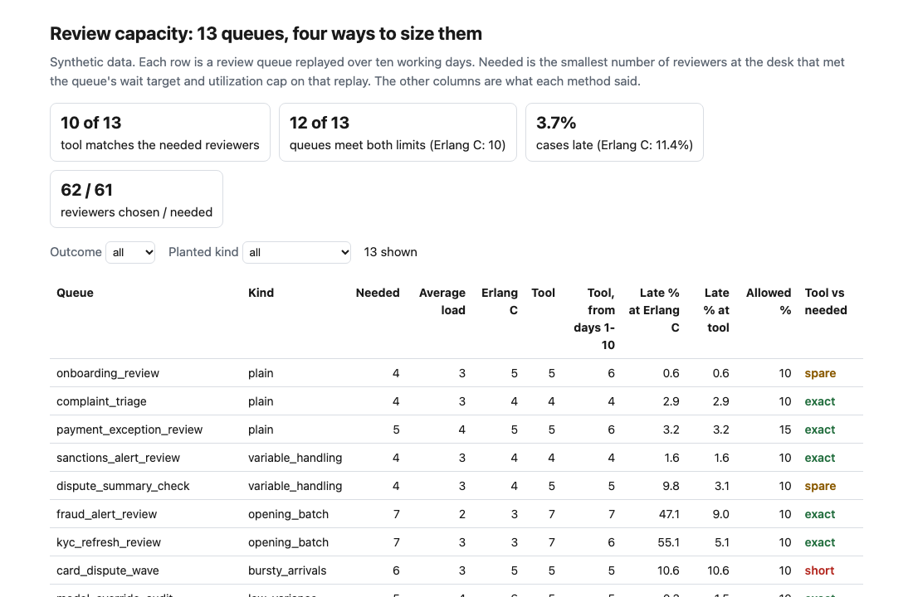
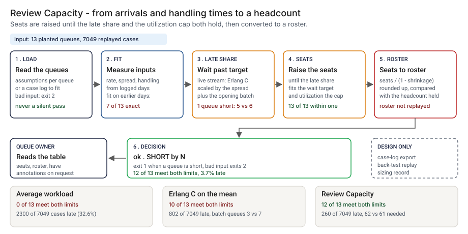
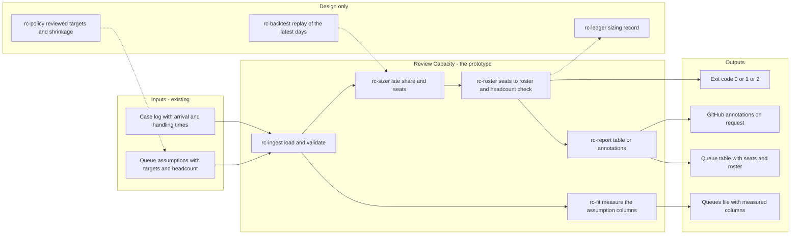
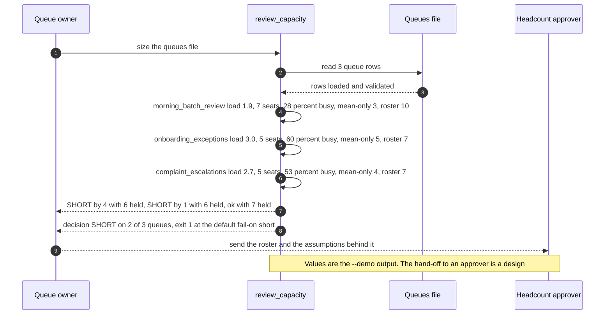

# 🧮 Review Capacity: how many reviewers does the human-in-the-loop queue need?

**I wanted a headcount number for a review queue that I could defend line by line. The spreadsheet answer divides a day's work by the hours in a shift and leaves the queue to absorb every cluster of arrivals. Erlang C does better, until a batch lands at open. This is a small command-line calculator: you give it arrival and handling-time assumptions, a wait target and a utilization cap, and it returns the reviewers needed at the desk and the roster that implies.** It extends [08 OversightOps](../08-oversightops-hitl-workflow/), which models the review queue, and [24 PortfolioBoard](../24-portfolioboard-ai-program-portfolio/), which sets review capacity against demand by team. I took the questions from those two, not their numbers or their code.

**▶ Static demo, no install:** [open demo.html](./demo.html)

[](./demo.html)

## Executive summary (90 seconds)

**Problem.** A human-in-the-loop queue behind an AI system is sized by feel or by dividing the day's work by the hours in a shift, and the person who owns the queue then has to defend that number to whoever approves the headcount. Staffing to the average leaves every cluster of arrivals and every long case to the queue, and the reviewers who absorb it are the ones asked to look carefully. In `step_01_average_workload.py`, on 13 synthetic queues and 7049 replayed cases, 🟢 staffing to the average workload meets both the wait target and the utilization cap on 0 of 13 queues, leaves 2300 of 7049 cases (32.6%) waiting past their target and gives the queues 39 reviewers where 61 were needed. The worst queue, fraud_alert_review, gets 2 reviewers against 7 needed, with 74.8% of its cases late.

**Product.** Review Capacity is a small command-line calculator. For each queue it reads one row of assumptions: arrival rate, an opening batch, handling time and its spread, a wait target, the share of cases that must meet it, a utilization cap and shrinkage. It models the share of late cases as two parts, the live stream (Erlang C with its tail scaled by the spread of arrivals and handling) and the opening batch (worked off at the rate the seats serve), then raises the reviewers at the desk until the late share and the utilization cap both hold. The roster is seats divided by one minus shrinkage, rounded up. It compares the roster with a current headcount when one is given and exits 1 when a queue is short, and 2 for input it cannot read. A second command, `fit`, measures the assumption columns from a case log. There is no model call; every figure is arithmetic on the inputs.

**Measured and modeled performance.**

- 🟢 **Average workload: 0 of 13 queues meet both limits.** 2300 of 7049 cases (32.6%) wait past their target and the queues get 39 reviewers where 61 were needed
  (`step_01_average_workload.py`).
- 🟢 **Erlang C on the mean rate: 10 of 13 queues meet both limits** and 8 of 13 land on the true number. 802 of 7049 cases (11.4%) are late, and the two opening-batch queues get 3 reviewers each where 7 were needed (`step_02_erlang_c.py`).
- 🟢 **Each half alone:** draining the opening batch lifts the exact matches from 8 to 10 of 13; the variability term alone moves two answers, one nearer and one farther
  (`step_03_deficiencies_exposed.py`).
- 🟢 **Together: 10 of 13 queues land on the true number, 13 of 13 within one, 12 of 13 meet both limits,** and 260 of 7049 cases (3.7%) are late against 11.4% for Erlang C. It asks for 62 reviewers where 61 were needed (`step_04_with_review_capacity.py`).
- 🟢 **Hard negatives:** two queues that look risky on paper are not over-staffed, 2 of 2 (`step_04_with_review_capacity.py`).
- 🟢 **Known limit:** one bursty queue is still one reviewer short, card_dispute_wave with 5 where 6 were needed, and with assumptions measured on the previous 10 days only 7 of 13 land on the true number and 10 of 13 meet both limits
  (`step_03_deficiencies_exposed.py`, `step_04_with_review_capacity.py`).
- 🟡 **Utility: (12/13 − 10/13) × 20 = 3.1 queue sizings a year that meet both limits where Erlang C on the mean would not,** assuming 20 queues are sized each year.
- 🔴 **Design target: a sizing within 10 minutes of a case-log export landing.** Designed in [`ARCHITECTURE.md`](./ARCHITECTURE.md), never built or timed.

**What I would ask a head of operations to decide.** Which wait target, which share of cases and which utilization cap each queue gets, since all three are policy and none is a finding here. My recommendation is to size one real queue from its own case log beside the headcount you hold today, set those three numbers with the queue owner, and treat the answer as a floor to defend, not a forecast: it is only as good as the days the log covers.

**Call to action.** Fork the repo. Swap `data/cases.csv` for your own log with the columns `queue_id`, `day`, `arrival_min`, `handle_min` and `channel`, run `fit` on it, edit the target columns and run `size`. To call it from code, import `required_seats` and `roster` from `src/review_capacity.py`. Send findings by opening an issue: say which kind of queue was wrong and by how many reviewers, not the case data itself.

_A portfolio prototype on synthetic data. Nothing here is deployed, load-tested or used by anyone, and I have not run it on a real case log._

## Run one now

```bash
cd 50-review-capacity/src && python3 review_capacity.py --demo
```

It prints:

```text
queue                   load  seats  util  mean-only  roster  have  status
morning_batch_review     1.9      7   28%          3      10     6  SHORT by 4
onboarding_exceptions    3.0      5   60%          5       7     6  SHORT by 1
complaint_escalations    2.7      5   53%          4       7     7  ok
decision: SHORT on 2 of 3 queues with a current_headcount
```

`seats` is reviewers at the desk, `mean-only` is Erlang C on the mean rate alone, `roster` is seats divided by one minus shrinkage, rounded up. Standard library only, Python 3.9 or newer. To size your own queues: `python3 review_capacity.py size queues.csv`, where each row holds the assumptions for one queue (the columns are listed at the top of `src/review_capacity.py`). It exits 1 when a queue is short, and `--format github` prints annotations. `python3 review_capacity.py fit caselog.csv --days 1-10` measures the arrival and handling columns from a case log and prints a queues CSV with the target columns at defaults for you to edit; redirect it to a file.

## What the numbers say

**What it shows** (🟢 measured on synthetic data: 13 planted queues and 7049 replayed cases; the script is named at the start of each bullet):

- `step_01`: 🟢 Staffing to the average workload: 0 of 13 queues meet both the wait target and the utilization cap, 2300 of 7049 cases (32.6%) wait past their target, and the queues get 39 reviewers where 61 were needed
- `step_02`: 🟢 Erlang C on the mean rate: 10 of 13 queues meet both limits, 8 of 13 land on the true number and 802 of 7049 cases (11.4%) are late. The two opening-batch queues get 3 reviewers each where 7 were needed, with 47.1% and 55.1% of their cases late
- `step_03`: 🟢 Each half of the fix alone: draining the opening batch lifts the exact matches from 8 to 10 of 13 and moves two queues nearer the truth and none farther; scaling the tail by the measured spread moves two answers, one nearer and one farther
- `step_04`: 🟢 The tool: 10 of 13 queues land on the true number, 13 of 13 within one, 12 of 13 meet both limits, and 260 of 7049 cases (3.7%) are late, against 11.4% for Erlang C. It asks for 62 reviewers where 61 were needed and Erlang C gives 54
- `step_04`: 🟢 Two hard negatives, queues that look risky on paper, are not over-staffed: 2 of 2
- `step_04`: 🟢 With the assumptions measured on the previous 10 days instead of the replayed ones: 7 of 13 land on the true number, 12 of 13 within one, and 10 of 13 meet both limits
- 🟡 Modeled, assumptions named: the wait targets, the 0.85 utilization cap and the 25% shrinkage are my choices, set in `data/queues.csv`. The roster column is arithmetic on the shrinkage and is not tested against a replay.
- 🔴 Hypothetical: that a reviewer who runs near the cap reviews worse. 08 models rubber-stamped reviews but not as a function of load, and nothing here measures that link, so the cap is a policy choice and not a finding.

## What it still gets wrong

- `step_04` and `step_03`: 🟢 One bursty queue is still one reviewer short: `card_dispute_wave` gets 5 where 6 were needed, with 10.6% of its cases late against 10% allowed. The tool reads the spread of the gaps between arrivals, 1.64 for that queue. Busy and quiet spells hide inside a gap statistic: its hourly arrival counts have a variance over mean of 3.66, against 0.80 for a plain queue. One queue sitting just over the line cannot prove that is the cause.
- `step_04`: 🟢 Two queues get one reviewer more than needed, `onboarding_review` and `dispute_summary_check`, each with 5 against 4.
- `step_03`: 🟢 The variability term is not shown to help. It changed 2 of 13 answers, one better and one worse. I kept it because it is the standard form and the near-constant handling queue needs it; 13 queues cannot settle it.
- `step_04`: 🟢 A change after the history was taken is invisible to any method fitted on the history. `payment_limit_exceptions` ran at 5.31 live cases an hour on days 1 to 10 and 6.78 on days 11 to 20; fitted on days 1 to 10 the tool says 4 reviewers and 5 were needed.
- **The data and the rules share an author.** I planted the queues and wrote the sizing, so the numbers are a ceiling for these rules, not a rate on a real queue, which I have not tested. I did not change the queue parameters after seeing a result.
- **Each true number is one 10-day replay**, so a miss of one reviewer at the edge is partly noise. The replay starts every day empty, serves cases first come first served by identical reviewers, and has no priorities, no skill routing, no abandonment and no time-of-day staffing beyond the opening batch.
- The tail scaling is the usual Allen-Cunneen style adjustment of Erlang C. I wrote it from the standard form and have not checked it against the original papers; the replay is the only authority in this folder.

## How the four steps fit

| Step | Question | Script |
|---|---|---|
| 1 | What does staffing to the average workload leave? | `step_01_average_workload.py` |
| 2 | What does Erlang C on the mean rate fix, and where does it stop? | `step_02_erlang_c.py` |
| 3 | Where does each half of the fix fail alone? | `step_03_deficiencies_exposed.py` |
| 4 | What do variability and the opening batch give together, and what is left? | `step_04_with_review_capacity.py` |

Run any of them from `src/`. Steps 1 to 4 measure the assumptions on the days they replay, so the comparison tests the method and not a forecast; the last block of step 4 repeats the test with assumptions from the earlier days. Data is generated by [`data/_generate.py`](./data/README.md); the check in `tools/check_repo.py` confirms that a rerun reproduces every file and that the green numbers above appear in a script's output.

## Utility delivered

The way I price product impact: **utility = (my solution − current state of the art) × the number of people or items it affects.**

Here the item is a queue sizing: one headcount number for one review queue. Each lands on the queue owner who defends it, the approver who signs it, and the reviewers who work the queue. The common basic approach is Erlang C on the mean arrival rate; the table prices the tool against it.

| Term | Value | Where it comes from |
| --- | --- | --- |
| Current state of the art (Erlang C on the mean rate), queues that meet both limits | 🟢 **10 of 13** | `step_02_erlang_c.py`; 802 of 7049 cases (11.4%) are late |
| My solution (Review Capacity), queues that meet both limits | 🟢 **12 of 13** | `step_04_with_review_capacity.py`; 260 of 7049 cases (3.7%) are late |
| Lift per queue sized | 🟢 12 of 13 minus 10 of 13 | Erlang C gets the opening-batch queues wrong, 3 reviewers each where 7 were needed (`step_02_erlang_c.py`); draining the batch lifts the exact matches from 8 to 10 of 13 (step 3) |
| Number it affects: queues sized in a year | 🟡 **20** | **Assumption, not a statistic.** Replace it with your own count of queue sizings in a year |
| Assumption that makes the lift real | 🟡 The arrival rate, spread and handling time measured on the log hold on the days that follow | If volume rises after the history, the lift goes: 🟢 with assumptions measured on the previous 10 days the tool meets both limits on 10 of 13 queues, the count Erlang C reaches when measured on the replayed days (`step_04_with_review_capacity.py`) |
| **Utility** | 🟡 **(12/13 − 10/13) × 20 = 3.1 queue sizings a year that meet both limits where Erlang C would not** | Assumes the 20 behave like the 13 planted queues |

Sensitivity to the count assumption (🟡, same lift): 10 sizings a year gives 1.5, 20 gives 3.1, 40 gives 6.2.

🔴 What I have not measured: what a late case costs, what an extra reviewer costs (the tool asks for 62 where 61 were needed), whether a reviewer who runs near the cap reviews worse, or how a real queue's mix compares with these. The planted set is dense in hard cases on purpose: two opening-batch queues, one bursty queue and one that drifts. Treat the result as a property of this mix, not a forecast.

---

## Architecture and call flow

Component names match [`ARCHITECTURE.md`](./ARCHITECTURE.md). GitHub renders the diagrams natively.



**System topology:**



**Per-run sequence** (the `--demo` run, three hand-typed queues):



**Interlocks (all red, designed, none built):**

- [08 OversightOps](../08-oversightops-hitl-workflow/) models the review queue. This folder took its questions, not its numbers or code, and reads none of its files.
- [24 PortfolioBoard](../24-portfolioboard-ai-program-portfolio/) sets review capacity against demand by team. The roster from `rc-roster` would be one input to that comparison.
- [49 Dispute Clock](../49-dispute-clock/) prints the clocks due in the next few days for a dispute queue. That list is one source of demand for a review queue; neither tool reads the other's files.

---

## PM artifacts

The PM artifacts that show how I would run this product if I owned the seat. This README is the walkthrough; the rest of the folder holds:

- [`PRD.md`](./PRD.md): the product requirements doc, with users, backlog, KPIs, rollout and open questions.
- [`ARCHITECTURE.md`](./ARCHITECTURE.md): the systems doc, with components, data model, security, failure behavior and operations. A design, not deployed.
- [`demo.html`](./demo.html): clickable, no-install walkthrough, built from the step outputs by `src/_build_demo.py`.
- [`data/`](./data/): the synthetic case log, the queue targets, the planted truth and the seeded generator. `data/README.md` explains how the true number is set.
- [`src/`](./src/): `review_capacity.py`, `common.py`, the four step scripts and the demo builder.
- [`tests/`](./tests/): 55 unittest tests, including a golden test that pins the numbers above and tests for bad input and hostile strings.

Run the four steps end to end:

```bash
cd src
python3 step_01_average_workload.py
python3 step_02_erlang_c.py
python3 step_03_deficiencies_exposed.py
python3 step_04_with_review_capacity.py
```

---

## Aligned to

Nothing. I did not build this against a published standard or a regulator's text, so I claim no alignment. It is a prototype on synthetic data.

## Data and limits

Synthetic, seeded, byte-for-byte reproducible. Nothing comes from any employer, customer or real bank. A prototype on synthetic data, not a production case study. The planted kinds, the definition of the true number and the assumptions are in [`data/README.md`](./data/README.md).

## Fork it

Swap `data/cases.csv` for your own log with the columns `queue_id`, `day`, `arrival_min`, `handle_min` and `channel` (`live`, or `batch` for cases created in one run at open), run `fit` on it, edit the target columns and run `size`. Read the [PRD](./PRD.md) for the scope I held to. I have not run the exit code and annotations in a GitHub workflow; what is tested is the command (`tests/test_cli.py`, 55 tests across the folder).

## Prereqs to run this on your laptop

You need Python 3.9 or newer and nothing else. The calculator, the four step scripts and the data generator use only the standard library, so there is nothing to install. There is no API key, no network call and no model call anywhere in the folder. To run the tests, use `python3 -m unittest discover -s tests` from this folder. The production pieces in [`ARCHITECTURE.md`](./ARCHITECTURE.md) (the reviewed target config, the back-test job, the sizing ledger) are a design, not something you need or can run.

## Author

**Vijay Saharan**, Sr Product / Program Manager · AI in BFSI · Enterprise AI Platforms

[LinkedIn](https://www.linkedin.com/in/vijaysaharan/)
