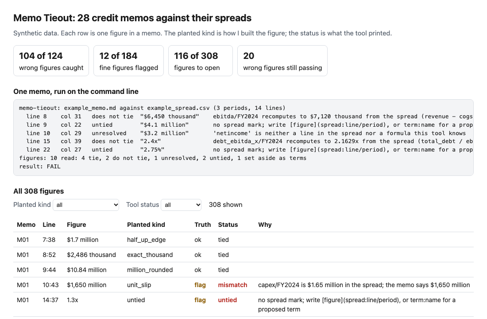
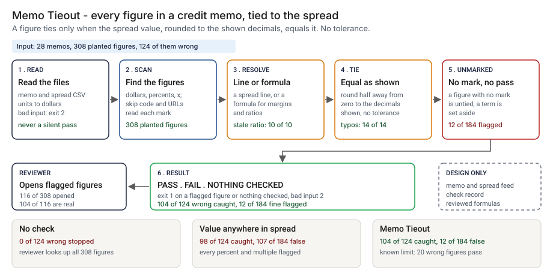
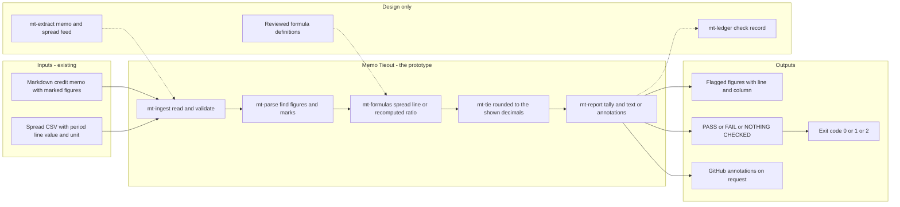
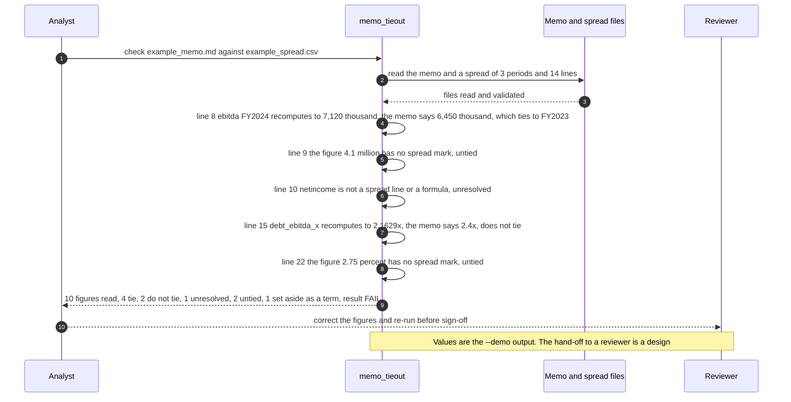

# 🧮 Memo Tieout: every figure in a credit memo, tied back to the spread

**I wanted to know how many of the figures in a credit memo a script can tie back to the spread, and which errors it cannot see. This is a command-line tool: it reads a markdown memo and a spread exported as CSV, and reports each figure as tied, not tied, unresolved or untied.** It extends [39 Claims Check](../39-claims-check/), which ties the numbers in a README to the output of a script. Here the evidence is a spread, so the tool also handles units, rounding to the precision the memo shows, and formulas for margins and ratios.

**▶ Static demo, no install:** [open demo.html](./demo.html)

[](./demo.html)

## Executive summary (90 seconds)

**Problem.** A credit memo quotes revenue, EBITDA and a handful of ratios from a spread, and the credit analyst who writes it and the reviewer who signs it off have no step that compares the two files. The spread is revised after the memo is drafted, a figure is copied from the wrong year, a ratio is worked out on last year's EBITDA, and a coverage ratio is rounded up to look better. 🟢 On 28 synthetic memos holding 308 planted figures, 124 of them wrong, a process with no check stops 0 of 124 wrong figures before sign-off, all 28 memos carry at least one, and a reviewer looks up all 308 figures by hand (`step_01_no_tieout.py`). The wrong figure is found by a reader who happens to look it up, or it is not found.

**Product.** Memo Tieout is a command that reads a markdown memo and a spread exported as CSV, and reports each figure as tied, not tied, unresolved or untied. An analyst marks a figure with a link such as `[$47.3 million](spread:revenue/FY2024)`; the tool reads the named line and period, converts the unit, and recomputes margins and ratios from the spread with formulas that are my own definitions. A figure ties when the spread value, rounded half away from zero to the decimals the memo shows, equals it, with no tolerance. A figure with no mark is untied, and a proposed term marked `term:name` is counted and set aside. The command exits 1 when a figure does not tie or when the memo held nothing it could check, and 2 for input it cannot read. There is no model call.

**Measured and modeled performance.**

- 🟢 **No check: 0 of 124 wrong figures stopped,** 28 of 28 memos carry at least one, and a reviewer looks up all 308 figures (`step_01_no_tieout.py`).
- 🟢 **A script that looks for each figure among the spread's values catches 98 of 124 wrong figures and flags 107 of 184 fine ones,** because it flags every percent and multiple whether right or wrong (`step_02_value_anywhere.py`).
- 🟢 **Each rule alone:** tying a figure to its mark takes false alarms from 107 to 0 of 184 but catches only 40 of 124; recomputing the ratios lifts that to 88 of 124; a 1% tolerance catches 72 of 124 and flags 22 of 184 fine figures (`step_03_deficiencies_exposed.py`).
- 🟢 **Together: 104 of 124 wrong figures caught and 12 of 184 fine ones flagged;** a person opens 116 of 308 figures and 104 of the 116 are real problems (`step_04_with_memo_tieout.py`).
- 🟢 **Memos that still carry a wrong figure after the check: 16 of 28,** against 28 of 28 with no check (`step_04_with_memo_tieout.py`).
- 🟢 **Known limit: 20 of 124 wrong figures still pass.** Ten are `prose_tag_mismatch`, a number that agrees with its mark under a sentence that names another line, and ten are `unparsed_form`, a figure written in words or with a USD prefix (`step_03_deficiencies_exposed.py`, `step_04_with_memo_tieout.py`).
- 🟡 **Utility: (104/124 − 98/124) × 50 = 2.4 more wrong figures a year caught than a value-anywhere script catches,** assuming 50 wrong figures reach the check each year.
- 🔴 **Design target: a tie-out result within 60 seconds of a memo and its spread landing.** Designed in [`ARCHITECTURE.md`](./ARCHITECTURE.md), never built or timed.

**What I would ask a head of credit operations to decide.** Whether a memo should carry a mark on every figure from the first draft, so that the reviewer starts from a tie-out result and not from two open files. My recommendation is to try it on one memo and spread whose owner agrees, in advisory mode, replace my formulas with the definitions your credit policy uses, and decide what to do with the sentence-versus-line check I have not built, since a number can agree with its mark and sit under the wrong words.

**Call to action.** Fork the repo. Swap `data/memos.json`, `data/spreads.csv` and `data/truth.csv` for your own memos and spreads, or skip the data and point `check` at one memo and one spread export with the columns `period, period_end, line, value, unit`. To call it from code, read the spread with `read_spread` and pass the memo text to `check_memo` in `src/memo_tieout.py`; edit `METRICS` for your own definitions. Send findings by opening an issue: say which kind of figure was wrong, not the memo or the spread.

_A portfolio prototype on synthetic data. Nothing here is deployed, load-tested or used by anyone, and I have not run it on a real memo or spread._

## Run one now

```bash
cd 51-memo-tieout/src && python3 memo_tieout.py --demo
```

It prints:

```text
memo-tieout: example_memo.md against example_spread.csv (3 periods, 14 lines)
  line 8    col 31   does not tie  "$6,450 thousand"    ebitda/FY2024 recomputes to $7,120 thousand from the spread (revenue - cogs - opex); the memo says $6,450 thousand. The figure does tie to ebitda/FY2023
  line 9    col 22   untied        "$4.1 million"       no spread mark; write [figure](spread:line/period), or term:name for a proposed term
  line 10   col 29   unresolved    "$3.2 million"       'netincome' is neither a line in the spread nor a formula this tool knows
  line 15   col 39   does not tie  "2.4x"               debt_ebitda_x/FY2024 recomputes to 2.1629x from the spread (total_debt / ebitda); the memo says 2.4x
  line 22   col 27   untied        "2.75%"              no spread mark; write [figure](spread:line/period), or term:name for a proposed term
figures: 10 read: 4 tie, 2 do not tie, 1 unresolved, 2 untied, 1 set aside as terms
result: FAIL
```

Standard library only, Python 3.9 or newer. To check your own memo: `python3 memo_tieout.py check memo.md --spread spread.csv`. It exits 1 when a figure does not tie, and also when the memo holds nothing it could check. It exits 2 when an input cannot be read. `--format github` prints annotations.

## How a memo marks a figure

| In the memo | Meaning |
|---|---|
| `[$47.3 million](spread:revenue/FY2024)` | This figure is the `revenue` line of the spread for `FY2024`. |
| `[2.16x](spread:debt_ebitda_x/FY2024)` | A ratio or margin. The tool recomputes it from the spread with a formula in `memo_tieout.py`. |
| `[$5.0 million](term:facility_amount)` | A proposed term, not a spread figure. Counted and not checked. |
| `$4.1 million`, `2.75%`, `1.2x` | A figure with no mark. Reported as untied. |

A figure is a number written with a dollar sign, a percent sign or a trailing x. Years, counts and section numbers are not figures, and neither are fenced code, code spans, link targets and URLs. A figure ties when the spread value, rounded half away from zero to the decimals the memo shows, equals it. There is no tolerance: `$47.3 million` ties to 47,320 thousand and `$47.4 million` does not. The spread file has the columns `period, period_end, line, value, unit` and the unit is `usd`, `usd_thousands` or `usd_millions`.

## What the numbers say

**What it shows** (🟢 measured on synthetic data: 28 memos and 308 planted figures, 124 of them wrong; the script is named in brackets):

- 🟢 With no check, 0 of 124 wrong figures are stopped before sign-off, 28 of 28 memos carry at least one, and a reviewer looks up all 308 figures by hand (`step_01`)
- 🟢 A script that looks for each figure among the spread's values catches 98 of 124 wrong figures and flags 107 of 184 fine ones (`step_02`)
- 🟢 Of those 98, 71 are percents and multiples, which that script flags whether they are right or wrong; on dollar figures it catches 27 of 53 (`step_02`)
- 🟢 Tying each figure to its mark removes the false alarms, 107 to 0 of 184, but without recomputing ratios it catches only 40 of 124 (`step_03`)
- 🟢 Recomputing the ratios lifts that to 88 of 124 with 0 false alarms; a version with a 1% tolerance catches 72 of 124 and flags 22 of 184 fine figures (`step_03`)
- 🟢 A 1% tolerance flags 6 of 14 digit typos and 1 of 10 ratios nudged by 0.01 in the borrower's favour; the shown precision flags 14 of 14 and 10 of 10 (`step_03`)
- 🟢 Flagging figures that carry no mark finds 16 of 16 unmarked spread figures; the price is 12 of 12 proposed terms written without a term mark (`step_03`)
- 🟢 The full tool catches 104 of 124 wrong figures and flags 12 of 184 fine ones; a person opens 116 of 308 figures and 104 of the 116 are real problems (`step_04`)
- 🟢 Memos that still carry a wrong figure after the check: 16 of 28, against 28 of 28 with no check (`step_04`)

## What it still gets wrong

- 🟢 20 of 124 wrong figures still pass, and `step_04` prints each one. Ten are `prose_tag_mismatch`: the number agrees with its mark, but the sentence names another line. Ten are `unparsed_form`: a figure written in words or with a USD prefix, which the reader does not parse.
- 🟢 The price of flagging unmarked figures is 12 of 184 fine figures flagged (`step_04`). They are proposed terms and ownership shares with no term mark. Mark them `term:name` and they are counted and not checked.
- **The data and the rules share an author.** I planted the wrong figures and wrote the rules, so 104 of 124 shows the rules cover what I planted. Two kinds are hard on purpose: fine figures that could raise a false alarm (a one-decimal figure on an exact rounding boundary, terms, years and section numbers in the prose) and wrong figures the rules should miss. Treat the result as a ceiling, not a rate on real memos, which I have not tested.
- The tool trusts the mark. If someone edits the number and the mark together, or marks a spread figure `term:`, it passes. The tool prints the count of terms it set aside so a reviewer can see it.
- 🟡 Step 2 is built on a spread file that holds no ratios. A spread export that carries its own ratios would give that script fewer false alarms and a lower catch rate on ratios than the 71 of 71 it shows here, because today it flags every percent and multiple.
- 🟡 The formulas are my definitions, not a standard's: EBITDA is revenue less cost of goods sold less operating expenses, and debt service coverage is EBITDA over interest plus scheduled principal. A bank's spread may define them with add-backs. A line in the spread file wins over a formula of the same name.
- Not handled: a loss written in brackets, such as `($1.2 million)`, is read as positive; a range such as `$4-$5 million` is read as two figures; a spread value that is not money (a count, a ratio); a memo that cites a period by prose only; a spread that does not match the financial statements it came from.

## How the four steps fit

| Step | Question | Script |
|---|---|---|
| 1 | What gets through when nothing ties a memo to its spread? | `step_01_no_tieout.py` |
| 2 | What does looking for each figure among the spread's values catch and cost? | `step_02_value_anywhere.py` |
| 3 | What does each rule add, and what does it cost? | `step_03_deficiencies_exposed.py` |
| 4 | What do the default settings catch, and what still passes? | `step_04_with_memo_tieout.py` |

Run any of them from `src/`. Data is produced by [`data/_generate.py`](./data/README.md); the check in `tools/check_repo.py` confirms that a rerun reproduces every file and that the green numbers above appear in a script's output. The tool has 63 tests in `tests/`.

## Utility delivered

The way I price product impact: **utility = (my solution − current state of the art) × the number of people or items it affects.**

Here the item is a wrong figure in a credit memo that reaches the check. Each lands on the reviewer who would otherwise find it by looking up the figure by hand, the analyst who owns the memo, and the credit committee that reads it. The common basic approach is a script that looks for each figure among the spread's values; the table prices the tool against it.

| Term | Value | Where it comes from |
| --- | --- | --- |
| Current state of the art (figure must be a value somewhere in the spread), wrong figures caught | 🟢 **98 of 124** | `step_02_value_anywhere.py`; it also flags 107 of 184 fine figures |
| My solution (Memo Tieout), wrong figures caught | 🟢 **104 of 124** | `step_04_with_memo_tieout.py`; 12 of 184 fine figures flagged |
| Lift per wrong figure | 🟢 104 of 124 minus 98 of 124 | The value-anywhere script lets through a figure from the wrong period or line when the value is still in the spread: wrong_period passes 6 of 14, wrong_line 2 of 12 (`step_02_value_anywhere.py`) |
| Number it affects: wrong figures reaching the check in a year | 🟡 **50** | **Assumption, not a statistic.** Replace it with your own count of wrong figures a year |
| Assumption that makes the lift real | 🟡 Analysts write a mark on each figure as they draft, and the spread is the one the memo was written from | A figure with no mark is reported untied and the tool ties nothing for it; I have not measured a memo drafted without marks |
| **Utility** | 🟡 **(104/124 − 98/124) × 50 = 2.4 more wrong figures a year caught than a value-anywhere script catches** | Assumes the 50 behave like the 124 planted ones |

Sensitivity to the count assumption (🟡, same lift): 25 a year gives 1.2, 50 gives 2.4, 100 gives 4.8.

The larger gap between the two is false alarms, 107 against 12 of 184 fine figures, and a reviewer opening 205 figures against 116 of 308 (`step_02_value_anywhere.py`, `step_04_with_memo_tieout.py`). I do not price it: 🔴 I have not measured how long a reviewer takes per figure opened, what a missed figure costs, or how often a real memo carries a wrong one. The planted set is dense, 124 of 308 figures wrong (`step_01_no_tieout.py`); a real memo carries far fewer. Treat the result as a property of this mix of figures, not a forecast.

---

## Architecture and call flow

Component names match [`ARCHITECTURE.md`](./ARCHITECTURE.md). GitHub renders the diagrams natively.



**System topology:**



**Per-run sequence** (the `--demo` run, a worked example memo against a three-period spread):



**Interlocks (all red, designed, none built):**

- [39 Claims Check](../39-claims-check/) is where the idea comes from: tie a number to the output that should print it. This folder imports nothing from it.
- [77 Spread Extraction Eval](../77-spread-extraction-eval/) scores the extractor that produces a spread. A spread it passes would be the input here; this tool reads none of its files.
- [74 Report Trace](../74-report-trace/) traces one cell of a filed report back to source rows. It would sit after sign-off, where Memo Tieout sits before it.

---

## PM artifacts

The PM artifacts that show how I would run this product if I owned the seat. This README is the walkthrough; the rest of the folder holds:

- [`PRD.md`](./PRD.md): the product requirements doc, with users, backlog, KPIs, rollout and open questions.
- [`ARCHITECTURE.md`](./ARCHITECTURE.md): the systems doc, with components, data model, security, failure behavior and operations. A design, not deployed.
- [`demo.html`](./demo.html): clickable, no-install walkthrough, built from the step outputs by `src/_build_demo.py`.
- [`data/`](./data/): the 28 made-up memos, their spreads, the planted truth and the seeded generator. `data/README.md` explains how each figure is built.
- [`src/`](./src/): `memo_tieout.py`, `common.py`, the four step scripts and the demo builder.
- [`tests/`](./tests/): 63 unittest tests, including a golden test that pins the numbers above and tests for bad input and hostile strings.

Run the four steps end to end:

```bash
cd src
python3 step_01_no_tieout.py
python3 step_02_value_anywhere.py
python3 step_03_deficiencies_exposed.py
python3 step_04_with_memo_tieout.py
```

---

## Aligned to

Nothing. I claim no alignment with a standard, framework or regulation. The marks, the formulas and the rounding rule are my own. It is a prototype.

## Data and limits

Synthetic, seeded, byte-for-byte reproducible. Nothing comes from any employer, customer, bank or real filing, and the borrower names are made up from word lists. 🟡 The formulas and the rounding rule are assumptions, named above. 🔴 Hypothetical: that a credit team would write marks into a memo as it drafts; I have not asked anyone. A prototype on synthetic data, not a production case study.

## Fork it

Swap `data/memos.json`, `data/spreads.csv` and `data/truth.csv` for your own memos and spreads, keeping the columns, or skip the data and point `check` at one memo and one spread export. Read the [PRD](./PRD.md) for the scope I held to.

## Prereqs to run this on your laptop

You need Python 3.9 or newer and nothing else. The tool, the four step scripts and the data generator use only the standard library, so there is nothing to install. There is no API key, no network call and no model call anywhere in the folder. To run the tests, use `python3 -m unittest discover -s tests` from this folder. The production pieces in [`ARCHITECTURE.md`](./ARCHITECTURE.md) (the memo and spread feed, the reviewed formula definitions, the check record) are a design, not something you need or can run.

## Author

**Vijay Saharan**, Sr Product / Program Manager · AI in BFSI · Enterprise AI Platforms

[LinkedIn](https://www.linkedin.com/in/vijaysaharan/)
