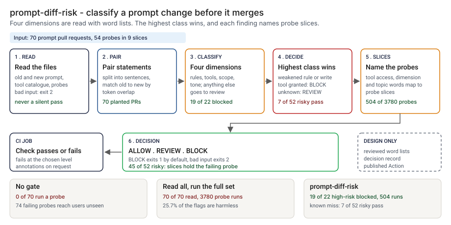

# Architecture: prompt-diff-risk

> **Status.** This is the design for a production shape. The repo implements the product mechanic as a prototype: a command, `src/prompt_diff_risk.py`, that compares two revisions of a system prompt, classifies each changed statement with word lists, prints ALLOW, REVIEW or BLOCK and names the probe slices to run, run here over 70 synthetic prompt pull requests and a 54-probe set. A GitHub Action is staged in `action/` and has not been published or run on GitHub. Nothing below is claimed as deployed or load-tested. Where a figure is a design target, it says so.

GCP is primary; AWS and Azure sit beside it.



---

## 1. Logical architecture

prompt-diff-risk is a function between a prompt repository and a merge: two revisions, an optional tool catalogue and an optional probe file in, a decision and a list of slices out. It runs no probe and calls no model.

Eight components: five decide the outcome, three support or report.

| Component | Responsibility | Language or framework | Decides the outcome? | Stateful? |
| --- | --- | --- | --- | --- |
| `pdr-ingest` | Loads the prompts, catalogue and probe file; rejects bad input with a one-line message. | Python 3.9+, standard library. Prototype: `load_prompt`, `load_catalogue`, `load_probes`, `parse_prompt` | Yes, by refusing: exit 2 | No |
| `pdr-align` | Pairs each old statement with a new one by token overlap, so a rewording is one edit. | Python. Prototype: `_align`, `_jaccard`, with `SAME_MIN` and `PAIR_MIN` | Yes | No |
| `pdr-classify` | Sorts each changed statement into constraints, tools, scope, tone or other and gives it a class. Lists move by reviewed change. | Python. Prototype: `strength`, `_classify_pair`, `_classify_lone`, the word lists in `src/prompt_diff_risk.py` | Yes, config | Stateful, in git |
| `pdr-verdict` | Takes the highest class among findings and maps it to an exit code at `--fail-on`. | Python. Prototype: `decide`, `DECISION_RANK`, `run_check` | Yes | No |
| `pdr-slices` | Maps each finding to probe slices by tool access, dimension and topic word. | Python. Prototype: `select_probes`, `_topic_slices`, `_tool_slices` | Yes, it picks the probes to run | No |
| `pdr-report` | Prints text or annotations, escaping untrusted strings. | Python. Prototype: `render`, `escape_annotation`, `escape_property`, `_clean`, `_flat` | No | No |
| `pdr-action` | Runs the command in a CI job, inputs through environment variables. | Composite GitHub Action, staged in `action/action.yml`, not published | No | No |
| `pdr-ledger` | One record per decision. Design only. Prototype analog: `src/out/step_04_decisions.csv`. | PostgreSQL plus object storage (design) | No | Stateful |

**What decides the outcome.** The input check, the pairing, the lists and thresholds, the class per finding and the slice map. The report, Action wrapper and ledger carry or record the decision.

**Repo structure** (production shape):

```
prompt-diff-risk/
├── check/      # ingest.py, align.py, classify.py, verdict.py, slices.py, report.py
├── lists/      # word lists and thresholds, changed by pull request
├── action/     # composite Action wrapper
├── ledger/     # decision record writer
├── infra/      # terraform for gcp, aws, azure
├── docs/runbooks/
└── tests/      # unit, golden, hostile strings
```

---

## 2. Physical and deployment architecture

One short-lived step in the pipeline that already runs on a prompt pull request. No server to keep warm.

| Component | GCP (primary) | AWS | Azure | Why |
| --- | --- | --- | --- | --- |
| Check process (`pdr-ingest` to `pdr-report`) | Cloud Build step or Cloud Run job | CodeBuild step or ECS Fargate task | Azure Pipelines step or Container Apps job | Stateless, one pass, runs where the pull request runs |
| Probe set and catalogue | Cloud Storage, versioned | S3, versioned | Blob Storage, versioned | Versioning keeps the bytes used |
| `pdr-ledger` | Cloud SQL for PostgreSQL | RDS for PostgreSQL | Azure Database for PostgreSQL | The platform team already runs it |

**Failure behavior (the decision that matters most).** The check must never silently pass. A missing, empty, headings-only or malformed input does not become ALLOW: it ends the run with exit 2 and a one-line reason, even with `--fail-on never`. A finding no topic word can place runs every slice and is never dropped.

| Failure | Behavior | Alert |
| --- | --- | --- |
| A prompt file missing, unreadable, not UTF-8, empty, or holding only headings and comments | Exit 2, one line naming the file | P3 |
| A catalogue that is not a non-empty JSON list, a tool without a string name, an `access` other than read or write, or a repeated name | Exit 2 naming the tool | P3 |
| A probe file without `probe_id` and `slice`, a line missing either, or no probes | Exit 2 naming the line | P3 |
| No catalogue given | Runs, and says tool grants were not checked | P4 |
| No probe file given | Runs, and prints slice names with "no probe file given" | None |
| A named slice that the probe file lacks | Runs, with a note naming the slice | P4 |
| Ledger unavailable (design) | The decision and exit code stand; the record queues locally and the gap is listed | P3 |

**Latency.** I have not timed the prototype. 🔴 Design target: a decision within 30 seconds of a pull request opening. Recovery is a re-run from the same two revisions.

---

## 3. Data architecture

| Entity | Key | What it holds | Real columns in the prototype |
| --- | --- | --- | --- |
| Prompt revision | pull request, side | Plain text; lines that start with `#` are not read | `data/pr_cases.csv`: `pr_id`, `assistant`, `old_prompt`, `new_prompt`; single files in `data/example_old.txt`, `data/example_new.txt` |
| Tool | `name` | Read or write access | `data/tools.json`: `name`, `access`, `description`. The tool reads `name` and `access` |
| Probe | `probe_id` | A probe in one slice | `data/probes.csv`: `probe_id`, `slice`, `severity`, `question`, `expected_behavior`. The tool reads `probe_id` and `slice` |
| Slice | `slice` | Dimension, severity and probe count | `data/slices.csv`: `slice`, `dimension`, `severity`, `n_probes`, `description` |
| Decision, with its findings | `decision_id` | Design: revisions, lists, thresholds, decision, slices, hashes, tool version, time | Prototype: `src/out/step_04_decisions.csv` (`decision`, `findings`, `slices`, `probes_run`) |
| Planted truth | `pr_id` | The planted edit and the failing probes | `data/pr_truth.csv`: `change_kind`, `truth_class`, `truth_slices`, `failing_probes`, `changed_item`. Exists only because the data is synthetic |

**Retention** is a design choice, not a measurement; confirm it against the bank's own schedule. 🔴 Design default: decision records 7 years, in PostgreSQL and archived with a retention lock; the revisions and lists a record used are kept as long, so it can be reproduced.

**Lineage.** A decision traces back in three hops: the record names the pull request, the lists and thresholds, and the hash of both revisions; the versioned store returns those bytes; and the rules are deterministic (no model, clock, locale or random draw), so re-running `analyse` reproduces the findings. In the prototype the trace is a row of `step_04_decisions.csv`.

**Deliberately not stored.** Probe answers, model output and customer text.

---

## 4. Security architecture

**Identity and roles.** The step runs under the CI platform's workload identity and has no user account of its own.

| Role | Can | Maps to |
| --- | --- | --- |
| `pdr:runner` | Read the revisions, catalogue, probes and lists; write a decision record | The CI service identity |
| `pdr:approver` | Clear a BLOCK or approve a list change, never for their own pull request | Prompt reviewer or second line |
| `pdr:auditor` | Read decisions, findings and list history | Internal audit |
| `pdr:admin` | Manage roles, buckets and the ledger | Platform engineering lead |

**Secrets.** The tool holds none and calls no model. The Action passes inputs through environment variables, which `tests/test_action.py` checks.

**Data classification and what leaves the boundary.** A system prompt is internal and may hold confidential business rules; a catalogue lists internal tool names. In the prototype nothing leaves the machine. In the design the exit code, annotations and ledger write leave the job.

| Threat | Example | Mitigation in the design |
| --- | --- | --- |
| Hostile string in a prompt or file name echoed into a log or annotation | A prompt sentence holding a newline and text that looks like a workflow command | `escape_annotation` and `escape_property` rewrite `%`, carriage return, newline, colon and comma; `_clean` replaces other control characters; `_flat` truncates a quoted statement. `tests/test_cli.py` covers a hostile statement, file name and control characters |
| A list or threshold is loosened to make a BLOCK go away | An exception word removed, `SAME_MIN` lowered | Pull request with a different approver; every decision stores the lists and thresholds it used |
| A catalogue edited to hide a write tool | A write tool marked read | The catalogue is versioned with the agent; a changed access field gets its own review (design) |
| A BLOCK cleared by its author | The same person approves | The ledger records the approver and refuses the author |

---

## 5. Operational architecture

**SLIs.** Decisions per class per repository per week; input rejections; probes named per run; BLOCKs cleared and by whom; false alarms found on review; risky changes found after an ALLOW; time to a decision. Prototype baseline: 🟢 2 of 18 harmless pull requests blocked and 5 of 18 sent to review (`step_04_with_gate.py`).

**SLOs (all 🔴 design targets, none measured).**
- A decision within 30 seconds of a pull request opening.
- Every prompt pull request carries a recorded decision.
- Every BLOCK read by a named person within one business day (planning estimate).
- 99.9 percent of decisions written to the ledger.

**Alerts.** P3: repeated rejections on one repository, or a BLOCK cleared by its author. P4: a daily digest of REVIEW decisions.

**Runbooks** (one page each, in `docs/runbooks/`):
- `clearing-a-block.md`: read the finding, run the named probes, attach the results, clear with a second person.
- `false-alarm.md`: record it and propose a list change in a separate pull request.
- `missed-change.md`: add a passed risky change to the planted set and re-run.
- `changing-a-list.md`: propose, re-run the planted set, compare with the golden numbers, approve.

**Ownership.** The prompt owner owns the step and runbooks, the evaluation owner the probe set and slice names, the second-line reviewer list changes and BLOCK clearance. Nobody is paged for a REVIEW.

**Change control.** Lists and thresholds are versioned. A change needs a proposer and a different approver. Before merge, the planted set is re-run against `tests/test_golden.py`, so a change that moves the blocked count shows in the diff.

---

## 6. Alignment and posture

Alignment, not certification. The README's "Aligned to" section cites nothing: it claims no alignment to a published standard or regulation, and says the probe set follows the shape of [04's probes](../04-evalforge-llm-eval-platform/data/README.md) and the slice table follows [13's slices](../13-swapbrief-model-migration/data/README.md), with no row copied from either.

- **What the design does.** It writes the rule lists out, stores the lists and thresholds used with every decision, and keeps the person who clears a BLOCK separate from the author.
- **What it does not claim.** Any alignment with, or conformity to, a standard or a rule. I have not read or mapped any source.

---

## 7. What is deliberately not here

- **One-word swaps.** 🟢 Seven of 52 risky changes pass (`step_04_with_gate.py`), six of them a swap inside a long sentence with no rule word, tone word, tool name or number.
- **A rule narrowed by a qualifier or a short clause.** 🟢 Two high-risk changes are flagged but not blocked (`step_04_with_gate.py`): the rule word survives, so the rules call it a rewrite.
- **A loophole in other words.** Exceptions come from a short list; another wording passes as a rewrite.
- **Harmless rewordings.** 🟢 Two are blocked (`step_04_with_gate.py`) because a plain imperative reads as a rule weakened.
- **Meaning.** English only, sentence by sentence; it ignores headings, comments and order, and misses a reversed condition with no negation word.
- **Real tool configuration.** Grants come from names in the prompt text.
- **Running the probes or a published Action.** The failing probes are planted; a Marketplace listing is a later step.

---

## Appendix: sample contract

```bash
python3 prompt_diff_risk.py check old.txt new.txt --tools tools.json --probes probes.csv --fail-on block --format github
```

Its output for the bundled `--demo` run is under "Run one now" in the README. Exit status: 0 below `--fail-on`, 1 at or above it, 2 for bad input.
