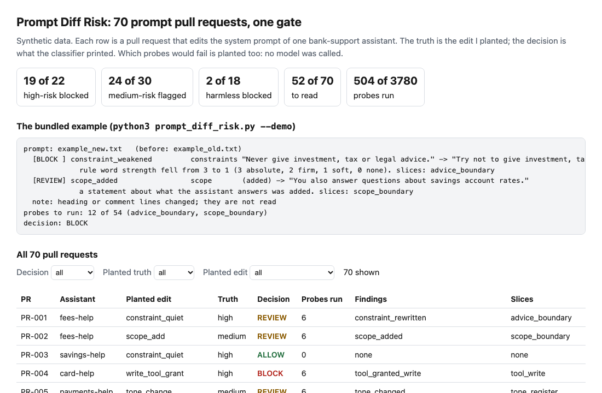
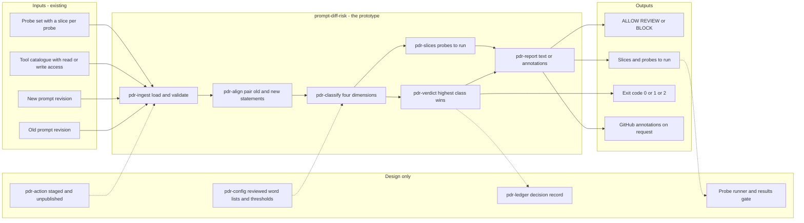
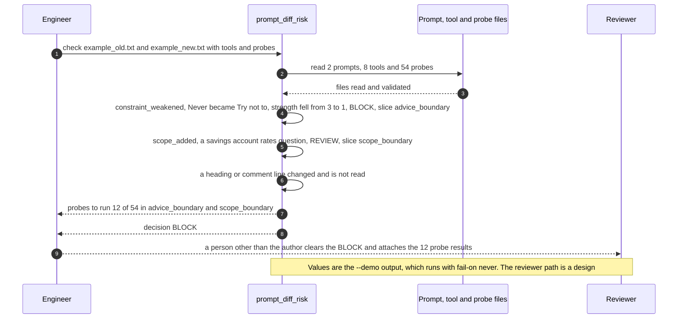

# 🧭 prompt-diff-risk (PR check): classify a prompt change before it merges

**I wanted to know what a pull request that edits a system prompt really changes, and how much of the probe set it puts at risk. This is a command-line check and a staged GitHub Action: it compares two revisions of a prompt, sorts each change into constraints, scope, tone or tools, prints ALLOW, REVIEW or BLOCK, and names the probe slices to run before the change merges.** It takes the probe-set shape from [04 EvalForge](../04-evalforge-llm-eval-platform/), the slice table from [13 SwapBrief](../13-swapbrief-model-migration/) and the gate layout from [28 Tool Schema Drift](../28-tool-schema-drift/); the prompts, the rules and the data are new.

**▶ Static demo, no install:** [open demo.html](./demo.html)

[](./demo.html)

## Executive summary (90 seconds)

**Problem.** A system prompt is edited in a pull request like any other file, and the engineer or product owner who maintains it, and the reviewer who approves the change, get a text diff and green tests on the code around it. The assistant then refuses what it used to answer, drops a rule or gains a tool, and the first signal is a customer. 🟢 On 70 synthetic prompt pull requests and a 54-probe set, with no gate, 0 of 70 pull requests run a probe before merge, 52 of 70 carry a planted failing probe, and 74 planted failing probes reach users unseen (`step_01_no_gate.py`). The two common answers both cost: reading every change reads 70 of 70, and running the full set on every change costs 3780 probe runs.

**Product.** prompt-diff-risk is a command, and a staged GitHub Action, that compares two revisions of a prompt. It splits each into statements, pairs them, sorts each change into constraints, tools, scope, tone or something else, and prints ALLOW, REVIEW or BLOCK. A rule removed, weakened to a softer word or given an exception such as "unless" is a BLOCK, and so is a write tool granted or the confirmation condition on one dropped. Scope, tone, a changed number, a new rule, a read tool and any sentence no rule can place are a REVIEW, because unknown is not treated as safe. Headings and comments are not read. Each finding maps to the probe slices to run before the change merges. The command exits 1 at the level you choose, BLOCK by default, and 2 for input it cannot read. There is no model call; the failing probes in the data are planted.

**Measured and modeled performance.**

- 🟢 **No gate: 0 of 70 pull requests run a probe before merge,** 52 of 70 carry a planted failing probe and 74 planted failing probes reach users unseen (`step_01_no_gate.py`).
- 🟢 **Common answers:** a person reading every change reads 70 of 70 and 25.7% of the flags are harmless; running the full 54-probe set on every change costs 3780 probe runs (`step_02_basic_approach.py`).
- 🟢 **Each rule alone:** a rule-word rule flags 15 of 22 high-risk pull requests and 7 of 18 harmless ones; a tool-name rule flags 4 of 22 and 0 of 18; 27 of 52 risky pull requests pass both (`step_03_deficiencies_exposed.py`).
- 🟢 **Together: 19 of 22 high-risk pull requests blocked (21 of 22 flagged),** 24 of 30 medium-risk flagged, 2 of 18 harmless blocked and 5 of 18 sent to review; a person reads 52 of 70 instead of 70 (`step_04_with_gate.py`).
- 🟢 **Named slices:** they contain the planted failing probe in 45 of 52 risky pull requests, and the run is 504 probes of 3780, which is 13.3% of the full-set cost (`step_04_with_gate.py`).
- 🟢 **Known limit: 7 of 52 risky changes pass** (PR-003, PR-007, PR-030, PR-038, PR-041, PR-053 and PR-064), mostly a one-word swap inside a long sentence with no rule word, tone word, tool name or number (`step_04_with_gate.py`).
- 🟡 **Utility: (3780 − 504) / 70 × 200 = 9,360 probe runs a year not spent against running the full set on every change,** assuming 200 prompt pull requests a year.
- 🔴 **Design target: a decision within 30 seconds of a pull request opening.** Designed in [`ARCHITECTURE.md`](./ARCHITECTURE.md), never built or timed.

**What I would ask a head of operations to decide.** Whether a prompt change should be gated the way a code change is, which dimensions may BLOCK and which only REVIEW, and who clears a BLOCK. My recommendation is to run it in advisory mode (`--fail-on never`) on one prompt repository for a few releases, count the false alarms against what the reviewers say, and set the rule-word, tone and tool lists with the team that owns the prompt, since the lists here are mine.

**Call to action.** Fork the repo. Swap `data/pr_cases.csv` (`pr_id`, `assistant`, `old_prompt`, `new_prompt`) and `data/pr_truth.csv` for your own exports, put your probe set in `probes.csv` with a `slice` column and list your tools with an `access` field in `tools.json`, or skip the data and point `check` at two prompt files from your repo. To call it from code, pass the two texts to `analyse` in `src/prompt_diff_risk.py`. The Action in `action/` is staged and has not run on GitHub. Send findings by opening an issue: say which kind of edit was missed or wrongly blocked, not the prompt text.

_A portfolio prototype on synthetic data. Nothing here is deployed, load-tested or used by anyone, and I have not run it on a real prompt repository._

## Run one now

```bash
cd 52-prompt-diff-risk/src && python3 prompt_diff_risk.py --demo
```

It prints:

```text
prompt: example_new.txt   (before: example_old.txt)
  [BLOCK ] constraint_weakened         constraints "Never give investment, tax or legal advice." -> "Try not to give investment, tax or legal advice."
             rule word strength fell from 3 to 1 (3 absolute, 2 firm, 1 soft, 0 none). slices: advice_boundary
  [REVIEW] scope_added                 scope       (added) -> "You also answer questions about savings account rates."
             a statement about what the assistant answers was added. slices: scope_boundary
  note: heading or comment lines changed; they are not read
probes to run: 12 of 54 (advice_boundary, scope_boundary)
decision: BLOCK
```

Standard library only, Python 3.9 or newer. To check your own files: `python3 prompt_diff_risk.py check old.txt new.txt --tools tools.json --probes probes.csv`. It exits 1 on BLOCK, so a CI step fails; `--format github` prints annotations. The tool does not run the probes and does not know whether anyone signed off; what clears a BLOCK is your own process.

## What it reads

| Dimension | What the rules look at | Decision |
|---|---|---|
| constraints | rule words: never, must, do not (absolute); should, avoid (firm); may, try to (soft) | rule removed, weakened, or given an exception such as "unless": BLOCK. New rule, stronger rule, changed number, rule rewritten: REVIEW |
| tools | tool names from a catalogue you supply, each with an explicit `read` or `write` access field | write tool granted, or its "only after the customer confirms" condition dropped: BLOCK. Read tool granted, any tool dropped, tool instruction rewritten: REVIEW |
| scope | statements that say what the assistant answers ("You answer questions about...") | added, removed or reworded: REVIEW |
| tone | register words (calm, polite, short, slang) | changed: REVIEW |
| anything else | a changed number, a dropped negation, or a sentence no rule can place | REVIEW: unknown is not treated as safe |

Headings and comments (lines that start with `#`) are not read. Wording changes that keep the rule word, the numbers and most of the sentence are ALLOW. Each finding maps to probe slices: by tool access, by dimension, or by topic words such as card number, advice, fee or queue. A finding no topic word can place runs every slice.

## What the numbers say

**What it shows** (🟢 measured on synthetic data: 70 planted prompt pull requests and a 54-probe set in 9 slices; the script is named in brackets):

- 🟢 No gate: 0 of 70 pull requests run a probe before merge, 52 of 70 carry a planted failing probe, and 74 planted failing probes reach users unseen (`step_01`)
- 🟢 A person reading every prompt change reads 70 of 70 and 25.7% of the flags are harmless; running the full 54-probe set on every change costs 3780 probe runs (`step_02`)
- 🟢 A rule-word rule flags 15 of 22 high-risk pull requests and 7 of 18 harmless ones; a tool-name rule flags 4 of 22 high-risk and 0 of 18 harmless; 27 of 52 risky pull requests pass both (`step_03`)
- 🟢 Four dimensions plus named slices: 19 of 22 high-risk blocked (21 of 22 flagged), 24 of 30 medium-risk flagged, 2 of 18 harmless blocked and 5 of 18 sent to review, and a person reads 52 of 70 instead of 70 (`step_04`)
- 🟢 The selected slices contain the planted failing probe in 45 of 52 risky pull requests, and the run is 504 probes of 3780, which is 13.3% of the full-set cost (`step_04`)

## What it still gets wrong

- 🟢 Seven of the 52 risky changes pass (`step_04` prints each one). Six are a one-word swap inside a long sentence that carries no rule word, tone word, tool name or number: a routing target changed (PR-007, PR-030 and PR-053) and a tone image changed from "colleague" to "friend" (PR-038, PR-041 and PR-064). The seventh is PR-003, a rule weakened by the qualifier "twice" that keeps the rule word and most of the sentence.
- 🟢 Two of the 22 high-risk changes are flagged but not blocked (PR-001 and PR-060): a rule narrowed by a short clause keeps its rule word, so the rules call it a rewrite and send it to review.
- 🟢 Two harmless rewordings are blocked (PR-048 and PR-057). Each swaps "Always" or "Do not" for a plain imperative with no rule word, which reads as a rule weakened. Three removed background sentences and two other rewordings are sent to review. A removed sentence no topic word can place runs every slice, so a harmless edit can cost the full set.
- **The data and the rules share an author.** I planted the edits and wrote the rules, so 19 of 22 shows the rules cover what I planted. The loophole edits are caught because I wrote them with "unless" and "except", which are on the exception list; a loophole in other words would pass as a rewrite. The hard cases (one-word swaps, short qualifiers, harmless rewordings, removed background) were added on purpose. Treat the result as a ceiling for these rules, not a rate on a real prompt repository, which I have not tested.
- **The failing probes are simulated.** No model was called. "45 of 52" says the slice I named contains the probe I planted as failing; it does not say a real model would fail it, or that the probe set covers the risk.
- 🟡 Two overlap thresholds decide when a sentence counts as the same one reworded (0.75) and when a removed and an added sentence count as one edit (0.4). I set them once from the length of the sentences and did not fit them to this data. The rule-word list, the exception list and the tone list are my assumptions too.
- 🔴 On real prompts, in real repositories, the false-alarm rate and the miss rate are unknown. The prompts here are short, one rule per sentence, and written in the style the rules expect.
- The reader is English only and works on sentences. It ignores headings, comments and the order of statements, though a heading or an order change can matter to a model. It does not understand a sentence: a swapped noun, a reversed condition without a negation word, and a new fact with no number all depend on token overlap. Tool grants are read from the names in the prompt text, not from the tool configuration an agent is started with.

## Use it in CI

[`action/`](./action/README.md) holds a staged GitHub Action and the steps to publish it from its own repository, which a Marketplace listing requires. It has not been published and has not run on GitHub. What is tested is the command it wraps (`tests/test_cli.py`) and the way the action passes its inputs (`tests/test_action.py`).

## How the four steps fit

| Step | Question | Script |
|---|---|---|
| 1 | What happens when nothing runs on a prompt change? | `step_01_no_gate.py` |
| 2 | What do reading every diff and running every probe cost? | `step_02_basic_approach.py` |
| 3 | Where do a rule-word rule and a tool-name rule fail alone? | `step_03_deficiencies_exposed.py` |
| 4 | What do four dimensions and named slices catch together? | `step_04_with_gate.py` |

Run any of them from `src/`. Data is produced by [`data/_generate.py`](./data/README.md); the check in `tools/check_repo.py` confirms that a rerun reproduces every file and that the green numbers above appear in a script's output.

## Utility delivered

The way I price product impact: **utility = (my solution − current state of the art) × the number of people or items it affects.**

Here the item is a prompt pull request. Each lands on the engineer who owns the prompt, the reviewer who approves it, and the evaluation owner whose probe runs are spent on it. The common basic approach that guarantees coverage is to run the full probe set on every change; the table prices the tool against it, and it is a trade of probe runs for recall, not a free gain.

| Term | Value | Where it comes from |
| --- | --- | --- |
| Current state of the art (run the full probe set on every change), probe runs | 🟢 **3780** | `step_02_basic_approach.py`; it catches the planted failing probe in 52 of 52 risky pull requests, and 972 of the runs are on harmless ones |
| My solution (prompt-diff-risk), probe runs | 🟢 **504** | `step_04_with_gate.py`; 13.3% of the full-set cost, and the named slices contain the planted failing probe in 45 of 52 risky pull requests |
| Lift per pull request | 🟢 504 of 3780 probe runs over 70 pull requests | The full set runs 54 probes on each of 70 pull requests; the slices cut that by naming the dimension and topic each finding touches (`step_04_with_gate.py`) |
| Number it affects: prompt pull requests in a year | 🟡 **200** | **Assumption, not a statistic.** Replace it with your own count of prompt pull requests in a year |
| Assumption that makes the lift real | 🟡 Every probe carries a slice, and a finding that names a slice is where the failure would show | A finding no topic word can place runs every slice, and a risky edit the rules miss runs nothing: 🟢 7 of 52 risky changes pass (`step_04_with_gate.py`) |
| **Utility** | 🟡 **(3780 − 504) / 70 × 200 = 9,360 probe runs a year not spent against running the full set on every change** | Assumes the 200 behave like the 70 planted ones |

Sensitivity to the count assumption (🟡, same lift): 100 pull requests a year gives 4,680, 200 gives 9,360, 400 gives 18,720.

🔴 What I have not measured: what a probe run costs in time or money, how long a reviewer takes to clear a BLOCK, or how often a real prompt repository changes a prompt. The failing probes are simulated, so 45 of 52 says the slice I named contains the probe I planted, not that a real model would fail it. Treat the result as a property of this mix of edits, not a forecast.

---

## Architecture and call flow

Component names match [`ARCHITECTURE.md`](./ARCHITECTURE.md). GitHub renders the diagrams natively.


**System topology:**



**Per-run sequence** (the `--demo` run, one rule weakened, one scope line added, one comment line edited):



**Interlocks (all red, designed, none built):**

- [04 EvalForge](../04-evalforge-llm-eval-platform/) holds the probe-set shape this tool follows (probe id, slice, severity, expected behavior). No row is copied and nothing is read from its files.
- [13 SwapBrief](../13-swapbrief-model-migration/) is where the slice table's shape comes from. This folder's slices are its own.
- [28 Tool Schema Drift](../28-tool-schema-drift/) is where the gate layout comes from. The two gate different changes, a tool schema and a prompt, and share no code.
- [40 Eval Gate](../40-eval-gate/) would read the results of the probes this tool names. Neither reads the other's files.

---

## PM artifacts

The PM artifacts that show how I would run this product if I owned the seat. This README is the walkthrough; the rest of the folder holds:

- [`PRD.md`](./PRD.md): the product requirements doc, with users, backlog, KPIs, rollout and open questions.
- [`ARCHITECTURE.md`](./ARCHITECTURE.md): the systems doc, with components, data model, security, failure behavior and operations. A design, not deployed.
- [`demo.html`](./demo.html): clickable, no-install walkthrough, built from the step outputs by `src/_build_demo.py`.
- [`data/`](./data/): the six invented assistants' prompts, the 70 pull requests, their planted truth, the probe set, the slice table, the tool catalogue and the seeded generator. `data/README.md` explains how the truth is set.
- [`src/`](./src/): `prompt_diff_risk.py`, `common.py`, the four step scripts and the demo builder.
- [`tests/`](./tests/): 63 unittest tests, including a golden test that pins the numbers above and tests for bad input, hostile strings and the way the Action passes its inputs.
- [`action/`](./action/README.md): the staged GitHub Action and the steps to publish it. Not published, not run on GitHub.

Run the four steps end to end:

```bash
cd src
python3 step_01_no_gate.py
python3 step_02_basic_approach.py
python3 step_03_deficiencies_exposed.py
python3 step_04_with_gate.py
```

---

## Aligned to

Nothing. I am not claiming alignment to a published standard or regulation. The probe set follows the shape of [04's probes](../04-evalforge-llm-eval-platform/data/README.md) (probe id, slice, severity, expected behavior) and the slice table follows [13's slices](../13-swapbrief-model-migration/data/README.md); no row is copied from either. This is a prototype.

## Data and limits

Synthetic, seeded, byte-for-byte reproducible. Six invented bank-support assistants, none based on any employer, customer or real bank. A prototype on synthetic data, not a production case study.

## Fork it

Swap `data/pr_cases.csv` (`pr_id`, `assistant`, `old_prompt`, `new_prompt`) and `data/pr_truth.csv` for your own exports and keep the columns, put your probe set in `probes.csv` with a `slice` column, and list your tools with an access field in `tools.json`. Or skip the data and point `check` at two prompt files from your repo. Read the [PRD](./PRD.md) for the scope I held to.

## Prereqs to run this on your laptop

You need Python 3.9 or newer and nothing else. The check, the four step scripts and the data generator use only the standard library, so there is nothing to install. There is no API key, no network call and no model call anywhere in the folder, and the probes are never run. To run the tests, use `python3 -m unittest discover -s tests` from this folder. The production pieces in [`ARCHITECTURE.md`](./ARCHITECTURE.md) (the reviewed word lists, the decision record, the probe runner, a published Action) are a design, not something you need or can run.

## Author

**Vijay Saharan**, Sr Product / Program Manager · AI in BFSI · Enterprise AI Platforms

[LinkedIn](https://www.linkedin.com/in/vijaysaharan/)
