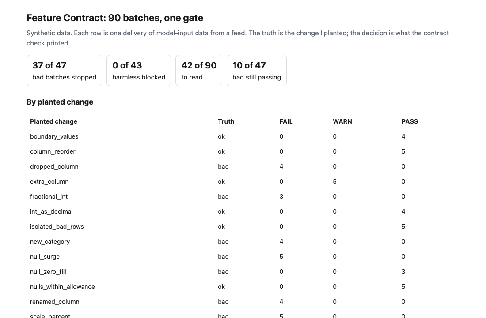
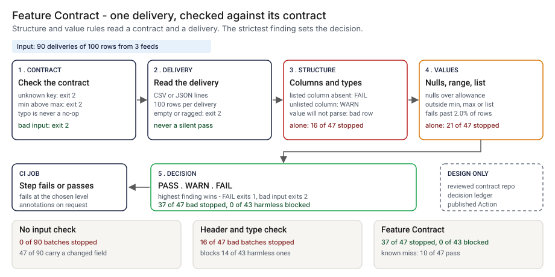
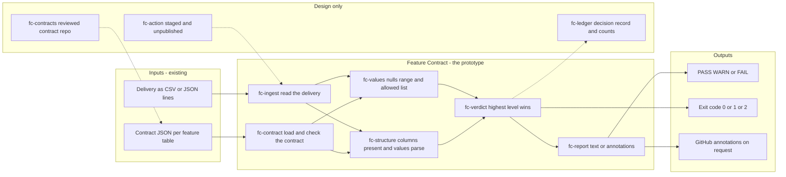
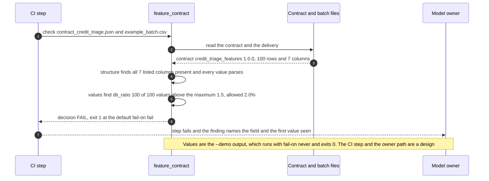

# 🧾 feature-contract (schema check): a data contract for model inputs

**I wanted to know how much of a changed model input a header and type check lets through, and what a contract with type, range and null checks stops before the model scores the batch. This is a command-line gate and a staged GitHub Action: you write a contract for a feature table, it checks each delivery of data against it and prints PASS, WARN or FAIL.** It follows the strict validator and the exit-code convention of [28 Tool Schema Drift](../28-tool-schema-drift/), moves the schema-gate idea of [15 SchemaWatch](../15-schemawatch-tool-schema-drift/) from tool inputs to model inputs, and leaves distribution monitoring to [02 DriftSentinel](../02-driftsentinel-model-drift-monitoring/).

**▶ Static demo, no install:** [open demo.html](./demo.html)

[](./demo.html)

## Executive summary (90 seconds)

**Problem.** An engineer owns a feature table that a credit, fraud or AML model reads, and another team owns the feed behind it. When the feed changes a field (a ratio sent as a percent, a null surge, a renamed column) the pipeline still runs and the model still scores, and the first sign is a score that moved. 🟢 In 90 synthetic deliveries of 100 rows from three feeds, a pipeline with no input check stops 0 of 90 batches, 47 of 90 carry a changed field, and 3,323 of the 4,700 rows in those 47 hold a changed value (`step_01_no_check.py`). The model scores all of them.

**Product.** Feature Contract is a command that reads a contract, one JSON file per feature table, and one delivery of data (CSV, or JSON lines with their JSON types), and prints PASS, WARN or FAIL. Per field the contract states a type, a range or an allowed list, and the share of nulls it allows. A column the contract lists and the batch lacks is a FAIL. A value that does not parse as the declared type, falls under `min`, rises over `max` or is not in `allowed` fails its field once more than `max_bad_rate` of the rows break it (2.0% in the bundled contracts), so one or two typo rows do not stop a delivery. A null share over `max_null_rate` is a FAIL. A column the contract does not list is a WARN by default. The highest level wins. The command exits 1 at the level you choose (FAIL by default) and 2 for malformed input. There is no model call; the rules are plain code you can read.

**Measured and modeled performance.**

- 🟢 **No check: 0 of 90 batches stopped.** 47 of 90 carry a changed field, and 3,323 of the 4,700 rows in those 47 hold a changed value (`step_01_no_check.py`).
- 🟢 **A header and type check stops 16 of 47 bad batches and blocks 14 of 43 harmless ones,** so 46.7% of its blocks are harmless (`step_02_header_and_type.py`).
- 🟢 **Each layer fails alone:** structure alone stops 16 of 47 and blocks 0 of 43; values alone with zero tolerance stop 22 of 47 and block 5 of 43; with a 2.0% tolerance they stop 21 of 47 and block 0 of 43 (`step_03_deficiencies_exposed.py`).
- 🟢 **Together: 37 of 47 bad batches stopped,** 0 of 43 harmless blocked and 5 of 43 warned; the decision is right on 80 of 90 (`step_04_with_contract.py`).
- 🟢 **Reading load: a person reads 42 of 90 batches** (37 failures and 5 warnings), where the step 2 check blocked 30 (`step_04_with_contract.py`).
- 🟢 **Known miss: 10 of 47 bad batches pass,** null_zero_fill 3, unit_cents 2 and unit_in_range 5. A change that stays inside the declared type, range and null rate is not seen (`step_03_deficiencies_exposed.py`, `step_04_with_contract.py`).
- 🟡 **Utility: (37/47 − 16/47) × 20 = 8.9 bad batches a year stopped that a header and type check would pass,** assuming 20 bad batches reach the gate each year.
- 🔴 **Design target: a decision within 120 seconds of a delivery landing,** before the scoring job starts. Designed in [`ARCHITECTURE.md`](./ARCHITECTURE.md), never built or timed.

**What I would ask a head of operations to decide.** Whether the scoring job behind a model should stop when a feed delivers a field outside the contract the model owner wrote. My recommendation is to adopt the contract on one feed, run it with `--fail-on never` against one real delivery first, set `max_bad_rate` against that feed's own rate of stray rows, and pair it with a distribution monitor for the changes a range cannot see.

**Call to action.** Fork the repo. Swap `data/contract_*.json` for the contract of one of your own feature tables, keeping the field keys (`name`, `type`, `min`, `max`, `allowed`, `max_null_rate`, `unit`) and the file keys (`max_bad_rate`, `unexpected_columns`), then point `check` at a sample export. To call it from code, import `check_batch` and `decide` from `src/feature_contract.py`. Keep each range as narrow as the field really is, since a range that can hold the wrong scale cannot see it. Send findings by opening an issue: say which finding kind fired and how many values, not the data itself.

_A portfolio prototype on synthetic data. Nothing here is deployed, load-tested or used by anyone, and the Action is staged and has not run on GitHub._

## Run one now

```bash
cd 53-feature-contract/src && python3 feature_contract.py --demo
```

It prints:

```text
contract: credit_triage_features 1.0.0   batch: 100 rows, 7 columns
  [FAIL] above_max         dti_ratio            100 of 100 values (100.0%) are above the maximum 1.5; first seen '64.51'; allowed 2.0%
decision: FAIL
```

The ratio of debt to income started arriving as a percent. The column name and the type did not change, so a header and type check passes it. Standard library only, Python 3.9 or newer. To check your own files: `python3 feature_contract.py check contract.json batch.csv`. It exits 1 on FAIL, so a CI step fails; `--format github` prints annotations; a `.jsonl` batch is checked with its JSON types.

## The contract

One JSON file per feature table. Per field: `type` (string, integer, number, boolean), `min` and `max` (inclusive), `allowed` values, `max_null_rate`, and a `unit` for the reader. Per file: `max_bad_rate`, the share of rows that may break a type, range or allowed-values rule before the field fails, and `unexpected_columns` (allow, warn or fail). Unknown keys are rejected, so a misspelt `maximum` cannot become a check that does nothing. See [`data/contract_credit_triage.json`](./data/contract_credit_triage.json).

## What the numbers say

**What it shows** (🟢 measured on synthetic data: 90 planted deliveries of 100 rows from three feeds; the script is named in brackets):

- 🟢 No input check: 0 of 90 batches stopped, 47 of 90 carry a changed field, and 3,323 of the 4,700 rows in those 47 hold a changed value (`step_01`)
- 🟢 A header and type check stops 16 of 47 bad batches and blocks 14 of 43 harmless ones, so 46.7% of its blocks are harmless (`step_02`)
- 🟢 The structure layer alone stops 16 of 47 and blocks 0 of 43. The value layer alone, with zero tolerance, stops 22 of 47 and blocks 5 of 43; with a 2.0% tolerance it stops 21 of 47 and blocks 0 of 43 (`step_03`)
- 🟢 Structure and values together: 37 of 47 bad batches stopped, 0 of 43 harmless blocked, 5 of 43 warned. A person reads 42 of 90 batches (37 failures and 5 warnings); the step 2 check blocked 30 (`step_04`)

## What it still gets wrong

- 🟢 Ten of the 47 bad batches pass (`step_04` prints each one): null_zero_fill 3, unit_in_range 5 and unit_cents 2. A zero-fill replaces missing values with 0, which is inside every range, so an outage turns into a valid-looking value. Days become weeks and months become years under the same column name, and the new numbers still sit inside the declared range. This is the known limit: a change that stays inside the declared type, range and null rate is not seen.
- 🟢 The two unit_cents misses are both on `txn_total_30d_usd`, whose declared maximum (10,000,000) is wide enough to hold the values multiplied by 100. A range that can hold the wrong scale cannot see it. Zero tolerance stops one more batch (22 against 21 in `step_03`), a cents change in which a single value left the range, and costs the 5 harmless batches with isolated bad rows.
- **The test set and the checker share an author.** I planted the changes and wrote the contracts, and I chose the hard cases on purpose, so 37 of 47 shows the rules cover what I planted. Treat it as a ceiling for these rules, not a rate on real feeds, which I have not tested.
- 🟡 The 2.0% tolerance for isolated bad rows and the 5.0% null allowance on four fields are my assumptions, not taken from any rule. The five harmless batches with one or two bad rows are harmless only under that tolerance; a stricter team would label them differently.
- 🔴 That a real feed changes in these ways, at these shares, is hypothetical. The eleven kinds of change are ones I think a feed can make; I have no log of real ones.
- No distribution check: a shift inside the range is the job of a monitor such as [02](../02-driftsentinel-model-drift-monitoring/), and I make no claim about how many of the ten it would catch.
- A null is an empty cell or a JSON null. "NA" or "null" in a numeric column is reported as a type mismatch. There is no row-count check, so a clean delivery of one row passes. Not supported: dates, patterns, cross-field rules, uniqueness, freshness.
- The contract is written by hand. There is no command that drafts one from a reference batch.

## Use it in CI

[`action/`](./action/README.md) holds a staged GitHub Action and the steps to publish it from its own repository, which a Marketplace listing requires. It has not been published and has not run on GitHub. What is tested is the command it wraps (`tests/test_cli.py`; 74 tests in all).

## How the four steps fit

| Step | Question | Script |
|---|---|---|
| 1 | What reaches the model when nothing checks the data? | `step_01_no_check.py` |
| 2 | What does a header and type check stop, and what does it block for no reason? | `step_02_header_and_type.py` |
| 3 | Where does each part of the contract fail alone? | `step_03_deficiencies_exposed.py` |
| 4 | What do structure and values catch together? | `step_04_with_contract.py` |

Run any of them from `src/`. Data is generated by [`data/_generate.py`](./data/README.md); the check in `tools/check_repo.py` confirms that a rerun reproduces every file and that the green numbers above appear in a script's output.

## Utility delivered

The way I price product impact: **utility = (my solution − current state of the art) × the number of people or items it affects.**

Here the item is a bad batch, a delivery with a changed field that the model should not see. Each one lands on the engineer who owns the feature table, the owner of the model, and whoever reads the scores downstream. The common basic approach is a header and type check; the table prices the contract against it.

| Term | Value | Where it comes from |
| --- | --- | --- |
| Current state of the art (header and type check), bad batches stopped | 🟢 **16 of 47** | `step_02_header_and_type.py`; it also blocks 14 of 43 harmless batches |
| My solution (Feature Contract), bad batches stopped | 🟢 **37 of 47** | `step_04_with_contract.py`; 0 of 43 harmless blocked, 5 of 43 warned |
| Lift per bad batch | 🟢 37 of 47 minus 16 of 47 | The header check lets these through, by planted change: new_category 4, null_surge 5, scale_percent 5, sentinel_values 5, unit_cents 2 (`step_02_header_and_type.py`, `step_04_with_contract.py`) |
| Number it affects: bad batches reaching the gate in a year | 🟡 **20** | **Assumption, not a statistic.** Replace it with your own count of deliveries in a year that carried a changed field |
| Assumption that makes the lift real | 🟡 The scoring job is held on a FAIL, and each range is narrower than the scale of any change the feed can make | A range wide enough to hold the changed scale cannot see it: 🟢 2 of the 4 unit_cents batches pass on `txn_total_30d_usd` (`data/README.md`, `step_04_with_contract.py`) |
| **Utility** | 🟡 **(37/47 − 16/47) × 20 = 8.9 bad batches a year stopped that a header and type check would pass** | Assumes the 20 behave like the 47 planted ones |

Sensitivity to the count assumption (🟡, same lift): 10 bad batches a year gives 4.5, 20 gives 8.9, 40 gives 17.9.

🔴 What I have not measured: what a stopped batch is worth in time or money, how long a FAIL takes to read and clear, what a false FAIL costs a delivery, or how often a real feed changes. The planted set is dense on purpose, 47 of 90 are bad (`step_01_no_check.py`); a real feed sees far fewer. Treat the result as a property of this mix of cases, not a forecast.

---

## Architecture and call flow

Component names match [`ARCHITECTURE.md`](./ARCHITECTURE.md). GitHub renders the diagrams natively.



**System topology:**



**Per-run sequence** (the `--demo` batch, a ratio that arrived as a percent):



**Interlocks (all red, designed, none built):**

- [28 Tool Schema Drift](../28-tool-schema-drift/) is where this folder took the strict validator and the exit-code convention. It follows them; it does not import or read that project's files.
- [15 SchemaWatch](../15-schemawatch-tool-schema-drift/) gates the inputs of a tool an agent calls; this gates the inputs of a model. A value that crosses both would be checked at two places, with no shared record yet.
- [02 DriftSentinel](../02-driftsentinel-model-drift-monitoring/) would watch the distribution inside the declared range, which is where the 10 of 47 misses live. I make no claim about how many it would catch.
- [09 LineageLog](../09-lineagelog-ai-decision-audit/) is a possible home for the decision record (`fc-ledger`).

---

## PM artifacts

The PM artifacts that show how I would run this product if I owned the seat. This README is the walkthrough; the rest of the folder holds:

- [`PRD.md`](./PRD.md): the product requirements doc, with users, backlog, KPIs, rollout and open questions.
- [`ARCHITECTURE.md`](./ARCHITECTURE.md): the systems doc, with components, data model, security, failure behavior and operations. A design, not deployed.
- [`demo.html`](./demo.html): clickable, no-install walkthrough, built from the step outputs by `src/_build_demo.py`.
- [`data/`](./data/): the three synthetic contracts, the 90 deliveries and their planted truth, the worked example behind `--demo`, and the seeded generator. `data/README.md` explains how the truth is set.
- [`src/`](./src/): `feature_contract.py`, `common.py`, the four step scripts and the demo builder.
- [`tests/`](./tests/): 74 unittest tests, including a golden test that pins the numbers above and tests for bad input and hostile strings.
- [`action/`](./action/README.md): the staged GitHub Action and the steps to publish it. Not published, not run on GitHub.

Run the four steps end to end:

```bash
cd src
python3 step_01_no_check.py
python3 step_02_header_and_type.py
python3 step_03_deficiencies_exposed.py
python3 step_04_with_contract.py
```

---

## Aligned to

Nothing. I claim no alignment to a standard or a regulation, and I did not read a source to cite. A data contract is a working pattern, and this is a prototype.

## Data and limits

Synthetic, seeded, byte-for-byte reproducible. Nothing comes from any employer, customer or real bank. The generator keeps the process that draws the values apart from the contracts that check them, and the truth label of each batch is the change that was planted. A prototype on synthetic data, not a production case study.

## Fork it

Swap `data/contract_*.json` for the contract of one of your own feature tables and point `check` at a sample export, or skip the data and check a file from your pipeline. Read the [PRD](./PRD.md) for the scope I held to.

## Prereqs to run this on your laptop

You need Python 3.9 or newer and nothing else. The checker, the four step scripts and the data generator use only the standard library, so there is nothing to install. There is no API key, no network call and no model call anywhere in the folder. To run the tests, use `python3 -m unittest discover -s tests` from this folder. The production pieces in [`ARCHITECTURE.md`](./ARCHITECTURE.md) (a reviewed contract repo, a decision ledger with counts, a published Action) are a design, not something you need or can run.

## Author

**Vijay Saharan**, Sr Product / Program Manager · AI in BFSI · Enterprise AI Platforms

[LinkedIn](https://www.linkedin.com/in/vijaysaharan/)
