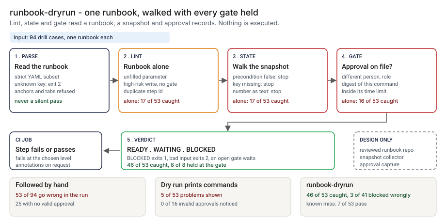

# Architecture: runbook-dryrun

> **Status.** This is the design for a production shape. The repo implements the product mechanic as a prototype: a command, `src/runbook_dryrun.py`, that reads a runbook in a YAML subset, lints it, walks it against a state snapshot and holds at each approval gate, run here over 94 synthetic drill cases. It executes nothing. Nothing below is claimed as deployed or load-tested. Where a figure is a design target, it says so.

GCP is primary; AWS and Azure sit beside it.



---

## 1. Logical architecture

runbook-dryrun is a function between a runbook and the person about to follow it: a runbook, a snapshot, approval records and a requester in, a verdict out. It runs no command, calls no model and changes no state.

Eight components: six decide the outcome, two support or report.

| Component | Responsibility | Language or framework | Decides the outcome? | Stateful? |
| --- | --- | --- | --- | --- |
| `rd-catalog` | The reviewed runbooks, one file each. Changes by review only. | A repo of YAML files (design). Prototype: `data/example_runbook.yml` | Yes, config | Stateful, in git |
| `rd-parse` | Reads the YAML subset; refuses anchors, tags, tabs, oversize files and unknown keys, with a line number. | Python 3.9+, standard library. Prototype: `parse_yaml`, `load_runbook` | Yes, by refusing: exit 2 | No |
| `rd-lint` | Defects in the runbook alone: duplicate id, undefined parameter, undeclared state key, ungated high-risk write; a missing rollback warns. | Python. Prototype: `lint` | Yes | No |
| `rd-state` | Renders each command, checks `requires` on a snapshot copy, applies the declared `sets`, stops at the first failure. | Python. Prototype: `dry_run`, `render`, `_compare` | Yes | No |
| `rd-gate` | Holds at a gate until a record is from another person, in the role, for the digest, inside the limit. | Python. Prototype: `digest`, `_gate`, `_reject_reason` | Yes | No |
| `rd-verdict` | BLOCKED on an error, WAITING on an open gate, else READY; maps to an exit code. | Python. Prototype: the end of `dry_run`, `DECISION_RANK`, `run_dryrun` | Yes | No |
| `rd-report` | Prints the plan and findings, and escapes untrusted strings. | Python. Prototype: `render_text`, `render_github`, `safe`, `escape_annotation` | No | No |
| `rd-ledger` | One record per dry run, off the decision path (design). Prototype analog: `src/out/step_04_cases.csv`. | PostgreSQL plus object storage with a retention lock (design) | No | Stateful |

Two input systems sit outside the tool, a read-only snapshot collector and the approval capture; the prototype reads their output as JSON files.

**What decides the outcome.** The catalog, the parser, lint, the state walk, the gate and the verdict. The report and the ledger carry or record it. The tool trusts the `effect`, `risk` and `sets` a step declares and the snapshot it is given.

**Repo structure** (production shape):

```
runbook-dryrun/
├── dryrun/     # parse, lint, state, gate, verdict, report
├── catalog/    # one runbook per file, changed by pull request
├── collector/  # read-only snapshot collector
├── ledger/     # dry-run record writer
├── infra/      # terraform for gcp, aws, azure
└── tests/      # unit, golden, hostile
```

---

## 2. Physical and deployment architecture

The tool is one short-lived task, started by the incident tool or a CI job. No server stays warm.

| Component | GCP (primary) | AWS | Azure | Why |
| --- | --- | --- | --- | --- |
| Dry-run process (parse, lint, state, gate, verdict, report) | Cloud Run job | ECS Fargate task | Container Apps job | Stateless, one pass, no credentials |
| `rd-catalog` | A reviewed repo | Same | Same | A gate change lands in the same history as the runbook |
| Snapshot collector (design) | Cloud Run job with a read-only role | Fargate task with a read-only role | Container Apps job with a read-only role | The tool reads what the collector wrote |
| `rd-ledger` and counts | Cloud SQL for PostgreSQL; OTel to Cloud Monitoring | RDS for PostgreSQL; CloudWatch | Azure Database for PostgreSQL; Azure Monitor | The platform team already runs them; off the decision path |

**Failure behavior (the decision that matters most).** The tool must never silently pass. A missing, empty, truncated or mistyped input does not become READY and is not skipped: it ends the run with exit 2 and a one-line reason, even with `--fail-on never`. A gate with no record is WAITING, not READY.

| Failure | Behavior | Alert |
| --- | --- | --- |
| Runbook missing, empty, truncated, binary, oversize or outside the YAML subset; an unknown key | Exit 2, one line on stderr | P2 if repeated on one runbook, else P3 |
| Snapshot or approvals file of the wrong type or truncated; `--requester` empty | Exit 2 with the reason | P3 |
| The snapshot lacks a key a step requires | Finding `state_unknown`: BLOCKED, later steps marked not reached | P3 |
| The snapshot holds a number as text | Finding `state_type_mismatch`: BLOCKED; the tool does not guess | P3 |
| No step has a `requires` condition, or an approval names a step with no gate | A note that the snapshot was not read, or warning `approval_unmatched` | P4 |
| Ledger unavailable (design) | The verdict and exit code stand; the record queues locally and the gap is listed | P3 |

**Latency.** The prototype is one pass over a small runbook; I have not timed it. 🔴 Design target: a verdict within 30 seconds of the request, on a snapshot read no more than 5 minutes earlier. Recovery is a re-run from the same inputs.

---

## 3. Data architecture

| Entity | Key | What it holds | Real columns or keys in the prototype |
| --- | --- | --- | --- |
| Runbook | `runbook` id | Title, `reads`, `params` and steps | `data/example_runbook.yml`; per step `id`, `effect`, `risk`, `run`, `requires`, `sets`, `approval` (`role`, `ttl_minutes`), `rollback`, `note` |
| Snapshot | state key | The values of the keys a runbook reads | `data/example_world.json`: for example `change.freeze`, `model.error_rate_pct` |
| Approval record | `step`, `approver` | Who approved which digest, in which role, how many minutes ago | `data/example_approvals.json`: `step`, `approver`, `role`, `digest`, `age_minutes` |
| Dry-run record, with its findings (`kind`, `severity`, `step`, `reason` from `lint` and `dry_run`) | `record_id` | Design: runbook id and version, requester, snapshot hash, approvals hash, verdict, findings, tool version, time | Prototype: `src/out/step_04_cases.csv`: `case_id`, `kind`, `group`, `truth`, `verdict`, `first_error`, `warnings` |
| Drill case | `case_id` | A runbook, snapshot, requester and approvals | `data/cases.csv`: `case_id`, `requester`, `params_json`, `world_json`, `approvals_json`, `runbook_yaml`; labels in `data/truth.csv`. Synthetic data only |

The digest is the first 12 hex characters of the SHA-256 of the runbook id, step id and rendered command; the design uses the full hash.

**Retention** is a design choice, not a measurement; confirm it against the bank's own schedule. 🔴 Design default: dry-run records 7 years, archived with a retention lock, with the runbook version, snapshot and approvals they read.

**Lineage.** A verdict traces back in three hops: the record names the runbook version, snapshot hash and approval hash; the stores return those bytes; and the rules are deterministic, so re-running `dry_run` reproduces the findings. In the prototype the trace is a row of `step_04_cases.csv`.

**Deliberately not stored.** The output of any command, since none is run, and the content of the incident.

---

## 4. Security architecture

**Identity and roles.** The tool runs under the incident tool's workload identity and has no user account of its own. Four roles: `rd:runner` (reads inputs, writes a record), `rd:approver` (reviews a runbook or gate change, never their own), `rd:auditor` (reads records and history) and `rd:admin` (platform lead).

**Secrets.** None, and no model call. The tool only renders command text and never runs it. The collector holds a read-only role, outside this tool.

**Data classification and boundary.** Runbook text is internal; a snapshot could carry customer-adjacent counts, so I would classify it as confidential. In the prototype nothing leaves the machine. In the design three things leave the job: the exit code, the annotations and the ledger write.

| Threat | Example | Mitigation in the design |
| --- | --- | --- |
| Hostile string in a parameter, requester or approver echoed into output or an annotation | A parameter holding a newline and text that looks like a workflow command | `safe` escapes control characters; `escape_annotation` rewrites `%`, carriage return and newline. `tests/test_cli.py` covers a newline in a parameter and a hostile requester |
| An approval carried over to a changed command | Approval for scorer-v8 reused for scorer-v7 | The digest binds the runbook id, step id and rendered command; a parameter override changes it (`tests/test_cli.py`) |
| A role string is forged | A record naming a role the approver does not hold | The prototype takes roles as written. The design resolves the role in a directory when the capture writes the record |
| The snapshot or an approval age is edited | `age_minutes` lowered by hand | The prototype trusts the file. The design takes a signed timestamp from the capture and computes the age, and stores hashes |

---

## 5. Operational architecture

**SLIs.** Dry runs per verdict per runbook per week (prototype baseline on clean or waiting synthetic cases: 🟢 3 of 41 blocked wrongly, `step_04_with_dryrun.py`); input rejections; findings by kind; gates open and their age; snapshot age at the run (design); BLOCKED verdicts overturned after review; time to verdict.

**SLOs (all 🔴 design targets, none measured).**
- Verdict within 30 seconds of the request, on a snapshot no more than 5 minutes old.
- Every high-risk write in an in-scope runbook preceded by a dry run.
- Every BLOCKED on a production runbook read by a named person within one business day (planning estimate).

**Alerts.** P2: repeated input rejections on one runbook, or the ledger down for more than a day. P3: a BLOCKED on a production runbook, also sent to the runbook owner. P4: a daily digest of warnings and open gates.

**Runbooks** (one page each, in `docs/runbooks/`):
- `blocked-verdict.md`: read the finding, fix the runbook or the state, re-run.
- `gate-waiting.md`: who may approve, which digest to show them, the time limit.
- `changing-a-gate.md`: pull request, second approver, golden numbers re-run.
- `snapshot-stale.md`: re-collect and re-run; never approve on an old verdict.

**On-call and ownership.** The runbook owner owns the file and gates; the platform lead owns the collector; the second-line reviewer approves gate and policy changes.

**Change control.** Runbooks, gates and policy values are versioned; a change needs a proposer and a different approver. Before merge the planted set is re-run against `tests/test_golden.py`, so a change that moves the caught count shows in the diff.

---

## 6. Alignment and posture

Alignment, not certification. The README's "Aligned to" section cites nothing: I am not claiming alignment with a standard or a regulation, and I cite none. Approval gates and rollbacks are ordinary practice and the policy values are mine.

- **What the design does.** It holds a high-risk write until an approval is on file for the exact command, from another person in the role, and records the verdict with the runbook version.
- **What it does not claim.** It makes no claim of conformity to any standard, rule or guidance, holds no certification, and I have not read or mapped any source.

---

## 7. What is deliberately not here

- **A step that lies about its effect.** 🟢 Four of the 7 misses are a production change declared `effect: read, risk: low` (`step_04_with_dryrun.py`). The tool does not read a command to see what it does.
- **A snapshot that moved.** 🟢 Three of the 7 misses are world_drift (`step_04_with_dryrun.py`). A dry run proves the runbook, not production.
- **A smarter type check.** 🟢 3 of 41 clean or waiting cases are blocked because a number is held as text; the tool refuses to guess.
- **Proof an approver read the command.** Role names are taken as written, with no directory lookup.
- **Branches, loops and parallel steps.** Runbooks are linear, and the YAML is a subset.
- **Running anything.** No executor, no hosting, no model call.
- **Policy values tuned on real runbooks.** The 30-minute limit and the gate and rollback rules are my assumptions.

---

## Appendix: sample contract

The shapes are the prototype's own (`data/example_runbook.yml`, `example_world.json`, `example_approvals.json`). The `--demo` output is under "Run one now" in the README.

```bash
python3 runbook_dryrun.py dryrun RUNBOOK.yml --world WORLD.json --requester dana --approvals APPROVALS.json --fail-on blocked
```

An approval record: `{"step": "s3", "approver": "marta", "role": "incident-commander", "digest": "38130d770ffd", "age_minutes": 12}`. Exit status: 0 below `--fail-on`, 1 at or above it, 2 for bad input.
