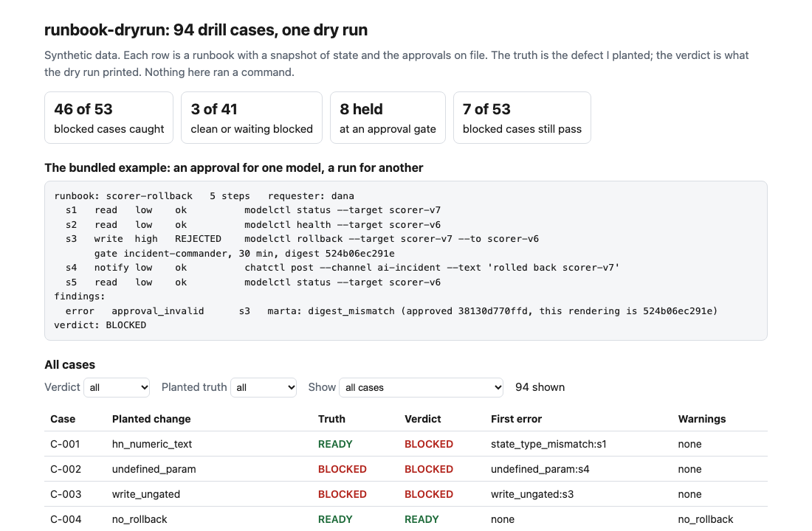
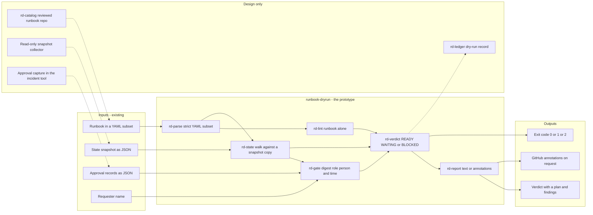
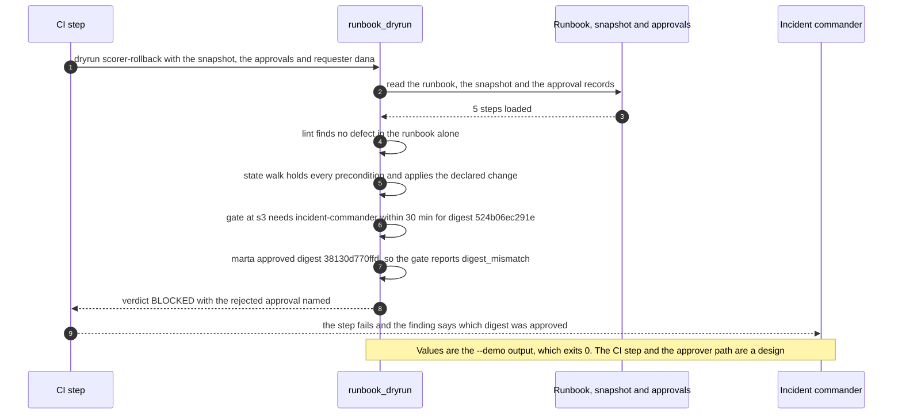

# 📋 runbook-dryrun: an incident runbook you can dry-run, with the approval gate held

**I wanted to know how much of an incident runbook can be checked before anyone is paged, and what a dry run has to hold to be worth reading. This is a command-line tool. It reads a runbook written in a small YAML subset, walks it against a snapshot of system state without running anything, and holds at every approval gate until a record is on file that was given by a different person, in the right role, for the exact command that is about to run, inside its time limit. It prints READY, WAITING or BLOCKED.** It builds on the approval-digest idea from [27 AgentKit](../27-agentkit-reference-agent-and-playbook/) and on the incident framing of [19 IncidentLedger](../19-incidentledger-ai-incident-response/): 19 starts the clock, this is about what the person does next.

**▶ Static demo, no install:** [open demo.html](./demo.html)

[](./demo.html)

## Executive summary (90 seconds)

**Problem.** The owner of an AI-operations runbook (a model rollback, a fallback route, a tool switch-off) writes it as a page, and its first real test is the incident. The person on call finds an unfilled parameter, a precondition that is not true, or an approval that covers a different target while the system is already degraded. 🟢 On 94 synthetic drill cases, 53 of 94 go wrong only while someone follows the runbook; in 25 of them a high-risk change goes ahead with no valid approval, and 12 of the 53 stop or send a bad command after a write step has already gone through (`step_01_prose_runbook.py`). A dry run that prints the commands does not help with any of those.

**Product.** runbook-dryrun is a command that reads a runbook in a small YAML subset and walks it without running anything. It applies three checks in order. Lint reads the runbook alone: a duplicate step id, a `{{name}}` that `params` does not define, a precondition on a state key nobody declares, and a high-risk write with no approval gate are errors; a medium or high write with no rollback is a warning. The state walk renders each command against a copy of the snapshot, applies the `sets` each step declares, and stops at the first precondition that fails, a key the snapshot lacks or a value of the wrong type. The gate holds at each approval step until a record exists from a different person than the requester, in the gate's role, for the digest of the exact rendered command, inside its time limit (30 minutes unless the gate says otherwise). The verdict is BLOCKED on any error, WAITING when a gate has no record yet, otherwise READY. `dryrun` exits 1 at the level you choose (BLOCKED by default) and 2 for input it cannot read. Nothing is ever executed and there is no model call; the rules are plain code you can read.

**Measured and modeled performance.**

- 🟢 **Nothing checked first: 53 of 94 cases go wrong in the run.** 25 send a high-risk change ahead with no valid approval, and 12 of the 53 stop or garble after a write has gone through (`step_01_prose_runbook.py`).
- 🟢 **A dry run that prints every command shows 5 of those 53 problems,** calls 48 of 53 fine, and notices 0 of 16 invalid approvals (`step_02_echo_dry_run.py`).
- 🟢 **Each part fails alone:** lint catches 17 of 53 and blocks 0 of 41 clean or waiting cases; the state check catches 17 of 53 and blocks 3 of 41 wrongly; the gate catches 16 of 53 (`step_03_deficiencies_exposed.py`).
- 🟢 **Together: 46 of 53 blocked cases caught,** 8 of 8 waiting cases held at the gate, the missing rollback warned in 4 of 4, 14 of 17 hard negatives pass; the verdict matches the planted truth in 84 of 94 (`step_04_with_dryrun.py`).
- 🟢 **Known miss: 7 of 53 pass as READY.** mislabeled_effect 4 and world_drift 3; the tool trusts what a step says about itself and what the snapshot says about the world (`step_03_deficiencies_exposed.py`, `step_04_with_dryrun.py`).
- 🟢 **False alarm: 3 of 41 clean or waiting cases are blocked,** a snapshot that holds a number as text (`step_04_with_dryrun.py`).
- 🟡 **Utility: (46/53 − 5/53) × 12 = 9.3 defective runbook runs a year caught before anyone follows them that a printed dry run would miss,** assuming 12 such runs reach the tool each year.
- 🔴 **Design target: a verdict within 30 seconds of the request, on a snapshot read no more than 5 minutes earlier.** Designed in [`ARCHITECTURE.md`](./ARCHITECTURE.md), never built or timed.

**What I would ask a head of operations to decide.** Whether a high-risk write in a runbook should wait for an approval bound to the exact command, from a different person in the stated role, inside a time limit. The 30-minute limit and the rule that a high-risk write needs a gate are my policy values, not measurements. My recommendation is to adopt the digest-bound approval for high-risk writes, run the dry run in advisory mode (`--fail-on never`) on one real runbook first, and decide separately who vouches for the effect and risk a step declares, since 4 of the 7 misses are a step that changes production but is labeled a read.

**Call to action.** Fork the repo. Swap `data/example_runbook.yml`, `data/example_world.json` and `data/example_approvals.json` for your own runbook, a snapshot of the state keys it reads and the approvals on file, keeping the runbook keys (`runbook`, `title`, `reads`, `params`, `steps`), then run `check` and `dryrun` as shown below. To call it from code, import `load_runbook` and `dry_run` from `src/runbook_dryrun.py`. Have your approval tool record the digest the dry run prints for each gate, so an approver signs what will run. Send findings by opening an issue: say which finding kind fired and at which step, not the runbook itself.

_A portfolio prototype on synthetic data. Nothing here is deployed, load-tested or used by anyone._

## Run one now

```bash
cd 54-runbook-dryrun/src && python3 runbook_dryrun.py --demo
```

It prints:

```text
runbook: scorer-rollback   5 steps   requester: dana
  s1   read   low    ok          modelctl status --target scorer-v7
  s2   read   low    ok          modelctl health --target scorer-v6
  s3   write  high   REJECTED    modelctl rollback --target scorer-v7 --to scorer-v6
       gate incident-commander, 30 min, digest 524b06ec291e
  s4   notify low    ok          chatctl post --channel ai-incident --text 'rolled back scorer-v7'
  s5   read   low    ok          modelctl status --target scorer-v6
findings:
  error   approval_invalid      s3   marta: digest_mismatch (approved 38130d770ffd, this rendering is 524b06ec291e)
verdict: BLOCKED
```

Marta approved a rollback of scorer-v8. The run is for scorer-v7. The approval is bound to the rendered command, so it does not carry over.

Standard library only, Python 3.9 or newer. To check your own files:

```bash
python3 runbook_dryrun.py check RUNBOOK.yml
python3 runbook_dryrun.py dryrun RUNBOOK.yml --world WORLD.json --requester NAME [--approvals APPROVALS.json] [--param name=value]
```

`check` needs no snapshot. `dryrun` exits 1 on BLOCKED, 2 on input it cannot read, and 0 otherwise; `--fail-on waiting` also fails on a held gate, and `--format github` prints annotations. Nothing is ever executed. Without `--approvals` the demo runbook ends `verdict: WAITING at s3`.

## What the numbers say

**What it shows** (🟢 measured on synthetic data: 94 drill cases, each a runbook with a state snapshot, a requester and the approvals on file; the script is named in brackets):

- 🟢 With nothing checked first, 53 of 94 cases go wrong only while someone follows the runbook; in 25 of them a high-risk change goes ahead with no valid approval, and 12 of the 53 stop or send a bad command after a write step has already gone through (`step_01`)
- 🟢 A dry run that prints every command shows 5 of those 53 problems (an unfilled placeholder), calls 48 of 53 fine, and notices 0 of 16 invalid approvals (`step_02`)
- 🟢 Each part alone: lint catches 17 of 53, the state check catches 17 of 53 and blocks 3 of 41 clean or waiting cases wrongly, the approval gate catches 16 of 53 (`step_03`)
- 🟢 Together: 46 of 53 blocked cases caught, 8 of 8 waiting cases held at the gate, the missing rollback warned in 4 of 4, 14 of 17 hard negatives pass, and the verdict matches the planted truth in 84 of 94 (`step_04`)

**Modeled** (🟡 these are my policy values, not a rule from anywhere): a high-risk write needs an approval gate; a medium or high-risk write should name a rollback or say `rollback: none`; an approval lasts 30 minutes unless the gate sets another limit. Change them in `runbook_dryrun.py` and the numbers move.

**Hypothetical** (🔴 never tested): that a team which dry-runs its runbooks loses less time in a real incident. I measured defects found before the run, not minutes saved.

## What it still gets wrong

- 🟢 7 of the 53 blocked cases pass as READY (`step_04` prints each one). Four are a step that changes production but is declared `effect: read, risk: low`, so nothing gates it (mislabeled_effect). Three are a snapshot that went stale between the dry run and the real one (world_drift). The tool trusts what the runbook says about itself and what the snapshot says about the world. It does not read a command to see what it does.
- 🟢 3 of 41 clean or waiting cases are blocked. The snapshot holds a number as text ("12" against `>= 5`), and the tool refuses to guess and says so. That is a false alarm by design: a stricter tool, not a smarter one.
- **The test set and the rules share an author.** I planted the defects and wrote the checks, so 46 of 53 shows the checks cover what I planted. I added hard negatives that could trip a rule (a placeholder in a note, a low-risk write with no gate, a second valid approval beside the requester's own, an approval exactly at its time limit) and the two kinds a dry run cannot see. Treat the numbers as a ceiling for these rules, not a rate on real runbooks, which I have not tested.
- The `sets` a step declares are the author's claim, and the tool applies them as written.
- An approval is bound to the rendered text of one command. It does not prove the approver read it, and role names are taken as written, with no directory lookup.
- Runbooks are linear: no branches, loops or parallel steps. The YAML is a subset (`data/README.md` lists it); a value that contains `: ` must be quoted.

## How the four steps fit

| Step | Question | Script |
|---|---|---|
| 1 | What does the on-call person meet when nothing is checked first? | `step_01_prose_runbook.py` |
| 2 | What does a dry run that prints every command show? | `step_02_echo_dry_run.py` |
| 3 | Where does each part of the tool fail alone? | `step_03_deficiencies_exposed.py` |
| 4 | What do lint, state and the approval gate catch together? | `step_04_with_dryrun.py` |

Run any of them from `src/`. Data is produced by [`data/_generate.py`](./data/README.md); `tools/check_repo.py` confirms that a rerun reproduces every file and that the green numbers above appear in a script's output. `demo.html` is built by `src/_build_demo.py` from the files step 4 writes to `src/out/`.

## Utility delivered

The way I price product impact: **utility = (my solution − current state of the art) × the number of people or items it affects.**

Here the item is a runbook run that would go wrong, a defect the person on call would otherwise meet during the incident. Each one lands on the person following the runbook, the incident commander asked to approve a step, and the owner of the system being changed. The common basic approach is a dry run that prints every command; the table prices the tool against it.

| Term | Value | Where it comes from |
| --- | --- | --- |
| Current state of the art (printed dry run), problems shown | 🟢 **5 of 53** | `step_02_echo_dry_run.py`; the 5 are an unfilled `{{name}}`, and it notices 0 of 16 invalid approvals |
| My solution (runbook-dryrun), blocked cases caught | 🟢 **46 of 53** | `step_04_with_dryrun.py`; 8 of 8 waiting cases held at the gate, 3 of 41 clean or waiting cases blocked wrongly |
| Lift per defective run | 🟢 46 of 53 minus 5 of 53 | What the printed plan cannot see, by planted change: digest_mismatch 4, self_approval 4, stale_approval 4, wrong_role 4, precondition_false 6, self_blocking 4, missing_state_key 3, undeclared_state_key 4, duplicate_id 3, write_ungated 5 (`step_03_deficiencies_exposed.py`, `step_04_with_dryrun.py`) |
| Number it affects: defective runbook runs reaching the tool in a year | 🟡 **12** | **Assumption, not a statistic.** Replace it with your own count of runbook runs in a year that met a defect |
| Assumption that makes the lift real | 🟡 The runbook tells the truth about each step's effect and risk, and the snapshot is current when the run starts | A step that lies about its effect, or a snapshot that moved, passes: 🟢 7 of 53 (`step_04_with_dryrun.py`) |
| **Utility** | 🟡 **(46/53 − 5/53) × 12 = 9.3 defective runs a year caught before anyone follows them that a printed dry run would miss** | Assumes the 12 behave like the 53 planted ones |

Sensitivity to the count assumption (🟡, same lift): 6 runs a year gives 4.6, 12 gives 9.3, 24 gives 18.6.

🔴 What I have not measured: minutes saved in a real incident, how long a BLOCKED verdict takes to read and clear, what a false block costs when the system is already degraded, or how often a real runbook carries these defects. The planted set is dense on purpose, 53 of 94 go wrong (`step_01_prose_runbook.py`); real runbooks hold far fewer. Treat the result as a property of this mix of cases, not a forecast.

---

## Architecture and call flow

Component names match [`ARCHITECTURE.md`](./ARCHITECTURE.md). GitHub renders the diagrams natively.


**System topology:**



**Per-run sequence** (the `--demo` run, an approval for scorer-v8 meeting a run for scorer-v7):



**Interlocks (all red, designed, none built):**

- [19 IncidentLedger](../19-incidentledger-ai-incident-response/) starts the clock on an incident. An incident record would hand the runbook id and the requester to a dry run; this folder reads neither project's files.
- [27 AgentKit](../27-agentkit-reference-agent-and-playbook/) is where the approval-digest idea came from. The digest, role and distinct-person checks are re-implemented here, and nothing is imported across folders.
- [25 KillSwitch](../25-killswitch-ai-fallback-drills/) drills a fallback. A fallback runbook would be dry-run before a drill; the two are not wired.
- [09 LineageLog](../09-lineagelog-ai-decision-audit/) is a possible home for the dry-run record (`rd-ledger`).

---

## PM artifacts

The PM artifacts that show how I would run this product if I owned the seat. This README is the walkthrough; the rest of the folder holds:

- [`PRD.md`](./PRD.md): the product requirements doc, with users, backlog, KPIs, rollout and open questions.
- [`ARCHITECTURE.md`](./ARCHITECTURE.md): the systems doc, with components, data model, security, failure behavior and operations. A design, not deployed.
- [`demo.html`](./demo.html): clickable, no-install walkthrough, built from the step outputs by `src/_build_demo.py`.
- [`data/`](./data/): the 94 synthetic drill cases (a runbook, a snapshot, a requester and approvals each), their planted truth, the worked example behind `--demo`, and the seeded generator. `data/README.md` explains the YAML subset, the approval digest and how the truth is set.
- [`src/`](./src/): `runbook_dryrun.py`, `common.py`, the four step scripts and the demo builder.
- [`tests/`](./tests/): 73 unittest tests, including a golden test that pins the numbers above and tests for bad input and hostile strings.

Run the four steps end to end:

```bash
cd src
python3 step_01_prose_runbook.py
python3 step_02_echo_dry_run.py
python3 step_03_deficiencies_exposed.py
python3 step_04_with_dryrun.py
```

---

## Aligned to

Nothing. I am not claiming alignment with a standard or a regulation for this project, and I cite none. Approval gates and rollbacks are ordinary practice and the policy values above are mine. It is a prototype on synthetic data and makes no claim of conformity to anything.

## Data and limits

Synthetic, seeded, byte-for-byte reproducible. The command names (`routectl`, `modelctl` and the rest) belong to no real product, and nothing comes from any employer, customer or bank. A prototype on synthetic data, not a production case study. The approval digest, the role check and the distinct-person check are re-implemented here from the gates in project 27 (there the second person is the one who judged the case; here it is the requester); nothing is imported across folders.

## Fork it

Swap `data/cases.csv` for your own runbooks, snapshots and approvals and keep the columns, or skip the data and point `check` and `dryrun` at your own files. Read the [PRD](./PRD.md) for the scope I held to.

## Prereqs to run this on your laptop

You need Python 3.9 or newer and nothing else. The tool, the four step scripts and the data generator use only the standard library, so there is nothing to install. There is no API key, no network call and no model call anywhere in the folder, and the tool never runs a command from a runbook. To run the tests, use `python3 -m unittest discover -s tests` from this folder. The production pieces in [`ARCHITECTURE.md`](./ARCHITECTURE.md) (a reviewed runbook repo, a snapshot collector, approval capture, a dry-run record) are a design, not something you need or can run.

## Author

**Vijay Saharan**, Sr Product / Program Manager · AI in BFSI · Enterprise AI Platforms

[LinkedIn](https://www.linkedin.com/in/vijaysaharan/)
