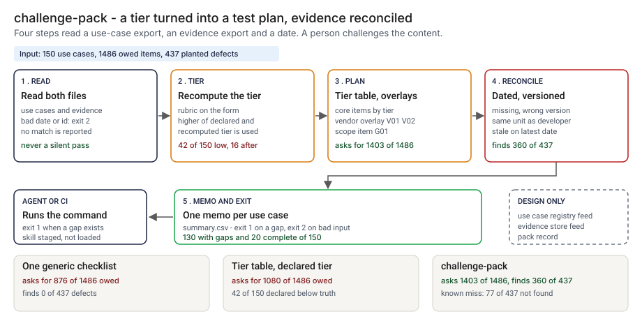

# Architecture: challenge-pack

> **Status.** This is the design for a production shape. The repo implements the product mechanic as a prototype: a command, `src/challenge_pack.py`, that reads a use-case export and an evidence export, recomputes the tier, builds the test plan, reconciles the evidence and writes a memo per use case, run here over 150 synthetic use cases. A Skill wrapper is staged in `skill/` and has not been loaded into an agent runtime. Nothing below is claimed as deployed or load-tested. Where a figure is a design target, it says so.

GCP is primary; AWS and Azure sit beside it.



---

## 1. Logical architecture

challenge-pack is a function between an inventory and a reviewer: two exports and an as-of date in, gaps and a memo out. It reads dates, versions and units; it never reads the evidence, calls a model or decides anything.

Seven components: four decide the outcome, three support or report.

| Component | Responsibility | Language or framework | Decides the outcome? | Stateful? |
| --- | --- | --- | --- | --- |
| `cp-ingest` | Reads both exports. Rejects an empty, truncated, mistyped, duplicate or unsafe-id file and a bad date with a one-line message. | Python 3.9+, standard library. Prototype: `read_table`, `read_use_cases`, `read_evidence`, `parse_date` | Yes, by refusing: exit 2 | No |
| `cp-tier` | The rubric on six form inputs; the tier used is the higher of declared and recomputed. | Python. Prototype: `rubric_points`, `effective_tier` | Yes | No |
| `cp-plan` | The tier-to-test-plan table, the evidence windows, the vendor overlay and the scope item. Changes by review only. | Reviewed table file (design). Prototype: `ITEMS`, `TIERS`, `plan_items`; `data/plan_items.csv` | Yes, config | Stateful, in git |
| `cp-reconcile` | Per plan item: missing, wrong version, not independent, stale on the latest date. | Python. Prototype: `assess`, `same_unit`, `add_months` | Yes | No |
| `cp-memo` | Writes a memo per use case and `summary.csv`, prints text or annotations, sets the exit code, and escapes sponsor text. | Python. Prototype: `render_memo`, `write_outputs`, `render_github`, `clean`, `md_cell`, `csv_safe`, `gh_escape` | No | No |
| `cp-skill` | Tells an agent how to run the command and what to say about its limits. Adds no logic. | `skill/challenge-pack/SKILL.md`, staged, not loaded | No | No |
| `cp-ledger` | One record per pack run, off the decision path (design). Prototype analog: `src/out/step_04_cases.csv`. | PostgreSQL plus object storage with a retention lock (design) | No | Stateful |

Two feeds sit outside the tool, the use-case registry and the evidence store; the prototype reads their exports as CSV.

**What decides the outcome.** The input check, the recompute, the table and the reconciliation. The memo, Skill and ledger carry or record it. A hollow item that is on time, current and prepared outside the developer's unit is a pass.

**Repo structure** (production shape):

```
challenge-pack/
├── pack/       # ingest, tier, plan, reconcile, memo
├── plan/       # the tier table and windows, changed by pull request
├── skill/      # agent Skill wrapper
├── ledger/     # pack record writer
├── infra/      # terraform for gcp, aws, azure
└── tests/      # unit, golden (planted set), hostile (injection strings)
```

---

## 2. Physical and deployment architecture

The tool is one short-lived batch task that runs when the evidence export lands. No server stays warm.

| Component | GCP (primary) | AWS | Azure | Why |
| --- | --- | --- | --- | --- |
| Pack process (ingest, tier, plan, reconcile, memo) | Cloud Run job, scheduled | ECS Fargate task | Container Apps job | Stateless, one pass, no credentials |
| `cp-plan` | A reviewed file in the repo | Same | Same | A table change lands in the same history as the code |
| Exports and memos | Cloud Storage, versioned | S3, versioned | Blob Storage, versioned | Versioning keeps the exact bytes a pack used |
| `cp-ledger` and counts | Cloud SQL for PostgreSQL; OTel to Cloud Monitoring | RDS for PostgreSQL; CloudWatch | Azure Database for PostgreSQL; Azure Monitor | The platform team already runs them; off the decision path |

**Failure behavior (the decision that matters most).** The tool must never silently pass. A missing, empty, truncated or mistyped input does not become "complete" and is not skipped: it ends the run with exit 2 and a one-line reason. An evidence file with no rows makes every plan item missing, and files that do not belong together are named.

| Failure | Behavior | Alert |
| --- | --- | --- |
| Either file missing, empty, not UTF-8, with NUL bytes, a repeated or missing column, a ragged row, a blank required field, a bad enum value, a duplicate or unsafe id | Exit 2, one line on stderr | P2 if repeated on one export, else P3 |
| `--as-of` not a real date; an evidence date after it; a reaffirmation before the evidence date; the output directory cannot be written | Exit 2 naming the row | P3 |
| Evidence rows name a use case or an item that does not exist, or none match any use case | Rows ignored, with a note; files that may not belong together are named | P4 |
| Ledger unavailable (design) | The memos and exit code stand; the record queues locally and the gap is listed | P3 |

**Latency.** The prototype runs 150 use cases in one pass; I have not timed it. 🔴 Design target: a pack for the whole inventory within 5 minutes of the evidence export landing. Recovery is a re-run from the same exports and the same as-of date, which give the same bytes.

---

## 3. Data architecture

| Entity | Key | What it holds | Real columns in the prototype |
| --- | --- | --- | --- |
| Use case | `use_case_id` | The form as the sponsor filled it | `data/use_cases.csv`: `use_case_id`, `title`, `model_type`, `vendor_model`, `customer_facing`, `decision_autonomy`, `data_class`, `regulatory_scope`, `financial_exposure_band`, `developer_unit`, `deployed_version`, `declared_tier` |
| Evidence row | `use_case_id`, `item_id` | What is on file for one item | `data/evidence.csv`: `ref`, `prepared_by_unit`, `covers_version`, `evidence_date`, `reaffirmed_date` |
| Plan item and tier | `item_id`, `tier` | The table the pack applies | `data/plan_items.csv`: `item_id`, `min_tier`, `independent`, `overlay`; `data/plan_tiers.csv`: `tier`, `depth`, `window_months` |
| Pack record, with its gaps | `record_id` | Design: as-of date, tier used, table version, plan, gaps with kinds and detail, SHA-256 of both exports, tool version | Prototype: `summary.csv` (`use_case_id`, `tier`, `declared_tier`, `scope`, `plan_items`, `gaps`, `gap_items`) and `src/out/step_04_gaps.csv` (`item_id`, `kinds`, `detail`) |
| Planted truth | `use_case_id` | The hidden tier and the planted status of each item | `data/truth_tier.csv`, `data/truth_evidence.csv`. Synthetic data only |

**Retention** is a design choice, not a measurement; confirm it against the bank's own schedule. 🔴 Design default: pack records, memos and the exports they read 7 years, in versioned storage with a retention lock.

**Lineage.** A gap traces back in three hops: the record names the table version, as-of date and export hashes; the store returns those bytes; and the rules are deterministic, with no clock, so re-running `assess` reproduces the gap. In the prototype the trace is a row of `step_04_gaps.csv`.

**Deliberately not stored.** The content of any evidence document. The pack keeps a reference, a unit, a version and two dates.

---

## 4. Security architecture

**Identity and roles.** The tool runs under the platform's workload identity with no user account of its own. Four roles: `cp:runner` (reads exports, writes memos and a record), `cp:approver` (approves a table or window change, never their own), `cp:auditor` (reads records and table history) and `cp:admin` (platform lead).

**Secrets.** None, and no model call. The Skill passes file paths to a local command and holds no credential.

**Data classification and boundary.** Use-case titles, unit names and evidence references are internal; evidence documents are not read. In the prototype nothing leaves the machine. In the design three things leave the job: the exit code, the memos and the ledger write.

| Threat | Example | Mitigation in the design |
| --- | --- | --- |
| Hostile sponsor text in a title, unit or reference reaches a memo, a log, an annotation or a spreadsheet | A title with a pipe, a link, a newline or a leading `=` | `clean` makes it one printable line; `md_cell` escapes Markdown and HTML; `gh_escape` rewrites `%`, carriage return and newline; `csv_safe` neutralizes formulas. `tests/test_cli.py` covers each |
| A use case id names a file outside the output directory | `../../x` | Ids must match `ID_RE`; `tests/test_cli.py` covers unsafe ids |
| An agent follows instructions hidden in sponsor text | A title that reads as a command | The Skill says to treat titles and unit names as data. I have not tested this on a model; loading it in a runtime is on the backlog |

---

## 5. Operational architecture

**SLIs.** Packs per week; input rejections; use cases with gaps and gaps by kind; use cases whose tier was raised (prototype baseline: 🟢 130 of 150 with gaps and 20 complete, `step_04_with_the_pack.py`); gaps overturned after the first line replies; time to pack.

**SLOs (all 🔴 design targets, none measured).**
- A pack within 5 minutes of the evidence export landing.
- Every in-scope use case covered by a pack.
- Every memo read by a named reviewer within five business days (planning estimate).

**Alerts.** P2: repeated input rejections on one export, or the ledger down for more than a day. P3: files that do not belong together, or a changed export hash. P4: a weekly digest of raised tiers and new gaps.

**Runbooks** (one page each, in `docs/runbooks/`):
- `pack-rejected.md`: find why the export could not be read, fix the source, re-run with the same date.
- `tier-raised.md`: why the recompute raised the tier, and what to tell the sponsor.
- `changing-the-table.md`: pull request, second approver, golden numbers re-run.
- `gap-disputed.md`: re-check dates, version and unit with the first line.

**On-call and ownership.** The reviewer team owns the run and memos; the head of the function owns the table and windows; the feed owners own the feeds.

**Change control.** The table, the windows and the independence list are versioned; a change needs a proposer and a different approver. Before merge the planted set is re-run against `tests/test_golden.py`, so a change that moves the found count shows in the diff.

---

## 6. Alignment and posture

Alignment, not certification. The README's "Aligned to" section cites one source, restated with the same wording about what was read: the Federal Reserve's [SR 26-2, Revised Guidance on Model Risk Management](https://www.federalreserve.gov/supervisionreg/srletters/SR2602.htm), issued with the OCC and the FDIC on April 17, 2026, with the [attached guidance](https://www.federalreserve.gov/supervisionreg/srletters/SR2602a1.pdf). I read both on 2026-10-24.

- **What the design does.** It names the areas the text names: independent challenge, validation by conceptual soundness, outcomes analysis and ongoing monitoring, vendor products, and a scope item for rules, generative and agentic use cases. It dates the evidence and records the result.
- **What it does not claim.** The guidance sets no tiers, test lists or evidence windows, and says it is not an enforceable standard, so the plan is my assumption. It is expected to be most relevant to banks with more than $30 billion in total assets; this prototype does not test that. It makes no claim of conformity to the guidance, holds no certification, and I have not read or mapped any other source.

---

## 7. What is deliberately not here

- **Hollow evidence.** 🟢 30 of 32 hollow items pass every check; the checks read dates, versions and units, never content (`step_04_with_the_pack.py`).
- **A tier below the truth.** 🟢 16 of 150 use cases keep a low tier after the recompute and leave 68 defects unasked (`step_04_with_the_pack.py`). The form is the only source; a check against a data catalog and a vendor registry is [35 TierGate Skill](../35-tiergate/)'s job, designed and not wired.
- **Gaps on items not owed.** 🟢 6 are raised, on use cases whose sponsor declared a tier above the truth; I kept the higher tier on purpose (`step_04_with_the_pack.py`).
- **Who reaffirmed.** A reaffirmation counts if its date is inside the window and the version matches. The check does not ask who or what they looked at.
- **A decision.** The pack lists what to ask for and what is wrong with what came back. A person challenges the content and signs the memo.
- **A loaded Skill.** It is staged and untested on a model.

---

## Appendix: sample contract

The call is the prototype's own. Its output for the bundled `--demo` run is under "Run one now" in the README.

```bash
python3 challenge_pack.py pack use_cases.csv evidence.csv --as-of 2026-10-01 --out-dir pack_out
```

It writes `pack_out/<use_case_id>.md` for each use case and `pack_out/summary.csv`. Exit status: 0 when no use case has a gap, 1 when at least one does, 2 for bad input.
