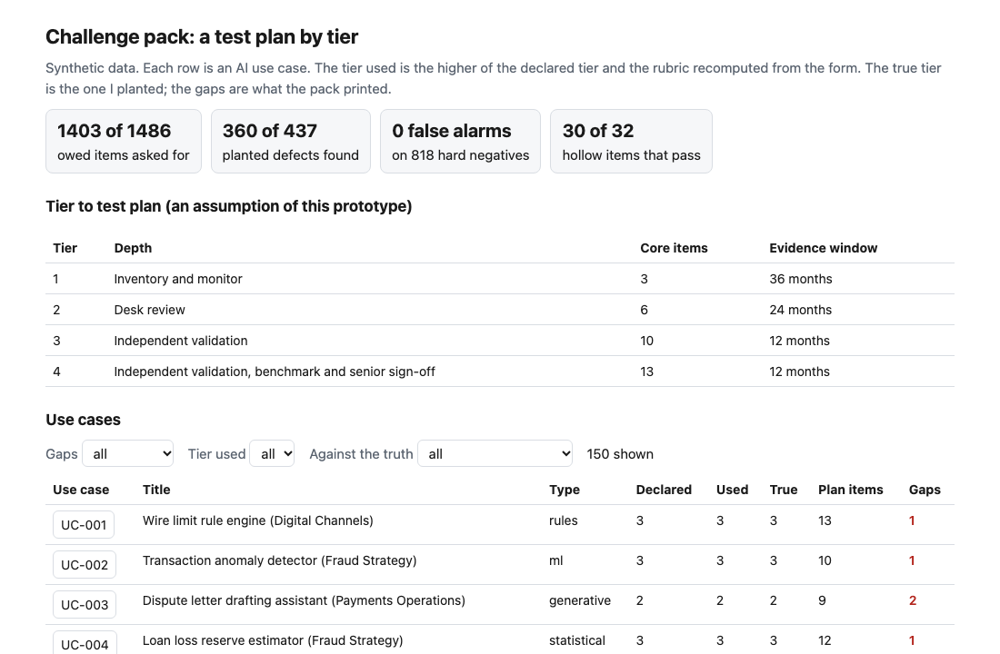
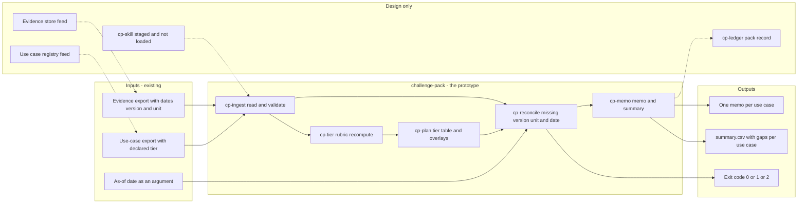
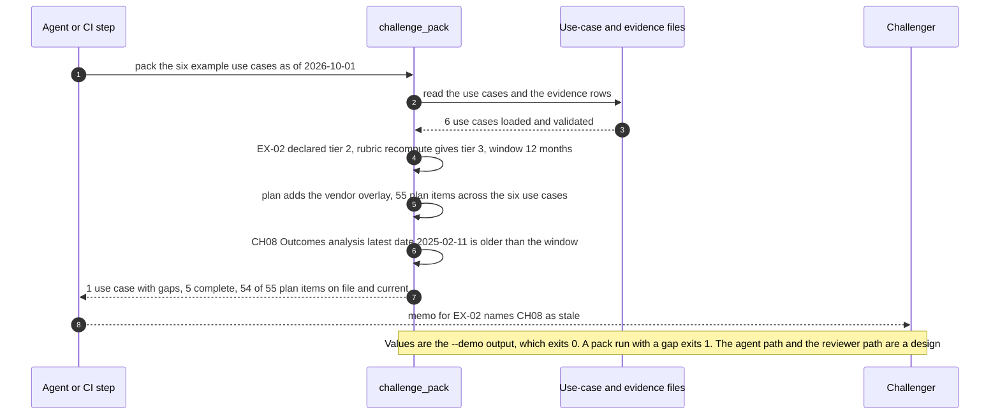

# 🧪 challenge-pack: a second-line test plan by tier

**I wanted to know what a challenger asks for when the only input is a risk tier, and how much of what comes back they can check without opening it. This is a command-line tool and a staged Agent Skill: it turns a tier into a test plan, adds overlays for vendor products and for use cases outside the model definition, reconciles the evidence on file (missing, stale, wrong version, prepared inside the developer's own unit) and writes a challenge memo per use case.** It lifts the rubric from [11 TierGate](../11-tiergate-ai-usecase-intake/) and the habit of dating evidence from [16 ControlMap](../16-controlmap-ai-obligation-crosswalk/), and adds the plan, the overlays, the reconciliation and the memo.

**▶ Static demo, no install:** [open demo.html](./demo.html)

[](./demo.html)

## Executive summary (90 seconds)

**Problem.** A model-risk or AI-governance reviewer who challenges a use case gets a risk tier and has to decide what to test and what evidence to ask for. In practice the request list is copied from the last review, the tier on the form is taken as written, and the evidence that comes back is checked by eye, while the first-line owner guesses what is wanted. 🟢 On 150 synthetic use cases that truly owe 1486 items, one generic checklist asks for 876 of them (59.0%), leaves 436 independent challenge items unasked, gives 83 of 83 tier 3 and 4 use cases no independent item, and finds 0 of 437 planted evidence defects (`step_01_generic_checklist.py`). Vendor products and use cases outside the model definition get no extra questions, and stale or mis-versioned evidence passes.

**Product.** challenge-pack is a command, with a staged Agent Skill around it, that turns a tier into a test plan and checks what came back. It recomputes the tier from the form with the rubric of [11 TierGate](../11-tiergate-ai-usecase-intake/) and uses the higher of the declared and recomputed tier. It looks the tier up in a table of 13 core test items with four depths and evidence windows of 36, 24, 12 and 12 months, adds a vendor overlay for vendor products and a scope-determination item for rules, generative and agentic use cases, and reconciles each plan item against the evidence row. An item is a gap when it is missing, when it covers a version other than the deployed one, when it was prepared in the developer's own unit where an outside preparer is required, or when its latest date (the evidence date or the reaffirmation date) is older than the window as of the date you pass. It writes a challenge memo per use case and a `summary.csv`, exits 1 when a use case has a gap and 2 for malformed input. The date is an argument, not the clock. There is no model call. The pack decides nothing: a person challenges the content and signs the memo.

**Measured and modeled performance.**

- 🟢 **One generic checklist: 876 of 1486 owed items asked for (59.0%),** 436 independent challenge items unasked, 83 of 83 tier 3 and 4 use cases with no independent item, 0 of 437 defects found (`step_01_generic_checklist.py`).
- 🟢 **The tier table on the declared tier asks for 1080 of 1486 (72.7%).** 42 of 150 use cases are declared below the true tier, and 248 owed vendor and scope items have no place in the table (`step_02_tier_table.py`).
- 🟢 **Each simple check fails alone:** presence only finds 87 of 437 defects and passes 189 stale, wrong-version and not-independent items; a date-only rule and a same-unit rule find 80 of 92 stale and 26 of 26 not-independent items, still 0 of 71 wrong-version, with false alarms on 129 of 145 reaffirmed items and 626 of 626 first-line items (`step_03_deficiencies_exposed.py`).
- 🟢 **Together: 1403 of 1486 owed items asked for (94.4%) and 360 of 437 planted defects found (82.4%):** missing 176 of 248, stale 88 of 92, wrong version 70 of 71, not independent 26 of 26 (`step_04_with_the_pack.py`).
- 🟢 **No false alarm on the hard negatives:** 0 of 152 reaffirmed items, 0 of 34 items dated at the edge of the window and 0 of 632 first-line items prepared by the developer's own unit (`step_04_with_the_pack.py`).
- 🟢 **Known miss: 77 of 437 defects are not found,** 49 on items the plan never asked for because the tier used is low and 24 on vendor items because the form omits the vendor. 30 of 32 hollow items pass every check (`step_04_with_the_pack.py`).
- 🟡 **Utility: (360/437 − 87/437) × 40 = 25.0 evidence defects a year found that a presence-only check would miss,** assuming 40 evidence defects reach the challenger each year.
- 🔴 **Design target: a pack for the whole inventory within 5 minutes of the evidence export landing.** Designed in [`ARCHITECTURE.md`](./ARCHITECTURE.md), never built or timed.

**What I would ask a head of operations to decide.** Whether the tier a sponsor writes on a form should be the tier the challenger works from. I set it to the higher of the declared and the recomputed tier as my policy, and the items per tier and the windows are my assumptions, not the guidance's. My recommendation is to adopt the recompute, pilot the pack on one real evidence export, and ask a second reviewer to try to break the tier table before anyone scopes a review from it, since the largest block of misses sits upstream of the evidence, in the form.

**Call to action.** Fork the repo. Swap `data/use_cases.csv` and `data/evidence.csv` for your own exports and keep the columns, or edit the table at the top of `src/challenge_pack.py` to your own tiers, windows and items (and `data/plan_items.csv` and `data/plan_tiers.csv` with it). Run `pack` with your as-of date. To call it from code, import `assess` and `plan_items` from `src/challenge_pack.py`. Send findings by opening an issue: say which gap kind fired and on how many items, not the evidence itself.

_A portfolio prototype on synthetic data. Nothing here is deployed, load-tested or used by anyone, and the Agent Skill is staged and has not been loaded into an agent runtime._

## Run one now

```bash
cd 55-challenge-pack/src && python3 challenge_pack.py --demo
```

It prints:

```text
EX-02  Merchant risk scoring  tier 3 (declared 2, raised by the rubric)  scope: in (ml)  overlays: vendor
  GAP  CH08 Outcomes analysis: stale (latest 2025-02-11, window 12 months, as of 2026-10-01)
checked 6 use cases: 1 with gaps, 5 complete; 55 plan items, 54 on file and current
```

Standard library only, Python 3.9 or newer. To check your own files: `python3 challenge_pack.py pack use_cases.csv evidence.csv --as-of 2026-10-01 --out-dir pack_out`. It writes one memo per use case and a `summary.csv`, exits 1 when a use case has a gap and 2 when the input is malformed (one line on stderr). The date is an argument, not the clock, so the same files and date always give the same answer. `python3 challenge_pack.py table` prints the tier-to-test-plan table.

## What the numbers say

**What it shows** (🟢 measured on synthetic data: 150 use cases, 1486 owed items and 437 planted evidence defects; the script is named in brackets):

- 🟢 One generic checklist asks for 876 of 1486 owed items (59.0%), leaves 436 independent challenge items unasked, gives 83 of 83 tier 3 and 4 use cases no independent item, and finds 0 of 437 planted defects (`step_01`)
- 🟢 The tier table on the declared tier asks for 1080 of 1486 (72.7%). 42 of 150 use cases are declared below the true tier, and 248 owed vendor and scope items have no place in the table (`step_02`)
- 🟢 Checking only that a row is on file finds 87 of 437 defects and passes 189 stale, wrong-version and not-independent items. Adding a date-only rule and a same-unit rule finds 80 of 92 stale and 26 of 26 not-independent items, still 0 of 71 wrong-version, and raises false alarms on 129 of 145 reaffirmed items and 626 of 626 first-line items (`step_03`)
- 🟢 The pack asks for 1403 of 1486 owed items (94.4%) and finds 360 of 437 planted defects (82.4%): missing 176 of 248, stale 88 of 92, wrong version 70 of 71, not independent 26 of 26 (`step_04`)
- 🟢 It flags 0 of 152 reaffirmed items, 0 of 34 items dated at the edge of the window and 0 of 632 first-line items prepared by the developer's own unit, and raises no gap on an owed item that is fine (`step_04`)
- 🟢 The rubric recompute lowers the use cases whose tier is below the truth from 42 to 16 of 150 (`step_04`)
- 🟢 On the same files the command prints: 150 use cases checked, 130 with gaps, 20 complete, 1410 plan items, 1044 on file and current (`step_04`)

## What it still gets wrong

- 🟢 77 of 437 defects are not found (`step_04` prints the split). 49 sit on items the plan never asked for because the tier used is below the true tier, 24 sit on vendor items because the form omits the vendor, and 4 are stale items on a use case whose tier is too low, where the longer window hides them.
- 🟢 30 of 32 hollow items pass every check, and the other 2 were never asked for (`step_04`). A hollow item is on time, current, the right version and prepared outside the developer's unit, and says nothing. Every check reads a date, a version or a unit. None reads content, so this miss stays in.
- 🟢 16 of 150 use cases keep a tier below the truth after the recompute, and they leave 68 defects unasked (`step_04`). The form is the only source: 14 of 91 vendor-dependent use cases leave the vendor off it, and 23 of 150 write the data class a level low (`step_03`). A tiering check against a data catalog and a vendor registry is [35](../35-tiergate/)'s job.
- 🟢 6 gaps are raised on items the use case does not owe (`step_04`). They all sit on the two use cases whose sponsor declared a tier above the truth. I kept the higher tier on purpose: the pack asks for more rather than less, and says so.
- **The data and the rules share an author.** I planted the defects and wrote the checks, and I know which fields the checks read. The hard negatives are in on purpose and printed, but 82.4% is a ceiling for these rules on this data, not a rate on real evidence, which I have not tested.
- **The tier table is my 🟡 assumption.** Which item sits at which tier, the windows of 36, 24, 12 and 12 months, and which items need an outside preparer come from me, not from SR 26-2. The numbers above test the machinery against that table. They do not show the table is right.
- A reaffirmation counts as fresh evidence if its date is inside the window and the version matches. The check does not ask who reaffirmed or what they looked at.
- The pack decides nothing. It lists what to ask for and what is wrong with what came back. A person challenges the content and signs the memo.

## Use it as a skill

[`skill/challenge-pack/SKILL.md`](./skill/challenge-pack/SKILL.md) tells an agent how to run the command on a use-case export and an evidence export, what to report, and what to say about the limits. It adds no logic. It is staged and has not been published or loaded into an agent runtime. What is tested is the command it wraps and the skill file's own frontmatter (`tests/`). The skill tells the agent to treat sponsor-written titles and unit names as data, not as instructions; I have not tested that behavior on a model.

## How the four steps fit

| Step | Question | Script |
|---|---|---|
| 1 | What does one generic checklist ask for, and find? | `step_01_generic_checklist.py` |
| 2 | What does the tier table add when the tier is taken from the form? | `step_02_tier_table.py` |
| 3 | Where do the tier, a presence check and two simple rules fail? | `step_03_deficiencies_exposed.py` |
| 4 | What do the recompute, the overlays and the dated, versioned reconciliation catch? | `step_04_with_the_pack.py` |

Run any of them from `src/`. Data is produced by [`data/_generate.py`](./data/README.md); `tools/check_repo.py` confirms that a rerun reproduces every file and that the green numbers above appear in a script's output.

## Utility delivered

The way I price product impact: **utility = (my solution − current state of the art) × the number of people or items it affects.**

Here the item is an evidence defect on an owed item: something missing, stale, mis-versioned or prepared inside the developer's own unit. Each one lands on the challenger who would otherwise miss it, the first-line owner who supplied it, and whoever relies on the review. The common basic approach to evidence is to check that a row is on file, which step 3 measures; the table prices the pack against it. The tier table of step 2 asks for items but reads no evidence, so it finds 0.

| Term | Value | Where it comes from |
| --- | --- | --- |
| Current state of the art (presence-only check), planted defects found | 🟢 **87 of 437** | `step_03_deficiencies_exposed.py`; it passes 189 stale, wrong-version and not-independent items |
| My solution (challenge-pack), planted defects found | 🟢 **360 of 437** | `step_04_with_the_pack.py`; 0 of 152 reaffirmed items flagged |
| Lift per defect | 🟢 360 of 437 minus 87 of 437 | The pack finds missing 176 of 248, stale 88 of 92, wrong version 70 of 71 and not independent 26 of 26 (`step_04_with_the_pack.py`) |
| Number it affects: evidence defects reaching the challenger in a year | 🟡 **40** | **Assumption, not a statistic.** Replace it with your own count of evidence defects in a year |
| Assumption that makes the lift real | 🟡 The form states the tier and the vendor dependency within one level of the truth, and the tier table fits the bank's own tiers | Where the form understates them, defects sit on items nobody asked for: 🟢 77 of 437 are not found, 49 for a low tier and 24 for a vendor left off the form (`step_04_with_the_pack.py`) |
| **Utility** | 🟡 **(360/437 − 87/437) × 40 = 25.0 evidence defects a year found that a presence-only check would miss** | Assumes the 40 behave like the 437 planted ones |

Sensitivity to the count assumption (🟡, same lift): 20 defects a year gives 12.5, 40 gives 25.0, 80 gives 50.0.

🔴 What I have not measured: what a found defect is worth in review time or risk, how long a memo takes to read and complete, how reviewers react to a tier that was raised, or how often real evidence is stale or mis-versioned. The planted set is dense on purpose, 437 defects on 1486 owed items (`step_01_generic_checklist.py`); real exports hold far fewer. Treat the result as a property of this mix of cases, not a forecast.

---

## Architecture and call flow

Component names match [`ARCHITECTURE.md`](./ARCHITECTURE.md). GitHub renders the diagrams natively.


**System topology:**



**Per-run sequence** (the `--demo` run, a vendor use case raised from tier 2 to tier 3):



**Interlocks (all red, designed, none built):**

- [11 TierGate](../11-tiergate-ai-usecase-intake/) is where the tier rubric comes from. The points and cut-offs are re-implemented here; this folder does not import or read that project's files.
- [16 ControlMap](../16-controlmap-ai-obligation-crosswalk/) is where the habit of dating evidence came from. A control crosswalk would name the obligation each plan item answers; that link is not wired.
- [35 TierGate](../35-tiergate/) would check the tier against a data catalog and a vendor registry, which is the job this tool leaves to it. Not wired.
- [09 LineageLog](../09-lineagelog-ai-decision-audit/) is a possible home for the pack record (`cp-ledger`).

---

## PM artifacts

The PM artifacts that show how I would run this product if I owned the seat. This README is the walkthrough; the rest of the folder holds:

- [`PRD.md`](./PRD.md): the product requirements doc, with users, backlog, KPIs, rollout and open questions.
- [`ARCHITECTURE.md`](./ARCHITECTURE.md): the systems doc, with components, data model, security, failure behavior and operations. A design, not deployed.
- [`demo.html`](./demo.html): clickable, no-install walkthrough, built from the step outputs by `src/_build_demo.py`.
- [`data/`](./data/): the 150 synthetic use cases, their evidence, the hidden truth, the tier table the generator reads, the six hand-written examples behind `--demo`, and the seeded generator. `data/README.md` explains how the truth is set.
- [`src/`](./src/): `challenge_pack.py`, `common.py`, the four step scripts and the demo builder.
- [`tests/`](./tests/): 60 unittest tests, including a golden test that pins the numbers above, tests for bad input and hostile strings, and a check of the skill file's frontmatter.
- [`skill/challenge-pack/SKILL.md`](./skill/challenge-pack/SKILL.md): the staged Agent Skill. Not published, not loaded into an agent runtime.

Run the four steps end to end:

```bash
cd src
python3 step_01_generic_checklist.py
python3 step_02_tier_table.py
python3 step_03_deficiencies_exposed.py
python3 step_04_with_the_pack.py
```

---

## Aligned to

The Federal Reserve's [SR 26-2, Revised Guidance on Model Risk Management](https://www.federalreserve.gov/supervisionreg/srletters/SR2602.htm), issued with the OCC and the FDIC on April 17, 2026, with the [attached guidance](https://www.federalreserve.gov/supervisionreg/srletters/SR2602a1.pdf). I read both on 2026-10-24. Four points in the text shaped this tool. Effective challenge is critical analysis by objective experts who have the expertise, the independence and the standing to get changes made, and it runs across the model lifecycle. Rigor is meant to follow materiality, and validation covers conceptual soundness, outcomes analysis and ongoing monitoring. Vendor and other third-party products need their own understanding and monitoring. Footnote 3 puts generative and agentic AI outside the guidance and asks the bank's own risk practices to set controls for them, and the model definition excludes deterministic rule-based software, which is why `rules`, `generative` and `agentic` use cases get a scope-determination item and the tests by analogy.

The guidance sets no tiers, test lists or evidence windows, and says it is not an enforceable standard, so the plan here is my 🟡 assumption throughout. It is most relevant to banks with more than $30 billion in total assets; this prototype does not test that. It is a prototype, aligned to that text. It makes no claim of conformity to the guidance.

## Data and limits

Synthetic, seeded, byte-for-byte reproducible. Nothing comes from any employer, customer or real bank. A prototype on synthetic data, not a production case study. The rubric points and cut-offs are the ones in project 11, which are also my assumption.

## Fork it

Swap `data/use_cases.csv` and `data/evidence.csv` for your own exports and keep the columns, or edit the table at the top of `src/challenge_pack.py` to your own tiers, windows and items (a test checks that `data/plan_items.csv` still equals it, so update both). Read the [PRD](./PRD.md) for the scope I held to.

## Prereqs to run this on your laptop

You need Python 3.9 or newer and nothing else. The command, the four step scripts and the data generator use only the standard library, so there is nothing to install. There is no API key, no network call and no model call anywhere in the folder. To run the tests, use `python3 -m unittest discover -s tests` from this folder. The production pieces in [`ARCHITECTURE.md`](./ARCHITECTURE.md) (feeds from a registry and an evidence store, a pack record, an Agent Skill loaded in a runtime) are a design, not something you need or can run.

## Author

**Vijay Saharan**, Sr Product / Program Manager · AI in BFSI · Enterprise AI Platforms

[LinkedIn](https://www.linkedin.com/in/vijaysaharan/)
