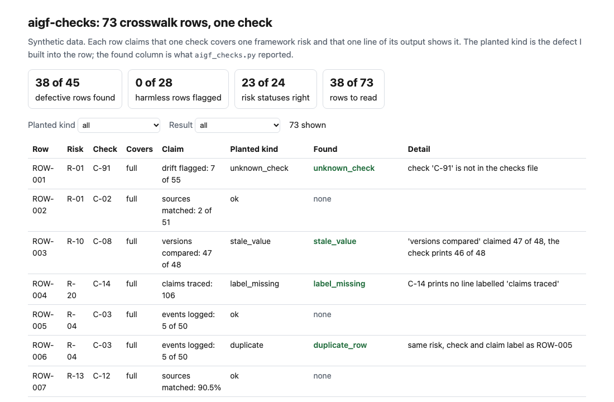
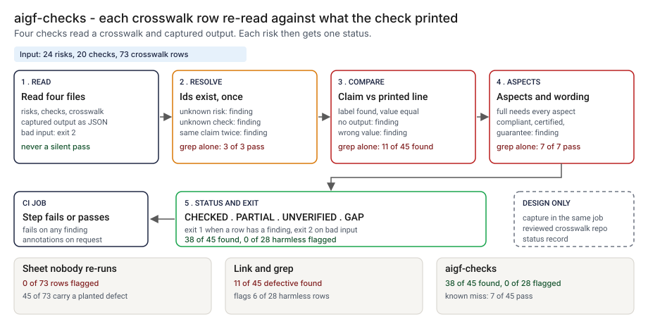
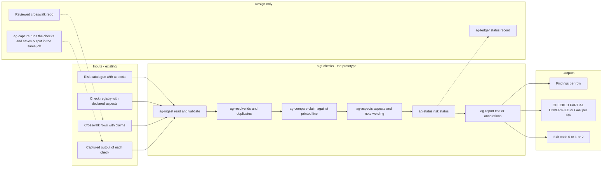
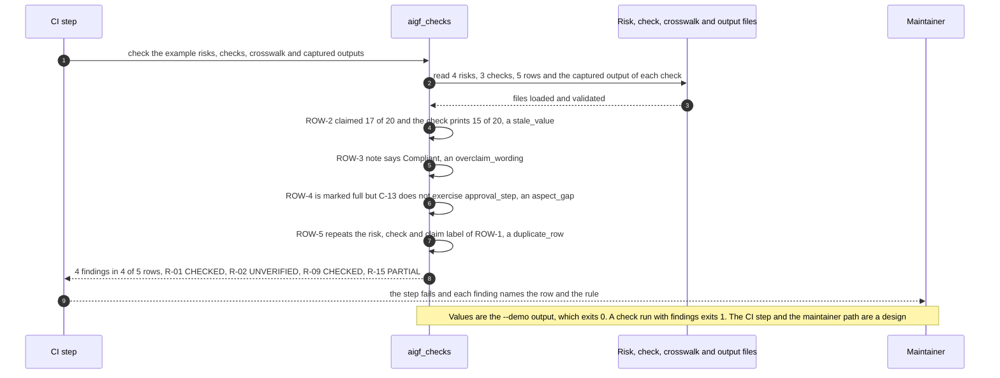

# 🔗 aigf-checks: from a framework risk to a check you can run

**I wanted to know what it takes for one line in a crosswalk, "this check covers this framework risk", to stay true after the check changes. This is a command-line tool: it reads a crosswalk of risks to runnable checks, the registry of those checks and the text each one printed, and reports the rows that no longer hold. It is built to back a contribution to the [FINOS AI Governance Framework](https://air-governance-framework.finos.org/): five risks mapped to checks in this portfolio, drafted as an issue and a pull request that I have not opened.** It moves the crosswalk idea from [16 ControlMap](../16-controlmap-ai-obligation-crosswalk/), obligations to controls, to framework risks to checks that print a number.

**▶ Static demo, no install:** [open demo.html](./demo.html)

[](./demo.html)

## Executive summary (90 seconds)

**Problem.** A governance framework lists risks. A team that wants to show it has dealt with one writes a crosswalk row: this check covers this risk, and this line of its output shows it. The row is typed once. When the check changes, nothing re-reads the row, so the crosswalk keeps saying what was true on the day it was written. The contributor who offers a mapping to a public framework and the maintainer who has to decide whether to trust it both see a sheet that looks the same whether a row holds or not. 🟢 In 73 synthetic crosswalk rows, 45 carry a planted defect, the sheet flags 0 of 73, and a reader who trusts every full row calls 20 of 24 risks covered where 16 are (`step_01_no_recheck.py`).

**Product.** aigf-checks is a command that reads four files: the risks, the registry of checks, the crosswalk and the text each check printed. For every row it resolves the risk and the check and reports a duplicate (`unknown_risk`, `unknown_check`, `duplicate_row`). It finds the labelled `label: value` line of the check's output and compares the claimed value with it, setting aside case, spacing and thousands separators (`stale_value`, `label_missing`, `no_output`). It compares the aspects a risk needs with the aspects the check declares (`aspect_gap` for a row marked full that is not). It reads the note for the words compliant, certified, certification and guarantee, and lets "non-compliant" through (`overclaim_wording`). Each risk then gets a status: CHECKED, PARTIAL, UNVERIFIED or GAP. The command exits 1 when a row has a finding and 2 for input it cannot read. A second subcommand lints a commit message for a `Signed-off-by` line and a subject of 72 characters or fewer. It does not run a check, read a check's code or call a model.

**Measured and modeled performance.**

- 🟢 **No re-check: the sheet flags 0 of 73 rows.** 45 of 73 carry a planted defect, and a reader who trusts every full row calls 20 of 24 risks covered where 16 are (`step_01_no_recheck.py`).
- 🟢 **Resolving the ids and grepping for the number finds 11 of 45 defective rows** and flags 6 of 28 harmless ones, all 6 reformatted outputs; 18 of 24 risks get the right status (`step_02_link_and_grep.py`).
- 🟢 **Where grep fails:** 5 of 10 stale rows pass because a short number sits inside a longer one, 4 of 4 rows pass whose label is gone, 4 of 4 pass whose check has no output, and 7 of 7 pass that are marked full against a check covering part of the risk (`step_03_deficiencies_exposed.py`).
- 🟢 **With the tool: 38 of 45 defective rows found,** 0 of 28 harmless rows flagged, 23 of 24 risk statuses right, and a person reads 38 of 73 rows (`step_04_with_checks.py`).
- 🟢 **No false alarm on the hard negatives:** 0 of 6 reformatted outputs, 0 of 3 notes that say "non-compliant" and 0 of 5 honest partial rows (`step_04_with_checks.py`).
- 🟢 **Known miss: 7 of 45 defective rows pass,** wording_paraphrase 3 and false_declaration 4, and R-18 is shown as CHECKED where the planted truth is PARTIAL (`step_04_with_checks.py`).
- 🟡 **Utility: (38/45 − 11/45) × 30 = 18.0 stale or overclaiming rows a year caught that a link-and-grep pass would miss,** assuming 30 defective rows arise in the crosswalk each year.
- 🔴 **Design target: a verdict on the whole crosswalk within 2 minutes of the checks finishing.** Designed in [`ARCHITECTURE.md`](./ARCHITECTURE.md), never built or timed.

**What I would ask a head of operations to decide.** Whether a claim that a check covers a framework risk should be re-read automatically every time the check changes, and who owns the captured output it is read against. My recommendation is to run the re-read in the CI job that runs the checks, in advisory mode first, and to keep the aspects a reviewed judgment, since the tool takes them as written and 4 of the 7 misses are a registry entry that declares an aspect the check does not exercise.

**Call to action.** Fork the repo. Keep the columns and swap in your own files: `risks.csv`, `checks.csv`, `crosswalk.csv` and `outputs.json`, as listed under Fork it. In CI, run your checks, save what they print into `outputs.json` in the same job, and run `python3 aigf_checks.py check ... --format github`. To call it from code, import `analyze` and the `load_*` functions from `src/aigf_checks.py`. Send findings by opening an issue: say which finding kind fired and on how many rows, not the crosswalk itself.

_A portfolio prototype on synthetic data. Nothing here is deployed, load-tested or used by anyone, and the issue and pull request are drafted and not opened._

## Run one now

```bash
cd 56-aigf-checks/src && python3 aigf_checks.py --demo
```

It prints:

```text
crosswalk: 5 rows, 4 risks, 3 checks; claims compared: 5
  ROW-2  R-02 -> C-01  stale_value       'retrieved cases caught' claimed 17 of 20, the check prints 15 of 20
  ROW-3  R-09 -> C-08  overclaim_wording the note says 'Compliant'; say 'aligned to' instead
  ROW-4  R-15 -> C-13  aspect_gap        marked full but C-13 does not exercise approval_step
  ROW-5  R-01 -> C-01  duplicate_row     same risk, check and claim label as ROW-1
risk status: R-01 CHECKED, R-02 UNVERIFIED, R-09 CHECKED, R-15 PARTIAL
result: 4 findings in 4 of 5 rows
```

Standard library only, Python 3.9 or newer. To check your own files: `python3 aigf_checks.py check risks.csv checks.csv crosswalk.csv outputs.json`. It exits 1 when a row has a finding, 2 when an input cannot be read; `--format github` prints annotations. `python3 aigf_checks.py signoff message.txt` checks a commit message for a `Signed-off-by` line and a subject of 72 characters or fewer.

## What the numbers say

**What it shows** (🟢 measured on synthetic data: 24 risks, 20 checks and 73 crosswalk rows with planted defects; the script is named in brackets):

- 🟢 No re-check: the sheet flags 0 of 73 rows, 45 of 73 carry a planted defect, and a reader who trusts every full row calls 20 of 24 risks covered where 16 are (`step_01`)
- 🟢 Resolve the ids and grep for the number: 11 of 45 defective rows found, 6 of 28 harmless rows flagged (all 6 reformatted outputs), 18 of 24 risks given the right status (`step_02`)
- 🟢 Where grep fails: 5 of 10 stale rows pass because a short number sits inside a longer one, 4 of 4 rows pass whose label is gone, 4 of 4 pass whose check has no output, 7 of 7 pass that are marked full against a check covering part of the risk (`step_03`)
- 🟢 With `aigf_checks.py`: 38 of 45 defective rows found, 0 of 28 harmless rows flagged, 23 of 24 risk statuses right, and a person reads 38 of 73 rows (`step_04`)
- 🟢 Hard negatives that could have raised a false alarm: 0 of 6 reformatted outputs, 0 of 3 notes that say "non-compliant", 0 of 5 honest partial rows (`step_04`)

## What it still gets wrong

- 🟢 7 of 45 defective rows still pass (`step_04` prints each one). Three are notes that overclaim in words the rule does not list ("fully satisfies the requirement"). Four are rows whose registry entry declares an aspect the check does not exercise: the tool takes the declared aspects as written and never reads the check. One of them leaves R-18 shown as CHECKED where the planted truth is PARTIAL.
- **The data and the rules share an author.** I planted the defects and wrote the rules, so 38 of 45 shows the rules cover what I planted. A real crosswalk will not hold 45 defective rows in 73, and its defects will not be the ones I thought of. Treat the result as a ceiling for these rules, not a rate.
- **It compares text, not meaning.** A check that keeps its label and starts measuring something else passes. If a check prints one label twice, the tool reads the first line; I planted no such case.
- **It does not run the check.** It compares a claim with a capture the contributor supplies. A stale capture gives a stale pass, so the capture should be regenerated in the same CI job that runs the tool.
- **Aspects are a judgment.** For the synthetic risks I wrote the aspects. For a real framework entry, a person would read the risk text and decide what a check has to exercise; the tool cannot do that.
- The sign-off lint checks the form of the line and the subject length. It does not check that the address is the author's, or that the subject is in the imperative mood.

## The contribution this was built for

I read the [FINOS AI Governance Framework](https://air-governance-framework.finos.org/) on 2026-10-24: the home page (it shows v2, October 20, 2025), the [repository](https://github.com/finos/ai-governance-framework) (licence CC BY 4.0), its [contribution guide](https://github.com/finos/ai-governance-framework/blob/main/CONTRIBUTING.md) and the entries for the five risks below in [`docs/_risks`](https://github.com/finos/ai-governance-framework/tree/main/docs/_risks). The guide asks for small commits, a subject line of 72 characters or fewer in the imperative mood, issues on the project's issue page, and a `Signed-off-by` line on every commit (`git commit -s`).

The idea is one runnable check per risk, with the command, what it covers and what it does not. The five mappings I would offer first, all 🔴 hypothetical: no maintainer has read them, and the covered and not-covered columns are my reading of each risk entry and each project's README. I listed the paths by hand and did not rerun the commands for this folder.

| AIGF risk | Check in this portfolio | What it covers | What it does not |
|---|---|---|---|
| `ri-4` Hallucination and Inaccurate Outputs (OP) | [41 narrative-trace](../41-narrative-trace/): `cd 41-narrative-trace/src && python3 narrative_trace.py --demo` | Traces each sentence of a generated narrative that cites a transaction and compares the figures it states with the record | Sentences with no citation; claims that are not about a transaction |
| `ri-5` Foundation Model Versioning (OP) | [47 SwapBrief CLI](../47-swapbrief/): `cd 47-swapbrief/src && python3 swapbrief.py --demo` | Compares a retiring and a successor model on the team's own results and prices before a move | It reads two files you supply; it does not detect that a provider changed a model |
| `ri-10` Prompt Injection (SEC) | [38 injection-pack](../38-injection-pack/): `cd 38-injection-pack/src && python3 injection_pack.py --demo` | Replays a pack of injection cases, many hidden in retrieved documents, on the old and new rules of a gateway | A real model; attack kinds the pack does not contain |
| `ri-24` Agent Action Authorization Bypass (SEC) | [23 scopekeeper](../23-scopekeeper-agent-permission-review/): `cd 23-scopekeeper-agent-permission-review/src && python3 step_04_with_scopekeeper.py` | Diffs the permissions an agent holds against the ones it used and proposes a least-privilege set | Its README names scope; I have not tested it on call chaining or skipped approval steps |
| `ri-26` MCP Server Supply Chain Compromise (SEC) | [28 tool-schema-drift](../28-tool-schema-drift/): `cd 28-tool-schema-drift/src && python3 tool_schema_drift.py --demo` | Compares two revisions of a tool schema and replays recorded calls against the new one | Reading a description for malicious instructions, intercepted connections, a server taking data |

The issue and the pull request are drafted in [`contribution/ISSUE_DRAFT.md`](./contribution/ISSUE_DRAFT.md) and [`contribution/PR_DRAFT.md`](./contribution/PR_DRAFT.md). Neither has been opened. The pull request waits for a maintainer's answer on where such a table belongs.

## How the four steps fit

| Step | Question | Script |
|---|---|---|
| 1 | What does a reader believe when nothing re-checks the rows? | `step_01_no_recheck.py` |
| 2 | What does resolving the ids and grepping for the number catch? | `step_02_link_and_grep.py` |
| 3 | Where does that fail, and what does the fix still miss? | `step_03_deficiencies_exposed.py` |
| 4 | What do labelled claims, aspects and notes catch together? | `step_04_with_checks.py` |

Run any of them from `src/`. Data is generated by [`data/_generate.py`](./data/README.md); the check in `tools/check_repo.py` confirms that a rerun reproduces every file and that the green numbers above appear in a script's output. `tests/` holds 42 tests, including one that pins these numbers.

## Utility delivered

The way I price product impact: **utility = (my solution − current state of the art) × the number of people or items it affects.**

Here the item is a defective crosswalk row, one that has stopped being true or never was. Each one lands on the contributor who wrote it, the maintainer who has to trust it, and the reader who relies on it. The common basic approach is to resolve the ids and grep the check's output for the number; the table prices the tool against it.

| Term | Value | Where it comes from |
| --- | --- | --- |
| Current state of the art (resolve the ids, grep for the number), defective rows found | 🟢 **11 of 45** | `step_02_link_and_grep.py`; it also flags 6 of 28 harmless rows |
| My solution (aigf-checks), defective rows found | 🟢 **38 of 45** | `step_04_with_checks.py`; 0 of 28 harmless rows flagged |
| Lift per defective row | 🟢 38 of 45 minus 11 of 45 | Grep lets these through, by planted kind: label_missing 4, no_output 4, overclaim 7, duplicate 3, wording_claim 4, and 5 of 10 stale_value rows (`step_03_deficiencies_exposed.py`, `step_04_with_checks.py`) |
| Number it affects: defective rows arising in a crosswalk in a year | 🟡 **30** | **Assumption, not a statistic.** Replace it with your own count of rows that went stale or overclaimed in a year |
| Assumption that makes the lift real | 🟡 The captured output is regenerated in the same CI job that runs the tool, and the aspects each check declares are honest | A stale capture gives a stale pass, and a declared aspect is taken as written: 🟢 7 of 45 defective rows still pass, 4 of them false declarations (`step_04_with_checks.py`) |
| **Utility** | 🟡 **(38/45 − 11/45) × 30 = 18.0 defective rows a year caught that a link-and-grep pass would miss** | Assumes the 30 behave like the 45 planted ones |

Sensitivity to the count assumption (🟡, same lift): 15 rows a year gives 9.0, 30 gives 18.0, 60 gives 36.0.

🔴 What I have not measured: what a caught row is worth in review time, whether a maintainer would trust a crosswalk that passes, or how often real checks change their labels or numbers. The planted set is dense on purpose, 45 of 73 rows are defective (`step_01_no_recheck.py`); a real crosswalk holds far fewer. Treat the result as a property of this mix of cases, not a forecast.

---

## Architecture and call flow

Component names match [`ARCHITECTURE.md`](./ARCHITECTURE.md). GitHub renders the diagrams natively.



**System topology:**



**Per-run sequence** (the `--demo` run, five rows against three checks):



**Interlocks (all red, designed, none built):**

- [16 ControlMap](../16-controlmap-ai-obligation-crosswalk/) maps obligations to controls. The status words come from it, changed to fit a risk and a check; nothing is imported from that folder.
- [39 Claims Check](../39-claims-check/) ties the numbers in a README to a script's output. This tool does the same for a crosswalk row; the two could share a runner, which is not built.
- [41](../41-narrative-trace/), [47](../47-swapbrief/), [38](../38-injection-pack/), [23](../23-scopekeeper-agent-permission-review/) and [28](../28-tool-schema-drift/) are the five checks the contribution points at. They are named by hand in the README table. This tool reads none of their files, and I did not rerun their commands for this folder.
- [09 LineageLog](../09-lineagelog-ai-decision-audit/) is a possible home for the status record (`ag-ledger`).

---

## PM artifacts

The PM artifacts that show how I would run this product if I owned the seat. This README is the walkthrough; the rest of the folder holds:

- [`PRD.md`](./PRD.md): the product requirements doc, with users, backlog, KPIs, rollout and open questions.
- [`ARCHITECTURE.md`](./ARCHITECTURE.md): the systems doc, with components, data model, security, failure behavior and operations. A design, not deployed.
- [`demo.html`](./demo.html): clickable, no-install walkthrough, built from the step outputs by `src/_build_demo.py`.
- [`data/`](./data/): the 24 synthetic risks, 20 checks, 73 crosswalk rows with planted defects, their captured outputs and truth files, the worked example behind `--demo`, and the seeded generator. `data/README.md` explains how the truth is set.
- [`src/`](./src/): `aigf_checks.py`, `common.py`, the four step scripts and the demo builder.
- [`tests/`](./tests/): 42 unittest tests, including a golden test that pins the numbers above and tests for bad input and hostile strings.
- [`contribution/`](./contribution/): the drafted issue and pull request. Neither has been opened.

Run the four steps end to end:

```bash
cd src
python3 step_01_no_recheck.py
python3 step_02_link_and_grep.py
python3 step_03_deficiencies_exposed.py
python3 step_04_with_checks.py
```

---

## Aligned to

The [FINOS AI Governance Framework](https://air-governance-framework.finos.org/) risk entries named above, as read on 2026-10-24, and its contribution guide. The status words come from [16 ControlMap](../16-controlmap-ai-obligation-crosswalk/), changed to fit a risk and a check; nothing is imported from that folder. [39 Claims Check](../39-claims-check/) ties the numbers in a README to a script's output; this tool does the same for a crosswalk row and adds the risk-level view. It is a prototype, aligned to that framework. It makes no claim of conformity to it and is not endorsed by FINOS.

## Data and limits

Synthetic, seeded, byte-for-byte reproducible. The 24 risks are paraphrases written for this exercise, not the text of any framework entry, and the 20 checks and their printed output are invented. Nothing comes from any employer, customer or real bank. A prototype on synthetic data, not a production case study.

## Fork it

Keep the columns and swap in your own files: `risks.csv` (`risk_id`, `title`, `aspects`), `checks.csv` (`check_id`, `project`, `command`, `exercises`), `crosswalk.csv` (`row_id`, `risk_id`, `check_id`, `covers`, `claim_label`, `claim_value`, `note`) and `outputs.json` (the text each check printed, by `check_id`). In CI, run the checks, save their output into `outputs.json`, then run `python3 aigf_checks.py check ... --format github`. Read the [PRD](./PRD.md) for the scope I held to.

## Prereqs to run this on your laptop

You need Python 3.9 or newer and nothing else. The tool, the four step scripts and the data generator use only the standard library, so there is nothing to install. There is no API key, no network call and no model call anywhere in the folder, and the tool never runs a check. To run the tests, use `python3 -m unittest discover -s tests` from this folder. The production pieces in [`ARCHITECTURE.md`](./ARCHITECTURE.md) (a capture step in the CI job that runs the checks, a reviewed crosswalk repo, a status record) are a design, not something you need or can run.

## Author

**Vijay Saharan**, Sr Product / Program Manager · AI in BFSI · Enterprise AI Platforms

[LinkedIn](https://www.linkedin.com/in/vijaysaharan/)
