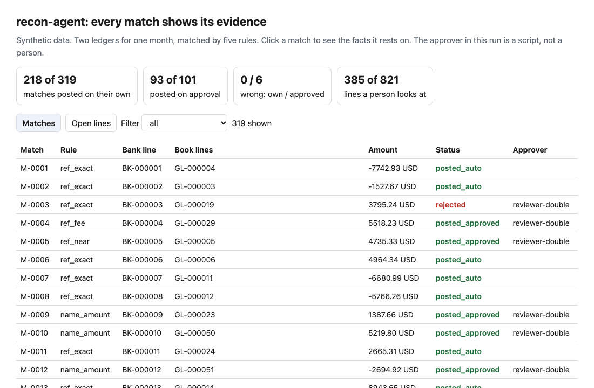
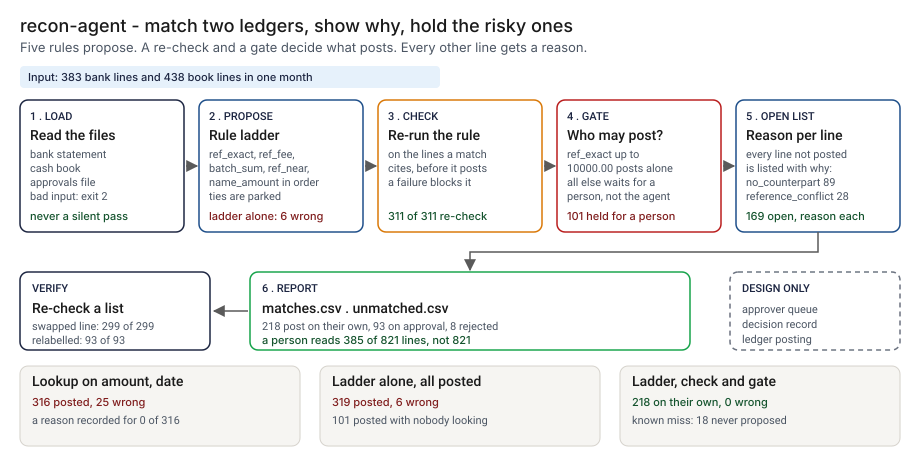
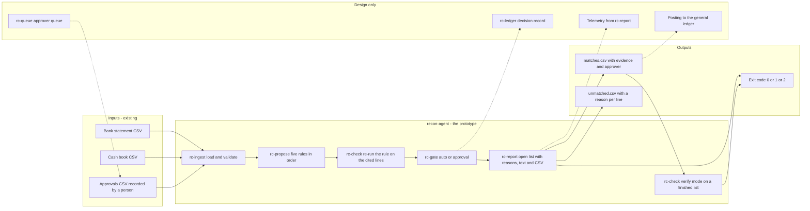
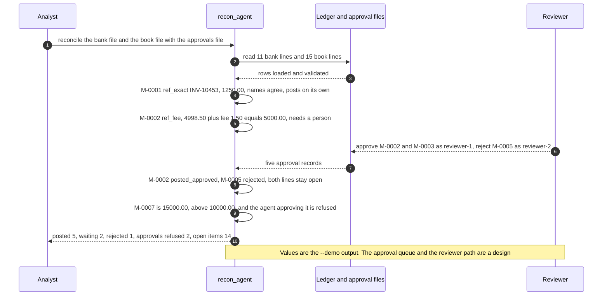

# 🧾 recon-agent (match with evidence): a ledger reconciler that has to show why two lines are one

**I wanted to know whether an agent that reconciles two ledgers can be made to show its work, and what that costs. This is a command-line tool that matches a bank statement to a cash book with five plain rules, cites the lines and the facts behind every match, re-runs the rule on those lines before anything posts, and holds the riskier matches for a person's approval.** On 383 bank lines and 438 book lines of synthetic data it posted 218 matches on its own with none wrong, held 101 for a person, and listed every one of the 169 lines still open with a reason. The part that does not hold is the person: the stand-in approver passed 6 look-alike invoices that were not matches.

**▶ Static demo, no install:** [open demo.html](./demo.html)

[](./demo.html)

## Executive summary (90 seconds)

**Problem.** The operations analyst who closes the month holds two ledgers for the same cash, the bank's and the company's, and the totals do not agree. 🟢 In the synthetic month that is 383 bank lines and 438 book lines, 821 to read side by side, and the USD totals differ by 139980.34 (`step_01_two_ledgers_unmatched.py`). The total does not say which lines are out. The usual first build is a lookup on amount and date. 🟢 It posts 316 matches, 291 right and 25 wrong, and records a reason beyond amount and date for 0 of 316 (`step_02_amount_and_date_lookup.py`). The ledgers look closer to agreeing, and nobody can tell which 25 are the wrong ones.

**Product.** recon-agent is a command that matches a bank statement to a cash book with five rules in a fixed order: `ref_exact`, `ref_fee`, `batch_sum`, `ref_near` and `name_amount`. Every match prints the rule, the lines and the facts it rests on: reference, amount, date gap and counterparty. A check re-runs the rule on exactly those lines before anything posts. A gate then decides who may post it: only `ref_exact`, at or below 10000.00 and with the names agreeing, posts on its own. Every other match waits for a recorded approval from someone other than the agent, bound to that exact proposal. When two book lines fit equally well, the bank line is parked, not guessed. Every line that is not posted is listed with a reason. There is no model call; the proposer is a rule ladder you can read.

**Measured and modeled performance.**

- 🟢 **A lookup on amount and date posts 316 matches, 25 of them wrong,** and records a checkable reason for 0 of 316. Its wrong matches are currency_clash 5, lookalike_conflict 10, near_ref_distinct 6 and twin_payments 4 (`step_02_amount_and_date_lookup.py`, `step_03_deficiencies_exposed.py`).
- 🟢 **The five-rule ladder alone, with every proposal posted at once, posts 319 matches, 6 wrong,** and 101 of them are matches the policy says a person must see (`step_03_deficiencies_exposed.py`).
- 🟢 **With the check and the gate, 218 matches post on their own and 0 are wrong;** 101 wait for a person, 93 post on approval and 8 are rejected (`step_04_with_gate.py`).
- 🟢 **The gate and the check refuse tampering.** Posted where the policy needs an approval and none is on record: 0. Self-approval by the agent is refused 101 of 101 times. A hand-edited finished list is caught: one book line swapped for another 299 of 299, an approved match relabelled as posted on its own 93 of 93, a match copied under a second id 311 of 311 (`step_04_with_gate.py`).
- 🟢 **A person looks at 385 of 821 lines instead of 821,** and the 169 open lines each carry a reason (`step_04_with_gate.py`).
- 🟢 **Known miss, two parts.** 18 true matches never get a proposal and sit in the open list. The scripted approver approved all 21 `ref_near` proposals, and 6 of them are distinct invoices one edit away from a real one, so 6 wrong matches posted with a name on them (`step_04_with_gate.py`).
- 🟡 **Utility: (25 − 6) × 12 = 228 wrong matches a year not posted** compared with the amount-and-date lookup, assuming 12 month-end closes of this size a year.
- 🔴 **Design target: a month-end run within 10 minutes of both exports landing, with an approval queue that shows the cited lines.** Designed in [`ARCHITECTURE.md`](./ARCHITECTURE.md), never built or timed.

**What I would ask a head of operations to decide.** Whether a match whose references are one edit apart may post on a single approval. I set it to approval-only as my policy, not as a measurement, and my stand-in approver let 6 look-alike invoices through. My recommendation is to adopt the ladder, the check and the gate as written, pilot them on one real month with a named reviewer who must open the invoice for every `ref_near` match, and count the approvals that turn out wrong before any rule other than `ref_exact` is allowed to post on its own.

**Call to action.** Fork the repo. Swap `data/ledger_a.csv` and `data/ledger_b.csv` for your own exports and keep the columns (bank: `a_id, value_date, amount, currency, counterparty, narrative, customer_ref`; book: `b_id, posting_date, amount, currency, counterparty, reference, batch_id, memo`). Set the window, the fee schedule and the approval limit in `Params` in `src/recon_agent.py`. To call it from code, import `reconcile` and `verify_matches`. Send findings by opening an issue: say which rule fired and how many lines, not the data itself.

_A portfolio prototype on synthetic data. Nothing here is deployed, load-tested or used by anyone, and the approver is a script I wrote, not a person._

## Run one now

```bash
cd 57-recon-agent/src && python3 recon_agent.py --demo
```

It prints, for a worked month of 11 bank lines and 15 book lines:

```text
recon-agent: 11 bank lines, 15 book lines, date window 3 days, a person approves above 10000.00 and for every rule except ref_exact
M-0001 posted_auto     ref_exact   BK-000001 = GL-000001
    ref inv-10453 = INV-10453 | amount 1250.00 USD = 1250.00 USD | gap 0 days | names agree
M-0002 posted_approved ref_fee     BK-000002 = GL-000002 by reviewer-1
    ref INV-10460 = INV-10460 | amount 4998.50 USD + fee 1.50 = 5000.00 | gap 0 days | names agree
M-0003 posted_approved batch_sum   BK-000003 = GL-000003,GL-000004,GL-000005 by reviewer-1
    ref BT-0304 is the batch id on 3 book lines | amount 3000.00 USD = 1000.00 + 1200.00 + 800.00 | gap 0 days | names agree
M-0004 posted_auto     ref_exact   BK-000004 = GL-000006
    ref PMT-004517 = PMT-4517 | amount -780.00 USD = -780.00 USD | gap 1 day | names agree
M-0005 rejected        ref_near    BK-000005 = GL-000007 by reviewer-2
    ref INV-10481 vs INV-10418, one edit apart | amount 2200.00 USD = 2200.00 USD | gap 0 days | names agree
M-0006 pending         name_amount BK-000006 = GL-000008
    ref bank blank, book INV-10477 | amount 6400.00 USD = 6400.00 USD | gap 0 days | names agree
M-0007 pending         ref_exact   BK-000010 = GL-000013
    ref INV-10500 = INV-10500 | amount 15000.00 USD = 15000.00 USD | gap 0 days | names agree
M-0008 posted_auto     ref_exact   BK-000011 = GL-000014
    ref INV-10490 = INV-10490 | amount 410.00 USD = 410.00 USD | gap 0 days | names agree
refused: reviewer-1 on name_amount:BK-000006:GL-000016:640000: stale: no current proposal has this key
refused: recon-agent on ref_exact:BK-000010:GL-000013:1500000: self-approval: the proposer cannot approve
open items: 14
  A BK-000005   2200.00 rejected_by_reviewer: M-0005 ref_near rejected by reviewer-2
  A BK-000006   6400.00 awaiting_approval: M-0006 name_amount needs a person because no reference on one side
  A BK-000007    900.00 ambiguous_candidates: cannot be told apart from: GL-000009, GL-000010
  A BK-000008    -35.00 no_counterpart: nothing on the other side meets any rule
  A BK-000009   1200.00 reference_conflict: same amount, counterparty and window as GL-000012, but the references...
  A BK-000010  15000.00 awaiting_approval: M-0007 ref_exact needs a person because the amount is above 10000.00
  B GL-000007   2200.00 rejected_by_reviewer: M-0005 ref_near rejected by reviewer-2
  B GL-000008   6400.00 awaiting_approval: M-0006 name_amount needs a person because no reference on one side
  B GL-000009    900.00 ambiguous_candidates: cannot be told apart from: BK-000007
  B GL-000010    900.00 ambiguous_candidates: cannot be told apart from: BK-000007
  B GL-000011  -2150.00 no_counterpart: nothing on the other side meets any rule
  B GL-000012   1200.00 reference_conflict: same amount, counterparty and window as BK-000009, but the references...
  B GL-000013  15000.00 awaiting_approval: M-0007 ref_exact needs a person because the amount is above 10000.00
  B GL-000015    410.00 possible_duplicate: identical in every compared field to GL-000014, which is in a match o...
posted 5 (3 on their own, 2 on approval); waiting 2; rejected 1; blocked by the check 0; approvals refused 2
```

Standard library only, Python 3.9 or newer. To run it on your own two CSV files: `python3 recon_agent.py reconcile bank.csv book.csv --approvals approvals.csv --out out/`, then `python3 recon_agent.py verify bank.csv book.csv out/matches.csv` to re-check the finished list. `verify` exits 1 when a posted match no longer re-checks, and `reconcile --fail-on-open` exits 1 when any line is still open; bad input exits 2 with one line.

## What the numbers say

**What it shows** (🟢 measured on synthetic data: one month, two ledgers, an answer key built by the generator; the script is named in brackets. 🟡 is modeled, with the assumption named):

- 🟢 Two ledgers and no matching: 383 bank lines and 438 book lines, 821 to read side by side, and the USD totals differ by 139980.34. The total does not say which lines are out (`step_01`)
- 🟡 Reading all 821 lines at one minute each is 13.7 hours. The one minute is my assumption, not a measurement (`step_01`)
- 🟢 A lookup on amount and date posts 316 matches: 291 right, 25 wrong, and a recorded reason for 0 of 316 beyond amount and date (`step_02`)
- 🟢 Its 25 wrong matches are currency_clash 5, lookalike_conflict 10, near_ref_distinct 6 and twin_payments 4. It cannot make fee_netted 20 or batch 12 at all (`step_03`)
- 🟢 The five-rule ladder alone, with every proposal posted at once, posts 319 matches, 6 of them wrong; 101 are matches the policy says a person must see (`step_03`)
- 🟢 With the check and the gate: 218 matches post on their own and 0 are wrong; 101 wait for a person; 93 post on approval and 8 are rejected (`step_04`)
- 🟢 Posted where the policy needs an approval and none is on record: 0. Self-approval by the agent, in three spellings, is refused 101 of 101 times; an approval for a proposal that no longer exists is refused 101 of 101; an approve and a reject on one proposal leave 10 of 10 pending (`step_04`)
- 🟢 Re-checking a finished list catches hand edits: one book line swapped for another 299 of 299, an approved match relabelled as posted on its own 93 of 93, a match copied under a second id 311 of 311 (`step_04`)
- 🟢 A person looks at 385 of 821 lines instead of 821, and the 169 open lines each carry a reason: no_counterpart 89, reference_conflict 28, ambiguous_candidates 18, rejected_by_reviewer 16, currency_differs 10, possible_duplicate 8 (`step_04`)

## What it still gets wrong

- 🟢 18 true matches never get a proposal: no_ref_abbrev 4, out_of_window 6, ref_garbled 4 and split_no_batch 4. A split deposit with no batch id on the book lines is the one I left in on purpose (BK-000029, BK-000217, BK-000254 and BK-000279; `step_03` prints each). They sit in the open list with a reason, so nobody is told they matched (`step_03`, `step_04`)
- 🟢 The gate records who approved. It does not make the approver careful. The scripted approver approved all 21 ref_near proposals, and 6 of them are distinct invoices one edit away from a real one, so 6 wrong matches posted with a name on them. The same script rejected 8 right matches because the payer name differed. The 15 real typos and the 6 look-alikes need the invoice to tell apart, and the script never opens it (`step_04`)
- **The approver here is a script I wrote, not a person.** It reads what is printed with each proposal and approves unless the counterparty names differ. Its blind spots are my choice. How a real reviewer behaves is 🔴 hypothetical: I have not tested one.
- **The data and the rules share an author.** I planted the cases and wrote the five rules, so 0 wrong among 218 matches posted on their own shows the rules cover what I planted. The first draft of the data was easier. I then added the hard cases: look-alike invoices, a currency clash, twin payments, and four kinds of true match the rules cannot reach. Treat the numbers as a ceiling for these rules, not a rate on a real bank. The date lag on the ordinary pairs is 0 to 3 days and the window is 3 days, so the window covers them by construction; only the out_of_window kind falls outside it.
- Amounts must match to the cent. There is no tolerance for rounding and no currency conversion. A fee is netted only from a credit, and only if it is on the fee schedule I gave the tool. The name table knows three abbreviations; the generator uses four.
- 🟡 The window (3 days), the approval limit (10000.00), the fee schedule (1.50, 2.50 and 15.00) and the rule that only `ref_exact` may post on its own are assumptions, not taken from any rule or bank. They are parameters at the top of `src/recon_agent.py`.
- There is no model in this folder. The proposer is a rule ladder. If a model were to propose matches, the check and the gate are the part I would keep; I have not tested that. 🔴
- I ran it on about 800 lines. I have not measured it on thousands.

## How the four steps fit

| Step | Question | Script |
|---|---|---|
| 1 | What is in front of a person with two ledgers and nothing matched? | `step_01_two_ledgers_unmatched.py` |
| 2 | What does a lookup on amount and date post, and what can anyone check? | `step_02_amount_and_date_lookup.py` |
| 3 | Where does each version fail against the answer key? | `step_03_deficiencies_exposed.py` |
| 4 | What do evidence, a re-check and an approval gate change? | `step_04_with_gate.py` |

Run any of them from `src/`. Step 4 writes `src/out/` (git-ignored), and `python3 _build_demo.py` turns that into `demo.html`. The data comes from [`data/_generate.py`](./data/README.md); `tools/check_repo.py` confirms that a rerun reproduces every file and that the green numbers above appear in a script's output.

The five rules, in order: `ref_exact` (same reference, amount, currency, within the window; posts on its own at or below the limit when the names agree), `ref_fee` (reference equal, amount short by a scheduled fee), `batch_sum` (the bank reference is the explicit batch id on 2 to 6 book lines that add up), `ref_near` (references one edit apart), `name_amount` (no reference on one side; same name and amount). Every rule except the first waits for a person. When two book lines fit equally well and are not identical, the bank line is parked for a person instead of guessed. Each proposal prints a key such as `ref_fee:BK-000002:GL-000002:499850`; an approval binds to exactly that key.

## Utility delivered

The way I price product impact: **utility = (my solution − current state of the art) × the number of people or items it affects.**

Here the item is a wrong match posted to the cash ledger in a month. Each one lands on the analyst who closes the month, the reviewer who approved it and whoever finds the difference later. The common basic approach is a lookup on amount and date; the table prices recon-agent against it.

| Term | Value | Where it comes from |
| --- | --- | --- |
| Current state of the art (lookup on amount and date), wrong matches posted | 🟢 **25 wrong**, among 316 posted | `step_02_amount_and_date_lookup.py`; it records a reason beyond amount and date for 0 of 316 |
| My solution (ladder, check and gate), wrong matches posted | 🟢 **6 wrong**: 0 on their own among 218, 6 among 93 posted on approval | `step_04_with_gate.py`; the 6 are near_ref_distinct, approved by the scripted approver |
| Lift per month | 🟢 25 wrong minus 6 wrong | The lookup's 25 are currency_clash 5, lookalike_conflict 10, near_ref_distinct 6 and twin_payments 4 (`step_03_deficiencies_exposed.py`). The ladder removes all but the 6 near_ref_distinct |
| Number it affects: month-end closes of this size in a year | 🟡 **12** | **Assumption, not a statistic.** Replace it with your own count of reconciliations a year at roughly this volume |
| Assumption that makes the lift real | 🟡 The rules cover the cases a real month holds, and a real reviewer opens the invoice for a `ref_near` match | With this stand-in approver the gate does not lower the count of wrong matches below the ladder alone: 🟢 6 either way (`step_03_deficiencies_exposed.py`, `step_04_with_gate.py`). What the gate adds is a name on each approval and 0 posted without one |
| **Utility** | 🟡 **(25 − 6) × 12 = 228 wrong matches a year not posted** compared with the lookup | Assumes the 12 months behave like the planted one |

Sensitivity to the count assumption (🟡, same lift): 6 closes a year gives 114, 12 gives 228, 24 gives 456.

🔴 What I have not measured: what a wrong match costs in rework or a misstated cash position, how long an approval takes, how many of the 101 held matches a real reviewer would reject or approve wrongly, or how the tool behaves on thousands of lines. The planted month is built to include hard cases on purpose; a real month has fewer. Treat the result as a property of this mix of cases, not a forecast.

---

## Architecture and call flow

Component names match [`ARCHITECTURE.md`](./ARCHITECTURE.md). GitHub renders the diagrams natively.



**System topology:**



**Per-run sequence** (the `--demo` run, a worked month of 11 bank lines and 15 book lines):



**Interlocks (all red, designed, none built):**

- [27 AgentKit](../27-agentkit-reference-agent-and-playbook/) is where the pattern came from: a person-held gate, a scripted stand-in for the person, and no approval from the agent itself. I wrote the matching rules here and copied no code from that folder.
- [08 OversightOps](../08-oversightops-hitl-workflow/) is the possible home for the approver queue (`rc-queue`), including how many matches one reviewer can read in a day.
- [09 LineageLog](../09-lineagelog-ai-decision-audit/) is a possible home for the decision record (`rc-ledger`).
- [05 AgentWatch](../05-agentwatch-agent-observability/) would watch the run after release. recon-agent produces counts and rejections and does no monitoring of its own.

---

## PM artifacts

The PM artifacts that show how I would run this product if I owned the seat. This README is the walkthrough; the rest of the folder holds:

- [`PRD.md`](./PRD.md): the product requirements doc, with users, backlog, KPIs, rollout and open questions.
- [`ARCHITECTURE.md`](./ARCHITECTURE.md): the systems doc, with components, data model, security, failure behavior and operations. A design, not deployed.
- [`demo.html`](./demo.html): clickable, no-install walkthrough, built from the step outputs by `src/_build_demo.py`.
- [`data/`](./data/): the synthetic bank statement and cash book, the answer key, the worked month behind `--demo` and the seeded generator. `data/README.md` explains how the key is made.
- [`src/`](./src/): `recon_agent.py`, `common.py`, the four step scripts and the demo builder.
- [`tests/`](./tests/): 91 unittest tests, including a golden test that pins the numbers above and tests for bad input and hostile strings.

Run the four steps end to end:

```bash
cd src
python3 step_01_two_ledgers_unmatched.py
python3 step_02_amount_and_date_lookup.py
python3 step_03_deficiencies_exposed.py
python3 step_04_with_gate.py
```

---

## Aligned to

Nothing. I have not mapped this to a standard, a regulation or a published control, so I claim no alignment. It is a prototype on synthetic data.

It borrows a pattern from [27 AgentKit](../27-agentkit-reference-agent-and-playbook/): a person-held gate, a scripted stand-in for the person, and no approval from the agent itself. I wrote the matching rules here and copied no code from that folder.

## Data and limits

Synthetic, seeded, byte-for-byte reproducible. Nothing comes from any employer, customer or real bank, and the counterparty names are invented. A prototype on synthetic data, not a production case study. The files and the planted kinds are listed in [`data/README.md`](./data/README.md).

## Fork it

Swap `data/ledger_a.csv` and `data/ledger_b.csv` for your own exports and keep the columns, or point `reconcile` at two files from your system. Change the window, the fee schedule or the limit in `Params`. Read the [PRD](./PRD.md) for the scope I held to.

## Prereqs to run this on your laptop

You need Python 3.9 or newer and nothing else. The tool, the four step scripts and the data generator use only the standard library, so there is nothing to install. There is no API key, no network call and no model call anywhere in the folder. To run the tests, use `python3 -m unittest discover -s tests` from this folder. The production pieces in [`ARCHITECTURE.md`](./ARCHITECTURE.md) (the approver queue, the decision record, telemetry, posting to a ledger system) are a design, not something you need or can run.

## Author

**Vijay Saharan**, Sr Product / Program Manager · AI in BFSI · Enterprise AI Platforms

[LinkedIn](https://www.linkedin.com/in/vijaysaharan/)
