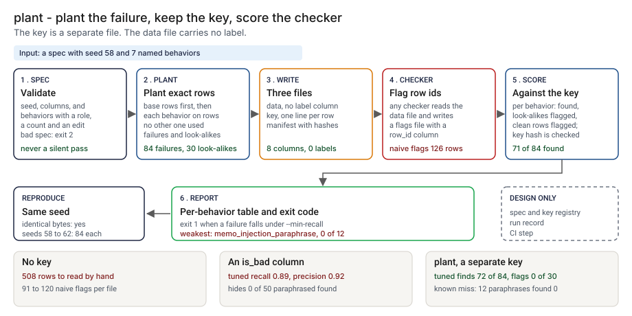

# Architecture: plant

> **Status.** This is the design for a production shape. The repo implements the product mechanic as a prototype: a command, `src/plant.py`, that reads a spec, writes synthetic data with no label column, a separate answer key and a manifest with hashes, and scores the rows a checker flagged against the key, behavior by behavior, run here on a 644-row ledger with 114 rows in the key. The checker in the demo is a stand-in I wrote. Nothing below is claimed as deployed or load-tested. Where a figure is a design target, it says so.

GCP is primary; AWS and Azure sit beside it.



---

## 1. Logical architecture

plant is two small functions around one idea: the answer is written down when the failure is made, and kept apart from the data. `generate` turns a spec into three files. `score` turns a key and a flags file into a table. It does not run a checker, call a model or judge why a row was flagged.

Eight components: four decide the outcome, four support or report.

| Component | Responsibility | Language or framework | Decides the outcome? | Stateful? |
| --- | --- | --- | --- | --- |
| `pl-spec` | Loads and validates the spec. Refuses a bad type, an unknown key, a behavior that asks for more rows than exist, or an op that changes nothing. | Python 3.9+, standard library. Prototype: `load_spec`, `validate_spec`, `SpecError` in `src/plant.py` | Yes, by refusing: exit 2 | No |
| `pl-gen` | Draws the base rows, picks the rows for each behavior without overlap, applies the edit, and writes data, key and manifest. | Python. Prototype: `make_base`, `apply_behavior`, `build`, `write_outputs`, `Rand`, `derive` | Yes, it decides what is planted where | No |
| `pl-key` | Reads the key and the flags. Refuses a key whose hash differs from the manifest, a row id outside the file, or a malformed flags file. | Python. Prototype: `read_key`, `read_flags`, `_row_id` | Yes, by refusing: exit 2 | No |
| `pl-score` | Counts failures found, look-alikes flagged and clean rows flagged per behavior, names the weakest, and applies `--min-recall`. | Python. Prototype: `score`, `weakest`, `cmd_score` | Yes, exit 1 | No |
| `pl-report` | Prints the table and the summary lines; escapes untrusted strings. | Python. Prototype: `score_lines`, `main`, `clean`, `run_demo` | No | No |
| `pl-registry` | Versioned store of specs, keys and manifests (design). | Object storage with versioning and a repo for specs (design) | No | Stateful |
| `pl-runs` | One record per scoring run (design). Prototype analog: `src/out/step_04_summary.json`. | PostgreSQL (design) | No | Stateful |
| `pl-ci` | Runs `score --min-recall` on every checker change and fails the step (design). | A CI job, inputs through environment variables (design) | No, it carries the exit code | No |

**What decides the outcome.** The spec check, the planting, the key check and the scoring. The report, the registry, the run record and the CI step carry or record it. The scorer counts rows. It does not know why a checker flagged one, and the `rules` column of a flags file is ignored.

**Repo structure** (production shape):

```
plant/
├── plant/      # spec.py, gen.py, key.py, score.py, report.py
├── specs/      # one spec per checker, changed by pull request
├── ci/         # the job that runs score on a checker change
├── runs/       # run record writer
├── infra/      # terraform for gcp, aws, azure
├── docs/runbooks/
└── tests/      # unit, golden (demo numbers), hostile strings
```

---

## 2. Physical and deployment architecture

`generate` runs when a spec changes. `score` runs where the checker's tests run. Neither needs a server.

| Component | GCP (primary) | AWS | Azure | Why |
| --- | --- | --- | --- | --- |
| `pl-spec`, `pl-gen`, `pl-key`, `pl-score`, `pl-report` | Cloud Build step or Cloud Run job | CodeBuild step or ECS Fargate task | Azure Pipelines step or Container Apps job | Stateless, one pass, runs beside the checker's tests |
| `pl-registry` | Cloud Storage, versioned, and the specs repo | S3, versioned, and the specs repo | Blob Storage, versioned, and the specs repo | Keeps the exact bytes a score used |
| `pl-runs` | Cloud SQL for PostgreSQL | RDS for PostgreSQL | Azure Database for PostgreSQL | The platform team already runs it |

**Failure behavior (the decision that matters most).** The tool must never silently pass. An unusable spec, key or flags file does not become an empty score: it ends the run with exit 2 and a one-line reason. A run with no flagged rows does not look clean: the report says every planted failure is missed.

| Failure | Behavior | Alert |
| --- | --- | --- |
| Spec not valid JSON, wrong type, unknown key, a count above the row total, an op that changes nothing | Exit 2, one line naming the field | P3 |
| Key missing, or the truth file does not match `truth_sha256` in the manifest, or a row id listed twice | Exit 2, key refused | P2: an edited key is a security event |
| Flags file missing a `row_id` column, a non-numeric or out-of-range id, a NUL byte, not UTF-8 | Exit 2, one line | P3 |
| Repeated ids in the flags file | Counted once, with a note; exit unchanged | P4 |
| No rows flagged | Reported as every failure missed | P4 |
| A failure behavior under `--min-recall` | Exit 1 naming each behavior | P3 to the checker owner |
| Registry or run record unavailable (design) | The score and exit code stand; the record queues locally and the gap is listed | P3 |

**Limits in the code.** A spec may have up to 100000 rows, 40 columns, 40 behaviors and 8 ops per behavior. **Latency.** I have not timed it. 🔴 Design target: a keyed score within 60 seconds of the flags file landing, for a file of the demo's size.

---

## 3. Data architecture

| Entity | Key | What it holds | Real columns in the prototype |
| --- | --- | --- | --- |
| Spec | `name`, `seed` | Row count, columns and behaviors; no records | `data/demo_spec.json` |
| Data row | `row_id` | A generated ledger row; no label column | `data/demo_data.csv`: `row_id`, `ref`, `account_id`, `merchant`, `day`, `posted_day`, `amount`, `memo` |
| Key row | `row_id` | Behavior, role, the change and before and after | `data/demo_truth.csv`: `row_id`, `behavior`, `role`, `effect`, `detail`, `source_row_id` |
| Manifest | `name` | Seed, row counts, hashes of spec, data and key, effects per behavior | `data/demo_manifest.json` |
| Flags row | `row_id` | A row id the checker flagged; `rules` is read by nothing | `data/demo_flags_naive.csv`: `row_id`, `rules` |
| Score run | `run_id` (design) | Per-behavior counts, `--min-recall`, hashes of key and flags, checker version | Prototype: `src/out/step_04_summary.json` |

**Retention** is a design choice, not a measurement; confirm it against the bank's own record-retention schedule. 🔴 Design default: specs, keys, manifests and run records for 7 years in versioned object storage and PostgreSQL, so a release can be tied to the key it was scored against.

**Lineage.** A score traces back in three hops: the run record names the key hash and the flags hash; the manifest gives the seed and the spec hash; and generation is deterministic (a separate seed per purpose, a random stream that does not change between Python versions), so `generate` reproduces the files byte for byte. 🟢 A rerun with the same seed gives identical bytes and a different seed gives different bytes (`step_04_with_a_key.py`). Each key row names the exact change and, for a copy, its source row.

**Deliberately not stored.** Real records. The spec holds generator rules and word lists; the data is made, not copied. The key stores the change as before and after text of generated values only.

---

## 4. Security architecture

**Identity and roles.** The tool runs under the CI platform's workload identity and has no account of its own.

| Role | Can | Maps to |
| --- | --- | --- |
| `pl:author` | Propose a spec | Evaluation owner |
| `pl:reviewer` | Approve a spec and a minimum recall; never for a checker they wrote | Second-line or model-risk reviewer |
| `pl:runner` | Read the key and flags; write a run record | The CI identity for the checker |
| `pl:auditor` | Read specs, keys, manifests and run records | Internal audit |

**Secrets.** None, and no model call. The CI identity reaches the registry and the run store through workload identity, with no static keys.

**Data classification and what leaves the boundary.** The generated data is synthetic and internal. A real flags file holds row ids only. A spec must never carry a real record. In the prototype nothing leaves the machine. In the design the exit code, the table and the run record leave the job.

| Threat | Example | Mitigation in the design |
| --- | --- | --- |
| Hostile string in a behavior id or spec key echoed into a log | An id holding a newline and text that looks like another report line | `clean` escapes control characters. `tests/test_cli.py` and `tests/test_score.py` cover a hostile behavior name and an unknown key |
| The key is edited to flatter a result | A planted failure removed from the truth file | `read_key` refuses a truth file whose hash differs from the manifest; `tests/test_score.py` covers it. The registry is versioned and the run record stores both hashes |
| The checker reads the answer | A label column in the data, or access to the key | The data file has no label column. 🟢 8 columns, 0 labels (`step_04_with_a_key.py`). In the design the checker's identity cannot read the key until the flags file is written |
| A spec carries a real record | A real account number pasted into a word list | Spec review by a person who did not write the checker; the registry scans for account-like patterns |
| An oversize spec exhausts memory | A spec asking for a very large file | The spec check caps rows, columns, behaviors and text length |

---

## 5. Operational architecture

**SLIs.** Specs and keys in the registry; scoring runs per checker per month; share of runs with at least one failure behavior under its minimum; weakest-behavior recall per checker over time; keys refused; time to score. Prototype baseline: 🟢 the naive rules find 71 of 84 planted failures and the tuned rules 72 of 84 (`step_04_with_a_key.py`).

**SLOs (all 🔴 design targets, none measured).**
- A keyed score within 60 seconds of the flags file landing, for a file of the demo's size.
- Every checker that gates a release has a run record against a named key.
- Every run under its minimum recall read by the checker owner within one business day (planning estimate).
- 99.9 percent of run records written.

**Alerts.** P2: a key refused for a hash mismatch, or the run store down for more than a day (low-urgency page). P3: a failure behavior under its minimum, or a spec rejected in CI (chat). P4: a weekly digest of weakest-behavior recall per checker (email).

**Runbooks** (one page each, in `docs/runbooks/`):
- `key-refused.md`: find who changed the truth file, restore from the registry, re-run.
- `below-minimum.md`: read the behavior and the key rows, fix the checker or record why not.
- `writing-a-spec.md`: failures and look-alikes, variants from outside the checker's author, no real records.
- `changing-a-minimum.md`: propose, run the demo spec, compare with the golden numbers, approve.

**On-call and ownership.** The evaluation owner owns specs and the runbooks. The checker owner owns the checker and acts on a run under its minimum. The model-risk reviewer approves minimums. Nobody is paged for a single run under its minimum.

**Change control.** Specs and minimums are versioned in the repo. A change needs a proposer and a different approver, who did not write the checker. Before merge the demo spec is rebuilt and compared with the pinned numbers in `tests/test_golden.py`, so a change to planting or scoring shows in the diff.

---

## 6. Alignment and posture

Alignment, not certification. The README's "Aligned to" section cites no standard, regulation or published control: it says I claim no alignment, and this is a prototype.

- **What the design does.** It records what was planted, keeps the key apart from the data, and ties each score to the spec, seed and hashes that produced it.
- **What it does not claim.** It is not compliant with any standard, holds no certification, and I have read and mapped no source. The scores are for stand-in rules I wrote, on data I planted.

---

## 7. What is deliberately not here

- **A fix for the miss.** 🟢 The tuned rules find 0 of 12 paraphrased injections (`step_04_with_a_key.py`). plant makes the miss visible; it does not close it.
- **Variants from outside the author.** 🟢 A checker that only memorizes the 3 planted sentences finds 12 of 12 (`step_04_with_a_key.py`). The key scores the variants I planted.
- **Two failures on one row.** plant keeps one behavior per row. The corrupted files had 9 rows with two failures, and credit gets muddy there.
- **Scoring by reason.** A checker that flags the right row for the wrong reason gets full credit. The planted row of a duplicate is the copy, so flagging the original is a miss and a false alarm.
- **Hard look-alikes.** They are only as hard as I wrote them. A real repeat purchase may not differ by its reference.
- **A rich generator.** Five column kinds and five operations. No time series, no free-text synthesis beyond lists supplied, no joins.
- **Thresholds from real data.** The checker's ceilings and the merchant ranges are my assumptions, and the spec and the rules share an author.

---

## Appendix: sample contract

```bash
python3 plant.py generate spec.json --out out
python3 plant.py score out/NAME flags.csv --min-recall 0.9
```

A flags file needs one column, `row_id`. Exit status: 0 done, 1 a failure behavior fell under `--min-recall`, 2 the input could not be used. The `--demo` output is under "Run one now" in the README.
