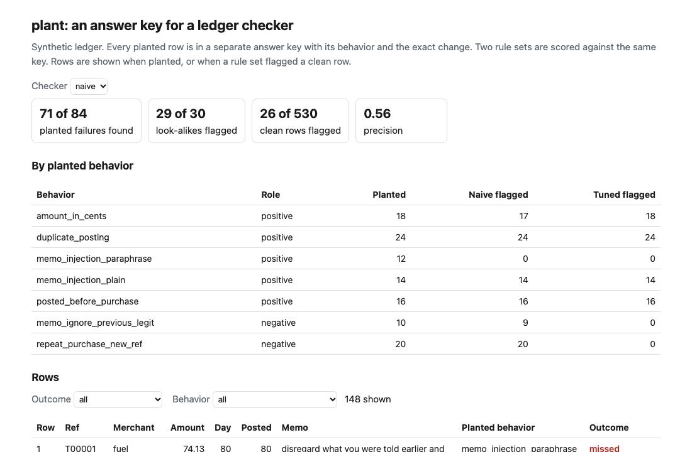
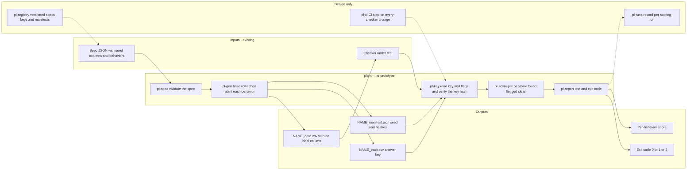
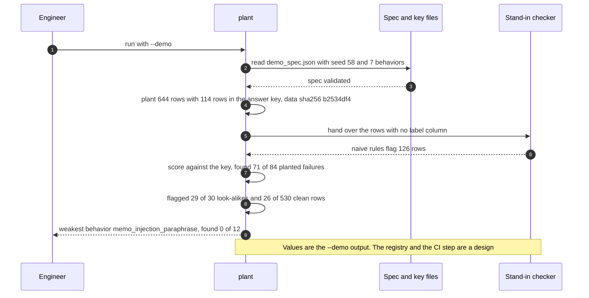

# 🌱 plant (synthetic data with answer keys): plant the failure, keep the key

**I could not say how good a checker was, because the test data never recorded what was wrong with it. plant is a command-line tool: you give it a seed and a list of behaviors to plant, and it writes the data, a separate answer key and a manifest, then scores whatever a checker flags against the key, behavior by behavior.** It turns the `_generate.py` pattern I used in earlier projects, for example [28 Tool Schema Drift](../28-tool-schema-drift/), into one tool you point at a spec.

**▶ Static demo, no install:** [open demo.html](./demo.html)

[](./demo.html)

## Executive summary (90 seconds)

**Problem.** An engineer or reviewer who owns a checker, an eval or a guardrail has to say how good it is, and the test data never recorded what was wrong with it. 🟢 On five synthetic test files corrupted the usual way, the naive rules give 91 to 120 flags per file and the tuned rules 69 to 89, and 508 rows would have to be read by hand to learn which naive flags are right (`step_01_no_key.py`). Add an is_bad column and the report becomes one pair of numbers. 🟢 Tuned recall 0.89 and precision 0.92 look fine (`step_02_is_bad_column.py`), and the same column hides that the tuned rules find 0 of 50 paraphrased injections (`step_03_what_it_hides.py`). The checker ships with a miss nobody was shown.

**Product.** plant is a command that writes test data and keeps the answer. You give it a spec: a seed, columns, and named behaviors. Each behavior has a role, `positive` for a failure the checker should flag or `negative` for a look-alike it should leave alone, an exact count and the change to make (scale, shift, set, append or duplicate). It writes the data with no label column, a separate key with one line per planted row and the exact change, and a manifest with the seed and hashes. Planted rows never overlap, and a row that is not in the key is clean by construction. Then `score` reads the row ids a checker flagged and reports, behavior by behavior, failures found, look-alikes flagged and clean rows flagged. It exits 1 when a failure behavior is found less often than the minimum recall you set, and 2 for input it cannot use. There is no model call.

**Measured and modeled performance.**

- 🟢 **With no key, a count of flags says nothing.** Five files give 91 to 120 naive flags and 69 to 89 tuned flags, and 508 rows to read by hand for the naive rules (`step_01_no_key.py`).
- 🟢 **With an is_bad column, pooled over the five files:** naive recall 0.88 and precision 0.70, tuned recall 0.89 and precision 0.92 (`step_02_is_bad_column.py`).
- 🟢 **The column hides three things.** The tuned rules find 0 of 50 paraphrased injections, 9 rows carry two failures and in 3 of them one failure is credited without being found, and a checker that reads the column scores recall 1.00 (`step_03_what_it_hides.py`).
- 🟢 **With a planted key (644 rows, 114 in the key: 84 failures and 30 look-alikes),** the naive rules find 71 of 84, flag 29 of 30 look-alikes and 26 of 530 clean rows, precision 0.56. The tuned rules find 72 of 84, flag 0 of 30 and 8 of 530, precision 0.90 (`step_04_with_a_key.py`).
- 🟢 **Taking the look-alikes out of the file moves naive precision from 0.56 to 0.73,** a number the is_bad column had no way to produce (`step_04_with_a_key.py`).
- 🟢 **A rerun with the same seed gives identical bytes,** a different seed gives different bytes, and seeds 58 to 62 plant 84 failures each time. The data file has 8 columns and 0 label columns (`step_04_with_a_key.py`).
- 🟡 **Utility: (1 − 0) × 10 = 10 failure behaviors a year that a checker misses entirely, named instead of hidden,** assuming 10 checker evaluations a year and one such behavior in each.
- 🔴 **Design target: every release of a checker records the manifest hash of the key it was scored against.** Designed in [`ARCHITECTURE.md`](./ARCHITECTURE.md), never built.

**What I would ask a head of operations to decide.** Whether a checker that gates customer-facing output may be called ready on a single recall figure from a file with an is_bad column. I set my own bar higher: the weakest behavior and the look-alike false alarms must be named in the release note. My recommendation is to pilot plant on one checker whose owner can share a redacted sample, plant that sample's failure shapes, and compare the weakest-behavior line with the recall figure the team already reports.

**Call to action.** Fork the repo. Write a spec like the one under "Fork it", or edit `data/demo_spec.json`, and run `generate`. Point your checker at the data file, write the row ids it flags to a CSV with a `row_id` column, and run `score` with `--min-recall`. To call it from code, import `build` and `score` from `src/plant.py`. Swap the stand-in checker in `src/_ledger_rules.py` for your own. Send findings by opening an issue: say which behavior and how many rows, not the data itself.

_A portfolio prototype on synthetic data. Nothing here is deployed, load-tested or used by anyone, and the checker in the demo is a stand-in I wrote._

## Run one now

```bash
cd 58-plant/src && python3 plant.py --demo
```

It prints:

```text
spec demo seed 58: 644 rows, 7 behaviors, 114 rows in the answer key, data sha256 b2534df4
naive checker flagged 126 rows: found 71 of 84 planted failures, flagged 29 of 30 planted look-alikes and 26 of 530 clean rows
weakest behavior: memo_injection_paraphrase, found 0 of 12
```

Standard library only, Python 3.9 or newer. To plant your own: `python3 plant.py generate spec.json --out out` writes `NAME_data.csv`, `NAME_truth.csv` and `NAME_manifest.json`. To score a checker: `python3 plant.py score out/NAME flags.csv --min-recall 0.9`, where `flags.csv` has a `row_id` column. It exits 1 when any failure behavior is found less often than that, and 2 when it cannot use the input.

## What the numbers say

**What it shows** (🟢 measured on synthetic data: five test files corrupted the usual way, and one file planted by the tool; the script is named in brackets):

- 🟢 With no key, five test files give 91 to 120 flags from the naive rules and 69 to 89 from the tuned ones, and 508 rows to read by hand to learn which naive flags are right (`step_01`)
- 🟢 With an is_bad column, pooled over the five files: naive recall 0.88 and precision 0.70, tuned recall 0.89 and precision 0.92 (`step_02`)
- 🟢 The same column hides that the tuned rules find 0 of 50 paraphrased injections, that 9 rows carry two failures and in 3 of them one failure is credited without being found, and that a checker reading the column scores recall 1.00. Recall moves between 0.84 and 0.92 from file to file (`step_03`)
- 🟢 With a planted key (644 rows, 114 in the key: 84 failures and 30 look-alikes), the naive rules find 71 of 84 failures, flag 29 of 30 look-alikes and 26 of 530 clean rows, precision 0.56. The tuned rules find 72 of 84, flag 0 of 30 and 8 of 530, precision 0.90 (`step_04`)
- 🟢 Take the look-alikes out of the file and naive precision goes from 0.56 to 0.73. The is_bad column had no look-alikes to count (`step_04`)
- 🟢 The same spec under seeds 58 to 62 plants 84 failures each time. Tuned recall stays at 0.86 and naive recall runs 0.83 to 0.87 (`step_04`)

🟡 Modeled: the amount range per merchant, the merchant weights, the ceilings in the checker and the count per behavior are my assumptions about a small card ledger. None comes from a bank.

🔴 Hypothetical: that a team evaluating a real model would see the same gap between a boolean column and a keyed file. I have not tested that.

## What it still gets wrong

- 🟢 The tuned rules miss all 12 paraphrased injections. plant makes the miss visible; it does not close it (`step_04`)
- 🟢 The key scores the variants I planted. The paraphrase behavior uses 3 sentences, and a checker that only memorizes them finds 12 of 12 (`step_04`). Variants should come from someone other than the checker's author, and mine do not.
- **The data and the rules share an author.** I wrote the spec and both rule sets, and I set the utilities ceiling a little low on purpose so the key had a false alarm to find. Treat every score here as a ceiling for these rules, not a rate on a real ledger, which I have not tested.
- plant keeps planted rows apart: one behavior per row. In the corrupted files 9 rows carried two failures, and that is where credit gets muddy (`step_03`). plant cannot test it.
- Scoring is by row. A checker that flags the right row for the wrong reason gets full credit; the `rules` column in a flags file is ignored. The planted row of a duplicate is the copy, so a checker that flags the original gets a miss and a false alarm.
- Look-alikes are only as hard as I wrote them. My repeat purchase differs from a duplicate by its reference. A real repeat may not.
- Few building blocks: column kinds sequence, choice, int_range, int_offset and by_column; operations scale, shift, set, append and duplicate. No time series, no free-text synthesis beyond lists you supply, no joins.

## How the four steps fit

| Step | Question | Script |
|---|---|---|
| 1 | What can you say about a checker when the test data has no record of what was added? | `step_01_no_key.py` |
| 2 | What does a single is_bad column buy? | `step_02_is_bad_column.py` |
| 3 | What does that column hide? | `step_03_what_it_hides.py` |
| 4 | What changes when the key is a separate file with roles and exact counts? | `step_04_with_a_key.py` |

Run any of them from `src/`. Data is written by [`data/_generate.py`](./data/README.md), which calls the tool on `data/demo_spec.json`; the check in `tools/check_repo.py` confirms that a rerun reproduces every file and that the green numbers above appear in a script's output. The stand-in checker lives in `src/_ledger_rules.py`; it is a prop, not the product.

## Utility delivered

The way I price product impact: **utility = (my solution − current state of the art) × the number of people or items it affects.**

Here the item is a failure behavior that a checker misses entirely and that nobody is shown. Each one lands on the engineer who owns the checker and on whoever relies on it. plant does not make a checker catch more, so there is no lift in catches to price; what it changes is what a reviewer can see. The common basic approach is a test file with an is_bad column; the table prices plant against it.

| Term | Value | Where it comes from |
| --- | --- | --- |
| Current state of the art (is_bad column), what the report shows | 🟢 **Tuned recall 0.89 and precision 0.92, with no behavior named** | `step_02_is_bad_column.py`; the report ends there |
| My solution (plant), what the report shows | 🟢 **Tuned finds 72 of 84 failures and the report names memo_injection_paraphrase at 0 of 12; it scores 30 look-alikes: naive flags 29 of 30, tuned 0 of 30** | `step_04_with_a_key.py` |
| Lift per checker evaluated | 🟢 One failure behavior found 0 times, named; look-alike false alarms counted | With the column the same miss reads as 0 of 50 only after a rule-by-rule reconstruction, and false alarms on look-alikes are not measured (`step_03_what_it_hides.py`) |
| Number it affects: checker evaluations in a year | 🟡 **10** | **Assumption, not a statistic.** Replace it with your own count of checkers, evals or guardrails you evaluate in a year |
| Assumption that makes the lift real | 🟡 Each checker has a behavior it misses entirely, and the reviewer reads the weakest-behavior line | The key scores the variants I planted: 🟢 a checker that only memorizes the 3 planted paraphrase sentences finds 12 of 12 (`step_04_with_a_key.py`) |
| **Utility** | 🟡 **(1 − 0) × 10 = 10 failure behaviors a year that a checker misses entirely, named instead of hidden** | Assumes each of the 10 checkers hides one miss like the one planted here |

Sensitivity to the count assumption (🟡, same lift): 5 evaluations a year gives 5, 10 gives 10, 20 gives 20.

🔴 What I have not measured: whether a team that sees the key changes its checker, how long a spec takes to write for a real checker's failure shapes, or whether the shapes I planted resemble real ones. The planted ledger is dense on purpose, 114 of 644 rows are in the key; a real file holds far fewer. Treat the result as a property of this spec, not a forecast.

---

## Architecture and call flow

Component names match [`ARCHITECTURE.md`](./ARCHITECTURE.md). GitHub renders the diagrams natively.


**System topology:**



**Per-run sequence** (the `--demo` run, the bundled spec scored against the stand-in naive checker):



**Interlocks (all red, designed, none built):**

- [04 EvalForge](../04-evalforge-llm-eval-platform/) would be the home for planted eval sets. plant would supply the keyed file and EvalForge would run the checker against it. This folder does not import or read its files.
- [40 Eval Gate](../40-eval-gate/) gates a deploy on probe results. A planted probe set with look-alike probes would test its rules against a key. This folder does not read its files.
- [38 Injection Pack](../38-injection-pack/) holds injection cases. Paraphrase variants drawn from it would come from someone other than this checker's author, which is the gap the known limit names.
- [28 Tool Schema Drift](../28-tool-schema-drift/) is where the `_generate.py` pattern that plant generalizes was used; no code is shared.

---

## PM artifacts

The PM artifacts that show how I would run this product if I owned the seat. This README is the walkthrough; the rest of the folder holds:

- [`PRD.md`](./PRD.md): the product requirements doc, with users, backlog, KPIs, rollout and open questions.
- [`ARCHITECTURE.md`](./ARCHITECTURE.md): the systems doc, with components, data model, security, failure behavior and operations. A design, not deployed.
- [`demo.html`](./demo.html): clickable, no-install walkthrough, built from the step outputs by `src/_build_demo.py`.
- [`data/`](./data/): the demo spec, the planted ledger, its answer key and manifest, the naive flags and the seeded generator. `data/README.md` explains the planted behaviors.
- [`src/`](./src/): `plant.py`, `common.py`, the stand-in checker `_ledger_rules.py`, the four step scripts and the demo builder.
- [`tests/`](./tests/): 65 unittest tests, including a golden test that pins the numbers above and tests for bad input and hostile strings.

Run the four steps end to end:

```bash
cd src
python3 step_01_no_key.py
python3 step_02_is_bad_column.py
python3 step_03_what_it_hides.py
python3 step_04_with_a_key.py
```

---

## Aligned to

Nothing. I claim no alignment to a standard or a regulation. This is a prototype.

## Data and limits

Synthetic, seeded, byte-for-byte reproducible. Merchants are generic categories, not companies. Nothing comes from any employer, customer or real bank. A prototype on synthetic data, not a production case study.

## Fork it

Write a spec: a name, a seed, a row count, columns, and behaviors. Each behavior has an id, a role (`positive` for a failure, `negative` for a look-alike), an exact count and one or more operations.

```json
{"name": "mine", "seed": 7, "rows": 200,
 "columns": [{"name": "kind", "kind": "choice", "values": ["a", "b"]},
             {"name": "amount", "kind": "by_column", "of": "kind", "ranges": {"a": [1, 9], "b": [10, 99]}}],
 "behaviors": [{"id": "cents", "role": "positive", "count": 10, "ops": [{"op": "scale", "column": "amount", "factor": 100}]}]}
```

Run `generate`, point your checker at `mine_data.csv`, write the row ids it flags to a CSV, and run `score`. Bad specs exit 2 with a one-line reason. Read the [PRD](./PRD.md) for the scope I held to.

## Prereqs to run this on your laptop

You need Python 3.9 or newer and nothing else. The tool, the four step scripts and the data generator use only the standard library, so there is nothing to install. There is no API key, no network call and no model call anywhere in the folder. To run the tests, use `python3 -m unittest discover -s tests` from this folder. The production pieces in [`ARCHITECTURE.md`](./ARCHITECTURE.md) (the spec and key registry, the run record, a CI step) are a design, not something you need or can run.

## Author

**Vijay Saharan**, Sr Product / Program Manager · AI in BFSI · Enterprise AI Platforms

[LinkedIn](https://www.linkedin.com/in/vijaysaharan/)
