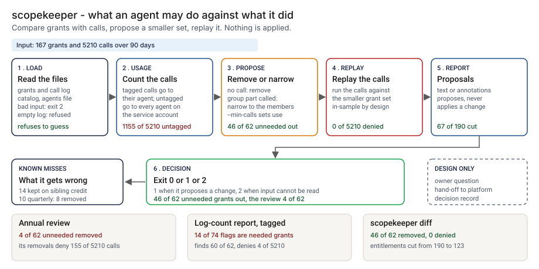

# Architecture: scopekeeper

> **Status.** This is the design for a production shape. The repo implements the product mechanic as a prototype: `src/scopekeeper.py` reads a grant list and a call log, proposes removing unused grants and narrowing group grants, and replays the proposal against the same calls, on a synthetic estate of 14 agents, 167 grants and 5210 calls. It never applies a change. Nothing below is claimed as deployed or load-tested, and the tool has never been run on a real grant store. Where a figure is a design target, it says so.

GCP is primary; AWS and Azure sit beside it.



---

## 1. Logical architecture

scopekeeper sits between an agent platform's grant list and its call log: two to four CSV files in, a proposal and a report out. It does not read a live grant store, apply a change, score risk or call a model.

Eight components: four decide the outcome or its exit code, four measure, support or record.

| Component | Responsibility | Language or framework | Decides the outcome? | Stateful? |
| --- | --- | --- | --- | --- |
| `sk-ingest` | Loads grants, calls, catalog and agents. Refuses bad input, a group grant with no catalog entry, and untagged calls with no agents file. | Python 3.9+, standard library. Prototype: `read_rows`, `load_grants`, `load_calls`, `load_catalog`, `load_agents`, `validate`, `InputError` in `src/scopekeeper.py` | Yes, by refusing: exit 2 | No |
| `sk-usage` | Counts calls per agent and scope; credits an untagged call to every agent on its service account that holds the scope. | Python. Prototype: the counting in `analyze`, with `effective_by_agent`, `service_groups`, `reach_of` | Yes, it decides what counts as used | No |
| `sk-propose` | Gives each grant keep, narrow or remove, with a reason; `--min-calls` sets what counts as use. | Python. Prototype: the per-grant loop in `analyze` | Yes | No |
| `sk-replay` | Replays every call against the smaller set; counts calls newly denied. | Python. Prototype: `replay` | No, it measures the proposal; it refuses a log no grant covers | No |
| `sk-report` | Prints the report or GitHub warnings, escapes input strings, sets the exit code. | Python. Prototype: `render_text`, `render_github`, `escape_annotation`, `clean`, `run_diff` | Yes, the exit code | No |
| `sk-owners` | Asks the agent's owner "is this scope periodic?" per removal and records the answer (design). | A small queue service (design) | No, it carries the human answer | Stateful |
| `sk-handoff` | Turns approved removals into a reviewed change for the platform (design). | A pull request or change ticket (design) | No | Stateful |
| `sk-ledger` | One record per proposal and per owner answer (design). | PostgreSQL plus object storage with a retention lock (design) | No | Stateful |

**What decides the outcome.** The input check, the sibling-credit rule, the per-grant decision and the exit code. The replay measures the proposal and is in-sample by construction. The queue, the hand-off and the ledger carry or record the decision. The tool trusts the agent tag and the grant list as exported.

**Repo structure** (production shape):

```
scopekeeper/
├── diff/       # ingest.py, usage.py, propose.py, replay.py, report.py
├── owners/     # owner question service
├── handoff/    # reviewed change writer
├── ledger/     # decision record writer
├── infra/      # terraform for gcp, aws, azure
├── docs/runbooks/
└── tests/      # unit, golden, hostile strings
```

---

## 2. Physical and deployment architecture

One short-lived batch job runs per review cycle or per pull request that changes a grant file. No server to keep warm.

| Component | GCP (primary) | AWS | Azure | Why |
| --- | --- | --- | --- | --- |
| Batch job (`sk-ingest` to `sk-report`) | Cloud Run job | ECS Fargate task | Container Apps job | Stateless, one pass over files |
| Exports and reports | Cloud Storage, versioned | S3, versioned | Blob Storage, versioned | Keeps the exact bytes a proposal used |
| `sk-owners` | Cloud Run service behind the identity proxy | Fargate service behind a load balancer | Container Apps with the identity provider | Owners sign in; the answer names the person |
| `sk-ledger` | Cloud SQL for PostgreSQL | RDS for PostgreSQL | Azure Database for PostgreSQL | The platform team already runs it |

**Failure behavior (the decision that matters most).** The tool must never silently pass, and it must never read a missing log as a reason to remove everything. A missing or malformed input ends the run with exit 2 and a one-line reason. A calls file that matches no grant is an error. A group grant with no catalog entry is refused, not guessed.

| Failure | Behavior | Alert |
| --- | --- | --- |
| A file missing, empty, header only, not UTF-8, a column missing, a wrong field count, a duplicate grant, a blank agent or scope, or a bad day | Exit 2, one line naming the file and line | P2 if repeated in one cycle, else P3 |
| A grant holder missing from the agents file, untagged calls and no agents file, a `*` grant with no catalog entry, or a call that names a group | Exit 2, refused, not guessed | P3 |
| No call is covered by any grant, or `--window-days` shorter than the log | Exit 2: the files describe different estates, or the window is wrong | P3 |
| Agents with no call in the log | Listed in the report: check the log covers them | P4 digest |
| Owner queue or ledger unavailable (design) | The proposal stands; nothing is applied; the gap is listed | P3 |

**Latency.** I have not timed the prototype. 🔴 Design target: a proposal within 5 minutes of the export landing, for an estate of the planted size.

---

## 3. Data architecture

| Entity | Key | What it holds | Real columns in the prototype |
| --- | --- | --- | --- |
| Grant | `agent_id`, `scope` | Who holds which scope, and the ticket | `data/grants.csv`: `agent_id`, `scope`, `granted_on`, `ticket_id`. The tool reads `agent_id` and `scope` |
| Call | `call_id` | One use of a scope, with an optional agent tag and service account | `data/calls.csv`: `call_id`, `agent_id`, `day`, `scope_used`, `service_account` |
| Catalog row | `scope` | What a group scope reaches | `data/scope_catalog.csv`: `scope`, `reaches` |
| Agent | `agent_id` | The service account it uses | `data/agents.csv`: `agent_id`, `owner`, `purpose`, `service_account`, `launched_on`. The tool reads `agent_id` and `service_account` |
| Proposal | `agent_id`, `scope` | Action, scopes kept, reason, calls tagged and credited | `src/out/step_04_grants.csv` |
| Truth | `agent_id`, `scope` | Needed or not, and the quarterly grants; synthetic only | `data/needed_truth.csv`, `data/periodic_truth.csv` |

**Retention** is a design choice, not a measurement; confirm it against the bank's own schedule. 🔴 Design default: proposals and owner answers for 7 years in PostgreSQL archived with a retention lock, and the exports a proposal used kept as long, versioned.

**Lineage.** A proposal traces back in three hops: the record names the grant, the log window, the call counts and the hashes of both exports; the versioned store returns those bytes; and the rules are deterministic and independent of input order, so `analyze` reproduces the proposal. In the prototype the trace is a row of `step_04_grants.csv`.

**Deliberately not stored.** Call payloads, arguments and customer data. The tool needs only which agent used which scope on which day.

---

## 4. Security architecture

**Identity and roles.** The batch job runs under the platform's workload identity and has no account of its own.

| Role | Can | Maps to |
| --- | --- | --- |
| `sk:runner` | Read grant and call exports; write proposals | The batch job identity |
| `sk:owner` | Answer the periodic-scope question for their own agents | Agent owner |
| `sk:reviewer` | Approve a removal list and a threshold change, never for their own agent | Access reviewer |
| `sk:auditor` | Read proposals, answers and config history | Internal audit |

**Secrets.** The tool holds none and never calls a model. It has no credential for the grant store and no write path to it, so it cannot apply a change. The job reaches storage and the ledger through workload identity, with no static keys.

**Data classification and what leaves the boundary.** A grant list and a call log map which agents can do what and which are over-permissioned; an attacker would read them as a list of targets. Treat them as confidential. In the prototype nothing leaves the machine. In the design the report, the owner questions and the record write leave the job.

| Threat | Example | Mitigation in the design |
| --- | --- | --- |
| Hostile string in an agent id or scope echoed into a log or workflow command | A scope holding a newline and text that looks like `::error::` | `escape_annotation` rewrites `%`, carriage return and newline; `clean` writes control characters as escapes in text output; `tests/test_cli.py` covers hostile values in both formats |
| A log trimmed to hide a use | Calls for a scope deleted before the run | Versioned exports; the record stores the log hash and window |
| A grant kept alive on a sibling's calls | An unneeded grant on a shared service account | The report lists every grant kept on untagged calls alone. 🟢 14 unneeded grants stay this way (`step_04_with_diff.py`) |
| A removal approved without the owner | A reviewer clears a list with periodic scopes in it | The owner answers per removal; the platform's own approval still applies |
| A grant export leaks | The estate map sent to the wrong place | Role-scoped bucket access; no copy outside the boundary |

---

## 5. Operational architecture

**SLIs.** Proposals per cycle by action; grants kept on untagged calls alone; calls newly denied in replay; owner answers and refusals; time to proposal; input rejections. Prototype baseline: 🟢 0 of 5210 calls newly denied, in-sample (`step_04_with_diff.py`).

**SLOs (all 🔴 design targets, none measured).**
- A proposal within 5 minutes of the export landing, for an estate of the planted size.
- Every removal proposal answered by its owner within 10 business days (planning estimate).
- No removal applied without an owner answer and a reviewer.
- 99.9 percent of proposals and answers written to the ledger.

**Alerts.** P2: repeated input rejections in a cycle, or the ledger down for more than a day (low-urgency page). P3: a removal an owner refuses for a scope the log shows unused (chat). P4: a weekly digest of unanswered proposals (email).

**Runbooks** (one page each, in `docs/runbooks/`):
- `input-rejected.md`: read the reason, fix the export, re-run.
- `owner-says-periodic.md`: record the cycle, keep the grant, extend the window.
- `tagging-gap.md`: move an agent to its own service account.
- `changing-the-threshold.md`: propose, re-run the planted estate, compare, approve.

**On-call and ownership.** The access reviewer owns the job, queue and runbooks; owners own the answer for their agents; the security architect owns the thresholds. Nobody is paged for a single proposal.

**Change control.** Rules and thresholds are versioned; a change needs a proposer and a different approver. Before merge the planted estate is re-run against the pinned numbers in `tests/test_golden.py`, so a change that moves the removal or denial counts shows in the diff.

---

## 6. Alignment and posture

Alignment, not certification. The README's "Aligned to" section cites two sources, restated with the same wording about what was read.

- The [OWASP Top 10 for Agentic Applications 2026](https://genai.owasp.org/resource/owasp-top-10-for-agentic-applications-for-2026/), dated December 9, 2025. I read the PDF the page links to on 2026-10-24. ASI03, Identity and Privilege Abuse, says an agent without a distinct, governed identity works in an attribution gap that makes true least privilege impossible; that is the shared service account here. ASI02, Tool Misuse and Exploitation, lists per-tool least-privilege profiles as its first mitigation.
- The [NIST AI Agent Standards Initiative](https://www.nist.gov/caisi/ai-agent-standards-initiative). I read the page on 2026-10-24. It lists industry-led standards, community-led protocols and research on agent authentication and identity infrastructure. This tool implements none of it; it is a usage-side check on whatever authorization a platform grants.

- **What the design does.** It measures how far a scope list sits from what was used, names the shared-account gap, and keeps a person in the loop for every removal.
- **What it does not claim.** It makes no claim of conformity to either source, holds no certification, and I have read and mapped no other.

---

## 7. What is deliberately not here

- **Quarterly use.** 🟢 10 grants are legitimate and used once a quarter; the diff removes 8, and the first quarter after the cut would deny 44 legitimate calls (`step_04_with_diff.py`). The log cannot show this.
- **Sibling credit's price.** 🟢 14 unneeded grants stay because untagged calls are credited to every agent that holds the scope (`step_04_with_diff.py`). One service account per agent removes the problem.
- **Stray use.** 🟢 2 unneeded grants stay because a smoke test called them (`step_04_with_diff.py`). Raising `--min-calls` removes them and costs needed grants.
- **Out-of-sample safety.** The replay is built from the calls it replays, so 0 newly denied is a property of the method, not evidence that next quarter is safe.
- **Nested groups, impact weighting, approval status.** Group scopes need a catalog and cannot nest. The tool does not weigh scopes or read whether a person approved a call.
- **Applying anything.** It proposes and never applies.
- **Rules tuned on real estates.** The planted estate and the rules share an author.

---

## Appendix: sample contract

```bash
python3 scopekeeper.py diff grants.csv calls.csv --catalog scope_catalog.csv --agents agents.csv --format github
```

A proposal line reads `remove  EX-03   cases:close_case   no call in the log`; a GitHub warning carries the same text, escaped. Exit status: 0 nothing to change or `--fail-on never`, 1 the diff proposes changes, 2 input it cannot read.
