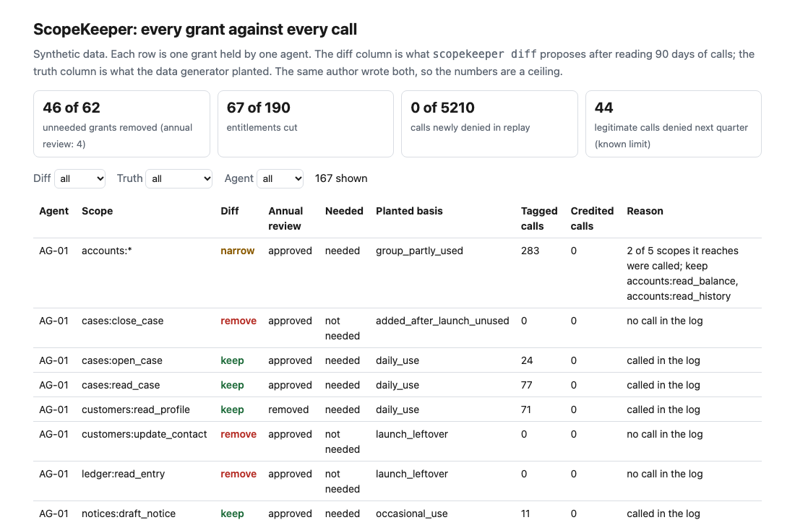
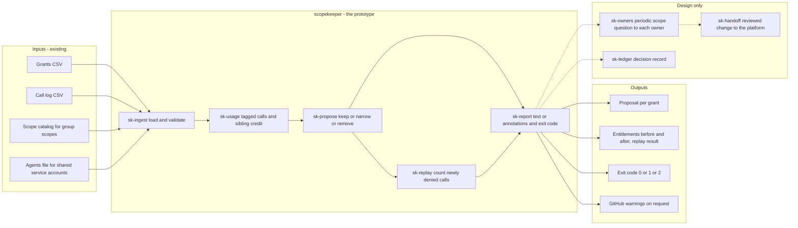
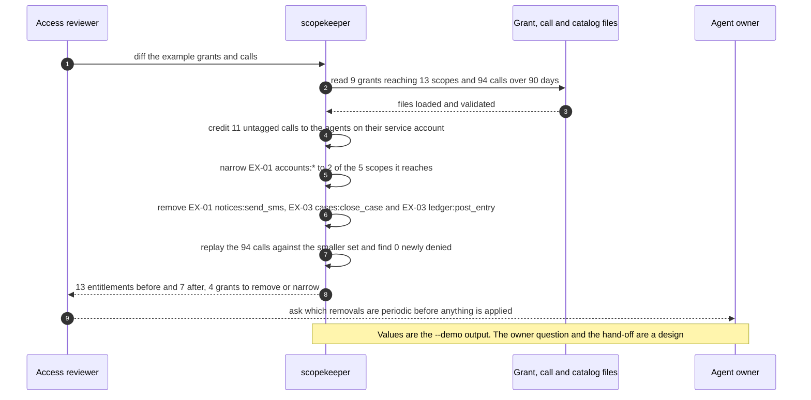

# 🔑 scopekeeper: a usage-versus-grant diff for agent permissions

**I wanted to know how much of what an AI agent is allowed to do it ever does, and how much a command line tool can safely take away. `scopekeeper diff grants.csv calls.csv` reads who holds which scope and 90 days of calls, proposes removing the grants nobody used and narrowing group grants to the scopes that were called, then replays the proposal against the same calls before anyone applies it.** It rebuilds the diff from [23 ScopeKeeper](../23-scopekeeper-agent-permission-review/) as a command with exit codes, and scores it on a new synthetic estate of its own.

**▶ Static demo, no install:** [open demo.html](./demo.html)

[](./demo.html)

## Executive summary (90 seconds)

**Problem.** The person who runs the access review for an agent platform, and the owner of each agent, have a list of what every agent may do and no view of what it does. The annual review approves what is on the list: names, dates and tickets, and not a single call. 🟢 On a synthetic estate, 167 grants reach 190 entitlements, 62 of the 167 grants (37.1%) are not needed, and 1155 of 5210 calls (22.2%) carry no agent tag (`step_01_no_comparison.py`). 🟢 The review removes 8 of 167 grants, all for a missing ticket: 4 of the 62 unneeded grants and 4 grants the agents need. Replaying the calls under what it left denies 155 of 5210 (`step_02_annual_review.py`). Most of the unneeded reach stays, and half of what the review removes is access the agents need.

**Product.** scopekeeper is a command that compares what each agent may do with what it did. For every grant it asks whether a scope the grant reaches was called in the log. No call: propose removal. A group grant, such as `accounts:*`, called on some members only: propose narrowing to the members called. A call with no agent tag is credited to every agent on its service account that holds the scope, so a grant in use is never proposed for removal. `--min-calls` sets how many calls count as use. The proposal is then replayed against the same calls to count the calls it would newly deny. The command proposes and never applies, exits 1 when it proposes a change and 2 for input it cannot read, and prints GitHub annotations on request. There is no model call; the rules are plain code.

**Measured and modeled performance.**

- 🟢 **Starting point: nothing compares grants with calls.** 167 grants reach 190 entitlements, 62 of 167 are not needed, and 0 of 167 grants are checked against calls today (`step_01_no_comparison.py`).
- 🟢 **The annual review removes 4 of 62 unneeded grants** and 4 needed ones, and its removals deny 155 of 5210 calls in a replay (`step_02_annual_review.py`).
- 🟢 **A log-count report that reads only tagged calls** flags 74 grants and finds 60 of 62 unneeded, but 14 of its flags are needed grants, it would deny 4 of 5210 calls, and it keeps 7 group grants whole (`step_03_deficiencies_exposed.py`).
- 🟢 **The call-count threshold has a price both ways.** At 3 calls both stray-use grants go (2 of 2), but 10 needed grants go too and 15 calls are newly denied; at 1 call it is 0 of 2, 0 needed grants and 0 calls (`step_03_deficiencies_exposed.py`).
- 🟢 **The diff removes 46 of 62 unneeded grants (74.2%) against 4 of 62 (6.5%) for the review,** narrows 6 group grants, and cuts entitlements from 190 to 123 (67 cut, 35.3%). The replay denies 0 of 5210 calls, in-sample by construction (`step_04_with_diff.py`).
- 🟢 **Known miss: quarterly use.** 10 grants are legitimate and used once a quarter; the diff removes 8 of them, and the first quarter after the cut would deny 44 legitimate calls. 14 unneeded grants stay on a sibling's untagged calls and 2 stay after a smoke test (`step_04_with_diff.py`).
- 🟡 **Utility: (46/62 − 4/62) × 100 = 67.7 more unneeded grants removed a year than the annual review,** assuming 100 unneeded grants sit in the estate under review.
- 🔴 **Design target: every removal proposal answered by its owner within 10 business days, with the periodic-scope question asked.** A planning estimate, designed in [`ARCHITECTURE.md`](./ARCHITECTURE.md), never built.

**What I would ask a head of operations to decide.** Whether a grant with no call in the log should be proposed for removal by default, given that a 90-day log cannot show a scope used once a quarter. I set it to yes as my policy, with the owner asked before anything is applied. My recommendation is to run the diff in report mode on one real grant export and a log longer than a quarter, treat the output as a list of questions for owners and not as changes, and keep the sibling credit as written until one service account per agent is in place.

**Call to action.** Fork the repo. Swap `data/grants.csv` and `data/calls.csv` for your own exports and keep the columns `agent_id, scope` and `agent_id, scope_used`. Add `--catalog` if you have group scopes and `--agents` if calls on a shared account carry no tag. To call it from code, import `analyze` from `src/scopekeeper.py`. Send findings by opening an issue: say which proposal type and how many grants, not the data itself.

_A portfolio prototype on synthetic data. Nothing here is deployed, load-tested or used by anyone, and it has never been run on a real grant store._

## Run one now

```bash
cd 59-scopekeeper/src && python3 scopekeeper.py --demo
```

It prints:

```text
scopekeeper diff: 3 agents, 9 grants reaching 13 scopes, 94 calls over 90 days
  11 calls carry no agent tag; each is credited to every agent on its service account that holds the scope

agent    grants  reach  after  cut  breadth
EX-01         3      7      3    4    57.1%
EX-03         4      4      2    2    50.0%
EX-02         2      2      2    0     0.0%

proposals (4 of 9 grants):
  narrow  EX-01   accounts:*                        2 of 5 scopes it reaches were called; keep accounts:read_balance, accounts:read_history
  remove  EX-01   notices:send_sms                  no call in the log
  remove  EX-03   cases:close_case                  no call in the log
  remove  EX-03   ledger:post_entry                 no call in the log

kept on untagged calls alone (1): a sibling on the same service account may be the only caller
  EX-03   payments:initiate_payment         8 untagged calls credited

grants: keep 5, remove 3, narrow 1
entitlements: 13 before, 7 after (6 cut, 46.2%)
replay: 0 of 94 calls newly denied (the proposal is built from these calls, so this is an in-sample check)
caution: a scope used less often than the log is long looks unused. Ask each owner which removals are periodic before applying any.
decision: 4 grants to remove or narrow
```

Standard library only, Python 3.9 or newer.

## Use it on your own files

```bash
python3 scopekeeper.py diff grants.csv calls.csv --catalog scope_catalog.csv --agents agents.csv
```

| File | Columns it reads | Notes |
|---|---|---|
| `grants.csv` | `agent_id`, `scope` | `ticket_id` and `granted_on` are ignored by the tool |
| `calls.csv` | `agent_id`, `scope_used` | `day`, `call_id` and `service_account` optional. `agent_id` may be blank on a shared service account |
| `--catalog` | `scope`, `reaches` | `reaches` is a semicolon list for a group scope and blank for a plain one. The group comes from this column, never from the name |
| `--agents` | `agent_id`, `service_account` | Required when any call has a blank `agent_id`; every agent holding a grant must be listed |

Options: `--min-calls N` (calls needed before a grant counts as used, default 1), `--window-days N`, `--format github` (one `::warning` annotation per proposal, values escaped), `--fail-on never`. Exit status: 0 nothing to change, 1 the diff proposes changes, 2 input it cannot read, with one line on stderr. A grant whose scope contains `*` but has no catalog entry is refused, not guessed. A calls file that matches no grant is an error, not a request to remove everything. [`sample_report.txt`](./sample_report.txt) is the full report on the bundled estate.

## What the numbers say

**What it shows** (🟢 measured on synthetic data: 14 agents, 167 grants, 5210 calls; the script is named in brackets):

- 🟢 Starting point: 167 grants reach 190 entitlements, 62 of the 167 grants (37.1%) are not needed, and 1155 of 5210 calls (22.2%) carry no agent tag (`step_01`)
- 🟢 The annual review removes 8 of 167 grants, all for a missing ticket: 4 of the 62 unneeded grants and 4 grants the agents need. Replaying the calls under what it left denies 155 of 5210 (`step_02`)
- 🟢 A log-count report that reads only agent-tagged calls flags 74 grants and finds 60 of 62 unneeded, but 14 of its flags are needed grants (10 used quarterly, 4 used only through untagged calls), it would deny 4 of 5210 calls, and it keeps 7 group grants whole (`step_03`)
- 🟢 The call-count threshold has a price both ways: at 3 calls both stray-use grants go (2 of 2), but 10 needed grants go too and 15 calls are newly denied; at 1 call it is 0 of 2, 0 needed grants and 0 calls (`step_03`)
- 🟢 The diff removes 46 of 62 unneeded grants (74.2%) against 4 of 62 (6.5%) for the review, narrows 6 group grants, and cuts entitlements from 190 to 123 (67 cut, 35.3%) (`step_04`)
- 🟢 Replay: 0 of 5210 calls newly denied, against 155 for the review's removals. This is in-sample by construction; the script also shows it is not vacuous by dropping one busy scope from one agent (`step_04`)
- 🟢 Hard negatives it keeps: 10 needed grants called once or twice in the whole log, and 4 needed grants whose only calls carry no agent tag (`step_04`)

## What it still gets wrong

- 🟢 **Quarterly use.** 10 grants are legitimate and used once a quarter; the diff removes 8 of them, and the first quarter after the cut would deny 44 legitimate calls (`step_04`, from `periodic_truth.csv`). The log cannot show this. A longer log would; the owner question "is this scope periodic?" on each removal proposal is 🔴 designed in project 23 and never tested with owners.
- 🟢 **Sibling credit.** 14 unneeded grants stay because untagged calls are credited to every agent on the service account that holds the scope (`step_04` prints each one). That is the price of never proposing to remove a grant that is in use. The tagged-only report removes more and denies calls; I chose the proposal that denies none. One service account per agent removes the problem.
- 🟢 **Stray use.** 2 unneeded grants stay because a smoke test called them once or twice (`step_04`). Raising `--min-calls` removes them and costs needed grants, as `step_03` shows.
- **The data and the rules share an author.** I planted the grants and wrote the diff, so 46 of 62 shows the rules cover what I planted. I added seven low-volume grants on shared accounts after the first run because the first version barely exercised that case. Treat every number as a ceiling for these rules, not a rate on a real environment, which I have not tested.
- **The replay is in-sample.** The proposal is built from the calls it is replayed on, so 0 newly denied is a property of the method, not evidence that next quarter is safe.
- Group scopes need a catalog and cannot nest. The tool does not weigh scopes by impact, does not read whether a call was approved by a person, and ranks nothing; project 23 does some of that. It proposes and never applies.
- 🟡 The annual review in `step_02` is my assumption of what a review does (approve with a ticket, revoke without). The 50% tag rate on shared accounts is also an assumption; the 22.2% untagged share follows from it.

## How the four steps fit

| Step | Question | Script |
|---|---|---|
| 1 | What is the starting point when nothing compares grants with calls? | `step_01_no_comparison.py` |
| 2 | What does the annual review remove? | `step_02_annual_review.py` |
| 3 | Where do a log-count report and a call-count threshold fail? | `step_03_deficiencies_exposed.py` |
| 4 | What does the diff remove, keep and get wrong? | `step_04_with_diff.py` |

Run any of them from `src/`. `step_04` writes the files `src/_build_demo.py` turns into `demo.html`. Data comes from [`data/_generate.py`](./data/README.md); `tools/check_repo.py` confirms that a rerun reproduces every file and that the green numbers above appear in a script's output. [`tests/`](./tests/) has 50 tests, including one that pins the numbers above and one that feeds hostile strings through both output formats.

## Utility delivered

The way I price product impact: **utility = (my solution − current state of the art) × the number of people or items it affects.**

Here the item is an unneeded grant sitting on a live agent. Each one lands on the owner of the agent, on the person who runs the access review and on whoever has to explain the reach after an incident. The common basic approach is the annual review; the table prices the diff against it.

| Term | Value | Where it comes from |
| --- | --- | --- |
| Current state of the art (annual review), unneeded grants removed | 🟢 **4 of 62 (6.5%)** | `step_02_annual_review.py`; it also removes 4 grants the agents need, and its removals deny 155 of 5210 calls |
| My solution (the diff), unneeded grants removed | 🟢 **46 of 62 (74.2%)** | `step_04_with_diff.py`; it also removes 8 needed grants, the quarterly ones, and denies 0 of 5210 calls in-sample |
| Lift per unneeded grant | 🟢 46 of 62 minus 4 of 62 | What it leaves is 14 grants kept on sibling credit and 2 kept after a smoke test (`step_04_with_diff.py`) |
| Number it affects: unneeded grants in the estate under review | 🟡 **100** | **Assumption, not a statistic.** Replace it with your own count of grants that are not needed, which the diff itself estimates |
| Assumption that makes the lift real | 🟡 An owner answers the periodic-scope question on each removal before it is applied | Without it the first quarter after the cut would deny 🟢 44 legitimate calls (`step_04_with_diff.py`). The question is 🔴 designed in project 23 and never tested with owners |
| **Utility** | 🟡 **(46/62 − 4/62) × 100 = 67.7 more unneeded grants removed a year than the annual review** | Assumes the 100 behave like the 62 planted ones |

Sensitivity to the count assumption (🟡, same lift): 50 unneeded grants gives 33.9, 100 gives 67.7, 200 gives 135.5.

🔴 What I have not measured: what an unneeded grant costs, how long an owner takes to answer a proposal, how many removals owners would refuse, or how often a scope is used less than once in a log. The planted estate is dense on purpose, 62 of 167 grants are unneeded (`step_01_no_comparison.py`); a real estate may hold fewer or more. Treat the result as a property of this mix of grants, not a forecast.

---

## Architecture and call flow

Component names match [`ARCHITECTURE.md`](./ARCHITECTURE.md). GitHub renders the diagrams natively.


**System topology:**



**Per-run sequence** (the `--demo` run, 3 agents and 9 grants):



**Interlocks (all red, designed, none built):**

- [23 ScopeKeeper](../23-scopekeeper-agent-permission-review/) is where the usage index, proposal and replay came from. I rewrote the parts I needed and share no code or numbers. The owner question on each removal is designed there, not tested.
- [05 AgentWatch](../05-agentwatch-agent-observability/) would be a possible source of the call log, with the agent tag written by the platform. This folder does not read its files.
- [08 OversightOps](../08-oversightops-hitl-workflow/) is a possible home for the owner queue (`sk-owners`), including how many proposals one owner can answer in a week.
- [09 LineageLog](../09-lineagelog-ai-decision-audit/) is a possible home for the decision record (`sk-ledger`).

---

## PM artifacts

The PM artifacts that show how I would run this product if I owned the seat. This README is the walkthrough; the rest of the folder holds:

- [`PRD.md`](./PRD.md): the product requirements doc, with users, backlog, KPIs, rollout and open questions.
- [`ARCHITECTURE.md`](./ARCHITECTURE.md): the systems doc, with components, data model, security, failure behavior and operations. A design, not deployed.
- [`demo.html`](./demo.html): clickable, no-install walkthrough, built from the step outputs by `src/_build_demo.py`.
- [`sample_report.txt`](./sample_report.txt): the full report on the bundled estate.
- [`data/`](./data/): the synthetic grants, call log, catalog, agents, the two truth files and the seeded generator. `data/README.md` explains the planted grant kinds.
- [`src/`](./src/): `scopekeeper.py`, `common.py`, the four step scripts and the demo builder.
- [`tests/`](./tests/): 50 unittest tests, including a golden test that pins the numbers above and tests for bad input and hostile strings.

Run the four steps end to end:

```bash
cd src
python3 step_01_no_comparison.py
python3 step_02_annual_review.py
python3 step_03_deficiencies_exposed.py
python3 step_04_with_diff.py
```

---

## Aligned to

- The [OWASP Top 10 for Agentic Applications 2026](https://genai.owasp.org/resource/owasp-top-10-for-agentic-applications-for-2026/), dated December 9, 2025. I read the PDF the page links to on 2026-10-24. ASI03, Identity and Privilege Abuse, says an agent without a distinct, governed identity works in an attribution gap that makes true least privilege impossible; that is the shared service account here, where a call cannot be tied to one agent. ASI02, Tool Misuse and Exploitation, lists per-tool least-privilege profiles as its first mitigation; this tool measures how far a scope list sits from what was used.
- The [NIST AI Agent Standards Initiative](https://www.nist.gov/caisi/ai-agent-standards-initiative). I read the page on 2026-10-24. It lists industry-led standards, community-led protocols and research, and links an NCCoE draft concept paper on software and AI agent identity and authorization. This tool implements none of it; it is a usage-side check on whatever authorization a platform grants.

This is a prototype, aligned to that guidance. It makes no claim of conformity to that guidance. It extends [23 ScopeKeeper](../23-scopekeeper-agent-permission-review/): I read its usage index, proposal and replay, rewrote the parts I needed for a command line, and share no code or numbers with it.

## Data and limits

Synthetic, seeded, byte-for-byte reproducible. Nothing comes from any employer, customer or real bank. A prototype on synthetic data, not a production case study. The files, the planted grant kinds and the assumptions are in [`data/README.md`](./data/README.md).

## Fork it

Export your own grant list and tool-call log, keep the column names above, and run `scopekeeper diff`. If your platform has group scopes, write a two-column catalog. If calls on a shared account are not tagged, add the agents file. The two truth files exist only because the data is synthetic. Read the [PRD](./PRD.md) for the scope I held to.

## Prereqs to run this on your laptop

You need Python 3.9 or newer and nothing else. The tool, the four step scripts and the data generator use only the standard library, so there is nothing to install. There is no API key, no network call and no model call anywhere in the folder. To run the tests, use `python3 -m unittest discover -s tests` from this folder. The production pieces in [`ARCHITECTURE.md`](./ARCHITECTURE.md) (the owner queue, the hand-off, the decision record) are a design, not something you need or can run.

## Author

**Vijay Saharan**, Sr Product / Program Manager · AI in BFSI · Enterprise AI Platforms

[LinkedIn](https://www.linkedin.com/in/vijaysaharan/)
