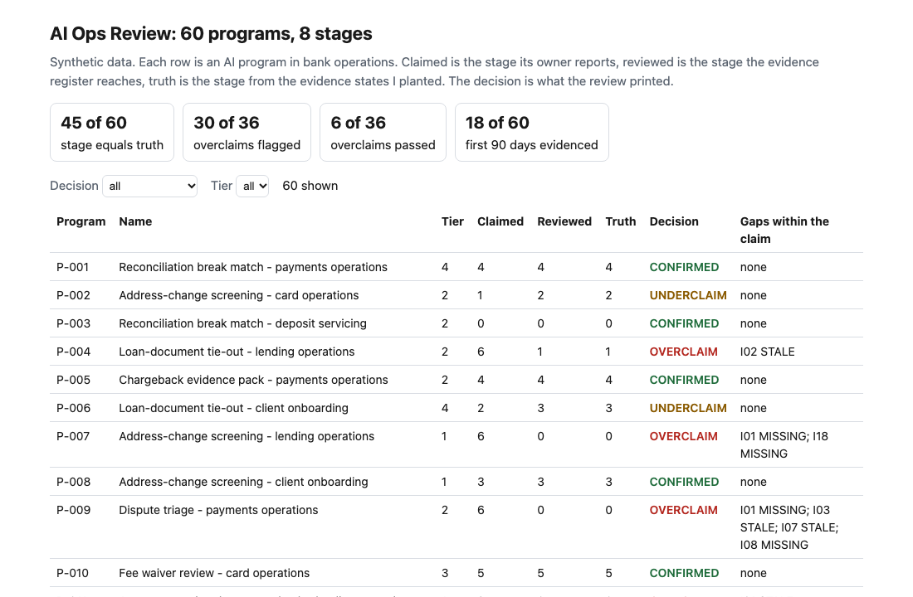
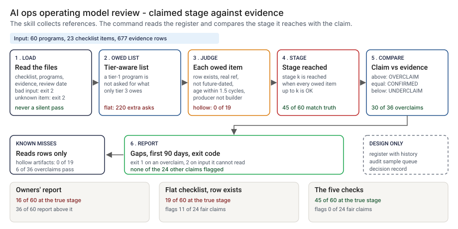
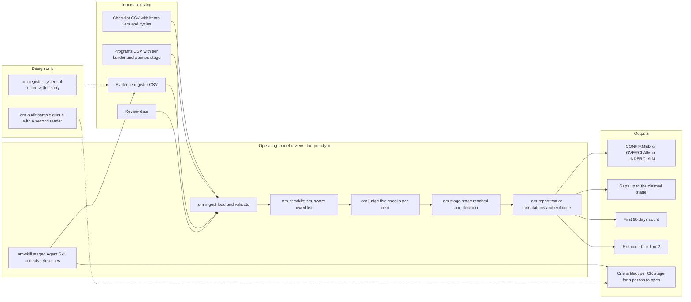
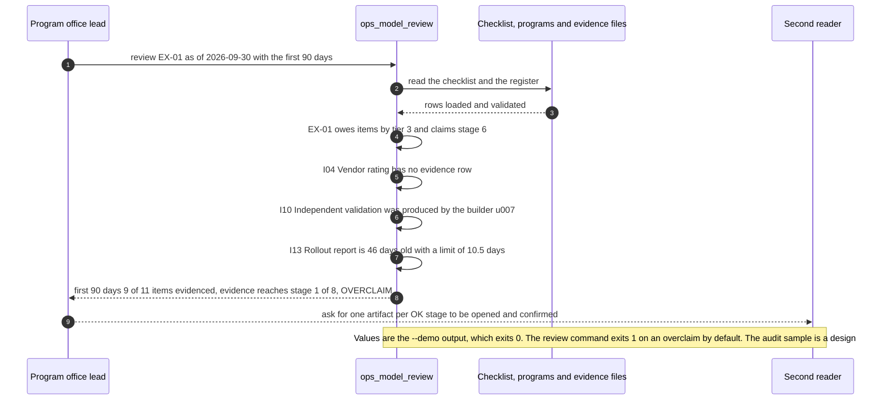

# 🧭 AI Ops Operating Model Review: a skill that asks for evidence at each stage

**I wanted to know how far a bank-operations AI program has really got when its owner says "we are in rollout", and to find out in an afternoon rather than after an incident. This is a staged Agent Skill and the command it wraps. The skill walks the eight stages of [OPERATING_MODEL.md](../OPERATING_MODEL.md), asks for an artifact reference, a producer and a date for every item the program's tier owes, and the command prints the stage the evidence reaches and CONFIRMED, OVERCLAIM or UNDERCLAIM against the stage the owner claims.** It turns the first 30, 60 and 90 days of that model into a checklist you can run.

**▶ Static demo, no install:** [open demo.html](./demo.html)

[](./demo.html)

## Executive summary (90 seconds)

**Problem.** The lead of an AI program office and the reviewer who has to say whether a claimed stage holds both see the same thing: the stage the owner writes in the status deck. Nobody checks that the proof for each earlier stage exists, is current and was produced by someone other than the builder, so the program office learns the real stage from an incident or an audit. 🟢 On 60 synthetic programs, the owners' reported stage equals the true stage for 16 of 60, 36 of 60 report a stage above it (118 stages over in total), and 14 of the 18 that report hand-off or later have not reached it (`step_01_self_reported_status.py`).

**Product.** This is a staged Agent Skill and the command it wraps. The skill walks the eight stages of [OPERATING_MODEL.md](../OPERATING_MODEL.md) and, for every item the program's tier owes, asks for an artifact reference, who produced it and its date. If there is no reference, there is no row. The command then applies five checks to each owed item: the tier owes it, the reference is not empty or a placeholder, the date is not after the review date, the evidence is no older than 1.5 times its cycle, and, where the item needs it, someone other than the builder produced it. A program reaches stage k when every owed item up to stage k passes. The command prints the stage the evidence reaches and CONFIRMED, OVERCLAIM or UNDERCLAIM against the claim, and exits 1 on an overclaim. The command reads the register, not the artifacts; the skill ends by naming one artifact per stage for a person to open. There is no model call in the command.

**Measured and modeled performance.**

- 🟢 **A flat checklist ticked when a row exists reaches the true stage for 19 of 60,** flags 28 of 36 overclaims and also 11 of 24 claims that were not overclaims, flags 220 missing items the tier does not owe (in 44 programs), and accepts 24 lapsed, 19 hollow, 9 blank-reference, 5 builder-produced and 2 future-dated items (`step_02_presence_checklist.py`).
- 🟢 **Each check earns its place.** Without the tier-aware list the stage matches fall to 32 of 60, without the placeholder test to 41, without freshness to 37, without independence to 44 (`step_03_deficiencies_exposed.py`).
- 🟢 **All five checks together reach the true stage for 45 of 60 programs,** flag 30 of the 36 claims above the truth and none of the other 24. For the first 90 days, every owed item evidenced: the review counts 18 of 60 programs, the planted truth 14 of 60 (`step_04_evidence_review.py`).
- 🟢 **Planted defects it rejects:** absent 483 of 483, lapsed 19 of 24, blank reference 9 of 9, builder-produced 5 of 5, future-dated 2 of 2 (`step_04_evidence_review.py`).
- 🟢 **Known miss: hollow artifacts.** It rejects 0 of 19, and 6 of the 36 overclaims still pass (`step_04_evidence_review.py`).
- 🟢 **A false alarm it cannot avoid:** 8 items planted as fine, from a cycle that ran late, are rejected as stale, and one program lands below its true stage because of it (`step_03_deficiencies_exposed.py`).
- 🟡 **Utility: (45/60 − 19/60) × 40 = 17.3 programs a year read at the right stage that a flat checklist reads wrong,** assuming 40 programs under review each year.
- 🔴 **Design target: every OK stage backed by an audit sample that a second person opened and confirmed in one sentence.** A design in [`ARCHITECTURE.md`](./ARCHITECTURE.md), never built or tested.

**What I would ask a head of operations to decide.** Whether the stage in the status deck is the owner's claim or the register's finding. I set it to the register as my policy. My recommendation is to run the command with `--fail-on never` on one real register for a quarter, pair every OK stage with the audit sample before anyone relies on it, and set the cycle days with the item owners, since a cycle that ran late was rejected as stale 8 times here.

**Call to action.** Fork the repo. Replace `data/checklist.csv` with your own items, tiers and cycles, and export your register to the programs and evidence files described in `data/README.md`. To call it from code, import `review_program` from `src/ops_model_review.py`. To try the skill, copy `skill/ai-ops-review` into your agent's skills directory. Send findings by opening an issue: say which check and how many programs, not the data itself.

_A portfolio prototype on synthetic data. Nothing here is deployed, load-tested or used by anyone, and the skill has not been run by anyone._

## Run one now

```bash
cd 60-ai-ops-operating-model/src && python3 ops_model_review.py --demo
```

It prints:

```text
program: EX-01 (Dispute triage - card operations)   tier 3   claimed stage 6
  stage 2 Admit and tier   I04 Vendor rating: MISSING  no evidence row
  stage 4 Build and prove  I10 Independent validation: NOT_INDEPENDENT  produced by the builder, u007
  stage 5 Limited rollout  I13 Rollout report: STALE  46 days old, limit 10.5 days
first 90 days: 9 of 11 owed items evidenced; open: I04, I10
evidence reaches stage 1 of 8
decision: OVERCLAIM (claimed 6)
```

Standard library only, Python 3.9 or newer. To review your own register: `python3 ops_model_review.py review --checklist C.csv --programs P.csv --evidence E.csv --as-of 2026-09-30`. It exits 1 when a claim is above its evidence, 2 for malformed input; `--format github` prints annotations and `--window 90` adds the first-90-days count.

## What the numbers say

**What it shows** (🟢 measured on synthetic data: 60 planted programs, 23 checklist items and 677 evidence rows; the script is named in brackets):

- 🟢 Owners' reported stage equals the true stage for 16 of 60 programs; 36 of 60 report a stage above it (118 stages over in total), and 14 of the 18 that report hand-off or later have not reached it (`step_01`)
- 🟢 A flat checklist ticked when a row exists reaches the true stage for 19 of 60, flags 11 of 24 claims that were not overclaims, flags 220 missing items the program's tier does not owe (in 44 programs), and accepts 24 lapsed, 19 hollow, 9 blank-reference, 5 builder-produced and 2 future-dated items (`step_02`)
- 🟢 Each check earns its place: without the tier-aware list the stage matches fall to 32 of 60, without the placeholder test to 41, without freshness to 37, without independence to 44; without the future-date test the match stays at 45 of 60 and 2 more defective items get through (26 against 24) (`step_03`)
- 🟢 All five checks together reach the true stage for 45 of 60 programs, flag 30 of the 36 claims above the truth and none of the other 24 (`step_04`)
- 🟢 Of the owed items planted as lapsed, it rejects 19 of 24; blank reference 9 of 9; builder-produced 5 of 5; future-dated 2 of 2 (`step_04`)
- 🟢 First 90 days, every owed item evidenced: the review counts 18 of 60 programs, the planted truth 14 of 60 (`step_04`)

## What it still gets wrong

- 🟢 It reads the register, not the artifacts. It rejects 0 of 19 hollow artifacts. The review's stage is above the truth for 14 of 60 programs, and 6 of the 36 overclaims still pass (`step_03` and `step_04` print each one with the planted state that let it through).
- 🟢 Lapsed evidence younger than 1.5 times its cycle passes: 5 of the 24 lapsed items did. The reverse also happens: 8 items planted as fine, from a cycle that ran late, are rejected as stale, and one program lands below its true stage because of it (`step_03`, `step_04`).
- **The data and the rules share an author.** I planted the states and wrote the checks, so 45 of 60 shows the checks cover what I planted. I drew the hollow and lapsed cases on purpose so that the rules miss them, and the late-cycle cases so that they raise a false alarm. Treat the numbers as a ceiling for these rules, not a rate on a real register, which I have not seen.
- 🟡 The tier assigned to each item, its cycle in days and the first-90-days window are my assumptions, except where OPERATING_MODEL.md section 4 sets the evidence owed at a tier. The 1.5 times factor is the one that file gives for obligation evidence, itself an assumption. Items E01, E02, E04, E09 and E11 of that table are not in the checklist.
- 🔴 The audit sample, where a person opens one artifact per stage the review marks OK and confirms one sentence, is designed in the skill and not measured. Whether it finds hollow artifacts is unknown.
- The register holds one row per program and item, so it shows the latest artifact and not the history. The tool does not compute the tier; [11 TierGate](../11-tiergate-ai-usecase-intake/) does that.

## Use it as a skill

[`skill/ai-ops-review/SKILL.md`](./skill/ai-ops-review/SKILL.md) is a staged Agent Skill with the eight-stage table, the questions to ask, the rule that no reference means no row, the command to run and the audit step. Copy the folder into your agent's skills directory to try it. It has not been installed in any agent and has not been run as a skill by anyone. What is tested is the command it wraps (`tests/`, 52 tests in all), and a test checks that the skill's table matches `data/checklist.csv`.

## How the four steps fit

| Step | Question | Script |
|---|---|---|
| 1 | What does the status deck show when the owner writes the stage? | `step_01_self_reported_status.py` |
| 2 | What does a flat checklist ticked on a row's existence add? | `step_02_presence_checklist.py` |
| 3 | What does each check add, and what does none of them see? | `step_03_deficiencies_exposed.py` |
| 4 | What do the five checks reach together? | `step_04_evidence_review.py` |

Run any of them from `src/`. Data is produced by [`data/_generate.py`](./data/README.md); `tools/check_repo.py` confirms that a rerun reproduces every file and that the green numbers above appear in a script's output.

## Utility delivered

The way I price product impact: **utility = (my solution − current state of the art) × the number of people or items it affects.**

Here the item is a program whose stage is read right. Each one lands on the program office lead who reports it, the reviewer who relies on it and whoever acts on the stage after an incident. The common basic approach is a flat checklist ticked when a row exists; the table prices the review against it.

| Term | Value | Where it comes from |
| --- | --- | --- |
| Current state of the art (flat checklist, ticked on a row), programs at the true stage | 🟢 **19 of 60** | `step_02_presence_checklist.py`; it also flags 11 of 24 claims that were not overclaims |
| My solution (five checks), programs at the true stage | 🟢 **45 of 60** | `step_04_evidence_review.py`; it flags none of the 24 others |
| Lift per program reviewed | 🟢 45 of 60 minus 19 of 60 | The flat list asks a tier-1 program for the same proof as a tier-4 one: 220 missing items in 44 programs that the tier does not owe (`step_02_presence_checklist.py`) |
| Number it affects: programs under review in a year | 🟡 **40** | **Assumption, not a statistic.** Replace it with your own count of AI programs whose stage is reported in a year |
| Assumption that makes the lift real | 🟡 Owners file real references, so the register reflects the artifacts | The review reads rows, not artifacts: 🟢 it rejects 0 of 19 hollow artifacts and 6 of 36 overclaims still pass (`step_04_evidence_review.py`) |
| **Utility** | 🟡 **(45/60 − 19/60) × 40 = 17.3 programs a year read at the right stage that a flat checklist reads wrong** | Assumes the 40 programs behave like the 60 planted ones |

Sensitivity to the count assumption (🟡, same lift): 20 programs a year gives 8.7, 40 gives 17.3, 80 gives 34.7.

🔴 What I have not measured: what a wrong stage costs, how long a reviewer takes to open an artifact, whether the audit sample finds hollow artifacts, or how many programs a real program office tracks. The planted set is dense on purpose, 36 of 60 claims are above the truth (`step_01_self_reported_status.py`); a real register may be cleaner. Treat the result as a property of this mix of cases, not a forecast.

---

## Architecture and call flow

Component names match [`ARCHITECTURE.md`](./ARCHITECTURE.md). GitHub renders the diagrams natively.



**System topology:**



**Per-run sequence** (the `--demo` run, program EX-01 at tier 3 claiming stage 6):



**Interlocks (all red, designed, none built):**

- [11 TierGate](../11-tiergate-ai-usecase-intake/) computes the tier. The review takes the tier as an input and does not recompute it.
- [24 PortfolioBoard](../24-portfolioboard-ai-program-portfolio/) shows evidence status per program. The review's stage could feed it; this folder does not read its files.
- [27 AgentKit](../27-agentkit-reference-agent-and-playbook/) holds the hand-off and gates that stages 4 to 6 point at. The pairing is mine, and this folder does not import it.
- [09 LineageLog](../09-lineagelog-ai-decision-audit/) is a possible home for the review record in `om-register`.

---

## PM artifacts

The PM artifacts that show how I would run this product if I owned the seat. This README is the walkthrough; the rest of the folder holds:

- [`PRD.md`](./PRD.md): the product requirements doc, with users, backlog, KPIs, rollout and open questions.
- [`ARCHITECTURE.md`](./ARCHITECTURE.md): the systems doc, with components, data model, security, failure behavior and operations. A design, not deployed.
- [`demo.html`](./demo.html): clickable, no-install walkthrough, built from the step outputs by `src/_build_demo.py`.
- [`data/`](./data/): the synthetic checklist, 60 programs, their evidence register, the two truth files and the seeded generator. `data/README.md` explains how the truth is made.
- [`src/`](./src/): `ops_model_review.py`, `common.py`, the four step scripts and the demo builder.
- [`tests/`](./tests/): 52 unittest tests, including a golden test that pins the numbers above and tests for bad input and hostile strings.
- [`skill/`](./skill/ai-ops-review/SKILL.md): the staged Agent Skill. Not installed in any agent and not run as a skill by anyone.

Run the four steps end to end:

```bash
cd src
python3 step_01_self_reported_status.py
python3 step_02_presence_checklist.py
python3 step_03_deficiencies_exposed.py
python3 step_04_evidence_review.py
```

---

## Aligned to

The Financial Stability Board's [Sound Practices for Responsible Adoption of Artificial Intelligence](https://www.fsb.org/uploads/P151026-1.pdf) (final report, 15 October 2026; I read the full text on 24 October 2026). Sound Practice 3 asks institutions to document AI use and to assess materiality and risk; Sound Practice 5 asks for that assessment at inception and after; Sound Practice 9 asks for performance evaluation in proportion to materiality and risk, including ongoing monitoring. The tier that sets what is owed, the evidence register and the renewal cycle are one way to make those three concrete. The report has its own section on stages of AI development and deployment (3.1); I did not map the ladder here to it, and the eight stages are OPERATING_MODEL.md's.

On [SR 26-2, Revised Guidance on Model Risk Management](https://www.federalreserve.gov/supervisionreg/srletters/SR2602.htm) (Federal Reserve, OCC and FDIC, 17 April 2026; I read the attached guidance on 24 October 2026): it says it sets no enforceable standards or prescriptive requirements, expects to be most useful for models behind significant business lines, and says in a footnote that generative AI and agentic AI models are outside its scope while a bank's own risk management and governance practices should guide their controls. So this review is a design for that governance. It does not map to SR 26-2 clause by clause. This is a prototype, aligned to that guidance. It makes no claim of conformity to that guidance. The paraphrases are mine, not the text of either document.

## Data and limits

Synthetic, seeded, byte-for-byte reproducible. Nothing comes from any employer, customer or real bank. A prototype on synthetic data, not a production case study.

## Fork it

Replace `data/checklist.csv` with your own items, tiers and cycles, and export your register to the three-file format in [data/README.md](./data/README.md). Read the [PRD](./PRD.md) for the scope I held to.

## Prereqs to run this on your laptop

You need Python 3.9 or newer and nothing else. The command, the four step scripts and the data generator use only the standard library, so there is nothing to install. There is no API key, no network call and no model call anywhere in the folder. To run the tests, use `python3 -m unittest discover -s tests` from this folder. The skill is a text file you copy into an agent's skills directory if you want to try it. The production pieces in [`ARCHITECTURE.md`](./ARCHITECTURE.md) (the register as a system of record, the audit queue) are a design, not something you need or can run.

## Author

**Vijay Saharan**, Sr Product / Program Manager · AI in BFSI · Enterprise AI Platforms

[LinkedIn](https://www.linkedin.com/in/vijaysaharan/)
