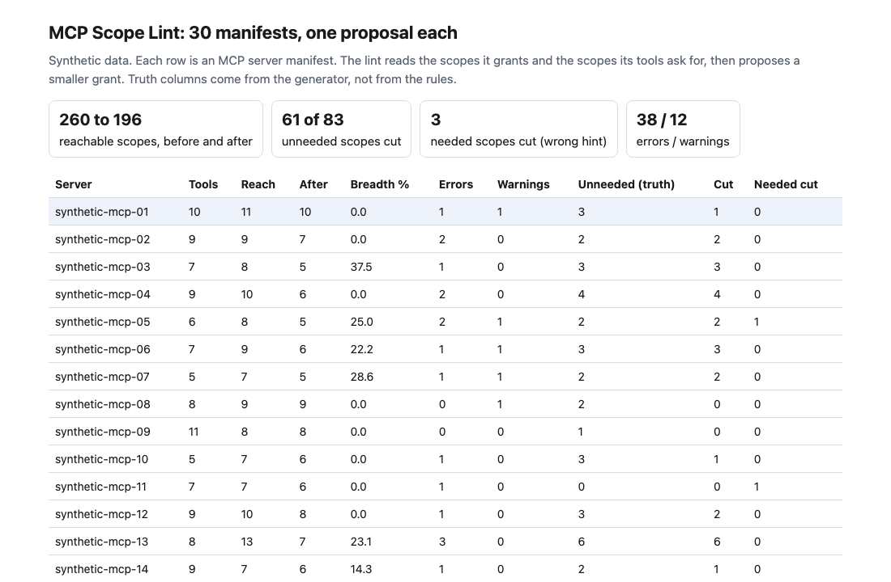
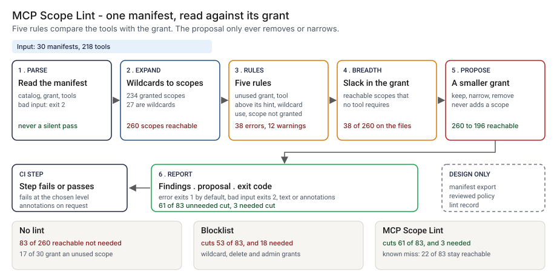
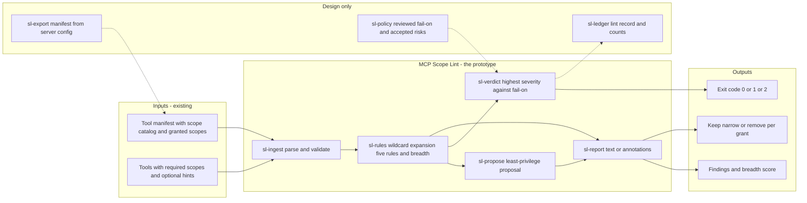
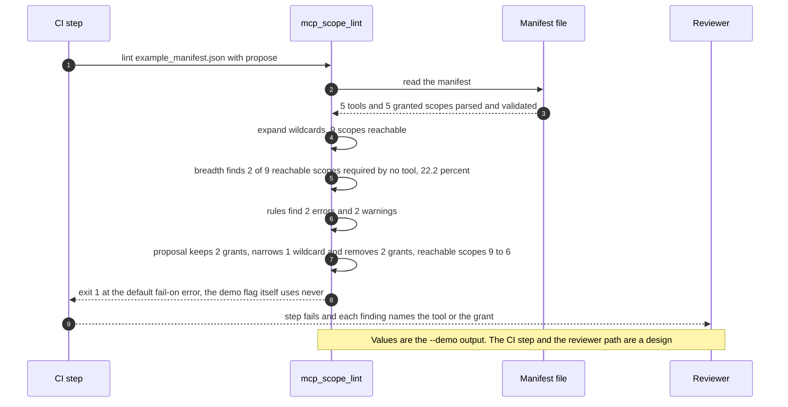

# 🧭 MCP Scope Lint: a tool manifest linter for grants nobody needs

**I wanted to know how much of what an MCP server is granted its own tools ever ask for, and how much of the rest a linter can take back without breaking a tool. This is a command-line linter: it reads a tool manifest, scores how broad the grant is, and prints a smaller grant that never adds a scope.** It carries the breadth score and the least-privilege proposal from [23 ScopeKeeper](../23-scopekeeper-agent-permission-review/) over to a static manifest, where there is no call log, and sits beside the tool-definition work in [15 SchemaWatch](../15-schemawatch-tool-schema-drift/) and [28 Tool Schema Drift](../28-tool-schema-drift/).

**▶ Static demo, no install:** [open demo.html](./demo.html)

[](./demo.html)

## Executive summary (90 seconds)

**Problem.** An MCP server is granted a set of scopes, and each of its tools asks for some of them. The engineer who owns the server and the security reviewer who approves the grant see a list of scope names. No step compares the grant with what the tools ask for, or with what their hints say they do. 🟢 On 30 synthetic manifests with 218 tools, 234 granted scopes (27 of them wildcards) reach 260 scopes; the generator marks 83 of 260 (31.9%) as not needed, and 17 of 30 manifests grant a scope that no tool asks for (`step_01_no_lint.py`). Every scope held without a need widens what a leaked or misused token could reach, and the grant stays until someone reads it.

**Product.** MCP Scope Lint is a command that reads a tool manifest and applies five rules. `unused_grant`: a granted scope that no tool requires is an error. `wildcard_narrowable`: a wildcard that tools use only in part is a warning. `tool_scope_above_hint`: a tool whose hints limit it to read, or to nothing destructive, but which requires a scope above that limit, is an error. `tool_requires_wildcard`: a tool with no usable hint that requires a wildcard is a warning, since there is nothing to narrow it by. `tool_scope_not_granted`: a tool that requires a scope the grant does not fully cover is an error. It also prints a breadth score, the share of reachable scopes that no tool requires, and a proposal that keeps, narrows or removes each grant, cuts tools back to their hints and never adds a scope. It exits 1 at the level you choose (error by default) and 2 for a file it cannot read or that is not a valid manifest. There is no model call; the rules are plain code you can read.

**Measured and modeled performance.**

- 🟢 **No lint: nothing reads the tools against the grant.** 234 granted scopes (27 wildcards) reach 260, 83 of 260 are not needed, and 150 of 218 tools carry a hint a check could use (`step_01_no_lint.py`).
- 🟢 **A blocklist of wildcard, delete and admin grants cuts 53 of 83 unneeded scopes and also cuts 18 needed ones** (`step_02_blocklist.py`).
- 🟢 **Each check alone stops short:** an unused-grant report cuts 27 of 83 and no needed scope; adding narrowing of partly used wildcards takes it to 38 of 83 (`step_03_deficiencies_exposed.py`).
- 🟢 **Together: 61 of 83 unneeded scopes cut,** reachable scopes 260 to 196 (24.6%), 38 errors and 12 warnings across the 30 manifests (`step_04_with_lint.py`).
- 🟢 **No false alarms on the hard negatives:** 0 findings on 15 tools behind a fully used wildcard, 6 tools that read two resources and 8 tools around a legitimate admin scope (`step_04_with_lint.py`).
- 🟢 **Known misses: 22 of 83 unneeded scopes stay reachable and 3 needed scopes are cut,** where a read-only hint is wrong (`step_03_deficiencies_exposed.py`, `step_04_with_lint.py`).
- 🟡 **Utility: (61/83 − 53/83) × 100 = 9.6 more unneeded scopes removed than the blocklist,** assuming 100 unneeded scopes are granted across the servers an organization runs.
- 🔴 **Design target: a lint result within 30 seconds of the pipeline step starting.** Designed in [`ARCHITECTURE.md`](./ARCHITECTURE.md), never built or timed.

**What I would ask a head of operations to decide.** Whether a tool that carries a read-only hint but requires a write scope, and a grant that no tool requires, should fail a server's pipeline. I set both to error as my policy, not as a measurement. My recommendation is to adopt those two rules as written, run the proposal in advisory mode on one real server manifest, and have the server owner read each proposed tool change before anything is removed, since 3 needed scopes would have been cut here.

**Call to action.** Fork the repo. Swap `data/example_manifest.json` (or `data/manifests.json`, which holds 30) for your own export and keep the fields `server.name`, `scope_catalog` (each with `id`, `resource` and `access`), `granted_scopes`, and `tools` (each with `name`, `requires_scopes` and optional `annotations`). To call it from code, import `lint` and `propose` from `src/mcp_scope_lint.py`. Export the manifest from the server's code or configuration, since MCP raises scopes at run time. Send findings by opening an issue: say which rule fired and how many times, not the manifest itself.

_A portfolio prototype on synthetic data. Nothing here is deployed, load-tested or used by anyone, and no real server or token was read._

## Run one now

```bash
cd 61-mcp-scope-lint/src && python3 mcp_scope_lint.py --demo
```

It prints:

```text
server: demo-ledger-desk   5 tools, 5 scopes granted, 9 scopes reachable
breadth: 2 of 9 reachable scopes are required by no tool (22.2%)
  [error] tool_scope_above_hint  list_transactions      requires `accounts:write` (access write) but its hints limit it to read
  [error] unused_grant           reports:read           no tool requires any of the 1 scope(s) it reaches
  [warn]  tool_requires_wildcard post_ledger_entry      requires the wildcard `ledger:*` and carries no hint to narrow it by
  [warn]  wildcard_narrowable    payments:*             reaches 3 scopes and tools require 2: payments:read, payments:write
hints: 3 of 5 tools were checked against a hint; not checked: get_payment_status, post_ledger_entry
result: 2 errors, 2 warnings
proposal (least privilege; no scope is added):
  keep   accounts:read
  remove accounts:write
  keep   ledger:*
  narrow payments:* -> payments:read, payments:write
  remove reports:read
  tool list_transactions: accounts:read, accounts:write -> accounts:read
  reachable scopes: 9 -> 6
```

Standard library only, Python 3.9 or newer. To lint your own file: `python3 mcp_scope_lint.py lint manifest.json --propose`. It exits 1 when a finding reaches `--fail-on` (default `error`; also `warn` or `never`), 0 otherwise, and 2 for a file it cannot read or that is not a valid manifest. `--format github` prints annotations with the manifest text escaped.

The manifest is my own simplified shape, not something an MCP server emits today: a `tools/list`-style tool list, each tool with the scope ids it requires and optional `readOnlyHint` and `destructiveHint` fields, plus a catalog of scopes (each with an explicit `resource` and `access`) and the list of scopes the server is granted. [`data/example_manifest.json`](./data/example_manifest.json) is the one above. The rules read `resource` and `access`, never the spelling of a scope id.

## What the numbers say

**What it shows** (🟢 measured on synthetic data: 30 manifests and 218 tools; the script is named in brackets):

- 🟢 With no lint, 234 granted scopes (27 of them wildcards) reach 260 scopes. The generator marks 83 of 260 (31.9%) as not needed, and 17 of 30 manifests grant a scope that no tool asks for (`step_01`)
- 🟢 A blocklist of wildcard, delete and admin grants cuts 53 of the 83 unneeded scopes and also cuts 18 needed ones (`step_02`)
- 🟢 An unused-grant report cuts 27 of 83 and no needed scope. Narrowing partly used wildcards takes it to 38 of 83 (`step_03`)
- 🟢 The full rules print 38 errors and 12 warnings, cut the reachable scopes from 260 to 196 (24.6%), and remove 61 of the 83 unneeded ones. They cut back 18 of 36 unneeded scopes that tools declare (`step_04`)
- 🟢 The manifests alone show 38 of 260 reachable scopes (14.6%) that no tool requires. The generator's truth says 83. The gap is tools that ask for more than they need, which only the hint check sees (`step_04`)
- 🟢 The rules raise 0 findings on three groups built to look risky and be needed: 15 tools behind a wildcard whose every scope is used, 6 tools that read two resources, and 8 tools around a legitimate admin scope (`step_04`)

## What it still gets wrong

- 🟢 22 of the 83 unneeded scopes stay reachable (`step_03` and `step_04` print the split). Six come from tools with no hint that declare write while only reading; step 3 names each one. Four come from a hint that allows write, so the declared scope is inside the tool's own limit. Four come from a tool nobody calls, which the manifest still lists. Eight sit behind a wildcard on a tool with no hint: the rule warns, and there is nothing to narrow it by.
- 🟢 3 needed scopes are cut. In each, the tool carries a read-only hint, the tool writes, and the declared write scope is right; the proposal swaps it for read and the tool would fail (`step_04` prints each one). A hint is the author's claim. The lint compares the claim with the scopes and does not prove what the tool does.
- **The test set and the rules share an author.** I built each resource from a profile, including the profiles the rules miss and the ones that could raise a false alarm, and I wrote the rules. The numbers show the rules cover what I planted. They are a ceiling for this rule set, not a rate on a real server catalog, which I have not tested.
- Tools with no usable hint are listed and not judged (🟢 150 of 218 carry one, `step_01`). A fully used wildcard is left alone: replacing it with its list would shrink nothing today but would stop it covering scopes added later, and the lint does not say so.
- Only an `any` scope covers other scopes. Real authorization servers can define hierarchies, such as an admin scope that implies read, and the MCP guidance notes this; it is not modeled. The manifest has to be exported from a server's code or configuration, since MCP raises scopes at run time; I have not built that export.
- It does not read tool descriptions or input schemas, so tool poisoning and schema drift are out of scope here. See [28](../28-tool-schema-drift/) for the schema side.

## How the four steps fit

| Step | Question | Script |
|---|---|---|
| 1 | What does a review see when nothing reads the tools against the grant? | `step_01_no_lint.py` |
| 2 | What does a blocklist of risky-looking grants cost? | `step_02_blocklist.py` |
| 3 | Where does each simpler check stop, and what stays? | `step_03_deficiencies_exposed.py` |
| 4 | What do the five rules and a proposal cut, and what do they get wrong? | `step_04_with_lint.py` |

Run any of them from `src/`. The rules are in `mcp_scope_lint.py`: `unused_grant`, `wildcard_narrowable`, `tool_scope_above_hint`, `tool_requires_wildcard` and `tool_scope_not_granted`. Data is generated by [`data/_generate.py`](./data/README.md); `tools/check_repo.py` confirms that a rerun reproduces every file and that the green numbers above appear in a script's output. There are 40 tests in `tests/`, including a golden test that pins these numbers.

## Utility delivered

The way I price product impact: **utility = (my solution − current state of the art) × the number of people or items it affects.**

Here the item is a scope that a server holds and no tool needs. Each one lands on the engineer who owns the server, the reviewer who approved the grant, and whoever answers for a token that leaks. The common basic approach is a blocklist of wildcard, delete and admin grants; the table prices the lint against it.

| Term | Value | Where it comes from |
| --- | --- | --- |
| Current state of the art (blocklist), unneeded scopes cut | 🟢 **53 of 83** | `step_02_blocklist.py`; it also cuts 18 needed scopes |
| My solution (five rules and the proposal), unneeded scopes cut | 🟢 **61 of 83** | `step_04_with_lint.py`; it cuts 3 needed scopes |
| Lift per unneeded scope | 🟢 61 of 83 minus 53 of 83 | The blocklist leaves read_tool_write_scope 9 and unused_specific 7 that the rules cut; the rules leave wildcard_nohint 8 that the blocklist cuts (`step_03_deficiencies_exposed.py`) |
| Number it affects: unneeded scopes granted across the servers an organization runs | 🟡 **100** | **Assumption, not a statistic.** Replace it with your own count of granted scopes that no tool needs |
| Assumption that makes the lift real | 🟡 The manifest is exported from the server's real configuration, and the hints are the tool authors' true claims | If a read-only hint is wrong, the proposal cuts a needed scope: 🟢 3 needed scopes are cut here (`step_04_with_lint.py`) |
| **Utility** | 🟡 **(61/83 − 53/83) × 100 = 9.6 more unneeded scopes removed than the blocklist** | Assumes the 100 behave like the 83 planted ones |

Sensitivity to the count assumption (🟡, same lift): 50 unneeded scopes gives 4.8, 100 gives 9.6, 200 gives 19.3.

🔴 What I have not measured: what an unneeded scope costs in risk or money, how long a person takes to read and apply the proposal, how many real manifests look like the planted ones, or how often real hints are right. The planted set is dense on purpose, 83 of 260 reachable scopes are unneeded (`step_01_no_lint.py`); a real server will differ. Treat the result as a property of this mix of cases, not a forecast.

---

## Architecture and call flow

Component names match [`ARCHITECTURE.md`](./ARCHITECTURE.md). GitHub renders the diagrams natively.



**System topology:**



**Per-run sequence** (the `--demo` run on `data/example_manifest.json`):



**Interlocks (all red, designed, none built):**

- [23 ScopeKeeper](../23-scopekeeper-agent-permission-review/) reads a call log. It would find the tool that nobody calls, which this lint cannot see because the manifest still lists it. This folder does not import or read its files; the breadth score and the proposal idea are carried over by hand.
- [15 SchemaWatch](../15-schemawatch-tool-schema-drift/) and [28 Tool Schema Drift](../28-tool-schema-drift/) watch tool definitions and schemas. Scope Lint does not read descriptions or input schemas, so the two would run side by side in the same pipeline.
- [09 LineageLog](../09-lineagelog-ai-decision-audit/) is a possible home for the lint record (`sl-ledger`).

---

## PM artifacts

The PM artifacts that show how I would run this product if I owned the seat. This README is the walkthrough; the rest of the folder holds:

- [`PRD.md`](./PRD.md): the product requirements doc, with users, backlog, KPIs, rollout and open questions.
- [`ARCHITECTURE.md`](./ARCHITECTURE.md): the systems doc, with components, data model, security, failure behavior and operations. A design, not deployed.
- [`demo.html`](./demo.html): clickable, no-install walkthrough, built from the step outputs by `src/_build_demo.py`.
- [`data/`](./data/): the 30 synthetic manifests, the two truth files, the two example manifests and the seeded generator. `data/README.md` explains how the truth is set.
- [`src/`](./src/): `mcp_scope_lint.py`, `common.py`, the four step scripts and the demo builder.
- [`tests/`](./tests/): 40 unittest tests, including a golden test that pins the numbers above and tests for bad input and hostile strings.

Run the four steps end to end:

```bash
cd src
python3 step_01_no_lint.py
python3 step_02_blocklist.py
python3 step_03_deficiencies_exposed.py
python3 step_04_with_lint.py
```

---

## Aligned to

- The [MCP specification's security best practices](https://modelcontextprotocol.io/specification/draft/basic/security_best_practices) (draft version, read 2026-10-24), section "Scope Minimization". It describes the harm of broad tokens and lists as common mistakes publishing every scope and using wildcard or omnibus scopes, and it recommends a progressive, least-privilege model. This lint checks the static part of that: a grant no tool needs, a wildcard used in part, a tool that asks for more than it says it does. It does not model the run-time step-up flow.
- The [OWASP MCP Top 10](https://owasp.org/www-project-mcp-top-10/) (read 2026-10-24; the page shows a 2025 designation and a beta phase), item MCP02, privilege escalation via scope creep.

This is a prototype, aligned to that guidance. It makes no claim of conformity to that guidance. I read both pages; the paraphrases are mine.

## Data and limits

Synthetic, seeded, byte-for-byte reproducible. Nothing comes from any employer, customer or real server. A prototype on synthetic data, not a production case study. The resources and tool names are invented.

## Fork it

Point `lint` at a manifest of your own in the shape above, or change the `QUOTA` profiles in `data/_generate.py` and rerun the steps. Read the [PRD](./PRD.md) for the scope I held to.

## Prereqs to run this on your laptop

You need Python 3.9 or newer and nothing else. The linter, the four step scripts and the data generator use only the standard library, so there is nothing to install. There is no API key, no network call and no model call anywhere in the folder. To run the tests, use `python3 -m unittest discover -s tests` from this folder. The production pieces in [`ARCHITECTURE.md`](./ARCHITECTURE.md) (the manifest export, the reviewed policy, the lint record) are a design, not something you need or can run.

## Author

**Vijay Saharan**, Sr Product / Program Manager · AI in BFSI · Enterprise AI Platforms

[LinkedIn](https://www.linkedin.com/in/vijaysaharan/)
