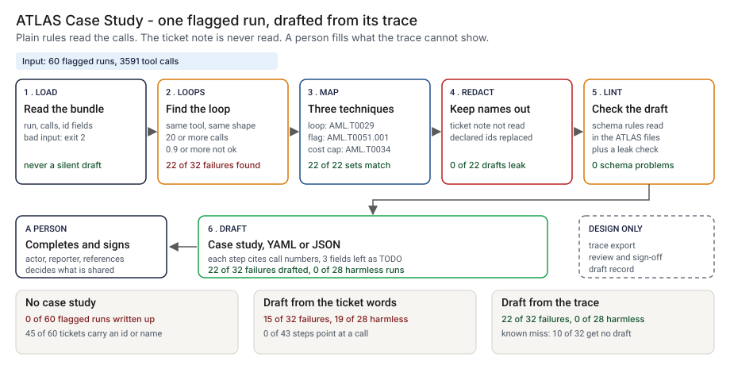

# Architecture: ATLAS Case Study

> **Status.** This is the design for a production shape. The repo implements the product mechanic as a prototype: a command, `src/atlas_case_study.py`, that reads a bundle holding the trace of one agent run, finds loops by plain rules, maps them to three ATLAS techniques and drafts a case study, then lints the draft, run here over 60 synthetic flagged runs and 3591 calls. The tool submits nothing. Nothing below is claimed as deployed or load-tested. Where a figure is a design target, it says so.

GCP is primary; AWS and Azure sit beside it.



---

## 1. Logical architecture

ATLAS Case Study is a function that runs after an incident: one bundle in, a draft, a lint result and an exit code out. It does not read the ticket, call a model, judge intent or submit anything.

Eight components: five decide the outcome, three support.

| Component | Responsibility | Language or framework | Decides the outcome? | Stateful? |
| --- | --- | --- | --- | --- |
| `ac-ingest` | Reads the bundle and rejects an unreadable, empty, truncated or wrongly typed one with a one-line message. | Python 3.9+, standard library. Prototype: `read_json`, `check_bundle` in `src/atlas_case_study.py` | Yes, by refusing: exit 2 | No |
| `ac-loops` | Splits calls into phases of the same tool and argument shape and keeps phases of 20 or more calls with 0.9 or more not ok. | Python. Prototype: `shape`, `phases`, `find_loops`, `cumulative_cost` | Yes: no loop, no draft | No |
| `ac-draft` | Writes the steps with tactic, technique and call numbers, and the YAML or JSON. | Python. Prototype: `build_study`, `to_yaml`, `summarize` | Yes | No |
| `ac-redact` | Replaces declared identifier values and long digit runs taken from them. | Python. Prototype: `keys_by_value`, `identifier_values`, `scrub`, `find_leaks`, `safe` | Yes, for what gets through | No |
| `ac-lint` | Checks the draft against the contribution schema rules I read, and for leaks. | Python. Prototype: `lint_study`, `run_lint` | Yes: exit 1 | No |
| `ac-export` | Builds the bundle from the tracing store and declares its identifier fields (design). | A job against the tracing store (design) | No, it supplies the input | No |
| `ac-review` | A person completes actor, reporter and references; privacy and security approve (design). | A review queue with two approvers (design) | Yes, for what leaves | Stateful |
| `ac-ledger` | One record per draft: bundle hash, rules version, approvers (design). | PostgreSQL plus object storage with a retention lock (design) | No | Stateful |

**What decides the outcome.** The input check, the loop rule, the mapping, the redaction and the lint. The export, the ledger and the review carry or record the draft, except that the review decides what leaves the firm. The tool reads `response_kind` and `response_flag` as the tracing store wrote them and trusts the scanner flag.

**Repo structure** (production shape):

```
atlas-case-study/
├── draft/      # ingest.py, loops.py, mapping.py, redact.py, lint.py
├── export/     # bundle export per tracing store, with identifier fields
├── review/     # review queue and sign-off records
├── ledger/     # draft record writer
├── infra/      # terraform for gcp, aws, azure
└── tests/      # unit, golden (planted-set numbers), hostile strings
```

---

## 2. Physical and deployment architecture

The drafter is one short-lived job that runs after an incident review opens. There is no server to keep warm.

| Component | GCP (primary) | AWS | Azure | Why |
| --- | --- | --- | --- | --- |
| Drafter (`ac-ingest` to `ac-lint`) | Cloud Run job | ECS Fargate task | Container Apps job | Stateless, one pass, no inbound traffic |
| `ac-export` | A job against the tracing store | Same | Same | The trace never leaves the store except as a bundle |
| Bundle and draft store | Cloud Storage, versioned, restricted | S3, versioned, restricted | Blob Storage, versioned, restricted | The bundle holds identifiers, so access is narrow |
| `ac-review` | A ticket queue with two approvers | Same | Same | The review tool the firm already uses |
| `ac-ledger` | Cloud SQL for PostgreSQL | RDS for PostgreSQL | Azure Database for PostgreSQL | The platform team already runs it |

**Failure behavior (the decision that matters most).** The tool must never silently pass or silently draft. An unreadable or malformed bundle ends with exit 2 and a one-line reason. A trace with no loop prints that it made no draft and exits 1; it does not write an empty case study. A draft with a leaked identifier exits 1 and names the key, not the value.

| Failure | Behavior | Alert |
| --- | --- | --- |
| Bundle missing, empty, truncated, not JSON, or a field of the wrong type | Exit 2, one line on stderr | P3 |
| Output path cannot be written | Exit 2 with the reason | P3 |
| No loop in the trace | "No draft", with the rule, exit 1. The run goes to a person | P4 |
| Draft has a schema problem or a leaked identifier | Exit 1, problems listed, leak names the key | P3 to the privacy reviewer |
| TODO fields left | Reported; fails only with `--strict` | None |
| Export call count differs from the trace (design) | The export fails the run; no bundle is written | P3 |
| Ledger unavailable (design) | The draft and exit code stand; the record queues locally | P3 |

**Latency.** The prototype is one pass over one run; I have not timed it. 🔴 Design target: a draft within 60 seconds of the trace export landing.

Recovery is a re-run from the same versioned bundle.

---

## 3. Data architecture

| Entity | Key | What it holds | Real columns in the prototype |
| --- | --- | --- | --- |
| Run | `run_id` | The flagged run and its cost cap | `data/runs.csv`: `run_id`, `agent_id`, `agent_role`, `customer_id`, `started_at`, `cost_cap_usd`, `n_calls`, `total_cost_usd`, `ticket_note` (read by steps 1 and 2 only) |
| Call | `call_id`, `run_id` | Tool, argument shape, response kind, flag, cost | `data/tool_calls.csv`: `call_id`, `run_id`, `step_index`, `tool_name`, `args_json`, `response_kind`, `response_flag`, `cost_usd` |
| Bundle | `run_id` | One run, its calls and `identifier_keys` | `data/example_bundle.json`; the shape is at the top of `src/atlas_case_study.py` |
| Draft | `run_id` and rules version | The `study` and a `meta` evidence block (step, technique, first and last call) | `issue/case_study_draft.yaml`, `src/out/step_04_example.yaml` |
| Planted truth | `run_id` | The scenario and the technique set a careful reader would assign. Exists only because the data is synthetic | `data/truth.csv`: `scenario`, `worthy`, `truth_techniques`, `planted_strings` |

🔴 Design default retention: the bundle, which holds identifiers, is kept 7 years in a restricted store; the draft and its record are kept as long as the incident record. Confirm both against the bank's own record-retention schedule.

**Lineage.** A draft step traces back in three hops: the `meta.evidence` entry names the step, technique and first and last call; those positions index the bundle; and the bundle's calls map to `call_id` rows in the tracing store. The rules are deterministic, so a re-run reproduces the draft.

**Deliberately not stored.** The ticket note, call argument values beyond their shape, and customer text. The draft keeps tool names, counts, response kinds and costs, with declared identifiers redacted.

---

## 4. Security architecture

**Identity and roles.** The job runs under workload identity and has no user account of its own. `ac:runner` reads a bundle and writes a draft; `ac:reviewer` (privacy and security) approves what leaves, never for their own draft; `ac:auditor` reads records; `ac:admin` manages roles and buckets.

**Secrets.** The tool holds none and never calls a model or a catalog. No submission credential exists in the design: sending a case study is a manual step by a person.

**Data classification and what leaves the boundary.** A trace is confidential; `customer_id`, tool arguments and agent roles may identify a customer. The draft is meant to leave only after review. In the prototype nothing leaves the machine, and the demo run is synthetic.

| Threat | Example | Mitigation in the design |
| --- | --- | --- |
| A declared identifier or a digit run from one reaches the draft | A customer id inside a tool argument or the agent role | `scrub` replaces values and long digit runs; `lint --bundle` fails and names the key. `tests/test_build.py` covers role redaction, digit cores and `find_leaks` |
| An identifier that was never declared | A field the export did not list in `identifier_keys` | The tool cannot see it. The export declares fields per store, and a reviewer reads the draft before it leaves |
| Hostile string in a tool name, role or path echoed into a terminal or YAML | A tool name holding a newline and text that looks like another field | `safe` writes control and non-ASCII characters as escapes; YAML values stay in one quoted value. `tests/test_cli.py` covers a hostile path, hostile values and hostile lint output |
| A draft overstates what the trace shows | A mapping read as proof of an adversary | `actor` stays TODO and `meta` states that it maps effects, not an adversary action |
| A draft is shared before review | An engineer posts the YAML | There is no submit function. The design gates release on two approvals, recorded with the bundle hash |

---

## 5. Operational architecture

**SLIs.** Drafts per week; runs with no draft; lint problems and leaks per draft; TODO fields left; time to a draft; reviewer turnaround (prototype baseline: 🟢 22 of 32 failures drafted and 0 of 28 harmless runs, `step_04_with_case_study_tool.py`).

**SLOs (all 🔴 design targets, none measured).**
- A draft within 60 seconds of the trace export landing.
- Every draft linted with `--bundle` and read by a named reviewer before it leaves.
- Every no-draft run read by a person within five business days (planning estimate).
- 99.9 percent of draft records written to the ledger.

**Alerts.** P3: a leak caught in a draft, which also goes to the privacy reviewer, or repeated input rejections from one export. P4: a weekly digest of runs with no draft and drafts with fields still TODO.

**Runbooks** (one page each, in `docs/runbooks/`):
- `no-draft.md`: read the trace by hand; short storms and alternating loops are the known misses.
- `leak-in-draft.md`: stop, find the key, add the field to `identifier_keys`, rebuild, re-lint.
- `changing-a-threshold-or-mapping.md`: propose, re-run the planted set, compare with the golden numbers, approve.
- `reading-a-new-atlas-release.md`: re-read the id mapping against the release file before the tables change.

**Ownership.** The program owner owns the drafts. The platform team owns the job and runbooks. Privacy and security own sign-off. The mapping tables and thresholds are versioned in the repo; a change needs a proposer and a different approver, and `tests/test_golden.py` pins the planted-set numbers, so a change that moves the drafted count shows in the diff.

---

## 6. Alignment and posture

Alignment, not certification. The README cites one source, restated with the same wording about what was read: [MITRE ATLAS](https://github.com/mitre-atlas/atlas-data) case-study format. I read, on 2026-10-24: the repository README (format version 6.0.0); the contribution schema (version 1.0.0) and the website case-study schema (version 1.1) for the study fields, enums and id patterns; and `dist/v6/ATLAS-2026.09.yaml` (collection 2026.09) for the three techniques and two tactics used here. I read the long files through a fetch tool that returns summaries, so the id mapping should be checked against the release file. The contribution page returns HTTP 404 to a plain fetch but renders in a browser; its case-study form builds a YAML file to email to the ATLAS team.

- **What the design does.** It drafts in the case-study shape, checks the schema rules I read, and keeps identifiers out.
- **What it does not claim.** The draft is not reviewed, endorsed or accepted by MITRE. The design is not compliant with any standard, holds no certification, and I have not read or mapped any other source.

---

## 7. What is deliberately not here

- **Failures the loop rule misses.** 🟢 10 of 32 failures get no draft (`step_04_with_case_study_tool.py`): five short retry storms and five alternating loops. I left both in on purpose.
- **Intent.** A trace shows effects. A loop after a bad response and one after a poisoned record look the same except for the scanner flag, which I assume exists.
- **Thresholds tuned on real traffic.** The 20-call line and the 0.9 share are mine, and 🟢 at 10 calls the rule drafts 5 of 28 harmless runs (`step_03_deficiencies_exposed.py`).
- **More than three techniques.** AI Agent Tool Data Poisoning (AML.T0099) is not mapped, because a trace cannot show who changed a record.
- **Full schema validation.** The lint applies the rules I read and does not check the object forms of tactic and technique.
- **Ticket text, submission and real incidents.** The ticket is never read, nothing is submitted, and a synthetic run is not an incident.
- **Identifiers nobody declared.** The tool redacts what it is told about.

---

## Appendix: sample contract

The call is the prototype's own. Its output for the bundled `--demo` run is under "Run one now" in the README.

```bash
python3 atlas_case_study.py build bundle.json --reporter "Team A" --yaml draft.yaml --json draft.json
python3 atlas_case_study.py lint draft.json --bundle bundle.json --strict
```

A bundle is `{"identifier_keys": [...], "synthetic": true, "run": {...}, "calls": [{"tool_name", "args", "response_kind", "response_flag", "cost_usd"}]}`. Exit status: 0 when the command did what it was asked, 1 for no loop, a schema problem or a leaked identifier (and with `--strict` a TODO field), 2 for bad input.
