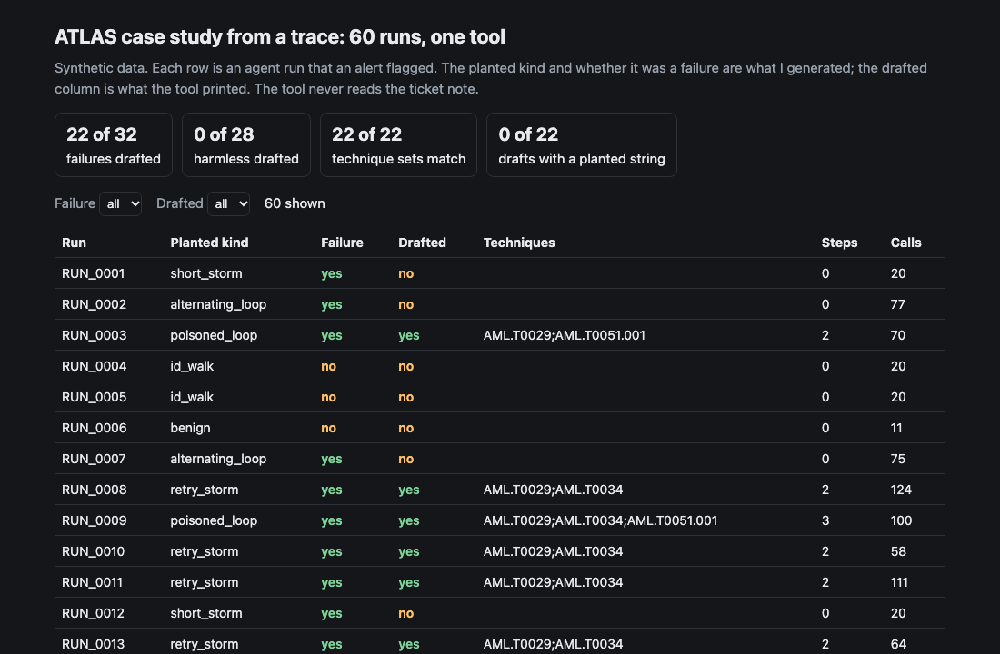
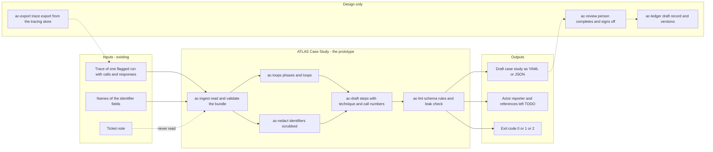
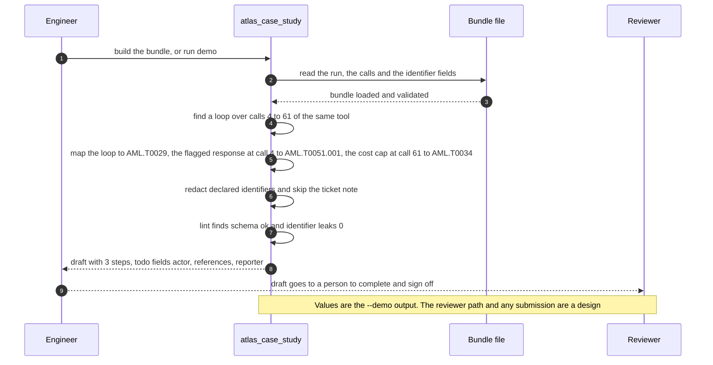

# 🗂 ATLAS Case Study: from the trace of one agent run to a draft a threat catalog can read

**I wanted to know how much of an agent incident can be turned into a case study by rules, and what only a person can supply. This is a command-line tool that reads the trace of one run and drafts a case study in the shape the MITRE ATLAS contribution schema describes: a short procedure of steps, each with a tactic, a technique and the call numbers that back it. The actor, the reporter and the references stay marked TODO.** The trace shape follows [05 AgentWatch](../05-agentwatch-agent-observability/); the rows here are new and none are copied from it.

**▶ Static demo, no install:** [open demo.html](./demo.html)

[](./demo.html)

## Executive summary (90 seconds)

**Problem.** An agent run goes wrong, an alert flags it, and an on-call engineer writes a ticket. The trace holds what happened and the ticket holds what someone thought; neither is in a form that a public threat catalog can read. The program owner and the security analyst who would share the lesson are left to write it by hand from a trace they have to scan row by row. 🟢 In 60 synthetic flagged runs, 0 of 60 have a case study, 32 of 60 were failures and the alert does not say which, a reader scans a median of 59 trace rows per run, and 45 of 60 tickets carry an identifier or a first name (`step_01_trace_as_report.py`). A draft written from the ticket copies those names into a public place.

**Product.** ATLAS Case Study is a command that reads a bundle, one run with its calls and the names of the fields that hold identifiers, and drafts a case study in the shape the MITRE ATLAS contribution schema describes. It splits the calls into phases of the same tool and argument shape. A phase of 20 or more calls where 0.9 or more of the responses are not ok is a loop. Each loop becomes a Denial of AI Service step (AML.T0029). An instruction-like response, flagged by an upstream scanner, on the call before the loop or its first call adds an Indirect prompt injection step (AML.T0051.001). The call where cumulative cost reaches the run's cap adds a Cost Harvesting step (AML.T0034). Each step carries the call numbers behind it. The ticket note is never copied, declared identifiers are redacted, and the actor, the reporter and the references stay marked TODO for a person. `lint` checks a draft against the rules I read in the contribution schema. The command exits 1 when it finds no loop, a schema problem or a leaked identifier, and 2 for input it cannot read. There is no model call; the rules are plain code you can read.

**Measured and modeled performance.**

- 🟢 **No tool: 0 of 60 flagged runs have a case study.** 32 of 60 were failures, a reader scans a median of 59 trace rows, and 45 of 60 tickets carry an identifier or a first name (`step_01_trace_as_report.py`).
- 🟢 **Writing from the ticket's words drafts 34 of 60 runs:** 15 of 32 failures but also 19 of 28 harmless runs. Only 6 of 34 drafts get the planted technique set, 23 of 34 carry a planted identifier or name, and 0 of 43 steps point at a call (`step_02_ticket_keywords.py`).
- 🟢 **Each approach fails alone:** the injection step is found in 1 of 10 poisoned runs from the ticket's words and in 10 of 10 from the trace shape; the trace shape misses 10 of 32 failures (`step_03_deficiencies_exposed.py`).
- 🟢 **The loop threshold is a trade:** at 10 calls the rule drafts 27 of 32 failures and also 5 of 28 harmless runs; at 20 or 30 calls it drafts 22 of 32 and 0 of 28 (`step_03_deficiencies_exposed.py`).
- 🟢 **Draft from the trace: 22 of 32 failures drafted and 0 of 28 harmless runs;** 22 of 22 technique sets equal the planted set, 0 schema problems, 0 of 22 drafts carry a declared identifier, and a median of 2 steps per draft (`step_04_with_case_study_tool.py`).
- 🟢 **Known miss: 10 of 32 failures get no draft,** five short retry storms and five alternating loops (`step_04_with_case_study_tool.py`).
- 🟡 **Utility: (22/32 − 15/32) × 20 = 4.4 more failures a year with a draft than the ticket-words draft gives,** assuming 20 failures a year are worth a case study and arrive with a trace.
- 🔴 **Design target: a draft within 60 seconds of the trace export landing.** Designed in [`ARCHITECTURE.md`](./ARCHITECTURE.md), never built or timed.

**What I would ask a head of operations to decide.** Whether the firm would ever share a redacted agent-failure case study outside, and who signs off if it does. The case-study form on the catalog's site says case studies are intended for attacks on AI systems, and I have not asked whether a failure with no confirmed adversary fits, and I have not submitted anything. My recommendation is to use the drafts internally first, as the starting point for an incident review where a person fills the actor, reporter and references, and to hold any submission until the maintainers answer the scope question in the staged issue and privacy and legal have read the draft.

**Call to action.** Fork the repo. Export a trace from your tracing store into the bundle shape, list your identifier fields in `identifier_keys`, and run `build`. Or swap `data/runs.csv`, `data/tool_calls.csv` and `data/truth.csv` for your own and keep the columns. To call it from code, import `build_study` and `lint_study` from `src/atlas_case_study.py`. Make sure your tracing store records `response_kind` and, if you have a scanner, `response_flag`. Send findings by opening an issue: say which step looked wrong, not the trace itself.

_A portfolio prototype on synthetic data. Nothing here is deployed, load-tested or used by anyone, and nothing has been submitted to any catalog._

## Run one now

```bash
cd 62-atlas-case-study/src && python3 atlas_case_study.py --demo
```

It prints:

```text
draft: "Retry loop after an instruction-like tool response" (2026-03-24), synthetic
procedure: 3 steps: AML.T0051.001 at call 4, AML.T0029 over calls 4-61, AML.T0034 at call 61
lint: schema ok; todo fields: actor, references, reporter; identifier leaks: 0
```

Standard library only, Python 3.9 or newer. To draft from your own trace: `python3 atlas_case_study.py build bundle.json --reporter "Team A" --yaml draft.yaml --json draft.json`, then `python3 atlas_case_study.py lint draft.json --bundle bundle.json`. A bundle is one JSON file with the run, its calls and the names of the fields that hold identifiers; the shape is at the top of [`src/atlas_case_study.py`](./src/atlas_case_study.py). It exits 1 when it finds no loop, a schema problem or a leaked identifier, and 2 for input it cannot read. The draft for the demo run is staged in [`issue/case_study_draft.yaml`](./issue/case_study_draft.yaml).

## What the numbers say

**What it shows** (🟢 measured on synthetic data: 60 flagged runs and 3591 tool calls; the script is named in brackets):

- 🟢 Status quo: 0 of 60 flagged runs have a case study. 32 of the 60 were failures and the alert does not say which. A reader scans a median of 59 trace rows per run, and 45 of 60 tickets carry an identifier or a first name (`step_01_trace_as_report.py`)
- 🟢 Writing from the ticket's words drafts 34 of 60 runs: 15 of 32 failures but also 19 of 28 harmless runs. Only 6 of 34 drafts get the planted technique set, 23 of 34 carry a planted identifier or name, and 0 of 43 steps point at a call in the trace (`step_02_ticket_keywords.py`)
- 🟢 Each approach alone: the injection step is found in 1 of 10 poisoned runs from the ticket's words and in 10 of 10 from the trace shape; the trace shape misses 10 of 32 failures and the ticket's words reach 7 of those (`step_03_deficiencies_exposed.py`)
- 🟢 The loop threshold is a trade, not a setting: at 10 calls the rule drafts 27 of 32 failures and also 5 of 28 harmless runs; at 20 or 30 calls it drafts 22 of 32 and 0 of 28 (`step_03_deficiencies_exposed.py`)
- 🟢 Draft from the trace: 22 of 32 failures drafted and 0 of 28 harmless runs; 22 of 22 technique sets equal the planted set; 0 schema problems; 0 declared identifiers and 0 planted strings in the 22 drafts; a median of 2 steps per draft (longest 3), the 22 drafts rest on 2060 calls, and 3 fields are left for a person in each draft (`step_04_with_case_study_tool.py`)

## What it still gets wrong

- 🟢 10 of 32 failures get no draft, and `step_04_with_case_study_tool.py` prints each one. Five are retry storms cut off after a dozen or so calls (the longest same-shape run is 15 to 18 calls against a threshold of 20) and five are two tools called in turn (the longest same-shape run is 1 to 4). I left both in on purpose.
- 🟡 The threshold of 20 calls and the share of 0.9 not-ok responses are my assumptions, not values from ATLAS. In my data a short storm (12 to 18 calls) and a not-found walk (6 to 18 calls) overlap in length, so no length separates them.
- **The test set and the rules share an author.** I planted the runs and wrote the rules, so 22 of 22 shows the rules cover what I planted. Treat it as a ceiling for these rules, not a rate on real traces, which I have not tested.
- **A trace cannot show intent.** ATLAS records adversary behavior. A retry loop after a bad response and one after a poisoned record look the same in the trace except for one flag set by an upstream scanner, which I assume exists. The draft marks the actor TODO and states in `meta` that it maps effects, not an adversary action. Whether a failure with no adversary belongs in the catalog is the maintainers' call, and the staged [issue draft](./issue/ISSUE_DRAFT.md) asks them.
- The ticket note is never copied, because notes carry names and identifiers. The cost is that the draft gives no root cause beyond what the trace shows.
- Three techniques are mapped. AI Agent Tool Data Poisoning (AML.T0099) is not, because a trace cannot show who changed a record.
- The lint applies the rules I read in the contribution schema. It is not a full JSON Schema validator and does not check the object forms of tactic and technique.
- 🔴 A synthetic run is not an incident. ATLAS case studies are real incidents or exercises, so the staged draft is a format example. I have not submitted anything, and the contribution page returns HTTP 404 to a plain fetch, though it renders in a browser (see below).

## How the four steps fit

| Step | Question | Script |
|---|---|---|
| 1 | What is there to work from when an alert flags a run? | `step_01_trace_as_report.py` |
| 2 | What does a draft written from the ticket's words cost? | `step_02_ticket_keywords.py` |
| 3 | Where does each approach fail alone? | `step_03_deficiencies_exposed.py` |
| 4 | What does a draft from the trace get right, and miss? | `step_04_with_case_study_tool.py` |

Run any of them from `src/`. Data is produced by [`data/_generate.py`](./data/README.md); the check in `tools/check_repo.py` confirms that a rerun reproduces every file and that the green numbers above appear in a script's output.

## Utility delivered

The way I price product impact: **utility = (my solution − current state of the art) × the number of people or items it affects.**

Here the item is a failed agent run that is worth a case study. Each one lands on the program owner who has to explain it, the analyst who would write it up, and the privacy reviewer who has to read it before it goes anywhere. The common basic approach is a draft written from the ticket's words; the table prices the trace-based draft against it.

| Term | Value | Where it comes from |
| --- | --- | --- |
| Current state of the art (draft from the ticket's words), failures drafted | 🟢 **15 of 32** | `step_02_ticket_keywords.py`; it also drafts 19 of 28 harmless runs |
| My solution (draft from the trace), failures drafted | 🟢 **22 of 32** | `step_04_with_case_study_tool.py`; it drafts 0 of 28 harmless runs |
| Lift per failure | 🟢 22 of 32 minus 15 of 32 | The ticket-words drafts also carry a planted identifier or name in 23 of 34 and point at a call in 0 of 43 steps; the trace drafts carry no declared identifier in 22 of 22 (`step_02`, `step_04`). I count only whether a failure got a draft, not whether it was usable |
| Number it affects: failures a year worth a case study that arrive with a trace | 🟡 **20** | **Assumption, not a statistic.** Replace it with your own count of flagged failures a year that you would want written up |
| Assumption that makes the lift real | 🟡 The tracing store records the call order, `response_kind` and the scanner flag, and a loop of 20 or more calls fits the real traffic | If the line is wrong the trade moves: 🟢 at 10 calls the rule drafts 27 of 32 and 5 of 28 harmless runs (`step_03_deficiencies_exposed.py`) |
| **Utility** | 🟡 **(22/32 − 15/32) × 20 = 4.4 more failures a year with a draft than the ticket-words draft gives** | Assumes the 20 behave like the 32 planted failures |

Sensitivity to the count assumption (🟡, same lift): 10 failures a year gives 2.2, 20 gives 4.4, 30 gives 6.6.

🔴 What I have not measured: the hours it takes to write a case study by hand against editing a draft, whether the maintainers would accept one, how many real traces look like the planted ones, or what a leaked identifier costs. The planted set is dense on purpose, 32 of 60 runs are failures (`step_01_trace_as_report.py`); a real queue will hold fewer. A synthetic run is not an incident, so the staged draft is a format example.

---

## Architecture and call flow

Component names match [`ARCHITECTURE.md`](./ARCHITECTURE.md). GitHub renders the diagrams natively.


**System topology:**



**Per-run sequence** (the `--demo` run on `data/example_bundle.json`):



**Interlocks (all red, designed, none built):**

- [05 AgentWatch](../05-agentwatch-agent-observability/) is where the trace shape comes from and where the alert and the trace export would come from. This folder does not import or read its files; no row is copied from it.
- [06 PromptShield](../06-promptshield-prompt-injection-defense/) is one possible source of the instruction-like flag on a response. I assume the flag exists; I have not connected any scanner.
- [19 IncidentLedger](../19-incidentledger-ai-incident-response/) is a possible home for the incident record that a draft would attach to.

---

## PM artifacts

The PM artifacts that show how I would run this product if I owned the seat. This README is the walkthrough; the rest of the folder holds:

- [`PRD.md`](./PRD.md): the product requirements doc, with users, backlog, KPIs, rollout and open questions.
- [`ARCHITECTURE.md`](./ARCHITECTURE.md): the systems doc, with components, data model, security, failure behavior and operations. A design, not deployed.
- [`demo.html`](./demo.html): clickable, no-install walkthrough, built from the step outputs by `src/_build_demo.py`.
- [`data/`](./data/): the 60 synthetic flagged runs, their 3591 calls, the planted truth, the identifier fields, the example bundle and the seeded generator. `data/README.md` explains how the truth is set.
- [`src/`](./src/): `atlas_case_study.py`, `common.py`, the four step scripts and the demo builder.
- [`tests/`](./tests/): 53 unittest tests, including a golden test that pins the numbers above and tests for bad input and hostile strings.
- [`issue/`](./issue/): a staged question for the catalog's maintainers (`ISSUE_DRAFT.md`) and the draft built from the demo run (`case_study_draft.yaml`). Not submitted.

Run the four steps end to end:

```bash
cd src
python3 step_01_trace_as_report.py
python3 step_02_ticket_keywords.py
python3 step_03_deficiencies_exposed.py
python3 step_04_with_case_study_tool.py
```

---

## Aligned to

[MITRE ATLAS](https://github.com/mitre-atlas/atlas-data) case-study format. I read, on 2026-10-24: the repository README (format version 6.0.0); `dist/schemas/atlas_contribution_schema.json` and `dist/schemas/atlas_website_case_study_schema.json` (the contribution schema is version 1.0.0, the website schema 1.1) for the study fields, their enums and the id patterns; and `dist/v6/ATLAS-2026.09.yaml` (collection 2026.09, modified 2026-09-15) for the three techniques and two tactics used here: AML.T0029 Denial of AI Service, AML.T0034 Cost Harvesting, AML.T0051.001 Indirect (under LLM Prompt Injection), AML.TA0005 Execution and AML.TA0011 Impact. I read the long files through a fetch tool that returns summaries, so check the id mapping against the release file before you rely on it. `CONTRIBUTING.md` points to `https://atlas.mitre.org/contribute` for new content; that address returns HTTP 404 to a plain fetch but renders in a browser, where its case-study form builds a YAML file to email to the ATLAS team; I have not submitted anything. This is a prototype, aligned to the case-study format and not reviewed, endorsed or accepted by MITRE.

## Data and limits

Synthetic, seeded, byte-for-byte reproducible. Nothing comes from any employer, customer or real agent. People's names in the tickets are invented first names. A prototype on synthetic data, not a production case study.

## Fork it

Export a trace from your own tracing store into the bundle shape, list your identifier fields in `identifier_keys`, and run `build`. Or swap `data/runs.csv`, `data/tool_calls.csv` and `data/truth.csv` for your own and keep the columns. Read the [PRD](./PRD.md) for the scope I held to.

## Prereqs to run this on your laptop

You need Python 3.9 or newer and nothing else. The drafter, the four step scripts and the data generator use only the standard library, so there is nothing to install. There is no API key, no network call and no model call anywhere in the folder. To run the tests, use `python3 -m unittest discover -s tests` from this folder. The production pieces in [`ARCHITECTURE.md`](./ARCHITECTURE.md) (the trace export, the review step, the draft record) are a design, not something you need or can run.

## Author

**Vijay Saharan**, Sr Product / Program Manager · AI in BFSI · Enterprise AI Platforms

[LinkedIn](https://www.linkedin.com/in/vijaysaharan/)
