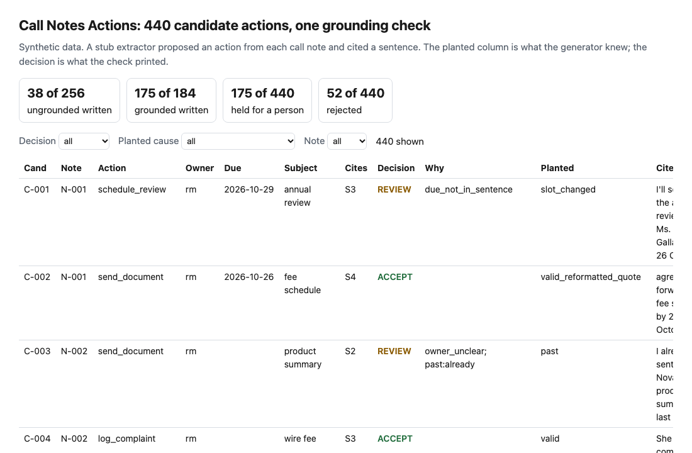
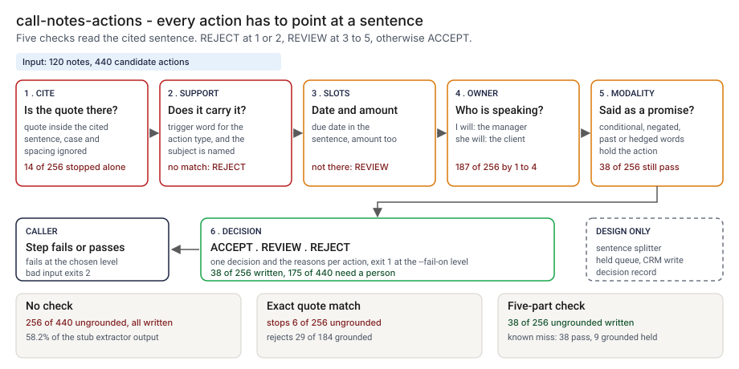
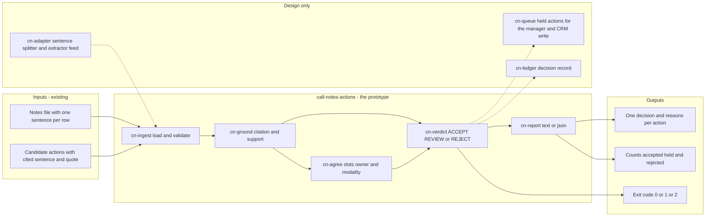
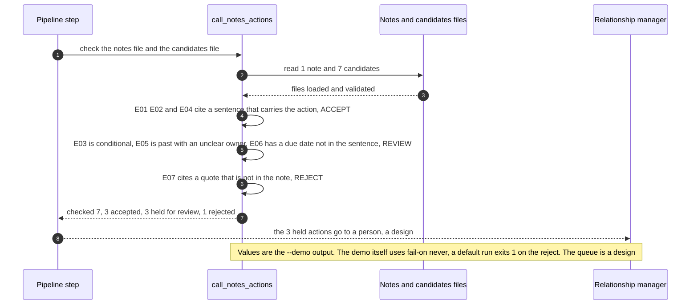

# 🗒️ call-notes-actions (grounding check): every CRM action has to point at a sentence

**I wanted to know what reaches the CRM when a model turns a relationship manager's call note into follow-up tasks and nobody checks that each task is something the manager actually said. This is a command-line check: for every proposed action it looks up the sentence the action cites and accepts it, holds it for a person, or rejects it.** On 120 synthetic notes it cut ungrounded actions written to the CRM from 256 to 38, and it left 175 of 440 candidates for a person to read.

**▶ Static demo, no install:** [open demo.html](./demo.html)

[](./demo.html)

## Executive summary (90 seconds)

**Problem.** A relationship manager finishes a call and a model proposes CRM tasks from the notes. The tasks look right. Some are not in the note at all, some cite a sentence that says the opposite, and some carry a date or an owner the sentence does not give. The person who owns the note-to-CRM step and the manager who has to trust their queue see tasks, not the sentences behind them. Written straight to the CRM, a wrong task sends a client a chaser for a document already delivered. 🟢 On 120 synthetic notes with 440 candidate actions from a stub extractor, 256 of 440 are ungrounded (58.2%) and with no check all 256 are written, while only 184 of 258 planted actions reach the CRM correctly (`step_01_no_check.py`). The 58.2% describes my stub extractor, not any real one.

**Product.** call-notes-actions is a command that reads the notes, one sentence per row, and the proposed actions, each with a cited sentence id and quote, and applies five parts in order. `cite`: the quote has to be in the cited sentence once case, quotes and spacing are normalized, else REJECT. `support`: the sentence has to carry a trigger word for that kind of action and name the subject, else REJECT. `slots`: a due date or an amount that the sentence does not contain sends the action to REVIEW. `owner`: for a commitment, the sentence has to be in the voice of the owner, the manager or the client, else REVIEW. `modality`: a conditional, negated, past or hedged sentence sends the action to REVIEW. It prints ACCEPT, REVIEW or REJECT per action with the reasons, and exits 1 at the level you choose (REJECT by default) and 2 for a missing or malformed file. There is no model call; the rules are plain code you can read.

**Measured and modeled performance.**

- 🟢 **No check: 256 of 440 candidates are ungrounded and all 256 are written (58.2%),** and only 184 of 258 planted actions reach the CRM correctly (`step_01_no_check.py`).
- 🟢 **Requiring a quote barely helps:** a non-empty citation stops 0 of 256; an exact match anywhere in the note stops 6 of 256 and rejects 29 of 184 grounded actions whose quote the model had tidied (`step_02_citation_present.py`).
- 🟢 **Each half fails alone:** citation alone stops 14 of 256; adding support, slots and owner stops 187 of 256, and 69 are still written because a conditional, negated, past or hedged sentence reads as a commitment (`step_03_deficiencies_exposed.py`).
- 🟢 **Together: 38 of 256 ungrounded actions are written (14.8%),** 166 are held for a person and 52 are rejected (`step_04_with_grounding_check.py`).
- 🟢 **The cost: 9 of 184 grounded actions are held and none is rejected;** 175 of 440 candidates need a person, and 94.9% of those held are ungrounded (`step_04_with_grounding_check.py`).
- 🟢 **Known misses: the 38 that pass are clause swaps 13, soft hedges 17 and phrasal negations 8,** and 74 of 258 planted actions never come out of the extractor correctly (`step_04_with_grounding_check.py`).
- 🟡 **Utility: (250/256 − 38/256) × 1000 = 828.1 ungrounded actions a year kept out of the CRM that an exact quote match would let through,** assuming 1,000 ungrounded actions a year are proposed.
- 🔴 **Design target: a decision for every candidate of a note within 5 seconds of the extractor output landing.** Designed in [`ARCHITECTURE.md`](./ARCHITECTURE.md), never built or timed.

**What I would ask a head of operations to decide.** Whether relationship managers would work a held queue of this size, and whether an action that is held should wait for a person or be written with a flag. I set REVIEW to hold as my policy, not as a measurement, and I did not time anyone. My recommendation is to run it in shadow on a few hundred real notes with the extractor you would actually use, write only ACCEPT, and measure the minutes a person spends per held action before choosing how strict the queue should be.

**Call to action.** Fork the repo. Swap `data/notes.csv` and `data/candidates.csv` for your own export and keep the columns `note_id, call_date, sent_id, text` and `cand_id, note_id, action_type, cite_sent_id, cite_quote`, with `owner, due, subject, amount` optional, then point `check` at them. To call it from code, import `check_all` from `src/call_notes_actions.py`. The trigger words, subject rules and hedge words are lists at the top of that file; the notes have to be split into sentences first, and there is no splitter. Send findings by opening an issue: say which part fired and on how many actions, not the note text.

_A portfolio prototype on synthetic data. Nothing here is deployed, load-tested or used by anyone, and no real note, client or CRM was read._

## Run one now

```bash
cd 63-call-notes-actions/src && python3 call_notes_actions.py --demo
```

It prints:

```text
call_notes_actions: 7 candidates against 1 note
  ACCEPT E01    send_document     rm      2026-10-16  S2    "I will send Ms. Okafor the rate sheet by Friday."
  ACCEPT E02    await_document    client  2026-10-21  S3    "She will return the KYC form by 21 October."
  REVIEW E03    callback          rm                  S4    "If the term deposit rate moves by more than 25 basis ..."  -> conditional:if
  ACCEPT E04    log_complaint     rm                  S5    "She complained about the card replacement delay."
  REVIEW E05    send_document     rm                  S6    "I already sent the fee schedule last week."  -> owner_unclear; past:already
  REVIEW E06    send_document     rm      2026-10-17  S2    "I will send Ms. Okafor the rate sheet by Friday."  -> due_not_in_sentence
  REJECT E07    schedule_review   rm      2026-10-20  S7    "I will book the annual review for 20 October."  -> cite_not_found
checked 7: 3 accepted, 3 held for review, 1 rejected
notes with no proposed action: 0 of 1
```

Standard library only, Python 3.9 or newer. To check your own files: `python3 call_notes_actions.py check notes.csv candidates.csv`. It exits 1 when any action is rejected (`--fail-on hold` also fails on a held one) and 2 for a missing or malformed file. Column layouts are in the [data README](./data/README.md).

## What the numbers say

**What it shows** (🟢 measured on synthetic data: 120 planted notes, 258 planted actions and 440 candidate actions from a stub extractor; the script is named in brackets):

- 🟢 No check: 256 of 440 candidates are ungrounded and all 256 are written (58.2%); only 184 of 258 planted actions reach the CRM correctly (`step_01`)
- 🟢 Requiring a quote: a non-empty citation stops 0 of 256; an exact match anywhere in the note stops 6 of 256 and rejects 29 of 184 grounded actions whose quote the model had tidied (`step_02`)
- 🟢 Citation alone stops 14 of 256. Adding support, slots and owner stops 187 of 256, and 69 are still written because a conditional, negated, past or hedged sentence reads as a commitment (`step_03`)
- 🟢 All five parts together: 38 of 256 ungrounded actions are written (14.8%), 166 are held for a person and 52 are rejected (`step_04`)
- 🟢 The cost: 9 of 184 grounded actions are held and none is rejected; 175 of 440 candidates need a person, and 94.9% of those held are ungrounded (`step_04`)

**What I assumed** (🟡 modeled): the stub extractor's error rates, listed in the [data README](./data/README.md), are mine, so 58.2% describes the stub, not any real extractor. A held candidate costs one read and a rejected one costs none; I did not time anyone. A weekday name means its first occurrence after the call.

**What I could not show** (🔴 hypothetical): that a real extractor's mix of errors resembles this one, or that a relationship manager would work a held queue of this size.

## What it still gets wrong

- 🟢 38 of 256 ungrounded actions pass, in three groups that `step_04` prints id by id. Clause swaps (13): a date or a document taken from the other clause of "Ms. X will return the form by 16 October, and I will send the sheet by 21 October"; the rules read a sentence, not a clause. Soft hedges (17): "I will try to call". Phrasal negations (8): "asked me to hold off calling". The last two are word lists, and the lists are mine.
- 🟢 9 of 184 grounded actions are held for nothing: an amount written in words (5) and a negation about something else in the same sentence (4).
- 🟢 74 of 258 planted actions never come out of the extractor correctly (`step_04`). The check removes bad actions; it cannot add a missing one.
- **ACCEPT means the sentence says it, not that it is true.** A wrong note produces a grounded wrong action.
- **The test set and the rules share an author.** I wrote the sentence templates, the stub's errors and the word lists, so catching every conditional, negated, past and declined case shows the lists cover my phrasings. I planted three kinds the rules cannot see and three kinds of valid action that look suspicious, and printed both. Treat the result as a ceiling for these rules, not a rate on real notes, which I have not tested.
- Dates: "next Friday" reads as "Friday"; "end of the month" and "in two weeks" are not read. Amounts need a dollar sign or a k, thousand or million suffix. Word lists are English only. The input is one sentence per row; there is no sentence splitter, so a bad split produces bad citations.
- The stub gives each candidate one defect. A real extractor combines them.

## How the four steps fit

| Step | Question | Script |
|---|---|---|
| 1 | What reaches the CRM when nothing checks the citation? | `step_01_no_check.py` |
| 2 | What does "every action must cite a quote" stop? | `step_02_citation_present.py` |
| 3 | Where does each half of the check fail alone? | `step_03_deficiencies_exposed.py` |
| 4 | What do citation, support, slots, owner and modality catch together? | `step_04_with_grounding_check.py` |

Run any of them from `src/`. Data is generated by [`data/_generate.py`](./data/README.md); `tools/check_repo.py` confirms that a rerun reproduces every file and that the green numbers above appear in a script's output. The layout follows [28 Tool Schema Drift](../28-tool-schema-drift/); no code is shared.

## Utility delivered

The way I price product impact: **utility = (my solution − current state of the art) × the number of people or items it affects.**

Here the item is an ungrounded action that would be written to the CRM. Each one lands on the relationship manager who gets a task they never said, the client who gets a chaser, and whoever answers the complaint. The common basic approach is to require a citation and accept it when the quote is in the note; the table prices the five-part check against it.

| Term | Value | Where it comes from |
| --- | --- | --- |
| Current state of the art (exact quote match anywhere in the note), ungrounded actions still written | 🟢 **250 of 256** | `step_02_citation_present.py`; it also rejects 29 of 184 grounded actions |
| My solution (the five parts), ungrounded actions still written | 🟢 **38 of 256** | `step_04_with_grounding_check.py`; it holds 9 of 184 grounded actions and rejects none |
| Lift per ungrounded action | 🟢 250 of 256 minus 38 of 256 | The quote match lets through, by planted cause: clause_swap 13, conditional 31, declined 21, declined_phrasal 22, hedged 13, hedged_soft 17, negated 19, negated_phrasal 8, owner_flipped 4, past 38, slot_changed 18, wrong_sentence 38, fabricated_cite 8 (`step_02_citation_present.py`) |
| Number it affects: ungrounded actions a year that an extractor proposes | 🟡 **1000** | **Assumption, not a statistic.** Replace it with your own count of proposed actions a year that the note does not support |
| Assumption that makes the lift real | 🟡 The held queue is read, and the extractor cites one sentence per action from notes that are split into sentences | The price of holding is 🟢 175 of 440 candidates needing a person (`step_04_with_grounding_check.py`); if nobody reads the queue, held actions stall and are never written |
| **Utility** | 🟡 **(250/256 − 38/256) × 1000 = 828.1 ungrounded actions a year kept out of the CRM that an exact quote match would let through** | Assumes the 1000 behave like the 256 planted ones |

Sensitivity to the count assumption (🟡, same lift): 500 ungrounded actions a year gives 414.1, 1000 gives 828.1, 1500 gives 1242.2.

🔴 What I have not measured: what a wrong task costs in time or in a client's patience, how long a person takes to clear a held action, how a real extractor's errors compare with my stub's, or how many real notes have clean sentence splits. The planted set is dense on purpose, 256 of 440 candidates are ungrounded (`step_01_no_check.py`); a real extractor is better than that, or this check would not be needed. Treat the result as a property of this mix of cases, not a forecast.

---

## Architecture and call flow

Component names match [`ARCHITECTURE.md`](./ARCHITECTURE.md). GitHub renders the diagrams natively.



**System topology:**



**Per-run sequence** (the `--demo` run on `data/example_notes.csv` and `data/example_candidates.csv`):



**Interlocks (all red, designed, none built):**

- [08 OversightOps](../08-oversightops-hitl-workflow/) is a human-review workflow. It is a possible home for the held queue (`cn-queue`); this folder does not read its files and the prototype holds nothing in a queue.
- [04 EvalForge](../04-evalforge-llm-eval-platform/) is where a real extractor would be evaluated before this check sits behind it. This check does not judge the extractor, only each action it proposes.
- [01 HalluGuard](../01-halluguard-bank-chatbot-safety/) is about containing hallucination in a bank chatbot. This check applies a related idea, that an output must point at its source, to a different output. No code is shared.

---

## PM artifacts

The PM artifacts that show how I would run this product if I owned the seat. This README is the walkthrough; the rest of the folder holds:

- [`PRD.md`](./PRD.md): the product requirements doc, with users, backlog, KPIs, rollout and open questions.
- [`ARCHITECTURE.md`](./ARCHITECTURE.md): the systems doc, with components, data model, security, failure behavior and operations. A design, not deployed.
- [`demo.html`](./demo.html): clickable, no-install walkthrough, built from the step outputs by `src/_build_demo.py`.
- [`data/`](./data/): the 120 synthetic notes, the planted actions, the 440 candidates and their planted causes, the example files and the seeded generator. `data/README.md` explains how the truth is set.
- [`src/`](./src/): `call_notes_actions.py`, `common.py`, the four step scripts and the demo builder.
- [`tests/`](./tests/): 39 unittest tests, including a golden test that pins the numbers above and tests for bad input and hostile strings.

Run the four steps end to end:

```bash
cd src
python3 step_01_no_check.py
python3 step_02_citation_present.py
python3 step_03_deficiencies_exposed.py
python3 step_04_with_grounding_check.py
```

---

## Aligned to

Nothing. I did not read a standard or a regulation for this project, so I claim no alignment. It is a prototype on synthetic data. It makes no claim of conformity to any standard or regulation. Call notes in a regulated bank carry recordkeeping and privacy duties that I have not touched.

## Data and limits

Synthetic, seeded, byte-for-byte reproducible. Nothing comes from any employer, client or real CRM. A prototype on synthetic data, not a production case study.

## Fork it

Swap `data/notes.csv` and `data/candidates.csv` for your own export and keep the columns, or point `check` at two files of your own. The trigger words, subject rules and hedge words are lists at the top of `src/call_notes_actions.py`. Read the [PRD](./PRD.md) for the scope I held to.

## Prereqs to run this on your laptop

You need Python 3.9 or newer and nothing else. The check, the four step scripts and the data generator use only the standard library, so there is nothing to install. There is no API key, no network call and no model call anywhere in the folder. To run the tests, use `python3 -m unittest discover -s tests` from this folder. The production pieces in [`ARCHITECTURE.md`](./ARCHITECTURE.md) (the sentence splitter, the held queue, the decision record) are a design, not something you need or can run.

## Author

**Vijay Saharan**, Sr Product / Program Manager · AI in BFSI · Enterprise AI Platforms

[LinkedIn](https://www.linkedin.com/in/vijaysaharan/)
