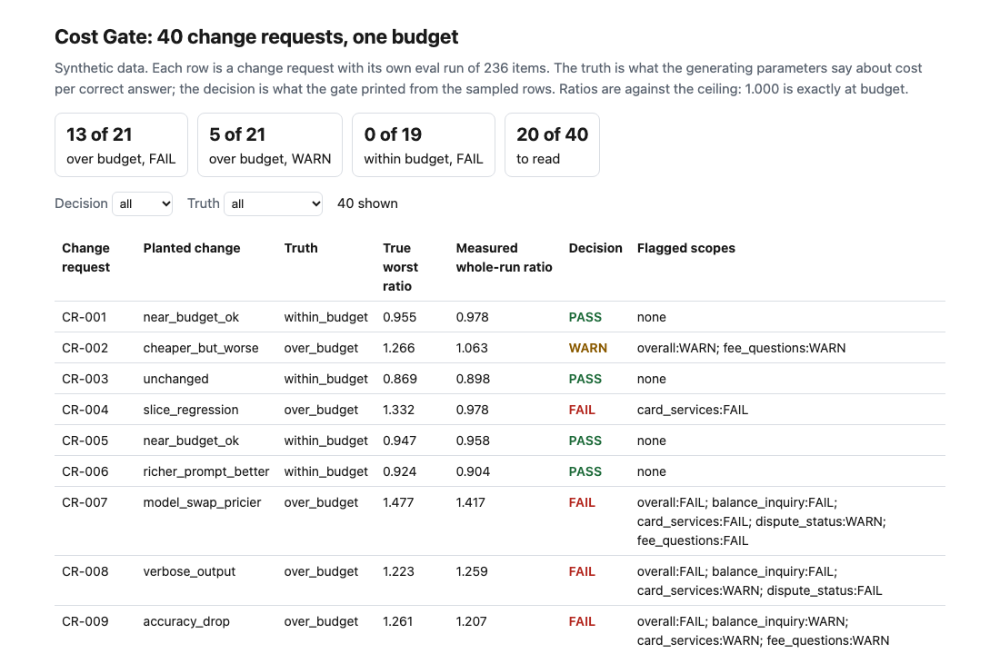
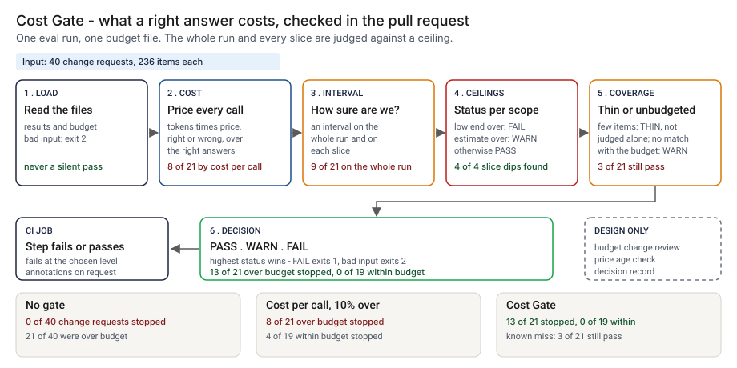
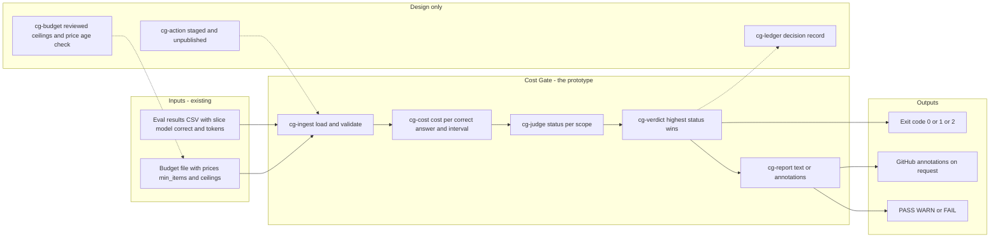
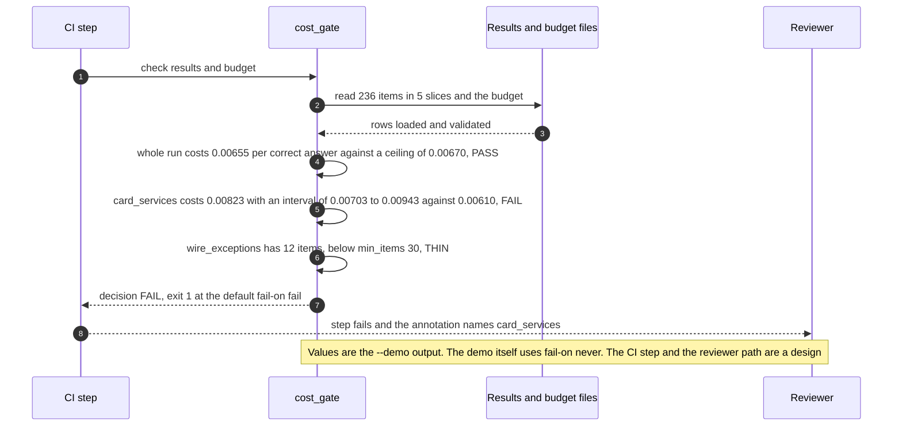

# 🚦 Cost Gate: an inference budget in CI

**I wanted to know whether a pull request that changes a prompt or a model can be stopped when it pushes the cost of a right answer over a budget, and what a spend check on cost per call misses. This is a command-line gate and a staged GitHub Action: it reads an eval results CSV and a budget file, works out the cost per correct answer for the whole run and for each slice with a confidence interval, and prints PASS, WARN or FAIL.** It takes the cost-per-correct-answer measure from [13 SwapBrief](../13-swapbrief-model-migration/) and the tokens-times-price accounting from [07 InferenceLens](../07-inferencelens-inference-finops/), and moves the check from a migration brief and a dashboard into the pull request. I copied no code from either; from 13 I reused the two synthetic price points.

**▶ Static demo, no install:** [open demo.html](./demo.html)

[](./demo.html)

## Executive summary (90 seconds)

**Problem.** A pull request changes a prompt, a retrieval depth or a model. The eval gate, if there is one, reports accuracy. Nothing reports what a right answer now costs, so an overspend shows up on the next invoice, after the merge. The engineer who owns the prompt and the reviewer who approves the change see accuracy and nothing about cost per right answer. 🟢 On 40 synthetic change requests, each with an eval run of 236 items, a pipeline with no cost check stops 0 of 40, while 21 of 40 are over budget, 15 of those 21 on the whole run and 6 of 21 only inside one slice (`step_01_no_gate.py`). A check on cost per call does not fix this: it passes a cheaper model that is right less often.

**Product.** Cost Gate is a command and a staged GitHub Action that reads an eval results CSV and a budget file. The CSV holds one row per item with `item_id`, `slice`, `model`, `correct`, `input_tokens` and `output_tokens`; the budget holds a price per model, `min_items`, a ceiling for the whole run and a ceiling for each slice. Cost per correct answer is the money spent on every call, right or wrong, divided by the number of right answers. The gate computes it for the whole run and for each slice with a 95% interval (the delta method for a ratio of means). FAIL: the interval's lower end is above the ceiling. WARN: the estimate is above the ceiling but the interval still reaches it, or a slice is in the results and not in the budget, or the other way round. PASS: the estimate is at or under the ceiling. THIN: a slice under `min_items` is printed, not judged alone, and still counted in the whole run. The highest status sets the decision. The command exits 1 at the level you choose (FAIL by default) and 2 for input it cannot read. There is no model call and no random number; the rules are plain code you can read.

**Measured and modeled performance.**

- 🟢 **No cost check: 0 of 40 change requests stopped,** 21 of 40 over budget, 15 of those 21 on the whole run and 6 of 21 only inside one slice (`step_01_no_gate.py`).
- 🟢 **Failing on cost per call (more than 10% over the baseline run) stops 12 of 40:** it catches 8 of 21 over-budget change requests, passes 13 of 21, and fails 4 of 19 within-budget ones; 6 of the 21 over-budget change requests cost less per call than the baseline (`step_02_cost_per_call.py`).
- 🟢 **Each part fails alone:** the measured cost per correct answer with no interval fails 18 of 21 over-budget change requests and wrongly fails 2 of 19 within budget; an interval on the whole run alone fails 9 of 21 and cannot see the 6 of 21 that are over only inside a slice (`step_03_deficiencies_exposed.py`).
- 🟢 **Together: FAIL on 13 of 21 over-budget change requests, WARN on 5, PASS on 3;** of 19 within budget, 0 stopped, 2 warned, 17 passed; a person reads 20 of 40 (`step_04_with_cost_gate.py`).
- 🟢 **4 of 4 planted slice regressions fail on a slice ceiling,** although the whole-run status was PASS on all 4 (`step_04_with_cost_gate.py`).
- 🟢 **Known miss: 3 of 21 over-budget change requests still PASS,** CR-010 and CR-024 inside a 12-item slice and CR-029 at 1.018 times its ceiling (`step_04_with_cost_gate.py`).
- 🟡 **Utility: (13/21 − 8/21) × 12 = 2.9 more over-budget change requests a year stopped than a cost-per-call check would stop,** assuming 12 over-budget change requests reach the gate each year.
- 🔴 **Design target: a decision within 60 seconds of the eval results file landing.** Designed in [`ARCHITECTURE.md`](./ARCHITECTURE.md), never built or timed.

**What I would ask a head of operations to decide.** Whether a change that is over its cost ceiling with confidence should stop the merge, and whether a WARN should stop it too. With the default `--fail-on fail` the gate stops 13 of 21 over-budget change requests; with `--fail-on warn` it stops 18 of 21 and also 2 of 19 within budget (`step_04_with_cost_gate.py`). My recommendation is to start in advisory mode on one feature's eval export, set the ceilings from that feature's own baseline run with the finance partner who owns the budget, keep `fail` as the default, and choose `warn` only where one missed overspend costs more than the reviews it adds.

**Call to action.** Fork the repo. Export your eval harness results to `item_id, slice, model, correct, input_tokens, output_tokens` (tokens as billed, retries included), and write a budget file in the shape of `data/budget.json` with your own prices and ceilings. To call it from code, import `evaluate` from `src/cost_gate.py`. Keep the prices in the budget file current, since the gate measures the prices it is given. Send findings by opening an issue: say which scope and which status, not the eval data.

_A portfolio prototype on synthetic data. Nothing here is deployed, load-tested or used by anyone, and the Action is staged and has not run on GitHub._

## Run one now

```bash
cd 64-cost-gate/src && python3 cost_gate.py --demo
```

It prints:

```text
run: 236 items, 5 slices
scope              items  correct  $/correct  95% interval         ceiling  status
overall              236      201    0.00655  0.00600 to 0.00711   0.00670  PASS
balance_inquiry       64       62    0.00313  0.00277 to 0.00349   0.00382  PASS
card_services         48       42    0.00823  0.00703 to 0.00943   0.00610  FAIL
dispute_status        56       45    0.00829  0.00712 to 0.00946   0.01034  PASS
fee_questions         56       44    0.00670  0.00553 to 0.00787   0.00768  PASS
wire_exceptions       12        8    0.01375  0.00805 to 0.01946   0.02081  THIN
  FAIL card_services: the interval's lower end 0.00703 is above the ceiling 0.00610
  THIN wire_exceptions: 12 items is below min_items 30; not judged alone, still counted in the overall
decision: FAIL
```

The whole run is inside its ceiling and one slice is not. Standard library only, Python 3.9 or newer. To check your own run: `python3 cost_gate.py check results.csv budget.json`. It exits 1 on FAIL, so a CI step fails; `--fail-on warn` also fails on WARN, and `--format github` prints annotations. Bad input exits 2 with one line on stderr.

How to read a status. Cost per correct answer is the money spent on every call, right or wrong, divided by the number of right answers.

| Status | Meaning |
|---|---|
| FAIL | The lower end of the 95% interval is above the ceiling: over budget, with confidence |
| WARN | The estimate is above the ceiling but the interval still reaches it: a person decides |
| PASS | The estimate is at or under the ceiling |
| THIN | A slice with fewer than `min_items` items: printed, not judged alone, still counted in the whole run |

A slice that is in the results but not in the budget, or in the budget but not in the results, is WARN and is named, so a renamed slice cannot switch its own check off.

## What the numbers say

**What it shows** (🟢 measured on synthetic data: 40 change requests, each with an eval run of 236 items; the script is named in brackets). The truth for each change request comes from the parameters that generated its run, not from the gate:

- 🟢 No cost check in CI: 0 of 40 change requests stopped, 21 of 40 are over budget, 15 of those 21 on the whole run and 6 of 21 only inside one slice (`step_01`)
- 🟢 Failing on cost per call (more than 10% over the baseline run) stops 12 of 40: it catches 8 of 21 over-budget change requests, passes 13 of 21, and fails 4 of 19 within-budget ones; 6 of the 21 over-budget change requests cost less per call than the baseline (`step_02`)
- 🟢 The measured cost per correct answer with no interval fails 18 of 21 over-budget change requests and wrongly fails 2 of 19 within-budget ones; an interval on the whole run alone fails 9 of 21 and cannot see the 6 of 21 that are over only inside a slice (`step_03`)
- 🟢 On every fourth item (59 items) the interval gate fails 5 of 21 over-budget change requests against 13 on the full set, and no slice has enough items to be judged alone (`step_03`)
- 🟢 Interval, whole run and slices together: FAIL on 13 of 21 over-budget change requests, WARN on 5, PASS on 3; of 19 within budget, 0 stopped, 2 warned, 17 passed; a person reads 20 of 40 (`step_04`)
- 🟢 The 4 of 4 planted slice regressions fail on a slice ceiling although the whole-run status was PASS on all 4 (`step_04`)

## What it still gets wrong

- 🟢 3 of 21 over-budget change requests still PASS (`step_04` prints each one). CR-010 and CR-024 regress inside `wire_exceptions`, a slice of 12 items, which is below `min_items` and so is never judged alone. CR-029 has a true cost per correct answer of 1.018 times its whole-run ceiling, which is inside the noise of 236 items. The tool is built to miss these, and I left them in on purpose.
- 🟢 With the default `--fail-on fail`, the 5 WARN and 3 PASS over-budget change requests still merge unless a person acts. `--fail-on warn` stops 18 of 21 over-budget and 2 of 19 within-budget change requests (`step_04`). That is a trade between missed overspend and noisy builds. I would set `warn` where one missed overspend costs more than the reviews of the within-budget change requests it also holds up.
- **The data and the rules share an author.** I wrote the generator and the gate, and I did not retune the effect sizes after running the gate, but the planted changes are still ones I thought of. Treat the numbers as a ceiling for this gate on this kind of data, not a rate on a real eval set, which I have not tested.
- **The interval counts only which items were sampled.** It is a normal approximation for a ratio (the delta method). It does not include grader noise: if `correct` comes from a model judge, that judge's error is not in the interval. It is unreliable with few right answers, which is the reason for `min_items`. Up to six scopes are judged per run, and I made no correction for that.
- **Only token cost is counted.** No latency, caching discount, batch price or per-request fee. Prices live in the budget file, so when a vendor changes a price the file has to change too, or the gate measures a stale one.
- **It does not judge quality.** A cheaper model that answers worse can still be inside the cost-per-correct ceiling. Pair it with an accuracy check; this one only knows what `correct` says.
- An eval set is not production traffic. A ceiling set on one is a guard on a change, not a forecast of the invoice.

## Use it in CI

[`action/`](./action/README.md) holds a staged GitHub Action and the steps to publish it from its own repository, which a Marketplace listing requires. It has not been published and has not run on GitHub. What is tested is the command it wraps (`tests/test_cli.py`, 50 tests in all across the folder).

## How the four steps fit

| Step | Question | Script |
|---|---|---|
| 1 | What happens to the budget when nothing checks it? | `step_01_no_gate.py` |
| 2 | What does failing on cost per call get wrong? | `step_02_cost_per_call.py` |
| 3 | Where does each part of the gate fail alone? | `step_03_deficiencies_exposed.py` |
| 4 | What do an interval, a whole-run ceiling and slice ceilings catch together? | `step_04_with_cost_gate.py` |

Run any of them from `src/`. Data is generated by [`data/_generate.py`](./data/README.md); `tools/check_repo.py` confirms that a rerun reproduces every file and that the green numbers above appear in a script's output.

## Utility delivered

The way I price product impact: **utility = (my solution − current state of the art) × the number of people or items it affects.**

Here the item is a change request that should have been stopped for cost. Each one lands on the engineer who owns the prompt, the reviewer who approved it, and the finance partner who finds it on the invoice. The common basic approach is to fail on cost per call; the table prices the gate against it.

| Term | Value | Where it comes from |
| --- | --- | --- |
| Current state of the art (fail when cost per call rises more than 10% over the baseline), over-budget change requests stopped | 🟢 **8 of 21** | `step_02_cost_per_call.py`; it also fails 4 of 19 within-budget change requests |
| My solution (Cost Gate), over-budget change requests stopped | 🟢 **13 of 21** | `step_04_with_cost_gate.py`; 0 of 19 within-budget change requests stopped |
| Lift per over-budget change request | 🟢 13 of 21 minus 8 of 21 | The cost-per-call check passes these, by planted change: accuracy_drop 3, cheaper_but_worse 3, slice_regression 4, small_overshoot 1, thin_slice_regression 2 (`step_02_cost_per_call.py`) |
| Number it affects: over-budget change requests reaching the gate in a year | 🟡 **12** | **Assumption, not a statistic.** Replace it with your own count of changes in a year that pushed cost per correct answer over a ceiling |
| Assumption that makes the lift real | 🟡 The budget file carries current prices and ceilings set from a baseline run, and the eval set looks like the feature's traffic | If a vendor price changes and the file does not, the gate measures a stale price. Without the slice ceilings the gate stops only what the whole-run interval stops: 🟢 9 of 21 (`step_03_deficiencies_exposed.py`) |
| **Utility** | 🟡 **(13/21 − 8/21) × 12 = 2.9 more over-budget change requests a year stopped than a cost-per-call check would stop** | Assumes the 12 behave like the 21 planted ones |

Sensitivity to the count assumption (🟡, same lift): 6 over-budget change requests a year gives 1.4, 12 gives 2.9, 24 gives 5.7.

🔴 What I have not measured: what an overspend costs in money, how long a FAIL takes to read and clear, what a false hold costs a release, or how often prices change. The planted set is dense on purpose, 21 of 40 change requests are over budget (`step_01_no_gate.py`); a real pipeline sees far fewer. Treat the result as a property of this mix of cases, not a forecast.

---

## Architecture and call flow

Component names match [`ARCHITECTURE.md`](./ARCHITECTURE.md). GitHub renders the diagrams natively.



**System topology:**



**Per-run sequence** (the `--demo` run, a slice over its ceiling while the whole run is inside):



**Interlocks (all red, designed, none built):**

- [13 SwapBrief](../13-swapbrief-model-migration/) is where the cost-per-correct-answer measure and the two synthetic price points come from. After a deliberate model move it says go or no-go; Cost Gate would then guard each later change. This folder copies no code from it.
- [07 InferenceLens](../07-inferencelens-inference-finops/) does the tokens-times-price accounting on live spend. It would be a possible source for the price table that the budget file carries.
- [40 Eval Gate](../40-eval-gate/) is the accuracy-side gate. Cost Gate does not judge quality, so the two would run side by side on the same pull request.
- [04 EvalForge](../04-evalforge-llm-eval-platform/) would supply the eval run that the results file is exported from.

---

## PM artifacts

The PM artifacts that show how I would run this product if I owned the seat. This README is the walkthrough; the rest of the folder holds:

- [`PRD.md`](./PRD.md): the product requirements doc, with users, backlog, KPIs, rollout and open questions.
- [`ARCHITECTURE.md`](./ARCHITECTURE.md): the systems doc, with components, data model, security, failure behavior and operations. A design, not deployed.
- [`demo.html`](./demo.html): clickable, no-install walkthrough, built from the step outputs by `src/_build_demo.py`.
- [`data/`](./data/): the synthetic baseline run, the 40 change requests, the budget file, their planted truth, and the seeded generator. `data/README.md` explains how the truth is set.
- [`src/`](./src/): `cost_gate.py`, `common.py`, the four step scripts and the demo builder.
- [`tests/`](./tests/): 50 unittest tests, including a golden test that pins the numbers above and tests for bad input and hostile strings.
- [`action/`](./action/README.md): the staged GitHub Action and the steps to publish it. Not published, not run on GitHub.

Run the four steps end to end:

```bash
cd src
python3 step_01_no_gate.py
python3 step_02_cost_per_call.py
python3 step_03_deficiencies_exposed.py
python3 step_04_with_cost_gate.py
```

---

## Aligned to

The [FinOps Foundation framework](https://www.finops.org/framework/), which I read on 2026-10-24, including its [Unit Economics](https://www.finops.org/framework/capabilities/unit-economics/) and [Budgeting](https://www.finops.org/framework/capabilities/budgeting/) capability pages (the pages show no revision date). Its Unit Economics capability pairs spend with a measure of value and gives cost per token as a resource-efficiency unit metric and cost per case resolved as a business unit metric. Cost per correct answer is my reading of a unit metric between the two, measured on an eval rather than on live traffic. Its Budgeting capability covers setting spend limits and comparing actual spend with them. At its Run maturity level it describes live thresholds, where spend nearing a budget line triggers a defined response, such as an alert, an approval gate or a throttle. This gate borrows that response and applies it earlier, as an approval gate on a pull request before the spend exists. The page also lists suggested variance limits of 20%, 15% and 12% by maturity level; those describe the gap between budget and actual spend, and I did not derive my ceilings from them.

This is a prototype, aligned to that framework's vocabulary. It makes no claim of conformity to that guidance.

## Data and limits

Synthetic, seeded, byte-for-byte reproducible. Nothing comes from any employer, bank or real eval. Prices are synthetic parameters, not vendor prices. 🟡 Modeled, with the assumption named: the overall ceiling is 15% above the baseline's expected cost per correct answer and each slice ceiling is 25% above its own baseline; `min_items` is 30; the 10% line in step 2 is the size of alert I would expect a team to set; correctness is a coin flip per item with a fixed accuracy per slice; token counts are a slice mean times a factor with a long tail on one item in twenty. All are in [`data/README.md`](./data/README.md). A prototype on synthetic data, not a production case study.

## Fork it

Export your eval harness results to `item_id, slice, model, correct, input_tokens, output_tokens` (tokens as billed, retries included). Write a budget file in the shape of [`data/budget.json`](./data/budget.json) with your own prices and ceilings; a baseline run on your main branch is the place to start. Extra columns in the CSV are ignored. Read the [PRD](./PRD.md) for the scope I held to.

## Prereqs to run this on your laptop

You need Python 3.9 or newer and nothing else. The gate, the four step scripts and the data generator use only the standard library, so there is nothing to install. There is no API key, no network call and no model call anywhere in the folder. To run the tests, use `python3 -m unittest discover -s tests` from this folder. The production pieces in [`ARCHITECTURE.md`](./ARCHITECTURE.md) (the reviewed budget file, the price age check, the decision record, a published Action) are a design, not something you need or can run.

## Author

**Vijay Saharan**, Sr Product / Program Manager · AI in BFSI · Enterprise AI Platforms

[LinkedIn](https://www.linkedin.com/in/vijaysaharan/)
