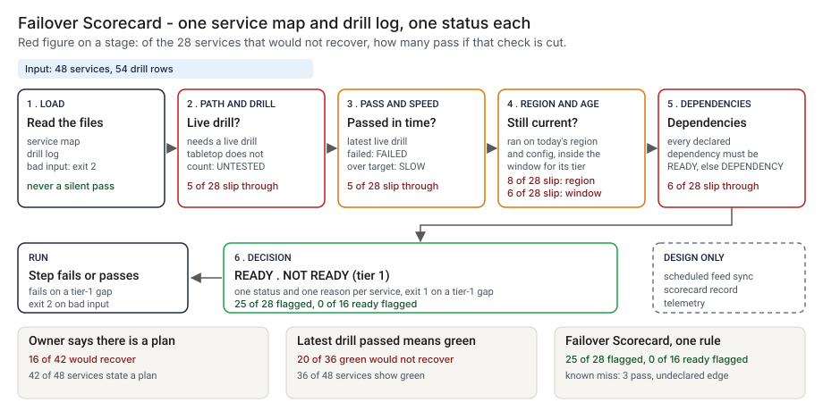

# Architecture: Failover Scorecard

> **Status.** This is the design for a production shape. The repo implements the product mechanic as a prototype: a command, `src/failover_scorecard.py`, that reads a service map and a drill log, applies one readiness rule per service and prints a status, a reason, a count by domain and a decision on the tier-1 services, run here over 48 synthetic services and 54 drill rows. No CI Action is staged. Nothing below is claimed as deployed or load-tested. Where a figure is a design target, it says so.

GCP is primary; AWS and Azure sit beside it.



---

## 1. Logical architecture

Failover Scorecard is a function over two exports: a service map and a drill log in, one status per service out. It does not run a drill, read a runbook or call a service.

Eight components: five decide the outcome, three support or report.

| Component | Responsibility | Language or framework | Decides the outcome? | Stateful? |
| --- | --- | --- | --- | --- |
| `fs-ingest` | Loads both files. Rejects empty, truncated, wrong-type or duplicate input, unknown references, and a drill dated after the as-of date. | Python 3.9+, standard library. Prototype: `load_services`, `load_drills`, `parse_date` in `src/failover_scorecard.py` | Yes, by refusing: exit 2 | No |
| `fs-policy` | Window for a passing drill by tier, tiers whose owner may accept having no way back, the scenario each mode needs. | A reviewed config file (design). Prototype: `default_policy`, `SCENARIO_FOR_MODE` | Yes, config | Stateful, in git |
| `fs-rule` | One status per service from its own record: second region, live drill, passed, in target, current region and config, in window. | Python. Prototype: `_own_status` | Yes | No |
| `fs-deps` | A READY service drops to DEPENDENCY when a declared dependency is not READY. Names where the chain ends. | Python. Prototype: the loop in `score`, and `_blocker` | Yes | No |
| `fs-verdict` | Picks the scope, says READY, NOT READY or NOTHING CHECKED, and maps it to an exit code at `--fail-on`. | Python. Prototype: `scope_of`, `decision`, `run_check` | Yes | No |
| `fs-report` | Prints text or annotations and a count by domain; strips or escapes untrusted strings. | Python. Prototype: `render`, `domain_line`, `clean`, `escape_annotation` | No | No |
| `fs-ledger` | Appends one record per scorecard run (design). Prototype analog: `src/out/step_04_scorecard.csv`. | PostgreSQL plus object storage with a retention lock (design) | No | Stateful |
| `fs-telemetry` | Counts statuses, rejections and run time, off the decision path (design). | OpenTelemetry | No | No |

**What decides the outcome.** The input check, the policy, the per-service rule, the dependency pass and the verdict. The report, ledger and telemetry carry or record it. A drill row is read at its word, and only the dependency edges given are followed.

**Repo structure** (production shape):

```
failover-scorecard/
├── scorecard/  # ingest, rules, deps, verdict, report
├── policy/     # windows and accepted tiers, changed by pull request
├── ledger/     # scorecard record writer
├── infra/      # terraform for gcp, aws, azure; IAM
├── docs/runbooks/
└── tests/      # unit, golden, hostile strings
```

---

## 2. Physical and deployment architecture

The scorecard is one short-lived process on a schedule, and again on a change to either export. There is no server to keep warm.

| Component | GCP (primary) | AWS | Azure | Why |
| --- | --- | --- | --- | --- |
| Scorecard process (`fs-ingest` to `fs-report`) | Cloud Run job started by Cloud Scheduler | ECS Fargate scheduled task | Container Apps job on a schedule | Stateless, one pass, no inbound traffic |
| `fs-policy` | A file in the repo | Same | Same | A window change lands in the same history as the code |
| Service-map and drill-register exports | Cloud Storage, versioned | S3, versioned | Blob Storage, versioned | Versioning keeps the exact bytes a record used |
| `fs-ledger` | Cloud SQL for PostgreSQL | RDS for PostgreSQL | Azure Database for PostgreSQL | The platform team already runs it |
| `fs-telemetry` | OTel Collector to Cloud Monitoring | To CloudWatch | To Azure Monitor | Off the decision path |

**Failure behavior (the decision that matters most).** The scorecard must never silently pass. A missing, empty, truncated or mistyped input does not become READY and is not skipped: it ends the run with exit 2 and a one-line reason. A service with no live drill is UNTESTED, never READY. A map with no tier-1 service is an error, because nothing was checked.

| Failure | Behavior | Alert |
| --- | --- | --- |
| Either file missing, empty, truncated, with a duplicate id, a bad tier or date, or a passing live drill with no minutes | Exit 2, one line on stderr naming the file and line | P2 if repeated on one schedule, else P3 |
| A dependency or a drill names a service not in the map; a drill is dated after the as-of date | Exit 2 with the reason | P3 |
| Drill log has a header and no rows | A valid, empty log: every service that needs a drill is UNTESTED | P3 if the last log was not empty |
| Map has no tier-1 service | Exit 2: nothing was checked, unless `--fail-on never` | P3 |
| An export is older than its expected refresh (design) | The run stops with exit 2 and names the stale export | P2 |
| Ledger or telemetry unavailable (design) | Statuses and exit code stand; the record queues locally | P3 |

**Latency.** The prototype is one pass over two small files; I have not timed it. 🔴 Design target: a refreshed scorecard within 15 minutes of a change to either export. Recovery is a re-run from the same versioned exports and policy.

---

## 3. Data architecture

| Entity | Key | What it holds | Real columns in the prototype |
| --- | --- | --- | --- |
| Service | `service_id` | Tier, regions, mode, recovery target, config version, declared dependencies | `data/services.csv`: `service_id`, `name`, `domain`, `tier`, `primary_region`, `secondary_region`, `failover_mode`, `rto_target_min`, `config_version`, `depends_on`, `accepted_risk`, and `failover_plan` (the owner's claim, read only by step 1) |
| Drill | `drill_id` | Type, scenario, region failed over to, config version, minutes, outcome | `data/drills.csv`: `drill_id`, `service_id`, `drill_date`, `drill_type`, `scenario`, `target_region`, `config_version`, `minutes_to_recover`, `outcome`, `failure_reason` |
| Status result | `service_id` per as-of date | Status, reason, blocking dependency, date of the latest drill | `src/out/step_04_scorecard.csv`: `status`, `reason`, `blocked_by`, `last_drill` and the service fields |
| Scorecard record | `record_id` | Design: as-of date, policy, SHA-256 of both exports, tool version, statuses, decision | Design only |
| Planted truth | `service_id` | The story planted and the class it deserves | `data/service_truth.csv`. Synthetic data only |

**Retention** is a design choice, not a measurement; confirm it against the bank's own record-retention schedule. Scorecard records and the exports they used: 🔴 7 years (design default), in PostgreSQL archived to versioned object storage with a retention lock.

**Lineage.** A status traces back in three hops: the record names the as-of date, the policy and the hash of both exports; the versioned store returns those bytes; and the rule is deterministic (the date is an argument, no clock or random draw, services sorted by id), so re-running `score` reproduces the status. In the prototype the trace is a row of `step_04_scorecard.csv`, whose `reason` names the drill date and `blocked_by` the dependency.

**Deliberately not stored.** Runbooks, free-text drill reports, traffic captures and customer data. `failure_reason` is kept only as a line to show the owner.

---

## 4. Security architecture

**Identity and roles.** The scorecard runs under the platform's workload identity and has no user account of its own.

| Role | Can | Maps to |
| --- | --- | --- |
| `fs:runner` | Read both exports and the policy; write a scorecard record | The scheduled job's identity |
| `fs:approver` | Approve a window change or a tier-3 acceptance, never for their own service | Second-line operational risk |
| `fs:auditor` | Read records, statuses and policy history | Internal audit |
| `fs:admin` | Manage roles, buckets and the ledger | Platform engineering lead |

**Secrets.** None. The scorecard never calls a model or a service under test; the job reaches the exports and ledger through workload identity, with no static keys.

**Classification and what leaves the boundary.** A service map with regions and dependency edges shows where a bank is weakest; treat it as confidential. In the prototype nothing leaves the machine. In the design three things leave the job: the exit code, the annotations and the ledger write.

| Threat | Example | Mitigation in the design |
| --- | --- | --- |
| Hostile string in an input field echoed into a log or annotation | A service `name` or `failure_reason` holding a newline and text that looks like a workflow command or a READY line | `clean` replaces non-printable characters; `escape_annotation` rewrites `%`, carriage return and newline. `tests/test_cli.py` covers a hostile name, failure reason and domain |
| A drill row is edited so a service passes | A date moved forward, minutes lowered, a region changed | Versioned exports; the record stores both hashes; a drill owner and evidence link are sequenced for v0.2 |
| A window or an acceptance is changed to hide a status | Tier-1 window widened, a tier-1 service flagged as accepted | Pull request with a different approver; acceptance honored for tier 3 only; every record stores its policy |
| The as-of date is set earlier than the run date | An old drill looks fresh | The job passes the platform date and the record stores it |
| A service is left out of the map | A service with no row is never scored | The scorecard cannot see this. The design reconciles the map with an inventory export |

---

## 5. Operational architecture

**SLIs.** Statuses per tier per run; input rejections; share of tier-1 services with a live drill inside the window (prototype baseline: 🟢 7 of 18 tier-1 services have a tested way back, `step_04_with_scorecard.py`); age of the oldest passing drill by tier.

**SLOs (all 🔴 design targets, none measured).**
- A scorecard within 15 minutes of a change to either export.
- Every non-READY tier-1 status read by a named owner within one business day (planning estimate).
- 99.9 percent of runs written to the ledger.

**Alerts.** P2: repeated input rejections, a stale export, or the ledger down for more than a day. P3: a tier-1 service that moved from READY to any other status, which also goes to its owner.

**Runbooks** (one page each, in `docs/runbooks/`):
- `input-rejected.md`: read the reason, fix the export or the drill row, re-run.
- `tier1-not-ready.md`: open the reason, assign the owner, schedule the drill it names.
- `dependency-chain.md`: follow `blocked_by` to the end of the chain and fix the root service once.
- `changing-a-window.md`: propose, re-run the planted set, compare with the golden numbers, approve.

**On-call and ownership.** The resilience owner owns the schedule, policy and runbooks. Each service owner owns their drill rows and declared dependencies. Second-line risk approves window changes and tier-3 acceptances.

**Change control.** The rule and policy are versioned. A change needs a proposer and a different approver. Before merge, the planted set is re-run and compared with the numbers pinned in `tests/test_golden.py`, so a change that moves the flagged count shows in the diff. Rollout is shadow, calibration, then tier-1 enforcement, as the PRD lays out.

---

## 6. Alignment and posture

Alignment, not certification. The README's "Aligned to" section cites one source, restated with the same wording about what was read: the Basel Committee's [Principles for operational resilience](https://www.bis.org/bcbs/publ/d516.htm), published 31 March 2021 (page read 2026-10-24). That page says the principles aim to improve banks' ability to withstand events such as technology failures and cyber incidents. My fetch tool returned only that page and not the 12-page text, so I cite no individual principle, and I read no Financial Stability Board text.

- **What the design does.** It points the same way as the page's general aim of withstanding operational disruption: a status per service that rests on a live drill, on today's region and config, inside a window, with records kept so a status can be reproduced.
- **What it does not claim.** No window, target or tier comes from a published text; each is my assumption, marked in `data/README.md`. It makes no claim of conformity to the Basel text or any other standard, holds no certification, and I have not read or mapped any other source.

---

## 7. What is deliberately not here

- **Data-loss targets, partial failover and capacity in the secondary region.** One primary and one secondary region per service; no recovery-point column.
- **Dependencies that are not declared.** 🟢 Three services score READY and would not recover because the map omits a dependency (`step_04_with_scorecard.py`). A call-graph comparison is queued, not built.
- **Telling a rehearsed drill from a real one.** A drill row is taken at its word, including when the clock on `minutes_to_recover` started.
- **More than the latest counted drill.** Only the latest live drill of the right scenario is read.
- **Windows from a published text.** The 180, 365 and 540 day windows are my assumptions.
- **Reading runbooks, running drills, hosting, cost, or a CI Action.**
- **A measured rate on real data.** The planted set and the rule share an author, so 25 of 28 is a ceiling, not a rate on a real map.

---

## Appendix: sample contract

The call is the prototype's own; its `--demo` output is under "Run one now" in the README.

```bash
python3 failover_scorecard.py check services.csv drills.csv --as-of 2026-10-24 --fail-on tier1
```

One drill row, with the columns the rule reads:

```text
drill_id,service_id,drill_date,drill_type,scenario,target_region,config_version,minutes_to_recover,outcome,failure_reason
D03,S03,2026-08-11,live,region_failover,region-b,5,,fail,traffic switch not applied in the secondary region
```

Exit status: 0 when no service in the `--fail-on` scope is short, 1 when one is, 2 for bad input or when nothing was checked.
