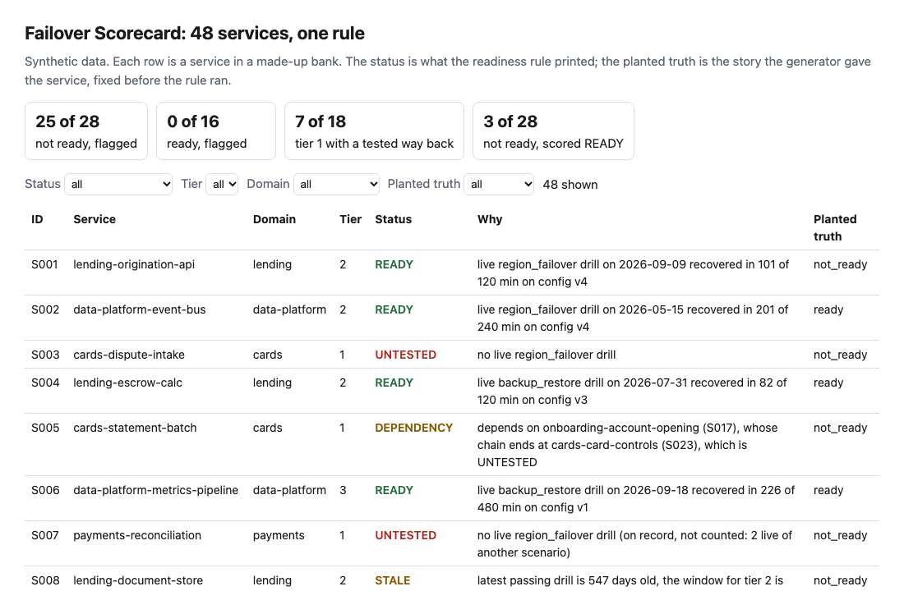
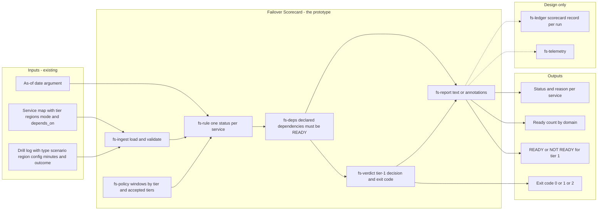
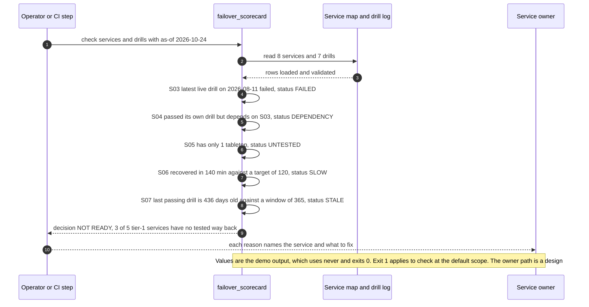

# 🧭 Failover Scorecard (KillSwitch extension): which services have a tested way back

**I wanted to know, for every service in a bank's map, whether anyone has shown that it can come back from the loss of its primary region, as opposed to saying that a plan exists. This is a command-line scorecard: it reads a service map and a drill log and prints READY, or the single reason a service is not.** It extends the drill scorecard in [25 KillSwitch](../25-killswitch-ai-fallback-drills/), which judged fallback drills for one AI decision service on three questions: did it work, was it fast enough, was the rules version fresh. Here the unit is every service, and the rule adds the region and config version a drill ran against, the window for the tier, and the dependencies.

**▶ Static demo, no install:** [open demo.html](./demo.html)

[](./demo.html)

## Executive summary (90 seconds)

**Problem.** The person who owns operational resilience for a bank's services, and the engineer who has to say which of them the bank would bet on, read a status column that holds a plan, a drill date and a color. 🟢 On a modeled map of 48 services, owners state a documented failover plan for 42, and only 16 of those 42 would recover (`step_01_self_reported.py`). Reading the column as green when the latest drill passed shows 36 of 48 green, and 20 of those 36 would not recover, 10 of 15 at tier 1 (`step_02_last_drill_passed.py`). A service nobody has tested in the right place is trusted until an outage says otherwise.

**Product.** Failover Scorecard is a command that reads a service map and a drill log and applies one rule per service, in order. A tier-3 owner may formally accept having no way back, which prints NOT_REQUIRED; any other service with no second region is NO_PATH. A service needs a live drill of the scenario its failover mode requires, and a tabletop or an availability-zone drill does not count: none gives UNTESTED. The latest such drill must have passed (else FAILED), inside the service's own recovery target (else SLOW), against the current secondary region and config version (else CHANGED), and inside the window for the tier, 180, 365 or 540 days by my assumption (else STALE). Last, every declared dependency must itself be READY, or the service is DEPENDENCY. It prints one status and one reason per service, a count by domain and a decision on the tier-1 services, exits 1 when one has no tested way back and 2 on bad input. There is no model call; the rule is plain code you can read.

**Measured and modeled performance.**

- 🟢 **Self-reported: a plan is stated for 42 of 48 services and 16 of those 42 would recover** (`step_01_self_reported.py`).
- 🟢 **"The latest drill passed" shows 36 of 48 green and 20 of those 36 would not recover,** 10 of 15 at tier 1; 4 of the 12 reds are owner-accepted gaps (`step_02_last_drill_passed.py`).
- 🟢 **Each part of the rule catches services the others pass:** of 28 not-ready services, 8 pass without the region and config check, 6 without the window, 6 without the dependency check, 5 without the recovery-time check and 5 without the live-drill check; the full rule lets 3 through (`step_03_deficiencies_exposed.py`).
- 🟢 **Together: 25 of 28 not-ready services flagged and 0 of 16 ready ones,** 4 of 4 accepted gaps kept apart from real ones, and 45 of 48 statuses match the planted truth (`step_04_with_scorecard.py`).
- 🟢 **At tier 1, 7 of 18 services have a tested way back, and 2 of those 7 would not recover** (`step_04_with_scorecard.py`).
- 🟢 **Known miss: 3 services score READY and would not recover** (S001, S012 and S018). Each needs a service the map does not list (`step_03_deficiencies_exposed.py`).
- 🟡 **Utility: (20/28 − 3/28) × 14 = 8.5 services** that would not recover and show as having a tested way back are caught on a map that holds 14 of them, assuming 14 behave like the 28 planted ones.
- 🔴 **Design target: a refreshed scorecard within 15 minutes of a change to the service map or the drill register.** Designed in [`ARCHITECTURE.md`](./ARCHITECTURE.md), never built or timed.

**What I would ask a head of operations to decide.** Whether a service counts as recoverable only on a live drill of the right scenario, on the current region and config, inside a window for its tier, with ready dependencies. My recommendation is to adopt the rule for tier 1, set the three windows against your own drill cadence (mine are assumptions, and moving the tier-1 window across 90, 180 and 365 days changed the tier-1 count only from 6 to 8 of 18), and pilot it on one real service map and drill log before anyone reads a READY count as a promise.

**Call to action.** Fork the repo. Swap `data/services.csv` and `data/drills.csv` for your own inventory and drill-register exports and keep the columns listed in `data/README.md`, then run `check services.csv drills.csv --as-of YYYY-MM-DD`. To call it from code, import `score` from `src/failover_scorecard.py`; change the windows in `default_policy()`. Make sure each drill row records the region it failed over to and the config version it ran on, because those two columns carry the check. Send findings by opening an issue: say which status fired and for how many services, not the data itself.

_A portfolio prototype on synthetic data. Nothing here is deployed, load-tested or used by anyone, and it has not been run against a real service map or a real drill._

## Run one now

```bash
cd 65-failover-scorecard/src && python3 failover_scorecard.py --demo
```

It prints:

```text
as of 2026-10-24: 8 services, 2 ready, 1 not required, 5 not ready
  [FAILED    ] tier 1  S03  cards-auth-gateway: latest live region_failover drill on 2026-08-11 was fail: traffic switch not applied in the secondary region
  [DEPENDENCY] tier 1  S04  channels-mobile-bff: depends on cards-auth-gateway (S03), which is FAILED
  [UNTESTED  ] tier 1  S05  onboarding-identity-check: no live region_failover drill (on record, not counted: 1 tabletop)
  [SLOW      ] tier 2  S06  payments-fx-quotes: latest drill on 2026-05-12 recovered in 140 min against a target of 120
  [STALE     ] tier 2  S07  cards-statement-batch: latest passing drill is 436 days old, the window for tier 2 is 365
by domain, ready of all: cards 0 of 2, channels 0 of 1, data-platform 0 of 1, onboarding 0 of 1, payments 2 of 3
decision: NOT READY (3 of 5 tier-1 services have no tested way back)
```

Standard library only, Python 3.9 or newer. To score your own files: `python3 failover_scorecard.py check services.csv drills.csv --as-of 2026-10-24`. The date is an argument because the tool never reads the clock. It exits 1 when a tier-1 service has no tested way back (`--fail-on any` widens that to every service, `never` only prints), 2 on malformed input or when the map has no tier-1 service and so nothing was checked. `--format github` prints annotations.

## What the numbers say

**What it shows** (🟢 measured on synthetic data: 48 services and 54 drill rows; the script is named in brackets):

- 🟢 Status quo: owners state a documented failover plan for 42 of 48 services, 16 of those 42 would recover, and 37 of 48 services have a live drill on record (`step_01`)
- 🟢 Green when the latest drill passed: 36 of 48 services are green, 20 of those 36 would not recover (10 of 15 at tier 1), and 4 of the 12 reds are owner-accepted gaps, not failures (`step_02`)
- 🟢 Take one part of the rule out and services slip through: without the region and config check 8 of 28 not-ready services pass (5 more than the full rule), without the window 6 of 28, without the dependency check 6 of 28, without the recovery-time check 5 of 28, without the live-drill check 5 of 28; the full rule lets 3 of 28 through (`step_03`)
- 🟢 The full scorecard flags 25 of 28 services that would not recover and 0 of 16 that would, with 3 fixed after a failed drill and 3 with an old drill still inside its window among the 16; it keeps 4 of 4 accepted gaps apart from real ones; 45 of 48 statuses match the planted truth (`step_04`)
- 🟢 At tier 1, 7 of 18 services have a tested way back, and 2 of those 7 would not recover (`step_04`)
- 🟡 The windows are my assumption, not a value from any rule: with the tier-1 window at 90, 180 and 365 days, 6, 7 and 8 of the 18 tier-1 services are READY (`step_04`)

## What it still gets wrong

- 🟢 Three services score READY and would not recover (`step_03` and `step_04` print each one; two are tier 1). Each has a clean drill and clean declared dependencies, and needs a service the map does not list. The rule follows only the edges it is given. A missing edge is invisible to it, and so is a service map that is out of date.
- **The planted set and the rule share an author.** I planted the stories and wrote the rule, so 25 of 28 shows the rule covers what I planted. Ten services are hard negatives (a drill that failed once and then passed, a passing drill that is old but inside its window, an accepted gap) and three are the hard misses above. Treat the result as a ceiling for this rule, not a rate on a real service map, which I have not tested.
- **A drill row is taken at its word.** The rule cannot tell a rehearsed, announced drill from a real one, or whether the clock on `minutes_to_recover` started when the outage started or when someone declared it.
- **The parts overlap.** Taking out the live-drill check lets in the 2 tabletop-only services, but the 2 services drilled only inside one availability zone are still caught, by the region check. That is the rule behaving as designed, and it means the step 3 counts are not additive.
- One primary and one secondary region per service; no recovery-point or data-loss target, no partial failover, no capacity in the secondary region. `depends_on` lists hard dependencies only. Only the latest counted drill is read.

## How the four steps fit

| Step | Question | Script |
|---|---|---|
| 1 | What do we know when each owner says there is a plan? | `step_01_self_reported.py` |
| 2 | What does "the latest drill passed" get wrong? | `step_02_last_drill_passed.py` |
| 3 | Which part of the rule catches what, and what does no part catch? | `step_03_deficiencies_exposed.py` |
| 4 | What does the whole scorecard flag, and what does it leave? | `step_04_with_scorecard.py` |

Run any of them from `src/`. Data is generated by [`data/_generate.py`](./data/README.md); `tools/check_repo.py` confirms that a rerun reproduces every file and that the green numbers above appear in a script's output. `src/_build_demo.py` builds `demo.html` from what step 4 writes to `src/out/`.

## Utility delivered

The way I price product impact: **utility = (my solution − current state of the art) × the number of people or items it affects.**

Here the item is a service that would not recover but shows as having a tested way back. Each one lands on the resilience owner who signs the status, the service owner who is told it is fine, and whoever answers the auditor. The common basic approach is to read a service as green when its latest drill passed; the table prices the scorecard against it.

| Term | Value | Where it comes from |
| --- | --- | --- |
| Current state of the art (green when the latest drill passed), services that would not recover and show green | 🟢 **20 of the 28** | `step_02_last_drill_passed.py` prints 20 of 36 green; the 28 services that would not recover are printed by `step_01_self_reported.py` and `step_03_deficiencies_exposed.py` |
| My solution (Failover Scorecard), services that would not recover and pass as READY | 🟢 **3 of 28** | `step_03_deficiencies_exposed.py` (full rule) and `step_04_with_scorecard.py`; it flags 0 of 16 that would recover |
| Lift per service that would not recover | 🟢 20 of 28 minus 3 of 28 | What the green reading passes, by planted story: az_only 2, changed_since_drill 3, dependency_gap 3, hidden_dependency 3, slow_pass 2, stale_drill 3, tabletop_only 2, wrong_region_drill 2 (`step_02_last_drill_passed.py`). The scorecard catches every story but hidden_dependency |
| Number it affects: services in a bank's map that would not recover | 🟡 **14** | **Assumption, not a statistic.** Replace it with your own count of services whose recovery is doubtful |
| Assumption that makes the lift real | 🟡 The service map lists every hard dependency, and each drill row records the region and config version it truly ran on | If the map omits edges, those services pass: 🟢 3 of 28 do here (`step_03_deficiencies_exposed.py`) |
| **Utility** | 🟡 **(20/28 − 3/28) × 14 = 8.5 services** moved from shown as ready to flagged | Assumes the 14 behave like the 28 planted ones |

Sensitivity to the count assumption (🟡, same lift): 7 services gives 4.25, 14 gives 8.5, 28 gives 17.

🔴 What I have not measured: whether a flagged service would have failed in a real event, what a drill costs or how long it takes to schedule, what an owner does with a status, or how many services in a real map are in doubt. The planted set is dense on purpose, 28 of 48 would not recover (`step_01_self_reported.py`); a real map may differ. Treat the result as a property of this mix of cases, not a forecast.

---

## Architecture and call flow

Component names match [`ARCHITECTURE.md`](./ARCHITECTURE.md). GitHub renders the diagrams natively.


**System topology:**



**Per-run sequence** (the `--demo` run, 8 services and 7 drills):



**Interlocks (all red, designed, none built):**

- [25 KillSwitch](../25-killswitch-ai-fallback-drills/) is where this idea began. Its fallback drills for an AI decision service would become rows in the drill log. This folder shares no code or data with it.
- [54 Runbook Dry-run](../54-runbook-dryrun/) would check the recovery runbook of a service the scorecard marks FAILED or UNTESTED before the next live drill.
- [19 IncidentLedger](../19-incidentledger-ai-incident-response/) is where a real regional event, or a failed live drill that behaved like one, would be recorded and its follow-ups tracked.
- [09 LineageLog](../09-lineagelog-ai-decision-audit/) is a possible home for the scorecard record (`fs-ledger`).

---

## PM artifacts

The PM artifacts that show how I would run this product if I owned the seat. This README is the walkthrough; the rest of the folder holds:

- [`PRD.md`](./PRD.md): the product requirements doc, with users, backlog, KPIs, rollout and open questions.
- [`ARCHITECTURE.md`](./ARCHITECTURE.md): the systems doc, with components, data model, security, failure behavior and operations. A design, not deployed.
- [`demo.html`](./demo.html): clickable, no-install walkthrough, built from the step 4 output by `src/_build_demo.py`.
- [`data/`](./data/): the synthetic service map of 48 services, the 54 drill rows, the planted truth per service and the seeded generator. `data/README.md` explains the planted stories and my assumptions.
- [`src/`](./src/): `failover_scorecard.py`, `common.py`, the four step scripts and the demo builder.
- [`tests/`](./tests/): 69 unittest tests, including a golden test that pins the numbers above and tests for bad input and hostile strings.

Run the four steps end to end:

```bash
cd src
python3 step_01_self_reported.py
python3 step_02_last_drill_passed.py
python3 step_03_deficiencies_exposed.py
python3 step_04_with_scorecard.py
```

---

## Aligned to

The Basel Committee's [Principles for operational resilience](https://www.bis.org/bcbs/publ/d516.htm), published 31 March 2021 (page read 2026-10-24). That page says the principles aim to improve banks' ability to withstand events such as technology failures and cyber incidents. My fetch tool returned only that page and not the 12-page text, so I do not quote or cite any individual principle, and I did not read any Financial Stability Board text, so I cite none. No window, target or tier in this project comes from a published text; each is marked as my assumption in [`data/README.md`](./data/README.md). This is a prototype, aligned to the general aim of showing that recovery works. It makes no claim of conformity to that guidance.

## Data and limits

Synthetic, seeded, byte-for-byte reproducible. Nothing comes from any employer, customer or real bank, and no real company is a subject. A prototype on synthetic data, not a production case study. The extension of 25 is in the idea and the three drill questions; no code or data is shared with that folder.

## Fork it

Replace `data/services.csv` and `data/drills.csv` with exports from your own inventory and drill register and keep the columns (see [`data/README.md`](./data/README.md)). Change the windows in `default_policy()` in `src/failover_scorecard.py`. Read the [PRD](./PRD.md) for the scope I held to.

## Prereqs to run this on your laptop

You need Python 3.9 or newer and nothing else. The scorecard, the four step scripts and the data generator use only the standard library, so there is nothing to install. There is no API key, no network call and no model call anywhere in the folder. To run the tests, use `python3 -m unittest discover -s tests` from this folder. The production pieces in [`ARCHITECTURE.md`](./ARCHITECTURE.md) (the reviewed policy config, the scorecard record, telemetry, a scheduled run) are a design, not something you need or can run.

## Author

**Vijay Saharan**, Sr Product / Program Manager · AI in BFSI · Enterprise AI Platforms

[LinkedIn](https://www.linkedin.com/in/vijaysaharan/)
