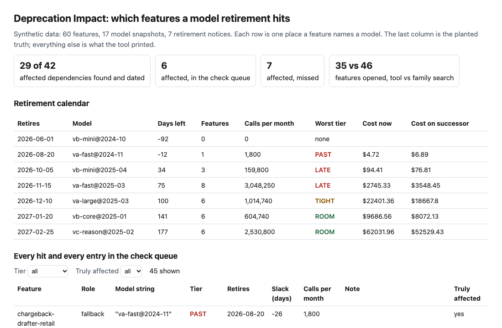
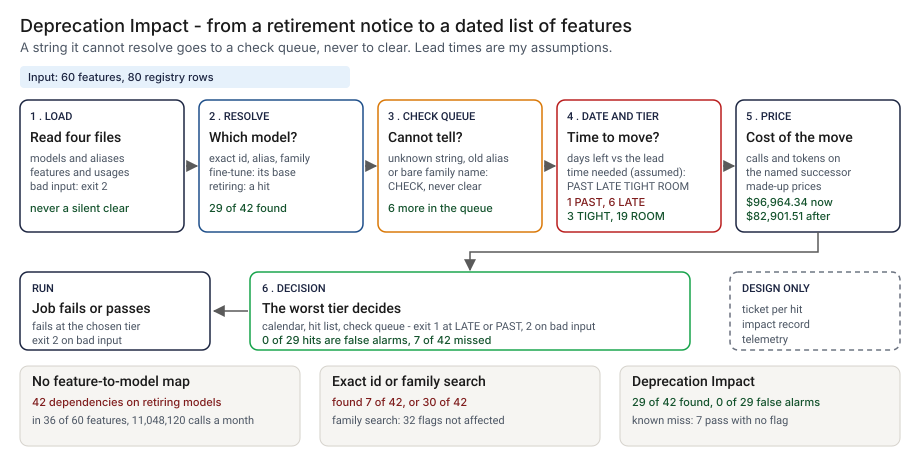
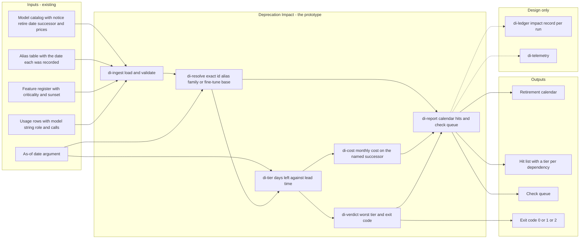
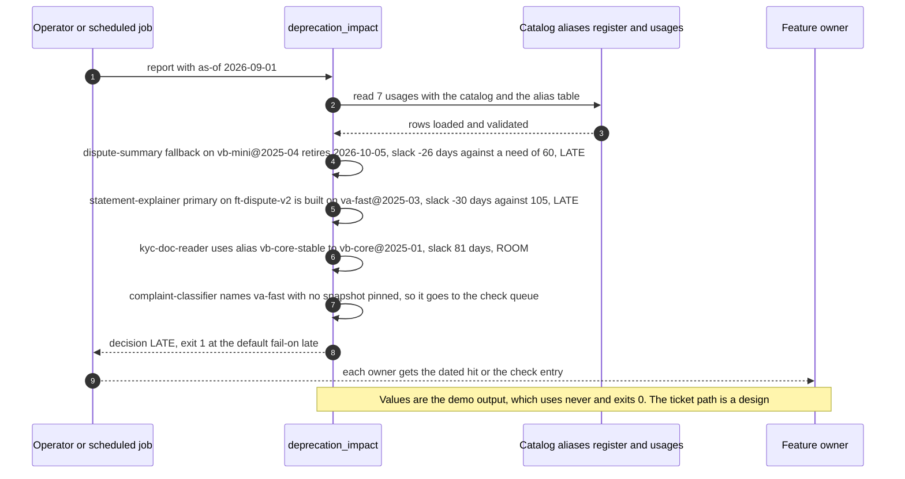

# 📅 Deprecation Impact: which of your features a model retirement hits

**A vendor writes that a model version retires on a date. I wanted to know which of my features call it, how long each one has to move, and what the move costs. This is a command-line tool: it reads a model catalog, an alias table and a feature register, and prints a retirement calendar, a hit list with a tier per dependency, and a check queue for the strings it cannot resolve.** It takes the idea of a notice date and a successor from [13 SwapBrief](../13-swapbrief-model-migration/) and the shape of a feature register and a price table from [07 InferenceLens](../07-inferencelens-inference-finops/). I read their data files for the logic and wrote my own code and data; nothing is imported and no number is carried over.

**▶ Static demo, no install:** [open demo.html](./demo.html)

[](./demo.html)

## Executive summary (90 seconds)

**Problem.** The person who runs the AI platform or the feature register, and the owners who get a ticket when a vendor notice lands, are told that a model version retires on a date. The notice names a model; nothing says which features call it, directly or through a floating alias, a fine-tune, a fallback or an evaluation judge. 🟢 In a modeled register of 60 features, 7 retirement notices are open and 42 dependencies in 36 of 60 features sit on the models they retire, carrying 11,048,120 calls a month (`step_01_no_map.py`). Filtering the primary model column for the id in the notice finds 7 of 42 (`step_02_exact_match.py`); a family-name search finds 30 of 42 but flags 62 rows, 32 of them not affected, and sends a reader to 46 features (`step_03_deficiencies_exposed.py`). Teams learn from failed calls, or search by hand and trust the search.

**Product.** Deprecation Impact reads a model catalog, an alias table, a feature register and the model each feature names in each role, and resolves every model string in order. An exact id counts, ignoring case and stray spaces. An alias counts, with the date it was recorded: an entry older than 90 days that points into a family with a retiring snapshot goes to the check queue, because the vendor may have moved it. A bare family name goes to the check queue when the family has a retiring snapshot. A fine-tune inherits the retirement date of its base. A string it cannot resolve is CHECK, never clear, and so is a feature with no model recorded. Each hit gets days left and the lead time the feature needs, from my assumed policy (60, 30 or 14 days by criticality, plus 30 with no evaluation set, 14 for a judge, 45 for a fine-tune), and a tier: PAST, LATE, TIGHT, ROOM, or SUNSETS when the feature is switched off before the model retires. It prints a retirement calendar, the hit list, the check queue and a monthly cost on the named successor, and the decision is the worst tier. It exits 1 at the tier you choose (LATE by default) and 2 for unreadable input. There is no model call; the rules are plain code.

**Measured and modeled performance.**

- 🟢 **No map: 42 dependencies in 36 of 60 features sit on models being retired,** carrying 11,048,120 calls a month, and 1 dependency is already on a retired model (`step_01_no_map.py`).
- 🟢 **Filtering the primary column finds 7 of 42** and flags no unaffected row; a family-name search finds 30 of 42, flags 62 rows of which 32 are not affected, and sends a reader to 46 features (`step_02_exact_match.py`, `step_03_deficiencies_exposed.py`).
- 🟢 **Together: 29 of 42 affected dependencies found and dated, 6 more in the check queue, 7 missed,** and 0 of the 29 hits are false alarms (`step_04_with_map.py`).
- 🟢 **A person opens 35 features instead of 46.** The check queue has 13 entries: 4 proved affected, 6 did not, and 3 are features with no model recorded (`step_04_with_map.py`).
- 🟢 **Known miss: 7 affected dependencies pass with no flag,** 4 unrecorded fallbacks and 3 behind a recent alias entry that does not match what the vendor serves (`step_04_with_map.py`).
- 🟡 **Tiers on assumed lead times: 1 PAST, 6 LATE, 3 TIGHT, 19 ROOM and 3 SUNSETS** (`step_04_with_map.py`). Change the lead times and the tiers move.
- 🟡 **Utility: (29/42 − 7/42) × 21 = 11 dependencies on a retiring model found and dated that a primary-column filter would not find,** assuming 21 such dependencies in a register.
- 🔴 **Design target: a refreshed hit list within 10 minutes of a notice being entered in the catalog.** Designed in [`ARCHITECTURE.md`](./ARCHITECTURE.md), never built or timed.

**What I would ask a head of operations to decide.** Whether a retirement notice should become a dated list of features, each with an owner and a tier, instead of an email. My recommendation is to adopt it for all three roles (primary, fallback and judge), treat the check queue as work to do and never as clear, set the lead times against your own change process (mine are assumptions and decide every tier), and pilot it on one real register before anyone relies on the tiers.

**Call to action.** Fork the repo. Swap `data/models.csv`, `data/aliases.csv`, `data/features.csv` and `data/usages.csv` for exports from your own catalog and register and keep the columns, listed in `data/README.md` and at the top of `src/deprecation_impact.py`. Put your lead times in a JSON file and pass it with `--policy`. To call it from code, import `analyze` from `src/deprecation_impact.py`. Fill `usages.csv` from the configuration the service really reads, not from a wiki. Send findings by opening an issue: say which tier or which check entry and how many features, not the data itself.

_A portfolio prototype on synthetic data. Nothing here is deployed, load-tested or used by anyone, and the vendors, model names, dates and prices are made up._

## Run one now

```bash
cd 66-deprecation-impact/src && python3 deprecation_impact.py --demo
```

It prints:

```text
as of 2026-09-01: 7 usages read, 5 hit a retiring model, 1 to check, 1 clear
calendar
  2026-10-05  vb-mini@2025-04       34 days  1 feature  12,000 calls/mo  LATE
  2026-11-15  va-fast@2025-03       75 days  2 features  490,000 calls/mo  LATE
  2027-01-20  vb-core@2025-01      141 days  1 feature  60,000 calls/mo  ROOM
  2027-02-25  vc-reason@2025-02    177 days  1 feature  3,000 calls/mo  ROOM
hits
  LATE     dispute-summary fallback on vb-mini@2025-04 retires 2026-10-05 slack -26 days (needs 60)
  TIGHT    dispute-summary primary on va-fast@2025-03 retires 2026-11-15 slack 15 days (needs 60)
  LATE     statement-explainer primary on ft-dispute-v2 retires 2026-11-15 slack -30 days (needs 105) [ft-dispute-v2 is built on va-fast@2025-03]
  ROOM     kyc-doc-reader primary on vb-core@2025-01 retires 2027-01-20 slack 81 days (needs 60) [alias vb-core-stable -> vb-core@2025-01]
  ROOM     statement-explainer judge on vc-reason@2025-02 retires 2027-02-25 slack 103 days (needs 74)
check (a person has to look)
  complaint-classifier primary "va-fast": no snapshot is pinned and the family has retiring snapshot(s) va-fast@2025-03
cost per month on the named successors: $1,424.80 -> $1,545.01 (+$120.21); 1 without a priced successor
decision: LATE
```

Standard library only, Python 3.9 or newer. To check your own files: `python3 deprecation_impact.py report --features features.csv --usages usages.csv --models models.csv --aliases aliases.csv --as-of 2026-09-01`. It exits 1 when the worst tier reaches `--fail-on` (LATE by default), 2 when an input file cannot be read, and `--format json` prints the same result as JSON. The columns each file needs are in the [data README](./data/README.md) and at the top of `src/deprecation_impact.py`.

## What the numbers say

Tags: 🟢 measured by a script in this folder, 🟡 modeled with the assumption named, 🔴 hypothetical.

**What it shows** (🟢 measured on synthetic data: 60 features, 87 true dependencies of which 42 reach a retiring model; the script is named in brackets):

- 🟢 With no feature-to-model map, 7 retirement notices are open and 42 dependencies in 36 of 60 features sit on the models they retire, carrying 11,048,120 calls a month (`step_01`)
- 🟢 Filtering the primary model column for the id in the notice finds 7 of 42 and flags no row that is not affected (`step_02`)
- 🟢 A family-name search over every model string in every role finds 30 of 42, flags 62 rows of which 32 are not affected, and sends a reader to 46 features (`step_03`)
- 🟢 This tool finds and dates 29 of 42, sends 6 more to a check queue and misses 7; none of its 29 hits is a false alarm (`step_04`)
- 🟢 A person opens 35 features instead of 46, and the check queue has 13 entries: 4 proved affected, 6 did not, and 3 are features with no model recorded (`step_04`)
- 🟡 With assumed lead times the 32 hits sort into 1 PAST, 6 LATE, 3 TIGHT, 19 ROOM and 3 SUNSETS. The lead times are 60, 30 and 14 days by criticality, plus 30 with no evaluation set, 14 for a judge and 45 for a fine-tune, with a 30-day margin. Change them and the tiers move
- 🟡 On made-up prices, the dependencies with a priced successor cost $96,964.34 a month now and $82,901.51 on the named successors. Token counts are held fixed except for an assumed input-count factor
- 🔴 Filling the models file from a vendor's own deprecation page is not built and not tested

## What it still gets wrong

- 🟢 7 of the 42 affected dependencies pass with no flag, and `step_04` prints each one. Four are fallback models that no registry row records. Three are features whose alias entry (`va-large-default`) was recorded 12 days before the as-of date and does not match what the vendor serves. The tool trusts a recent alias table. The family-name search finds those three, because it matches the text and not the table.
- 🟢 The check queue is noisy by design: 6 of 13 entries did not need a look. I take that over calling an unknown string clear.
- **The data and the rules share an author.** I planted the dependencies and wrote the resolver, so 29 of 42 shows the rules cover what I planted. I added the hard cases after the first version: neighboring family names, an alias that already points at a live snapshot, a fine-tune on a live base, features that sunset first, and the two misses above. Treat the result as a ceiling for these rules, not a rate on a real register, which I have not tested.
- **The tool reads the registry.** A model chosen at run time from a list kept elsewhere is invisible unless the usage file says what it chooses from. Only three roles exist: primary, fallback and judge. Embedding models, and the cost of re-indexing after a swap, are not modeled.
- **Tiers depend on lead times I assumed.** A real team's lead time depends on its change process, and a vendor can move a retirement date; the tool reads the date in the file.
- **The cost view is a first pass.** It holds output tokens fixed. A successor that writes longer answers costs more than the view says. Fine-tunes have no priced successor because they must be retrained.

## How the four steps fit

| Step | Question | Script |
|---|---|---|
| 1 | What does a notice cover when nothing maps models to features? | `step_01_no_map.py` |
| 2 | What does filtering the model column for the id in the notice find? | `step_02_exact_match.py` |
| 3 | Where does each simple lookup fail? | `step_03_deficiencies_exposed.py` |
| 4 | What do resolving, dating and pricing find together? | `step_04_with_map.py` |

Run any of them from `src/`. Data is produced by [`data/_generate.py`](./data/README.md); `tools/check_repo.py` confirms that a rerun reproduces every file and that the green numbers above appear in a script's output. Step 4 writes `src/out/`, which `src/_build_demo.py` turns into `demo.html`.

## Utility delivered

The way I price product impact: **utility = (my solution − current state of the art) × the number of people or items it affects.**

Here the item is a dependency of a feature on a model that is being retired. Each one lands on the feature owner who has to move it, the platform owner who has to answer for the calendar, and whoever takes the call when it fails. The common basic approach is to filter the primary model column for the id in the notice; the table prices the tool against it.

| Term | Value | Where it comes from |
| --- | --- | --- |
| Current state of the art (filter the primary model column for the id), affected dependencies found | 🟢 **7 of 42** | `step_02_exact_match.py`; it flags 7 rows and none is unaffected |
| My solution (Deprecation Impact), affected dependencies found and dated | 🟢 **29 of 42** | `step_04_with_map.py`; 0 of 29 hits are false alarms, and 6 more are in the check queue and not counted as found |
| Lift per affected dependency | 🟢 29 of 42 minus 7 of 42 | The filter does not find, by planted kind: alias_retiring 4, bare_retiring 3, exact_messy 2, fallback_past 1, fallback_retiring 5, fallback_unrecorded 4, ft_retiring 6, judge_retiring 4, no_model_retiring 2, stale_alias_missed 3, unresolved_retiring 1 (`step_03_deficiencies_exposed.py`) |
| Number it affects: dependencies on a retiring model in a register | 🟡 **21** | **Assumption, not a statistic.** Replace it with your own count of dependencies on models with an open notice |
| Assumption that makes the lift real | 🟡 The registry records the model each feature names in each role, and the alias table is current | If it does not, the tool misses them: 🟢 7 of 42 pass with no flag, 4 unrecorded fallbacks and 3 behind a recent alias entry (`step_04_with_map.py`) |
| **Utility** | 🟡 **(29/42 − 7/42) × 21 = 11 dependencies** found and dated that the filter would not find | Assumes the 21 behave like the 42 planted ones |

Sensitivity to the count assumption (🟡, same lift): 7 dependencies gives 3.7, 21 gives 11, 42 gives 22.

🔴 What I have not measured: what a missed retirement costs in failed calls or in an incident, how long a feature owner needs to move in practice, how often a vendor changes a retirement date, or how a real register differs from mine. The planted set is dense on purpose, 42 of 87 dependencies are affected (`data/README.md`); a real register has far fewer. Treat the result as a property of this mix of cases, not a forecast.

---

## Architecture and call flow

Component names match [`ARCHITECTURE.md`](./ARCHITECTURE.md). GitHub renders the diagrams natively.



**System topology:**



**Per-run sequence** (the `--demo` run, 7 usages):



**Interlocks (all red, designed, none built):**

- [13 SwapBrief](../13-swapbrief-model-migration/) is the go or no-go brief for a move to a named successor. This tool says which features must move and by when; it does not judge the successor. It reads no file from 13 and imports nothing.
- [07 InferenceLens](../07-inferencelens-inference-finops/) would supply real usage and price data in place of my made-up price table and call counts.
- [40 Eval Gate](../40-eval-gate/) is where a feature's move to the successor would be checked before deploy, so the new snapshot does not ship on a flat pass rate.
- [44 Inventory Check](../44-inventory-check/) is a possible source for the feature register, with its staleness and coverage tests applied first.

---

## PM artifacts

The PM artifacts that show how I would run this product if I owned the seat. This README is the walkthrough; the rest of the folder holds:

- [`PRD.md`](./PRD.md): the product requirements doc, with users, backlog, KPIs, rollout and open questions.
- [`ARCHITECTURE.md`](./ARCHITECTURE.md): the systems doc, with components, data model, security, failure behavior and operations. A design, not deployed.
- [`demo.html`](./demo.html): clickable, no-install walkthrough, built from the step 4 output by `src/_build_demo.py`.
- [`data/`](./data/): the synthetic catalog of 17 model snapshots, 7 aliases, 60 features, 80 registry rows, the planted truth and the seeded generator. `data/README.md` explains the planted kinds and my assumptions.
- [`src/`](./src/): `deprecation_impact.py`, `common.py`, the four step scripts and the demo builder.
- [`tests/`](./tests/): 54 unittest tests, including a golden test that pins the numbers above and tests for bad input and hostile strings.

Run the four steps end to end:

```bash
cd src
python3 step_01_no_map.py
python3 step_02_exact_match.py
python3 step_03_deficiencies_exposed.py
python3 step_04_with_map.py
```

---

## Aligned to

Nothing published. I claim no alignment with a standard, regulation or vendor policy. The vendors, model names, notice dates and prices are made up. This is a prototype, not a production case study.

## Data and limits

Synthetic, seeded, byte-for-byte reproducible. Nothing comes from any employer, customer, bank or real model catalog. A prototype on synthetic data.

## Fork it

Replace `data/models.csv`, `data/aliases.csv`, `data/features.csv` and `data/usages.csv` with exports from your own register and keep the columns, or call `report` on your files directly. Put your own lead times in a JSON file and pass it with `--policy`. Read the [PRD](./PRD.md) for the scope I held to.

## Prereqs to run this on your laptop

You need Python 3.9 or newer and nothing else. The tool, the four step scripts and the data generator use only the standard library, so there is nothing to install. There is no API key, no network call and no model call anywhere in the folder. To run the tests, use `python3 -m unittest discover -s tests` from this folder. The production pieces in [`ARCHITECTURE.md`](./ARCHITECTURE.md) (the reviewed policy file, the impact record, telemetry, a scheduled run) are a design, not something you need or can run.

## Author

**Vijay Saharan**, Sr Product / Program Manager · AI in BFSI · Enterprise AI Platforms

[LinkedIn](https://www.linkedin.com/in/vijaysaharan/)
