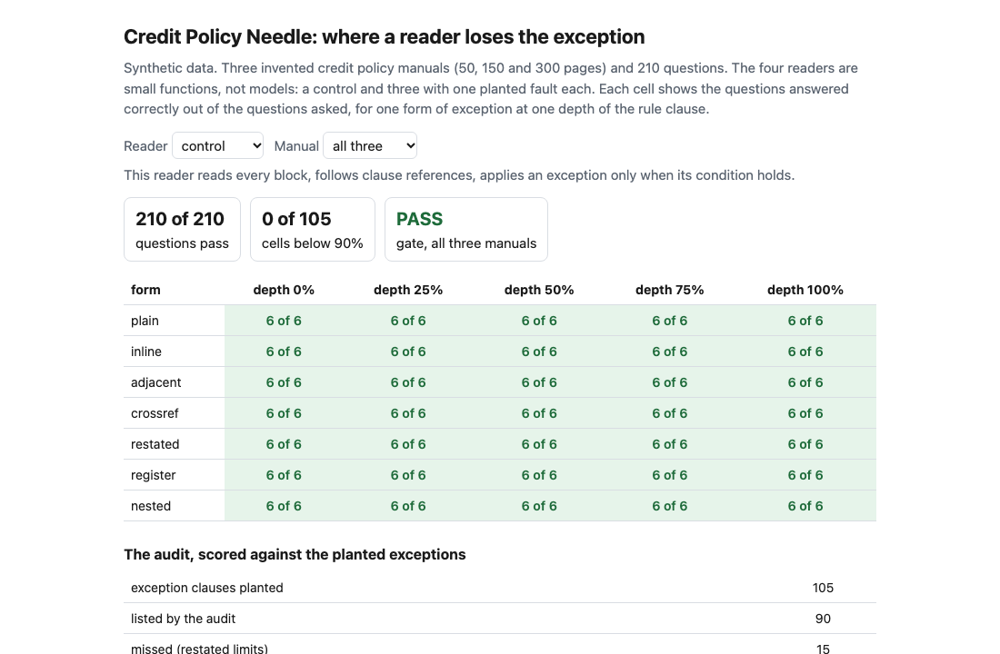
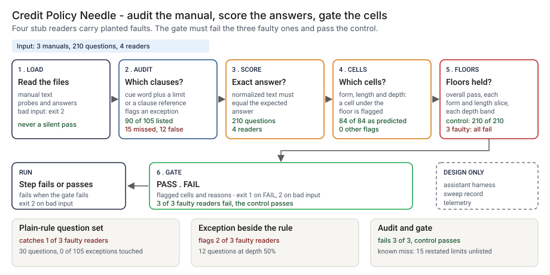
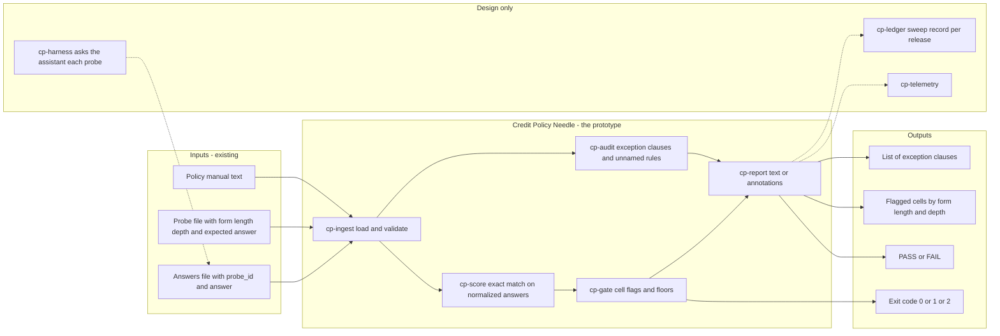
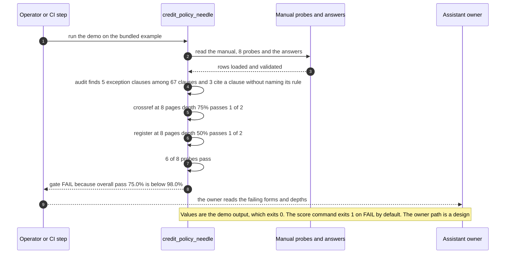

# 🔎 Credit Policy Needle: where an assistant loses the exception clause

**I wanted to know whether an assistant that answers from a 300-page credit policy finds the exception that changes the answer, and where in the document it stops finding it. This is a small command-line tool that lists the clauses that read as exceptions and scores an assistant's answers by form of exception and depth, plus four stub readers to try it against: a control and three with a planted fault.** It extends [14 PolicyNeedle](../14-policyneedle-long-context-fidelity/) from planted facts to planted exceptions in a synthetic credit policy.

**▶ Static demo, no install:** [open demo.html](./demo.html)

[](./demo.html)

## Executive summary (90 seconds)

**Problem.** The owner of an assistant that answers credit staff from a long policy, and the model risk or policy reviewer who signs off its test set, read a pass rate on the questions they have. A credit policy states a limit in one clause and loosens it for some applicants in another, and an assistant can state the limit with confidence and leave out the exception. 🟢 In a modeled test of 3 manuals and 210 questions, a plain-rule set of 30 questions catches 1 of 3 faulty readers. The two it misses pass 30 of 30 and then answer 90 of 180 and 120 of 180 exception questions correctly, and none of the 105 planted exception clauses is touched by a plain-rule question (`step_01_plain_rule_questions.py`). A short test set shows nothing about the exception.

**Product.** Credit Policy Needle is a small command-line tool with two commands and four stub readers to try them on. `audit` lists the clauses of a manual that read as exceptions: a numbered clause or register entry that carries a cue word such as except, notwithstanding or does not apply and a limit or a clause reference, and not a clause that says no exception is permitted. It says which of them cite a clause without naming its rule, because a search on the rule's own words will not return those. `score` compares an assistant's answers with exact expected answers after normalizing them, sorts the result into cells of form, manual length and depth, flags a cell that passes under 90%, and prints PASS or FAIL. It is FAIL when the overall pass is under 98.0%, or any form-by-length slice or any depth band is under 90%. Those lines are mine. `score` exits 1 on FAIL and 2 for unreadable input. There is no model call; the stub readers are plain code with faults I planted.

**Measured and modeled performance.**

- 🟢 **A plain-rule question set catches 1 of 3 faulty readers;** the other two pass 30 of 30 (`step_01_plain_rule_questions.py`).
- 🟢 **Twelve exception questions with the exception beside the rule, asked at depth 50%, flag 2 of 3 faulty readers;** the retrieval reader passes 12 of 12 (`step_02_exception_beside_rule.py`).
- 🟢 **The full sweep of 210 questions:** the control passes 210, the truncating reader 56, the base-only reader 120 and the retrieval reader 150. The retrieval reader passes 30 of 30 with the exception beside the rule, 0 of 45 with it elsewhere and 0 of 15 when a far clause cancels it (`step_03_deficiencies_exposed.py`).
- 🟢 **The gate fails 3 of 3 faulty readers and passes the control with 0 cells flagged.** The cells it flags for each faulty reader are the cells the fault should hit: 84 of 84, 90 of 90 and 60 of 60, with 0 other flags (`step_04_with_gate.py`).
- 🟢 **The audit lists 90 of 105 planted exception clauses,** and lists 45 of the 60 that do not name their rule (`step_04_with_gate.py`).
- 🟢 **Known misses: the audit misses 15 of 15 restated limits and lists 12 of 36 look-alikes by mistake,** and a reader that never opens an exception passes 90 of 90 questions where the exception does not apply (`step_03_deficiencies_exposed.py`, `step_04_with_gate.py`).
- 🟡 **Utility: (3/3 − 1/3) × 6 = 4 faulty assistant releases** caught that a plain-rule question set would pass, assuming 6 such releases reach the test.
- 🔴 **Design target: a sweep result within 30 minutes of a release candidate being tagged.** Designed in [`ARCHITECTURE.md`](./ARCHITECTURE.md), never built or timed.

**What I would ask a head of operations to decide.** Whether the sign-off test for a policy-grounded assistant must include exception questions asked in pairs, one applicant who meets the condition and one who does not, with the exception placed beside the rule and away from it. My recommendation is to adopt the paired set as the release test, have the policy owner write the questions from real exceptions, run the gate in advisory mode on one real manual first, and set the 98.0% and 90% lines against that manual's own noise, since both are my assumptions.

**Call to action.** Fork the repo. Replace `data/manuals/*.txt` and `data/probes.csv` with your policy and with questions your policy owner has signed off, keep the five probe columns the score command reads (`probe_id`, `form`, `length_pages`, `depth_pct`, `expected_answer`), and put your assistant's answers in a two-column file of `probe_id` and `answer`. To call it from code, import `audit_text`, `score_probes` and `gate` from `src/credit_policy_needle.py`. Send findings by opening an issue: say which form and depth cells failed, not the policy text.

_A portfolio prototype on synthetic data. Nothing here is deployed, load-tested or used by anyone, and it has not been run against a real policy or a real assistant._

## Run one now

```bash
cd 67-credit-policy-needle/src && python3 credit_policy_needle.py --demo
```

It prints:

```text
audit  example_manual.txt: 5 exception clauses flagged among 67 clauses; 3 cite a clause without naming its rule
score  example_answers.csv: 6 of 8 probes pass
  crossref 8 pages depth 75%: 1 of 2
  register 8 pages depth 50%: 1 of 2
gate: FAIL (overall pass 75.0% is below 98.0%; 4 more)
```

The example is an 8-page manual with four rules and an assistant that searches on the rule's own words. It finds the exception that sits in the rule clause and the one in the next clause, and misses the one in another section and the one in the register. One of the five flagged clauses is a look-alike pointer, not an exception (see below). Standard library only, Python 3.9 or newer.

To check your own files: `python3 credit_policy_needle.py audit manual.txt`, and `python3 credit_policy_needle.py score probes.csv answers.csv`. The second exits 1 on FAIL so a CI step fails; `--format github` prints annotations with every value from the files escaped; a file that cannot be read exits 2 with one line on stderr.

## What the numbers say

**What it shows** (🟢 measured on synthetic data: 3 manuals, 210 questions, 4 stub readers; the script is named in brackets):

- 🟢 A plain-rule question set of 30 questions catches 1 of 3 faulty readers. The two it misses pass 30 of 30 and then answer 90 of 180 and 120 of 180 of the exception questions correctly (step 1)
- 🟢 Twelve exception questions with the exception beside the rule, asked at depth 50%, flag 2 of 3 faulty readers; the retrieval reader passes 12 of 12 (step 2)
- 🟢 The full sweep of 210 questions: the control passes 210, the truncating reader 56, the base-only reader 120 and the retrieval reader 150 (step 3)
- 🟢 The retrieval reader passes 30 of 30 with the exception beside the rule, 0 of 45 with it elsewhere, and 0 of 15 when a far clause cancels it (step 3)
- 🟢 The gate fails 3 of 3 faulty readers and passes the control with 0 cells flagged. The cells it flags for each faulty reader are the cells the fault should hit: 84 of 84, 90 of 90 and 60 of 60, with 0 other flags (step 4)
- 🟢 The audit lists 90 of 105 planted exception clauses, and lists 45 of the 60 that do not name their rule (step 4)

🟡 Modeled: one page is 1,800 characters, borrowed from project 14. The truncating reader sees 60,000 characters, about 33 pages; that is an assumption, not a measured model limit. Every limit and threshold in the manuals is invented.

🔴 Hypothetical: that a production assistant loses exceptions in the way the retrieval stub does. I have not run this against one.

## What it still gets wrong

- 🟢 The audit misses 15 of 15 restated limits, which carry no exception wording ("For an applicant with ..., the limit in clause X is ..."), and lists 12 of 36 look-alikes by mistake: pointers such as "Reviewers cite clause X, except for files closed with no decision" (step 4 prints both)
- 🟢 A reader that never opens an exception passes 90 of 90 questions where the exception does not apply. A score on answers alone cannot tell it from a reader that read the exception and judged it did not apply; only the paired question where the exception does apply fails it (step 3 prints this as the known limit, and step 4 does not remove it)
- **The data, the readers and the checks share an author.** I planted the exceptions, wrote the stub readers and wrote the audit rules. The control passes 210 of 210 because I wrote it to, and each faulty reader fails where I wrote it to. Treat the results as a ceiling for these rules on this wording, not a rate on a real policy manual, which I have not tested. The agreement between the cells the gate flags and the cells I predicted from the planted offsets shows the gate sees what was planted. It does not show the faults are realistic.
- The retrieval reader is blunt on purpose: it reads only blocks that hold every word of the product name and the attribute phrase. A real retriever is softer and will sometimes find a far exception.
- Exceptions here only loosen a limit, carry one numeric condition, and nest one level. Not covered: exceptions that tighten, several exceptions stacked on one rule, amendments, tables, or conditions that are not numbers. Matching is exact on a normalized answer, so a correct answer wrapped in a sentence scores as wrong; I have not measured how many answers that would affect.
- The audit reads English cue words and clause numbers in the form "7.12" with register entries "R-3". A manual numbered another way needs the patterns changed.

## How the four steps fit

| Step | Question | Script |
|---|---|---|
| 1 | What does a plain-rule question set tell you? | `step_01_plain_rule_questions.py` |
| 2 | What does a first set of exception questions tell you, with the exception beside the rule? | `step_02_exception_beside_rule.py` |
| 3 | Where does each reader fail when the exception is somewhere else? | `step_03_deficiencies_exposed.py` |
| 4 | What do the audit and the gate catch, and what do they miss? | `step_04_with_gate.py` |

Run any of them from `src/`. Data is generated by [`data/_generate.py`](./data/README.md); `tools/check_repo.py` confirms that a rerun reproduces every file and that the green numbers above appear in a script's output. The 50 tests in `tests/` pin those numbers and cover empty, wrong-type and truncated input and hostile strings.

## Utility delivered

The way I price product impact: **utility = (my solution − current state of the art) × the number of people or items it affects.**

Here the item is a release of the assistant that carries a fault in how it finds exceptions. Each one lands on the credit staff who get a confident wrong limit, the owner who signed the test set off, and the reviewer who relied on it. The common basic approach is a question set of plain rules; the table prices the exception sweep and gate against it.

| Term | Value | Where it comes from |
| --- | --- | --- |
| Current state of the art (a plain-rule question set), faulty readers caught | 🟢 **1 of 3** | `step_01_plain_rule_questions.py`; it catches the truncating reader only |
| My solution (the exception sweep and gate), faulty readers caught | 🟢 **3 of 3** | `step_04_with_gate.py`; the control passes with 0 cells flagged |
| Lift per faulty release | 🟢 3 of 3 minus 1 of 3 | The plain-rule set lets these through: the base-only reader and the retrieval reader both pass 30 of 30, and then answer 90 of 180 and 120 of 180 exception questions correctly (`step_01_plain_rule_questions.py`). It rests on three planted faults |
| Number it affects: faulty assistant releases reaching the test | 🟡 **6** | **Assumption, not a statistic.** Replace it with your own count of releases that change retrieval, context length or prompt |
| Assumption that makes the lift real | 🟡 The questions are written from real exceptions, in pairs, and the real fault looks like one of the planted ones | A reader that never opens an exception passes 🟢 90 of 90 questions where the exception does not apply, so the paired question is what fails it (`step_03_deficiencies_exposed.py`) |
| **Utility** | 🟡 **(3/3 − 1/3) × 6 = 4 faulty releases** caught that a plain-rule set would pass | Assumes the 6 behave like the 3 planted readers |

Sensitivity to the count assumption (🟡, same lift): 3 releases gives 2, 6 gives 4, 12 gives 8.

🔴 What I have not measured: how often a real assistant loses an exception, what a wrong limit costs, how long the sweep takes against a real assistant, or whether a real fault looks like my three. The lift rests on three stub readers I wrote. Treat the result as a property of this setup, not a forecast.

---

## Architecture and call flow

Component names match [`ARCHITECTURE.md`](./ARCHITECTURE.md). GitHub renders the diagrams natively.



**System topology:**



**Per-run sequence** (the `--demo` run, an 8-page manual and 8 probes):



**Interlocks (all red, designed, none built):**

- [14 PolicyNeedle](../14-policyneedle-long-context-fidelity/) is the base idea: facts planted at known depths and stub readers with known faults. This folder reuses the approach and imports no code or data from it.
- [04 EvalForge](../04-evalforge-llm-eval-platform/) would host the sweep as one suite on an evaluation platform, with the assistant behind `cp-harness`.
- [40 Eval Gate](../40-eval-gate/) is where a changed snapshot would trigger a re-run of the sweep before the pin moves.

---

## PM artifacts

The PM artifacts that show how I would run this product if I owned the seat. This README is the walkthrough; the rest of the folder holds:

- [`PRD.md`](./PRD.md): the product requirements doc, with users, backlog, KPIs, rollout and open questions.
- [`ARCHITECTURE.md`](./ARCHITECTURE.md): the systems doc, with components, data model, security, failure behavior and operations. A design, not deployed.
- [`demo.html`](./demo.html): clickable, no-install walkthrough, built from the step 4 output by `src/_build_demo.py`.
- [`data/`](./data/): the three synthetic manuals of 50, 150 and 300 pages, 210 questions with exact answers, the planted truth for 105 exception clauses and 36 look-alikes, and the seeded generator. `data/README.md` explains the seven forms.
- [`src/`](./src/): `credit_policy_needle.py`, `common.py` with the four stub readers, the four step scripts and the demo builder.
- [`tests/`](./tests/): 50 unittest tests, including a golden test that pins the numbers above and tests for bad input and hostile strings.

Run the four steps end to end:

```bash
cd src
python3 step_01_plain_rule_questions.py
python3 step_02_exception_beside_rule.py
python3 step_03_deficiencies_exposed.py
python3 step_04_with_gate.py
```

---

## Aligned to

Nothing. I claim no alignment to a regulation or a standard and cite none. The idea of planting a fact at a known depth comes from the needle-in-a-haystack tests, and this project reuses the approach of [14 PolicyNeedle](../14-policyneedle-long-context-fidelity/) (stub readers with known faults, a page convention, a gate on form-by-depth cells) without importing its code or data. It is a prototype. It makes no claim of conformity to any guidance.

## Data and limits

Synthetic, seeded, byte-for-byte reproducible: three manuals of 50, 150 and 300 pages with 105 planted exception clauses and 36 look-alikes, and 210 questions with exact answers. Nothing comes from any employer, lender or real policy. A prototype on synthetic data, not a production case study.

## Fork it

Replace `data/manuals/*.txt` and `data/probes.csv` with your own policy and with questions your policy owner has signed off, keep the five probe columns the score command reads (`probe_id`, `form`, `length_pages`, `depth_pct`, `expected_answer`), and put your assistant's answers in a two-column file. Write each exception question as a pair: one applicant who meets the condition and one who does not. Read the [PRD](./PRD.md) for the scope I held to.

## Prereqs to run this on your laptop

You need Python 3.9 or newer and nothing else. The tool, the four step scripts, the stub readers and the data generator use only the standard library, so there is nothing to install. There is no API key, no network call and no model call anywhere in the folder. To run the tests, use `python3 -m unittest discover -s tests` from this folder. The production pieces in [`ARCHITECTURE.md`](./ARCHITECTURE.md) (the harness that asks a real assistant, the sweep record, telemetry, a scheduled run) are a design, not something you need or can run.

## Author

**Vijay Saharan**, Sr Product / Program Manager · AI in BFSI · Enterprise AI Platforms

[LinkedIn](https://www.linkedin.com/in/vijaysaharan/)
