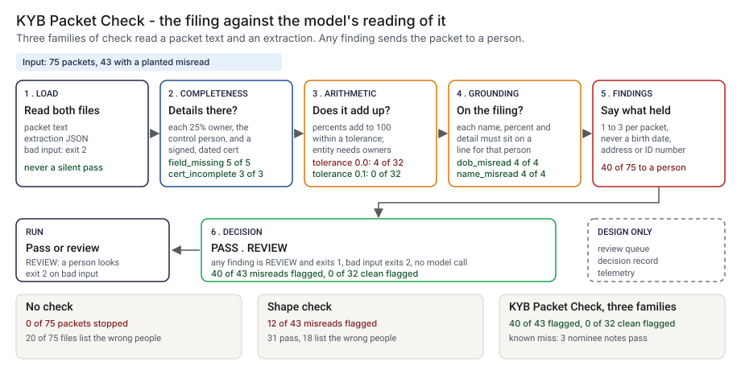

# Architecture: KYB Packet Check

> **Status.** This is the design for a production shape. The repo implements the product mechanic as a prototype: a command, `src/kyb_packet_check.py`, that takes the text of an onboarding packet and a model's extraction as JSON, runs completeness, arithmetic and grounding checks and prints PASS or REVIEW, run here over 75 synthetic packets with a recorded extraction for each. No model is called and no CI Action is staged. Nothing below is claimed as deployed or load-tested. Where a figure is a design target, it says so.

GCP is primary; AWS and Azure sit beside it.



---

## 1. Logical architecture

KYB Packet Check is a function over two inputs: the text of a packet and an extraction in, findings and a decision out. It does not read a scan, call an extractor or verify that a person is who they say they are.

Eight components: five decide the outcome, three support or report.

| Component | Responsibility | Language or framework | Decides the outcome? | Stateful? |
| --- | --- | --- | --- | --- |
| `kp-ingest` | Reads the packet text and the extraction. Rejects a missing, empty, oversized, non-UTF-8 or invalid-JSON input and a wrong-type field. | Python 3.9+, standard library. Prototype: `read_text`, `load_json`, `parse_extraction` in `src/kyb_packet_check.py` | Yes, by refusing: exit 2 | No |
| `kp-complete` | Details for each owner at 25 percent or more and for the control person; a legal name; a certification with a signer and a date. | Python. Prototype: `_completeness`, `beneficial_owners` | Yes | No |
| `kp-arith` | Percentages add up within the tolerance; an entity at 25 percent or more shows the owners behind it, one level deep. | Python. Prototype: `_arithmetic`, `ownership` | Yes | No |
| `kp-ground` | Each name, percentage and personal detail sits on a filing line that names the same holder or person. | Python. Prototype: `_index`, `_grounding`, `name_key` | Yes | No |
| `kp-verdict` | Any finding means REVIEW; maps REVIEW to exit 1 at `--fail-on`. | Python. Prototype: `check_parsed`, `decide`, `run_check` | Yes | No |
| `kp-report` | Prints findings, a one-line summary and the decision; never prints a date of birth, address or ID number; shows control characters as escapes. | Python. Prototype: `render`, `clean`, `fmt_pct` | No | No |
| `kp-ledger` | Appends one decision record per packet (design). Prototype analog: `src/out/step_04_decisions.csv`. | PostgreSQL plus object storage with a retention lock (design) | No | Stateful |
| `kp-telemetry` | Counts decisions, finding kinds and rejections, off the decision path (design). | OpenTelemetry | No | No |

**What decides the outcome.** The input check, the three families of check and the verdict. The report, ledger and telemetry carry or record it. The check trusts the text it is given: a poor text layer becomes its error, and a false filing passes if the extraction agrees with it.

**Repo structure** (production shape):

```
kyb-packet-check/
├── check/      # ingest, complete, arith, ground, verdict, report
├── phrases/    # nominee and side-letter phrases, filings owner
├── ledger/     # decision record writer
├── infra/      # terraform for gcp, aws, azure; IAM
├── docs/runbooks/
└── tests/      # unit, golden, hostile strings
```

---

## 2. Physical and deployment architecture

The check is one short-lived process, called once per packet by the onboarding workflow after extraction. There is no server to keep warm.

| Component | GCP (primary) | AWS | Azure | Why |
| --- | --- | --- | --- | --- |
| Check process (`kp-ingest` to `kp-report`) | Cloud Run job or a step in the workflow | ECS Fargate task or a workflow step | Container Apps job or a workflow step | Stateless, one pass, runs next to the extractor |
| Packet text and extraction | The workflow's case store | Same | Same | Read in place, not copied |
| `kp-ledger` | Cloud SQL for PostgreSQL | RDS for PostgreSQL | Azure Database for PostgreSQL | The platform team already runs it |
| `kp-telemetry` | OTel Collector to Cloud Monitoring | To CloudWatch | To Azure Monitor | Off the decision path; carries counts only |

**Failure behavior (the decision that matters most).** The check must never silently pass. A missing, empty, oversized or mistyped input does not become PASS: it ends the run with exit 2 and a one-line message. A missing or empty value inside a valid extraction is a finding, not a crash, so it cannot pass either.

| Failure | Behavior | Alert |
| --- | --- | --- |
| Packet or extraction missing, empty, larger than 5,000,000 bytes, or not UTF-8 | Exit 2, one line on stderr | P3 |
| Extraction not valid JSON, truncated, too deeply nested, or not an object with a `holders` list | Exit 2 with the reason | P3, P2 if repeated on one extractor |
| A field of the wrong type, a holder kind other than individual or entity, a percent that is not a finite number | Exit 2 naming the field | P3 |
| A detail, the control person, the certification or the legal name is missing or empty | A completeness finding, so REVIEW | None |
| Packet text is empty or the text layer is poor (design) | REVIEW with a text-layer finding, never PASS | P3 |
| Ledger or telemetry unavailable (design) | The decision and exit code stand; the record queues locally | P3 |

**Latency.** The prototype is one pass over a short text and a small JSON object; I have not timed it. 🔴 Design target: a decision within 30 seconds of an extraction landing. Recovery is a re-run from the same packet and extraction.

---

## 3. Data architecture

| Entity | Key | What it holds | Real columns in the prototype |
| --- | --- | --- | --- |
| Packet | `packet_id` | The text of the filing the model was shown | `data/packets.csv`: `packet_id`, `source_text` |
| Extraction | `packet_id` | The model's reading as JSON: `holders` (name, kind, pct), `lookthrough` (entity, name, pct), `people` (name, address, dob, id_last4), `control_person` (name, title), `certification` (signed_by, date), `legal_name` | `data/extractions.csv`: `packet_id`, `extraction_json` |
| Finding | packet, `family`, `kind` | Family (completeness, arithmetic or grounding), kind, subject and detail | Output of `check_packet`; kinds seen in the steps include `pct_not_in_source` and `person_record_missing` |
| Decision record | `record_id` | Design: packet and extraction hashes, tolerance, tool version, findings, decision, reviewer and outcome, time | Prototype analog: `src/out/step_04_decisions.csv` |
| Planted truth | `packet_id` | The scenario, whether a misread was planted, the true owners and control person | `data/truth.csv`: `scenario`, `defect`, `true_beneficial_owners`, `true_control_person`, `planted_detail`. Synthetic data only |

**Retention** is a design choice, not a measurement; confirm it against the bank's own record-retention schedule and privacy rules. Decision records: 🔴 5 years (design default), in PostgreSQL archived to object storage with a retention lock. The packet and the extraction stay in the case system under its own retention.

**Lineage.** A decision traces back in three hops: the record names the packet hash, the extraction hash and the tolerance; the case system returns those bytes; and the checks are deterministic (no clock, locale or random draw), so re-running `check_packet` reproduces the findings.

**Deliberately not stored.** Dates of birth, addresses and ID numbers in the decision record, in findings or in telemetry. The record keeps names, percentages, finding kinds and hashes; the personal details live only in the case system.

---

## 4. Security architecture

**Identity and roles.** The check runs under the workflow's workload identity and has no user account of its own.

| Role | Can | Maps to |
| --- | --- | --- |
| `kp:runner` | Read one packet and extraction; write a decision record | The onboarding workflow's service identity |
| `kp:reviewer` | Read findings and clear or hold a REVIEW | Onboarding analyst |
| `kp:approver` | Approve a tolerance or phrase-list change, never for their own packet | Compliance lead |
| `kp:auditor` | Read records and change history | Internal audit |

**Secrets.** The check holds none and never calls a model, so no extractor key is in its path. It reaches the case store and the ledger through workload identity, with no static keys.

**Classification and what leaves the boundary.** A real packet and extraction hold names, addresses, dates of birth and ID numbers: restricted personal data. In the prototype every name and detail is invented and an ID is only its last four digits. In the design three things leave the job: the exit code, the findings without personal details, and the ledger write.

| Threat | Example | Mitigation in the design |
| --- | --- | --- |
| Hostile string in an extraction or filing echoed into a log | A name holding a newline and text that looks like a PASS line or a workflow command | `clean` shows control characters as escapes and cuts long text; filing text is never printed. The `input error` line is passed through `clean` as well, so a message built from untrusted text stays on one line. `tests/test_hostile.py` covers hostile names, hostile text in the source and a hostile path in an error; `tests/test_cli.py` covers a raw message with a newline |
| Personal details copied into output | A finding that repeats a date of birth or an ID number | Findings name the holder and the percent only; the design keeps the same rule in the ledger and telemetry |
| The extraction is edited after the model produced it | A percent changed to match the filing, or an owner added | The record stores the extraction hash; the workflow's case store versions it |
| The tolerance or a phrase list is changed to clear a packet | `--tolerance` raised until a bad schedule passes | Pull request with a different approver; every record stores the tolerance it used |
| Text in the filing is written to steer the extractor | A line that tells the extractor what to return | The check calls no model and compares output with filing lines. A steered output that matches a line still passes, which it cannot see |

---

## 5. Operational architecture

**SLIs.** Decisions per outcome per day; finding kinds per extractor; input rejections; share of REVIEW packets cleared within a day; time from extraction to decision (prototype baseline on the planted set: 🟢 40 of 75 packets go to a person, `step_04_with_check.py`).

**SLOs (all 🔴 design targets, none measured).**
- A decision within 30 seconds of an extraction landing.
- Every packet that reaches the file has a decision record.
- Every REVIEW read by a named person within one business day (planning estimate).
- 99.9 percent of decisions written to the ledger.

**Alerts.** P2: repeated input rejections from one extractor, or the ledger down for more than a day. P3: a jump in a finding kind for one extractor, which also goes to the extraction model owner.

**Runbooks** (one page each, in `docs/runbooks/`):
- `review-packet.md`: open the finding, compare the filing line, clear or hold.
- `input-rejected.md`: read the one-line reason, fix the extractor output, re-run.
- `finding-spike.md`: a kind jumped for one extractor; check the text layer and the extractor version.
- `changing-the-tolerance.md`: propose, re-run the planted set, compare with the golden numbers, approve.

**On-call and ownership.** The workflow owner owns the step and runbooks. The extraction model owner owns the extractor output shape. The filings owner owns the phrase list. The compliance lead approves tolerance and phrase changes.

**Change control.** Rules, tolerance and phrase lists are versioned. A change needs a proposer and a different approver. Before merge, the planted set is re-run and compared with the numbers pinned in `tests/test_golden.py`, so a change that moves a flagged count shows in the diff.

---

## 6. Alignment and posture

Alignment, not certification. The README's "Aligned to" section cites one source, restated with the same wording about what was read: FinCEN order FIN-2026-R001, "Exceptive Relief from Requirement to Identify and Verify Beneficial Owners at Each Account Opening", issued February 13, 2026 ([PDF](https://www.fincen.gov/system/files/2026-02/FinCEN-Order-CCDExceptiveRelief.pdf)). I read the whole text on 2026-10-24 and did not check for later changes; the order says FinCEN may revoke an exception at its discretion. What I took from it is from its page 2 text and footnote 6, which recites 31 CFR 1010.230: the 25 percent owner test, a single individual who controls the customer, the information to collect (name, address, date of birth and an identification number) and a certification of accuracy.

- **What the design does.** It is not part of the order's identification or verification steps. It checks, before them, whether what a model wrote down agrees with the filing it read.
- **What it does not claim.** The sum rule and its tolerance, the grounding rule, one level of look-through and sending any finding to a person are my design, not the order's. It makes no claim of conformity to the order or to any other standard, holds no certification, and verifying that a person is who they say they are is outside it. I have not read or mapped any other source.

---

## 7. What is deliberately not here

- **Nominee notes.** 🟢 Three misreads pass: KYB-001, KYB-032 and KYB-057 (`step_04_with_check.py`). A check for the word "nominee" would catch them, and I left it out because it would be fit to my own wording; the filings owner would write it.
- **Scans, and whether the filing is true.** The text here is clean synthetic text, and grounding is only as good as the text layer. A PASS shows the extraction agrees with the filing, not that a person is who they say they are.
- **Trusts and deeper look-through.** Look-through goes one level; trusts are not handled.
- **Unallocated interests.** A schedule that legitimately adds to less than 100 would be flagged; none of my packets has one, so I have not measured that.
- **Same-name people and the certification text.** Names match on words, so two people with the same first and last name count as one; the certification is checked for a signer and a date only.
- **A measured rate on real data.** The packets and the checks share an author, so 40 of 43 is a ceiling, not a rate on real filings.

---

## Appendix: sample contract

The call is the prototype's own; its `--demo` output is under "Run one now" in the README.

```bash
python3 kyb_packet_check.py check packet.txt extraction.json --tolerance 0.1 --fail-on review
```

A minimal extraction. Only `holders` is required; any other missing value becomes a completeness finding:

```json
{"packet_id": "KYB-EX01", "holders": [{"kind": "individual", "name": "Imani Weller", "pct": 50}]}
```

Exit status: 0 on PASS or with `--fail-on never`, 1 on REVIEW, 2 for bad input.
