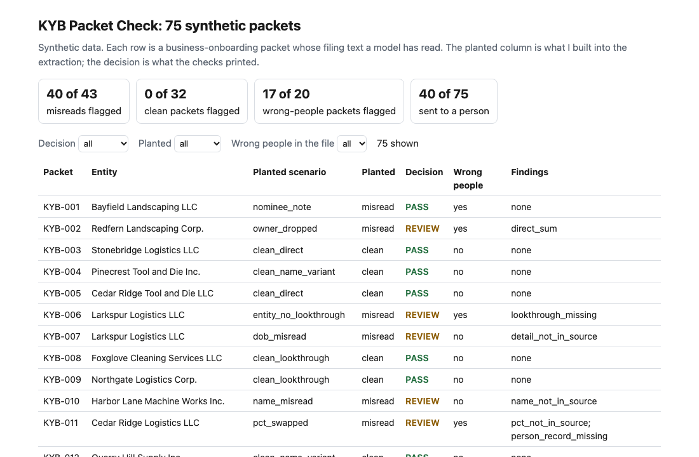
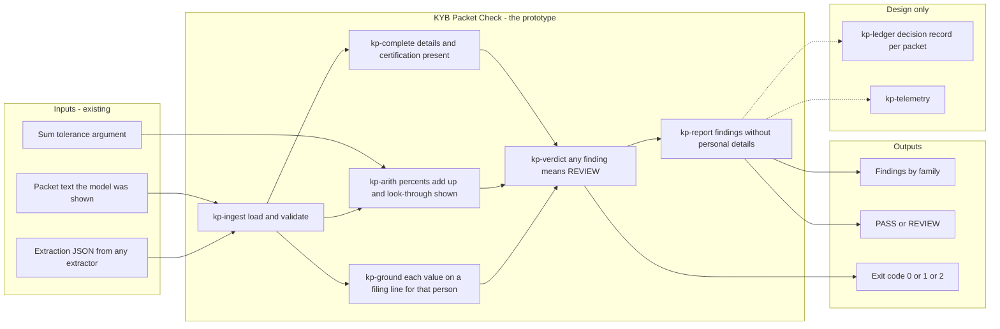
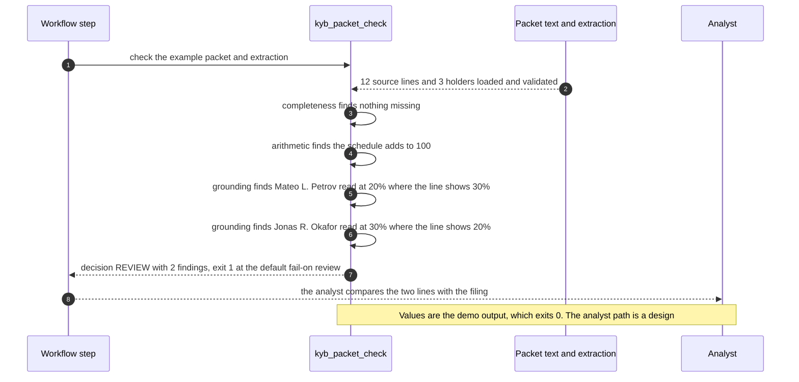

# 🪪 KYB Packet Check: the beneficial owner a model misread (synthetic documents)

**I wanted to know what lands in an onboarding file when a model misreads one line of a business filing, and which misreads a cheap check can stop before a person signs off. This is a command-line check: it takes the text of a packet and the model's extraction of it, and prints PASS or REVIEW with the findings.** It never calls a model. The extraction is an input, so any extractor can sit in front of it; I ship 75 synthetic packets and a recorded extraction for each.

**▶ Static demo, no install:** [open demo.html](./demo.html)

[](./demo.html)

## Executive summary (90 seconds)

**Problem.** The person who owns the onboarding workflow behind a model extraction, and the analyst who reviews what the workflow flags, get a record of owners, percentages, a control person and personal details, read by a model from a business filing. Nobody compares that reading with the filing. 🟢 On 75 synthetic packets, 43 with a planted misread, a process with no check stops 0 of 75, and 20 of 75 files would list the wrong people, meaning the individuals at 25 percent or more plus the control person (`step_01_no_check.py`). A shape check, fields present and certification signed, flags 12 of 43 misreads and passes 18 packets that would list the wrong people (`step_02_field_validation.py`). A percent read as 2.5 instead of 25 is a well-formed number, and a file that names the wrong owner reads as complete.

**Product.** KYB Packet Check takes the text of one packet and the model's extraction as JSON and runs three families of check. Completeness: each owner at 25 percent or more and the control person has a name, an address, a date of birth and an ID number, and the certification has a signer and a date. Arithmetic: the percentages add up to 100 within 0.1 point, which is my assumption, and an entity holding 25 percent or more shows the owners behind it, one level deep. Grounding: each name, percentage and personal detail appears on a filing line that names the same holder or person, matching names on words and ignoring single-letter initials and word order. Any finding means REVIEW. Findings print names and percentages and never a date of birth, address or ID number. It exits 1 on REVIEW and 2 for unreadable input. It never calls a model; the extraction is an input, so any extractor can sit in front of it.

**Measured and modeled performance.**

- 🟢 **No check: 0 of 75 packets stopped, and 20 of 75 files would list the wrong people** (`step_01_no_check.py`).
- 🟢 **A shape check flags 12 of 43 misreads and 0 of 32 clean packets;** it passes 31 of 43 misreads, 18 of which would list the wrong people (`step_02_field_validation.py`).
- 🟢 **Each half alone fails:** completeness and arithmetic without the filing text flag 30 of 43 misreads, grounding alone flags 19 of 43, and 21 are caught only by the first and 10 only by the second (`step_03_deficiencies_exposed.py`).
- 🟢 **A sum check with zero tolerance flags 4 of 32 clean packets** (thirds written as 33.33); with a tolerance of 0.1 it flags 0 of 32 (`step_03_deficiencies_exposed.py`).
- 🟢 **Together: 40 of 43 misreads flagged, 0 of 32 clean packets flagged, 17 of 20 wrong-people packets flagged,** and 40 of 75 packets go to a person (`step_04_with_check.py`).
- 🟢 **Known miss: 3 nominee notes pass** (KYB-001, KYB-032 and KYB-057). The extraction matches the schedule and a note elsewhere in the filing says the holder acts for someone else (`step_04_with_check.py`).
- 🟡 **Utility: (17/20 − 2/20) × 40 = 30 wrong-people files** caught that a shape check would pass, assuming 40 such files reach the check.
- 🔴 **Design target: a decision within 30 seconds of an extraction landing.** Designed in [`ARCHITECTURE.md`](./ARCHITECTURE.md), never built or timed.

**What I would ask a head of operations to decide.** Whether an extraction of a beneficial-owner schedule should be compared with the filing line by line before a person signs it off, and whether the review load that follows is acceptable: 40 of 75 packets went to a person here, on a mix I made dense on purpose. My recommendation is to adopt grounding and completeness first, run the check in advisory mode on one real extraction log, and set the 0.1 tolerance against your own filings before it blocks anything.

**Call to action.** Fork the repo. Swap `data/packets.csv` and `data/extractions.csv` for your own exports and keep the columns; the scoring steps also need `truth.csv`. To call it from code, import `check_packet` from `src/kyb_packet_check.py` with the text and the decoded extraction. Pass the same text layer the model was shown, because grounding is only as good as that text. Send findings by opening an issue: say which finding kind fired and how many packets, never a filing or a personal detail.

_A portfolio prototype on synthetic data. Nothing here is deployed, load-tested or used by anyone, and every name, address and number is invented._

## Run one now

```bash
cd 68-kyb-packet-check/src && python3 kyb_packet_check.py --demo
```

It prints:

```text
packet KYB-EX01  Harbor Lane Supply LLC
  [grounding   ] pct_not_in_source      Mateo L. Petrov: read 20%, source line shows 30%
  [grounding   ] pct_not_in_source      Jonas R. Okafor: read 30%, source line shows 20%
checked: 3 holders, 0 look-through rows, 3 people against 12 source lines
owners at 25 percent or more as read: Imani Weller 50%, Jonas R. Okafor 30%; control person: Imani Weller
decision: REVIEW (2 findings)
```

The model swapped two percentages. The schedule still adds to 100, so a sum check is silent. Only the comparison with the filing line shows that the file would name Jonas Okafor, who holds 20 percent, as an owner and leave out Mateo Petrov, who holds 30.

Standard library only, Python 3.9 or newer. To check your own files: `python3 kyb_packet_check.py check packet.txt extraction.json`. Exit 0 is PASS, 1 is REVIEW, 2 means an input could not be read (empty, truncated or wrong-type files get a one-line message, not a traceback). The demo exits 0 so the command does not look like a failure. The extraction format is in [`data/README.md`](./data/README.md).

## What the numbers say

**What it shows** (🟢 measured on synthetic data: 75 planted packets, 43 with a planted misread and 32 clean; the script is named in brackets):

- 🟢 No check: 0 of 75 packets stopped, and 20 of 75 files would list the wrong people, meaning the 25 percent owners plus the control person (`step_01`)
- 🟢 A shape check (fields present, certification signed) flags 12 of 43 misreads and 0 of 32 clean packets; it passes 31 of 43 misreads, 18 of which would list the wrong people (`step_02`)
- 🟢 Completeness and arithmetic without the filing text flag 30 of 43 misreads; grounding against the filing text alone flags 19 of 43; 21 are caught only by the first, 10 only by the second (`step_03`)
- 🟢 A sum check with zero tolerance flags 4 of 32 clean packets (thirds written as 33.33 add up to 99.99); with a tolerance of 0.1 it flags 0 of 32 (`step_03`)
- 🟢 All three together: 40 of 43 misreads flagged, 0 of 32 clean packets flagged, 17 of 20 wrong-people packets flagged, and 40 of 75 packets go to a person (`step_04`)
- 🟡 Modeled: the sum tolerance of 0.1 point and the rule that a schedule adds to 100 are my assumptions, not the order's. I chose the tolerance so that thirds written to two decimals pass.
- 🔴 Hypothetical: that a reviewer clears a three-line finding faster than a re-read of the filing. I did not time anyone. How often a real model misreads a filing like these is also unmeasured; the planted misreads say nothing about it.

## What it still gets wrong

- 🟢 Three of the 43 misreads pass (`step_04` prints each one): the nominee notes KYB-001, KYB-032 and KYB-057. The extraction matches the schedule line for line, and a note elsewhere in the filing says the holder acts for someone who is not listed. A check for the word "nominee" would catch these three. I left it out because it would be fit to my own wording of the note.
- **The packets and the checks share an author.** I planted the misreads and wrote the rules, so 40 of 43 shows the rules cover what I planted. I built hard cases into both sides: clean packets a careless rule would flag (thirds, names in another form, an entity at 20 percent, an owner exactly at 25 and one at 24), and swapped percents that keep the total at 100. Treat the result as a ceiling for these rules, not a rate on real filings, which I have not tried.
- **The filing text here is clean.** It is plain synthetic text in a few row formats. A real filing is a scan or a PDF, and grounding is only as good as the text layer you hand it: an OCR error can flag a correct read or let a wrong one through.
- A PASS shows only that the extraction agrees with the filing, not that the filing is true or that a person is who they say they are. The order's "verify" step is outside this tool.
- Names match on words, ignoring single-letter initials and word order, so two different people with the same first and last name count as one. Look-through goes one level. Trusts are not handled. Dates must be ISO. A schedule that legitimately adds to less than 100 (unallocated interests) would be flagged; none of my packets has one, so I have not measured that.
- The certification is checked for a signer and a date, not read against the filing. Findings print names and percentages but never a date of birth, address or ID number.

## The extraction is a stub

`data/extractions.csv` holds what an imaginary extractor returned for each packet, with the misreads planted by [`data/_generate.py`](./data/README.md) after the filing text was written. The steps replay it. To use a real extractor, write its output in the same JSON shape and pass the file to `check`.

## How the four steps fit

| Step | Question | Script |
|---|---|---|
| 1 | What reaches the file when nothing checks the extraction? | `step_01_no_check.py` |
| 2 | What does a field-presence check catch? | `step_02_field_validation.py` |
| 3 | Where does each half fail alone? | `step_03_deficiencies_exposed.py` |
| 4 | What do the three checks catch together? | `step_04_with_check.py` |

Run any of them from `src/`. Data is generated by [`data/_generate.py`](./data/README.md); `tools/check_repo.py` confirms that a rerun reproduces every file and that the green numbers above appear in a script's output. The tests (`tests/`, 61 of them) pin those numbers, bad input and hostile strings.

## Utility delivered

The way I price product impact: **utility = (my solution − current state of the art) × the number of people or items it affects.**

Here the item is an onboarding file that would list the wrong people as beneficial owners. Each one lands on the analyst who signs it off, the compliance lead who relied on it, and the customer whose file is wrong. The common basic approach is a shape check on the extraction; the table prices the three checks against it.

| Term | Value | Where it comes from |
| --- | --- | --- |
| Current state of the art (a shape check: fields present, certification signed), wrong-people packets flagged | 🟢 **2 of 20** | `step_02_field_validation.py`; it flags 12 of 43 misreads and 0 of 32 clean packets |
| My solution (KYB Packet Check), wrong-people packets flagged | 🟢 **17 of 20** | `step_04_with_check.py`; 0 of 32 clean packets flagged |
| Lift per wrong-people file | 🟢 17 of 20 minus 2 of 20 | The shape check passes 18 of them, by planted misread: dob_misread 4, entity_no_lookthrough 4, name_misread 4, nominee_note 3, owner_dropped 5, pct_decimal_slip 5, pct_swapped 6 across its 31 passing misreads (`step_02_field_validation.py`) |
| Number it affects: wrong-people files reaching the check | 🟡 **40** | **Assumption, not a statistic.** Replace it with your own count of onboarding files whose owner list is wrong |
| Assumption that makes the lift real | 🟡 The extractor reads from the same text the check is given, and a reviewer acts on a flag | If the filing text is a poor scan, grounding flags correct reads or passes wrong ones. A nominee note still passes: 🟢 3 of 43 misreads (`step_04_with_check.py`) |
| **Utility** | 🟡 **(17/20 − 2/20) × 40 = 30 wrong-people files** flagged that a shape check would pass | Assumes the 40 behave like the 20 planted ones |

Sensitivity to the count assumption (🟡, same lift): 10 files gives 7.5, 40 gives 30, 100 gives 75.

🔴 What I have not measured: how often a real model misreads a real filing, how long a reviewer takes to clear a finding, what a wrong owner list costs, or how a real scan changes grounding. The planted set is dense on purpose, 20 of 75 packets would list the wrong people (`step_01_no_check.py`); a real stream has far fewer. Treat the result as a property of this mix of cases, not a forecast.

---

## Architecture and call flow

Component names match [`ARCHITECTURE.md`](./ARCHITECTURE.md). GitHub renders the diagrams natively.


**System topology:**



**Per-run sequence** (the `--demo` run, two holders' percents swapped):



**Interlocks (all red, designed, none built):**

- [77 Spread Extraction Eval](../77-spread-extraction-eval/) scores an extractor across layouts. It would sit in front of this check and say which layouts the extractor reads badly. This folder reads no file from 77.
- [51 Memo Tieout](../51-memo-tieout/) applies the same idea, tying a written figure back to its source, to a credit memo. No code is shared.
- [08 OversightOps](../08-oversightops-hitl-workflow/) is where the person who clears a REVIEW would be designed in: role, calibration and a record of the decision.
- [76 Name Match Eval](../76-name-match-eval/) is a possible source for a stronger name matcher than the word match used here.

---

## PM artifacts

The PM artifacts that show how I would run this product if I owned the seat. This README is the walkthrough; the rest of the folder holds:

- [`PRD.md`](./PRD.md): the product requirements doc, with users, backlog, KPIs, rollout and open questions.
- [`ARCHITECTURE.md`](./ARCHITECTURE.md): the systems doc, with components, data model, security, failure behavior and operations. A design, not deployed.
- [`demo.html`](./demo.html): clickable, no-install walkthrough, built from the step 4 output by `src/_build_demo.py`.
- [`data/`](./data/): the 75 synthetic packets, a recorded extraction for each, the planted truth and the seeded generator. `data/README.md` explains the scenarios and the extraction format.
- [`src/`](./src/): `kyb_packet_check.py`, `common.py`, the four step scripts and the demo builder.
- [`tests/`](./tests/): 61 unittest tests, including a golden test that pins the numbers above and tests for bad input and hostile strings.

Run the four steps end to end:

```bash
cd src
python3 step_01_no_check.py
python3 step_02_field_validation.py
python3 step_03_deficiencies_exposed.py
python3 step_04_with_check.py
```

---

## Aligned to

FinCEN order FIN-2026-R001, "Exceptive Relief from Requirement to Identify and Verify Beneficial Owners at Each Account Opening", issued February 13, 2026 ([PDF](https://www.fincen.gov/system/files/2026-02/FinCEN-Order-CCDExceptiveRelief.pdf)). I read the whole text on 2026-10-24 and did not check for later changes; the order says FinCEN may revoke an exception at its discretion.

What I took from it, all from its footnote 6, which recites 31 CFR 1010.230: a beneficial owner is each individual who directly or indirectly owns 25 percent or more of the equity interests, plus a single individual with significant responsibility to control, manage or direct the customer; the information is name, address, date of birth and an identification number; and the person providing it certifies that it is accurate. The order lets an institution limit identification and verification to a customer's first account, to any time it knows facts that reasonably call earlier information into question, and to what its risk-based procedures call for. This tool sits upstream of that: it asks whether what a model wrote down agrees with the filing it read.

Everything else is my design and not from the order: the sum rule and its tolerance, the grounding rule, one level of look-through, and sending any finding to a person. It is a prototype, aligned to that text. It makes no claim of conformity to that guidance.

## Data and limits

Synthetic, seeded, byte-for-byte reproducible. Nothing comes from any employer, customer, real filing or bank, and the names are invented. A prototype on synthetic data, not a production case study.

## Fork it

Swap `data/packets.csv` and `data/extractions.csv` for your own exports and keep the columns, or skip the data and point `check` at one packet text and one extraction file. The scoring steps also need `truth.csv`. Read the [PRD](./PRD.md) for the scope I held to.

## Prereqs to run this on your laptop

You need Python 3.9 or newer and nothing else. The check, the four step scripts and the data generator use only the standard library, so there is nothing to install. There is no API key, no network call and no model call anywhere in the folder. To run the tests, use `python3 -m unittest discover -s tests` from this folder. The production pieces in [`ARCHITECTURE.md`](./ARCHITECTURE.md) (the review queue, the decision record, telemetry, a live extractor in front of the check) are a design, not something you need or can run.

## Author

**Vijay Saharan**, Sr Product / Program Manager · AI in BFSI · Enterprise AI Platforms

[LinkedIn](https://www.linkedin.com/in/vijaysaharan/)
