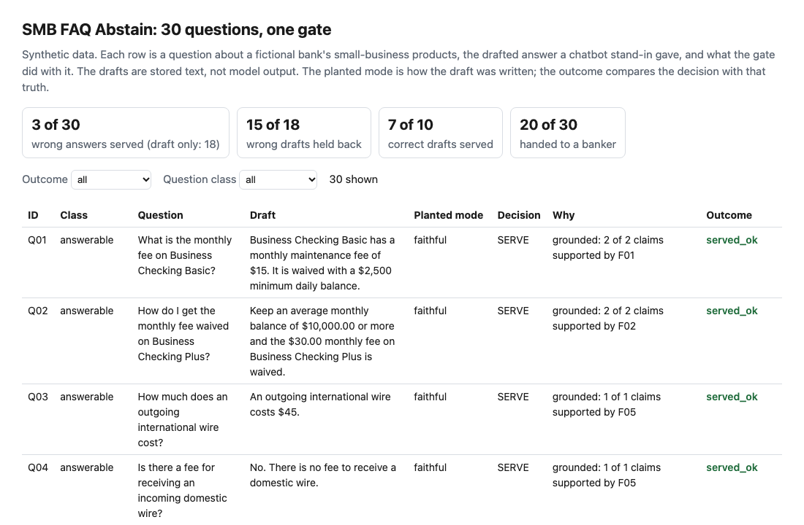
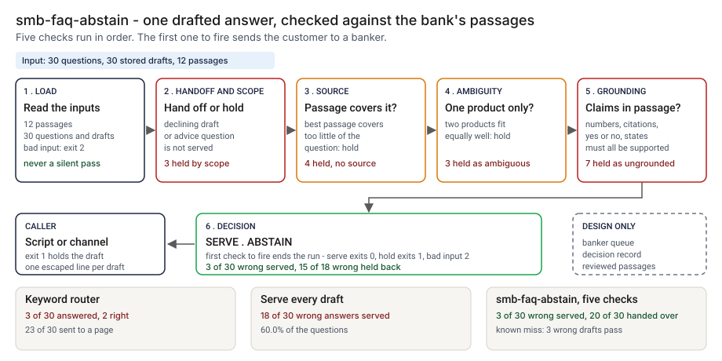
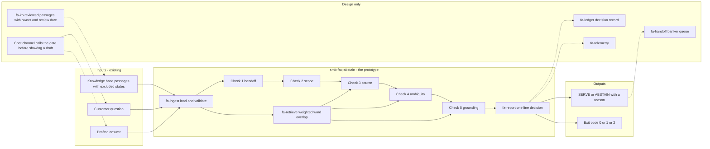
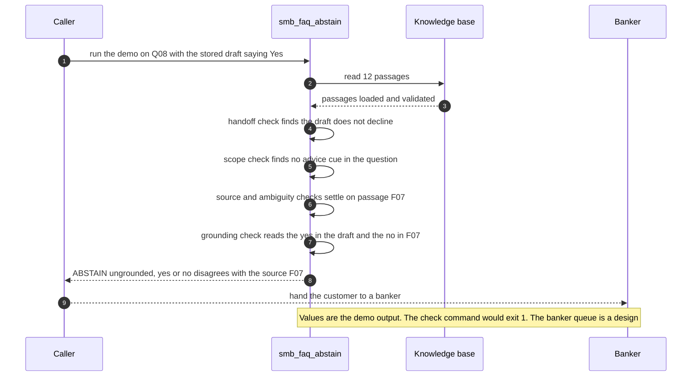

# 🏪 smb-faq-abstain (HalluGuard re-skin): an FAQ assistant that hands off instead of guessing

**I wanted to know whether a small-business FAQ assistant can hold back a drafted answer about deposits or lending when the bank's own text does not support it, and what that costs in questions sent to a banker. This is a rule-based gate: it reads a question, a drafted answer and a short knowledge base, and prints SERVE or ABSTAIN.** It re-skins the idea in [01 HalluGuard](../01-halluguard-bank-chatbot-safety/) on a new set of 30 small-business questions, with checks that read the text instead of fixed verifier scores.

**▶ Static demo, no install:** [open demo.html](./demo.html)

[](./demo.html)

Tags used below: 🟢 measured (a script in this folder prints the number), 🟡 modeled (the assumption is named), 🔴 hypothetical.

## Executive summary (90 seconds)

**Problem.** The people involved are the product owner of a bank's small-business chat channel and the banker who takes the handoffs. An FAQ assistant drafts answers about deposit and lending products, and some drafts state a fee, rate, term or availability the bank's own text does not support, or answer a question that belongs with a person. The customer cannot tell which drafts are wrong. 🟢 On 30 synthetic small-business questions, serving every draft puts 28 of 30 in front of the customer, 10 correct and 18 wrong, which is 60.0% of the 30 questions (`step_02_draft_only.py`). A keyword router in front of the FAQ pages invents nothing but is thin: it returns a canned passage for 3 of 30 questions, while the knowledge base can answer 17 (`step_01_keyword_router.py`). The cost of a wrong draft is a customer who acts on a figure the bank does not stand behind.

**Product.** smb-faq-abstain is a command that reads a question, a drafted answer and a short knowledge base, and prints SERVE or ABSTAIN. It applies five checks in order. `handoff`: a draft that already declines is a handoff. `scope`: a question that asks for advice or a decision (cues such as "should I", "approved", tax, legal, qualify) is held. `source`: if no passage covers at least 0.50 of the question's weighted words, it is held. `ambiguity`: if passages from more than one product fit within 0.05 of the best, it is held. `grounding`: every number, citation, yes or no and named state in the draft must be supported by the best passage, or the draft is held; a draft with nothing checkable in it is held as unverifiable. The `check` command exits 0 to serve, 1 to hold back and 2 for malformed input. There is no model call, and the drafts in the data are stored text.

**Measured and modeled performance.**

- 🟢 **Serve every draft: 18 wrong answers reach the customer,** 60.0% of the 30 questions, next to 10 correct ones (`step_02_draft_only.py`).
- 🟢 **Each check fails alone:** the source check alone serves 12 of 18 wrong drafts, the checks on the question alone serve 9 of 18, and the grounding check alone serves 5 of 18 (`step_03_deficiencies_exposed.py`).
- 🟢 **A loose threshold costs two more:** requiring half of the claims serves 5 of 18 wrong drafts instead of 3 of 18, adding Q13 (a fake citation) and Q14 (a wrong opening hour) (`step_03_deficiencies_exposed.py`).
- 🟢 **All checks together: 3 of 30 wrong answers served against 18,** 15 of 18 wrong drafts held back, 7 of 10 correct drafts served (`step_04_with_gate.py`).
- 🟢 **The price is handoffs:** 20 of 30 (66.7%) go to a banker, 2 of those because the draft already declined, and 3 correct drafts are held back by mistake (Q07, Q11 and Q26) (`step_04_with_gate.py`).
- 🟢 **Known miss: 3 wrong drafts pass** (Q05, Q10 and Q16). Each quotes a number that is in the right passage and means something else (`step_04_with_gate.py` prints each as a KNOWN LIMIT).
- 🟡 **Utility: (15/18 − 0/18) × 120 = 100 wrong drafts a year kept from customers,** assuming the assistant produces 120 wrong drafts a year.
- 🔴 **Design target: a decision before the draft is shown, within 250 milliseconds at the 95th percentile.** Designed in [`ARCHITECTURE.md`](./ARCHITECTURE.md), never built or timed.

**What I would ask a head of operations to decide.** Whether a small-business customer should be handed to a banker whenever the bank's own text does not back the drafted answer, knowing that 20 of 30 questions here end in a handoff and that the set is built from failure cases. My recommendation is to adopt the rule that an unsupported draft is held, run the gate in shadow mode on a week of real drafts first (decisions logged, nothing held back), and set the 0.50 coverage minimum and the 0.05 tie margin against that data, since both are my assumptions.

**Call to action.** Fork the repo. Swap `data/kb.csv` (columns `fact_id, product, excluded_states, text`, with excluded states named in full) for your own passages, and `data/queries.csv` and `data/drafts.csv` for your questions and the drafts your assistant wrote, or point `batch` at a `pairs.csv` with `query_id, question, draft`. To call it from code, import `evaluate` and `load_kb` from `src/smb_faq_abstain.py`. Send findings by opening an issue: say which check held back or passed a draft and for which kind of question, not the customer text itself.

_A portfolio prototype on synthetic data. Nothing here is deployed, load-tested or used by anyone, and the drafts are stored text, not model output._

## Run one now

```bash
cd 69-smb-faq-abstain/src && python3 smb_faq_abstain.py --demo
```

It prints:

```text
question: Does the Business Credit Card have an annual fee?
draft:    Yes. Expect an annual fee on the Business Credit Card.
decision: ABSTAIN (ungrounded) yes or no disagrees with the source (source F07)
```

The stored draft says yes. The passage (F07) says the card has no annual fee, so the draft is held back and the customer is handed to a banker. Standard library only, Python 3.9 or newer.

## What the numbers say

**What it shows** (🟢 measured on synthetic data: 30 questions, 12 passages and 30 stored drafts; the step is named in brackets):

- 🟢 A keyword router returns a canned passage for 3 of 30 questions, 2 of them the right one, points 23 to a page and hands 4 to a banker; the knowledge base can answer 17 of the 30 and the router answers 2 of those (step 1)
- 🟢 Serving every draft puts 28 of 30 in front of the customer: 10 are correct and 18 are wrong, which is 60.0% of the 30 questions (step 2)
- 🟢 No single check is enough: the source check alone serves 12 of 18 wrong drafts, the checks on the question alone serve 9 of 18, and the grounding check alone serves 5 of 18 (step 3)
- 🟢 A loose grounding threshold (half of the claims) serves 5 of 18 wrong drafts instead of 3 of 18; the two extra are Q13, a fake citation, and Q14, a wrong opening hour (step 3)
- 🟢 All checks together: 3 of 30 wrong answers served against 18 in step 2, 15 of 18 wrong drafts held back, 7 of 10 correct drafts served, and 20 of 30 (66.7%) handed to a banker, 2 of those because the draft already declined (step 4)

## What it still gets wrong

- 🟢 Three wrong drafts pass (step 4 prints each as a KNOWN LIMIT). Each quotes a number that is in the right passage and means something else. Q05 gives 1.20% APY for a $40,000 balance where the passage gives 2.10% for balances of $25,000 or more. Q10 calls the $150 annual fee monthly. Q16 answers a rate for a 700 credit score from a knowledge base that sets no rate by score. The gate reads numbers, not units or meaning.
- 🟢 Three correct drafts are held back by mistake (step 4 prints each). Q07 spells its number out ("ninety days"), so nothing is left to check. Q11 asks "what documents should I bring", and "should I" is a scope cue. Q26 says Hawaii and Alaska are "not available" where the passage says "except", and the yes or no check reads the negation word as a disagreement.
- 🟢 One advice question is held by the source check and not by the scope check: Q24 has a best coverage of 0.47 against a minimum of 0.50. I set the minimum before running anything and did not tune it. 🟡 Both thresholds (coverage 0.5, tie margin 0.05) are assumptions.
- **The set and the rules share an author.** I wrote the questions, the passages, the drafts and the rules, so the passages and questions share vocabulary. After the first run I rewrote the Q26 draft to add a negation word, because I had not planted a false alarm of that kind. Read the results as a ceiling for these rules, not a rate on real traffic, which I have not tested.
- **The drafts are stored text, not model output.** The gate has never seen drafts from a real model. It is a set of rules, not a trained verifier. HalluGuard's design calls for a trained verifier and its step 4 uses fixed scores, so the two sets of numbers do not compare.
- Retrieval is word overlap: no synonyms, and "Term Loan" shares words with "Equipment Loan". Only full state names are read, not "TX". English only. Numbers written as words are not parsed. Units are not read. The yes or no check looks for negation words anywhere in the passage.
- The handoff rate comes from a set built from failure cases. Live traffic is mostly routine, so the live rate should be lower, but I have not measured it. 🔴 Whether customers prefer a handoff to a wrong answer is not tested here.

## Use it on your own files

```bash
python3 smb_faq_abstain.py check --kb kb.csv --question "Is the Equipment Loan available in Texas?" --draft "Yes."
python3 smb_faq_abstain.py batch --kb kb.csv --pairs pairs.csv
```

`kb.csv` has the columns `fact_id`, `product`, `excluded_states` and `text`; `pairs.csv` has `query_id`, `question` and `draft`. `check` exits 0 to serve, 1 to hold back and 2 for malformed input, with a one-line message on stderr. `--min-grounded` sets the share of claims that must be supported (default 1.0). When no passage covers the question, the output says so.

## How the four steps fit

| Step | Question | Script |
|---|---|---|
| 1 | What does a keyword router answer? | `step_01_keyword_router.py` |
| 2 | What reaches the customer when every draft is served? | `step_02_draft_only.py` |
| 3 | Where does each check fail alone, and what stays missed? | `step_03_deficiencies_exposed.py` |
| 4 | What do all the checks catch together? | `step_04_with_gate.py` |

Run any of them from `src/`. Data is generated by [`data/_generate.py`](./data/README.md); `tools/check_repo.py` confirms that a rerun reproduces every file and that the green numbers above appear in a script's output. The scope I held to is in the [PRD](./PRD.md).

## Utility delivered

The way I price product impact: **utility = (my solution − current state of the art) × the number of people or items it affects.**

Here the item is a wrong drafted answer. Each one lands on a small-business customer who may act on it, the product owner of the channel, and the banker who hears about it later. The common basic approach is to serve every draft; the table prices the gate against it.

| Term | Value | Where it comes from |
| --- | --- | --- |
| Current state of the art (serve every draft), wrong drafts held back | 🟢 **0 of 18** | `step_02_draft_only.py`; 28 of 30 drafts are served and 18 of them are wrong |
| My solution (the gate), wrong drafts held back | 🟢 **15 of 18** | `step_04_with_gate.py`; 7 of 10 correct drafts are still served |
| Lift per wrong draft | 🟢 15 of 18 minus 0 of 18 | Three wrong drafts still pass: Q05, Q10 and Q16 (`step_04_with_gate.py`) |
| Number it affects: wrong drafts the assistant produces in a year | 🟡 **120** | **Assumption, not a statistic.** Replace it with your own count of drafts in a year that were wrong |
| Assumption that makes the lift real | 🟡 The wrong drafts in live traffic look like the planted ones, and the knowledge base is current | The planted set has 3 wrong drafts that quote a real number with a different meaning, and the gate holds back none of them (`step_02_draft_only.py`, `step_04_with_gate.py`). If most live errors are that kind, the lift falls toward zero |
| **Utility** | 🟡 **(15/18 − 0/18) × 120 = 100 wrong drafts a year kept from customers** | Assumes the 120 behave like the 18 planted ones |

Sensitivity to the count assumption (🟡, same lift): 60 wrong drafts a year gives 50, 120 gives 100, 240 gives 200.

🔴 What I have not measured: what a wrong draft costs a customer or the bank, how long a banker takes to clear a handoff, what the 3 correct drafts held back by mistake cost in goodwill, or what share of live drafts are wrong. The planted set is dense on purpose, 18 of 30 drafts are wrong (`step_02_draft_only.py`), and live traffic is mostly routine. Treat the result as a property of this mix of questions, not a forecast.

---

## Architecture and call flow

Component names match [`ARCHITECTURE.md`](./ARCHITECTURE.md). GitHub renders the diagrams natively.



**System topology:**



**Per-run sequence** (the `--demo` run, the Business Credit Card annual fee question):



**Interlocks (all red, designed, none built):**

- [01 HalluGuard](../01-halluguard-bank-chatbot-safety/) is the idea this extends. Its design calls for a trained verifier, which could sit beside these rules. This folder does not import or read its files.
- [08 OversightOps](../08-oversightops-hitl-workflow/) is a possible home for the banker queue (`fa-handoff`), so a handoff carries the question, the draft and the reason to a reviewer sized for it.
- [09 LineageLog](../09-lineagelog-ai-decision-audit/) is a possible home for the decision record (`fa-ledger`).
- [05 AgentWatch](../05-agentwatch-agent-observability/) would watch live drafts after release, which the shadow-mode phase needs. This gate decides one draft at a time and does no monitoring.

---

## PM artifacts

The PM artifacts that show how I would run this product if I owned the seat. This README is the walkthrough; the rest of the folder holds:

- [`PRD.md`](./PRD.md): the product requirements doc, with users, backlog, KPIs, rollout and open questions.
- [`ARCHITECTURE.md`](./ARCHITECTURE.md): the systems doc, with components, data model, security, failure behavior and operations. A design, not deployed.
- [`demo.html`](./demo.html): clickable, no-install walkthrough, built from the step outputs by `src/_build_demo.py`.
- [`data/`](./data/): the synthetic knowledge base, the 30 questions, the stored drafts, the planted truth, and the seeded generator. `data/README.md` explains how the truth is set.
- [`src/`](./src/): `smb_faq_abstain.py`, `common.py`, the four step scripts and the demo builder.
- [`tests/`](./tests/): 62 unittest tests, including a golden test that pins the numbers above and tests for bad input and hostile strings.

Run the four steps end to end:

```bash
cd src
python3 step_01_keyword_router.py
python3 step_02_draft_only.py
python3 step_03_deficiencies_exposed.py
python3 step_04_with_gate.py
```

---

## Aligned to

None. I did not anchor this project to a regulation or a standard, and I claim no alignment with one. It extends the idea in [01 HalluGuard](../01-halluguard-bank-chatbot-safety/): hand the customer to a banker instead of stating something the source does not support. What is new here is the question set, drafts from a seeded generator, and rules that read the text. No code or number was copied. It is a prototype on synthetic data.

## Data and limits

Synthetic, seeded, byte-for-byte reproducible. The bank, its products and its numbers are invented. Nothing comes from any employer, customer or real bank. A prototype on synthetic data, not a production case study.

## Fork it

Replace `data/kb.csv` with your own passages (keep the columns and name the excluded states explicitly), and `data/queries.csv` and `data/drafts.csv` with your questions and the drafts your assistant produced, then add a `data/truth.csv` row for each. The step scripts will score your drafts the same way.

## Prereqs to run this on your laptop

You need Python 3.9 or newer and nothing else. The gate, the four step scripts and the data generator use only the standard library, so there is nothing to install. There is no API key, no network call and no model call anywhere in the folder. To run the tests, use `python3 -m unittest discover -s tests` from this folder. The production pieces in [`ARCHITECTURE.md`](./ARCHITECTURE.md) (the reviewed knowledge base, the banker queue, the decision record, telemetry, the chat integration) are a design, not something you need or can run.

## Author

**Vijay Saharan**, Sr Product / Program Manager · AI in BFSI · Enterprise AI Platforms

[LinkedIn](https://www.linkedin.com/in/vijaysaharan/)
