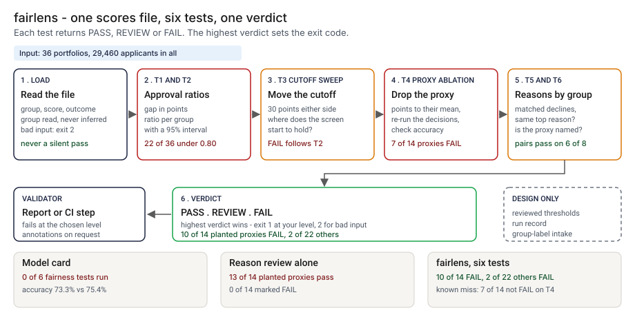

# Architecture: fairlens six-test pack

> **Status.** This is the design for a production shape. The repo implements the product mechanic as a prototype: a command, `src/fairlens_pack.py`, that reads a scores file with a group column, runs six tests and prints PASS, REVIEW or FAIL for each, run over 36 synthetic portfolios with a planted mechanism each. There is no model, no hosted service and no real applicant data. Nothing below is claimed as deployed or load-tested. Where a figure is a design target, it says so.

GCP is primary; AWS and Azure sit beside it.



---

## 1. Logical architecture

The pack is a batch function inside a validation workspace: one scores file, a cutoff and optional proxy settings in, six verdicts and an overall verdict out. It trains nothing, calls no model and infers no group.

Eight components: five decide the outcome, three support or report.

| Component | Responsibility | Language or framework | Decides the outcome? | Stateful? |
| --- | --- | --- | --- | --- |
| `fp-ingest` | Loads the file. Rejects an empty file, a repeated header, a missing column, a ragged row, a bad value, an empty group or fewer than two groups. | Python 3.9+, standard library. Prototype: `load_scores`, `InputError`, `Data`, `Params` in `src/fairlens_pack.py` | Yes, by refusing: exit 2 | No |
| `fp-stats` | Approval and accuracy per group, a seeded bootstrap, the cutoff sweep, the ablation re-run and the matched reason pairs. | Python. Prototype: `group_stats`, `bootstrap`, `sweep`, `ablate`, `reason_pairs` | Yes | No |
| `fp-tests` | The six tests, each returning a verdict, the numbers and the rule behind it. | Python. Prototype: `t1_gap` to `t6_naming`, `interval_verdict` | Yes | No |
| `fp-verdict` | Takes the highest verdict among tests that ran and maps it to an exit code at `--fail-on`. A test without its columns is NOT RUN, and listed. | Python. Prototype: `run_pack`, `RANK`, `run_check` | Yes | No |
| `fp-config` | Thresholds, screen, sweep width, seed, resamples. Changes by reviewed change. | A reviewed file (design). Prototype: constants at the top of `src/fairlens_pack.py` and the `check` flags | Yes, config | Stateful, in git |
| `fp-report` | Prints text or GitHub annotations, escaping labels and paths. | Python. Prototype: `render_text`, `render_github`, `clean`, `gh_data`, `gh_prop` | No | No |
| `fp-ledger` | One run record per file and cutoff (design). Prototype analog: `src/out/step_04_cases.csv`. | PostgreSQL plus object storage with a retention lock (design) | No | Stateful |
| `fp-telemetry` | Counts runs by verdict, NOT RUN and rejections, off the decision path (design). | OpenTelemetry to the platform's monitoring | No | No |

**What decides the outcome.** The input check, the statistics, the six tests, the thresholds and the verdict. The report, ledger and telemetry carry or record it. The pack takes the group and proxy columns as given and cannot tell that one is wrong.

**Repo structure** (production shape):

```
fairlens/
├── pack/       # ingest.py, stats.py, tests.py, verdict.py, report.py
├── config/     # thresholds, seed, resamples, changed by pull request
├── job/        # batch wrapper for the validation workspace (design)
├── ledger/     # run record writer
├── infra/      # terraform for gcp, aws, azure
└── tests/      # unit, golden, hostile strings
```

---

## 2. Physical and deployment architecture

One short batch job in the validation project, started by a validator or by a validation pipeline. The scores file never leaves the project.

| Component | GCP (primary) | AWS | Azure | Why |
| --- | --- | --- | --- | --- |
| Pack job (`fp-ingest` to `fp-report`) | Cloud Run job | ECS Fargate task | Container Apps job | Stateless, one pass, no network needed |
| Scores files | Cloud Storage bucket in the validation project, versioned | S3, versioned | Blob Storage, versioned | The exact bytes a verdict used can be returned |
| `fp-config` | A file in the repo | Same | Same | A threshold change lands in the same history as the code |
| `fp-ledger` | Cloud SQL for PostgreSQL | RDS for PostgreSQL | Azure Database for PostgreSQL | The platform team already runs it |
| `fp-telemetry` | OTel Collector to Cloud Monitoring | To CloudWatch | To Azure Monitor | Off the decision path |

**Failure behavior (the decision that matters most).** The pack must never silently pass. A missing, empty or mistyped input ends the run with exit 2 and a one-line reason, even with `--fail-on never`. A test that lacks its columns is reported as NOT RUN with the reason, never as PASS.

| Failure | Behavior | Alert |
| --- | --- | --- |
| File missing, unreadable, not UTF-8, empty, column missing, ragged row, bad value, one group; a named column not in the file | Exit 2, one line naming the line or column | P3 |
| Cutoff approves nobody | Exit 2: approval ratios are undefined | P3 |
| No proxy column or no reason columns | T4, T5 or T6 print NOT RUN and the overall line lists them | P3 when the scorecard is in scope |
| Too few matched pairs or proxy declines to judge | REVIEW with the counts, never PASS | None |
| Ledger or telemetry down (design) | The verdict and exit code stand; the record queues locally | P3 |

**Latency.** The prototype runs 36 portfolios of 760 to 830 applicants each; I have not timed it at any scale. 🔴 Design target: a verdict on a file of one million applicants within 15 minutes. The bootstrap is the cost; if the target is missed, the resamples would move to a vectorized library.

Recovery is a re-run from the same versioned file, cutoff, thresholds and seed. The designed interlocks (none built) are in the README.

---

## 3. Data architecture

| Entity | Key | What it holds | Real columns in the prototype |
| --- | --- | --- | --- |
| Applicant row | `applicant_id` | A group, a score, a default flag, the proxy points, up to three reason codes | `data/case_scores.csv`: `case_id`, `applicant_id`, `group`, `score`, `bad_outcome`, `postcode_points`, `region_points`, `reason_1`, `reason_2`, `reason_3`. The pack reads `group`, `score`, `bad_outcome` and the columns you name |
| Portfolio | `case_id` | One scorecard's applicants and its cutoff | `data/case_truth.csv`: `applicants`, `cutoff`, `smallest_group_size` |
| Run record | `run_id` | Design: file hash, cutoff, proxy column and code, thresholds, seed, tool version, the six verdicts with their numbers, the overall verdict | Prototype: `src/out/step_04_cases.csv` |
| Planted truth | `case_id` | The mechanism and whether a proxy was planted | `data/case_truth.csv`: `mechanism`, `proxy_planted`, `proxy_predictive`, `legit_shift_scale`, `postcode_max_points`, `region_max_points`, `redraws`. Synthetic data only |

**Retention** is a design choice; confirm each value against the bank's own schedule. 🔴 Design defaults: run records 7 years; the scores file a verdict used, as long as the validation evidence it supports, in the validation project only; the record keeps a hash and counts, never applicant rows.

**Lineage.** A verdict traces back in three hops: the run record names the file hash, cutoff, proxy column, thresholds, seed and tool version; the versioned store returns that file; and every test is a count, a ratio, a sort or a seeded resample (400 resamples, seed 70 by default), so a re-run reproduces the verdict. In the prototype the trace is a row of `step_04_cases.csv`.

**Deliberately not stored.** Applicant rows, in any record or log. The pack prints group names and aggregate numbers, and a record holds only those.

---

## 4. Security architecture

**Identity and roles.** The job runs under the validation project's workload identity and has no user account of its own.

| Role | Can | Maps to |
| --- | --- | --- |
| `fp:runner` | Read one scores file, write a run record | The job identity |
| `fp:validator` | Start a run, read verdicts | Model risk analyst |
| `fp:approver` | Approve a threshold change, never their own | Compliance or fair-lending reviewer |
| `fp:auditor` | Read run records and config history | Internal audit |
| `fp:admin` | Manage roles, buckets and the ledger | Platform engineering lead |

**Secrets.** The pack holds none and calls no model. Storage and ledger access is by workload identity.

**Data classification and what leaves the boundary.** In a real use the file joins a group label to a score and a default flag per applicant: restricted. In the prototype nothing leaves the machine and every row is synthetic. In the design three things leave the job: the verdict, annotations and a run record, none holding applicant rows.

| Threat | Example | Mitigation in the design |
| --- | --- | --- |
| Hostile group label, path or column name echoed into a log or annotation | A label holding a newline and text that looks like a workflow command | `clean` writes control characters as escapes and caps a label at 60 characters; `gh_data` and `gh_prop` rewrite `%`, carriage return, newline, colon and comma. `tests/test_cli.py` covers a hostile group name in an annotation and in text, and a hostile path in an error |
| A threshold edited so a FAIL becomes a PASS | The 0.05 lift or the 1-point cost raised | Reviewed config with a different approver; every run record stores the thresholds it used; the golden test shows a verdict that moves |
| The scores file copied outside the boundary | A file emailed for a second opinion | The job runs inside the validation project with no network, and outputs carry aggregates only |
| A wrong group label or proxy column | A stale extract; the wrong column | The pack cannot see this. The run record stores the column and the label source for the reviewer |
| A screening statistic read as a legal finding | A ratio under 0.80 quoted as a violation | The wording says screen, and the compliance reviewer approves how a verdict is reported |

---

## 5. Operational architecture

**SLIs.** Runs per week by overall verdict; tests NOT RUN on in-scope scorecards; input rejections; time to verdict; FAILs overturned after the credit analyst's reply; runs using a threshold set other than the approved one. Prototype baseline on the planted set: 🟢 overall FAIL on 10 of 14 planted-proxy portfolios and 2 of 22 others (`step_04_with_fairlens.py`).

**SLOs (all 🔴 design targets, none measured).**
- A verdict on a file of one million applicants within 15 minutes.
- Every in-scope validation has a run record.
- Every FAIL read by a named person within five business days (planning estimate).

**Alerts.** P3: a required test NOT RUN on an in-scope scorecard, or repeated input rejections. P4: a weekly digest of verdicts by scorecard. Nobody is paged for a FAIL.

**Runbooks** (one page each, in `docs/runbooks/`):
- `input-rejected.md`: read the one-line reason, fix the file or column name, re-run.
- `fail-verdict.md`: confirm the file hash and cutoff, send the numbers to the credit analyst as a question.
- `changing-a-threshold.md`: propose, re-run the planted set, compare with the golden numbers, approve.
- `labels-and-columns.md`: confirm the label source and proxy column before a run counts.

**On-call and ownership.** The head of model validation owns the job and the runbooks. The compliance reviewer approves threshold changes and how a verdict is worded. Credit analysts own the answer to a FAIL.

**Change control.** Thresholds are versioned in the repo. A change needs a different approver, and the planted set is re-run against the pinned numbers in `tests/test_golden.py` before merge, so a change that moves a verdict shows in the diff. Rollout is shadow, then calibration, then advisory, as the PRD lays out.

---

## 6. Alignment and posture

Alignment, not certification. The README's "Aligned to" section cites two pages, restated with the same wording about what was read, both on 2026-10-24: [12 CFR 1002.9 (Regulation B)](https://www.consumerfinance.gov/rules-policy/regulations/1002/9/), where the statement of reasons for adverse action must be specific and indicate the principal reason or reasons, and the commentary says no particular number of reasons is mandated and that more than four is not likely to help the applicant; and [Circular 2022-03](https://www.consumerfinance.gov/compliance/circulars/circular-2022-03-adverse-action-notification-requirements-in-connection-with-credit-decisions-based-on-complex-algorithms/), published 2022-05-26, where specific reasons are still required when a creditor uses a complex algorithm.

- **What the design does.** T5 and T6 check whether the reasons a scorecard lists are consistent across groups and name the factor that decided, and the run record keeps what was tested.
- **What it does not claim.** It makes no claim of conformity to that guidance. I did not read the rules on disparate impact, so nothing tests for it. The 0.80 ratio is a screening convention I did not read and a statistic, not a legal finding.

---

## 7. What is deliberately not here

- **A search for a second proxy.** 🟢 Seven of 14 planted proxies are not marked FAIL by T4 (`step_04_with_fairlens.py`). The ablation takes one column; in the three `two_proxies` portfolios the region points that remain keep the ratio under 0.80.
- **A proxy too small to move the ratio.** The three `quiet_proxy` portfolios, worth 8 to 12 points, lift the ratio by almost nothing.
- **A noise estimate for the accuracy guard.** 🟢 One of 22 portfolios with no planted proxy is marked FAIL by T4 (`step_04_with_fairlens.py`); the 1-point guard is an assumption.
- **Group labels.** Real credit files rarely carry them. The pack reads a column, never infers one, and does not stress-test wrong labels.
- **Reason lists from a real scorecard.** The reasons come from my own rule, the three components with the most points lost. A lender who ranks them another way changes T5 and T6.
- **Thresholds tuned on real data.** Every threshold is an assumption, and the cutoff sweep's 30-point width assumes a score scale of a few hundred.
- **Legal conclusions, training a model, a hosted service.** A verdict is a screen.

---

## Appendix: sample contract

The bundled `--demo` run (portfolio C19) is under "Run one now" in the README.

```bash
python3 fairlens_pack.py check scores.csv --cutoff 126 --proxy-column postcode_points --proxy-code R05 --fail-on fail --format github
```

`scores.csv` needs `group`, `score` and `bad_outcome`; optional are the proxy's points column and `reason_1` to `reason_3`. Output is one line per test with a verdict and the numbers, then `overall:` with the counts and any test not run. Exit: 0 below `--fail-on`, 1 at or above it, 2 for malformed input.
