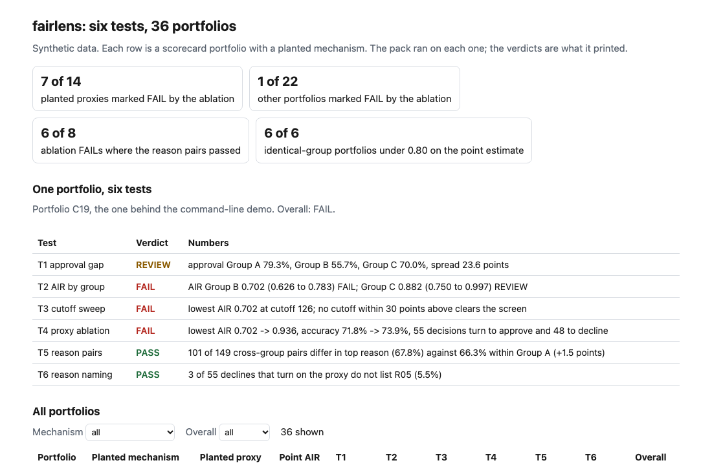
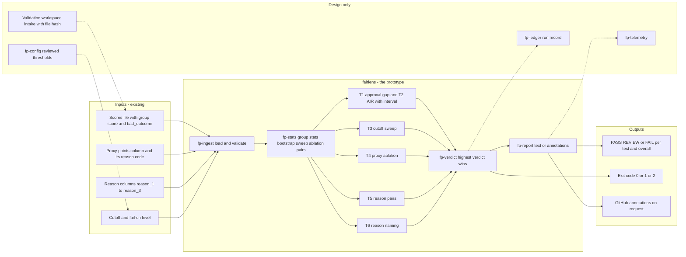
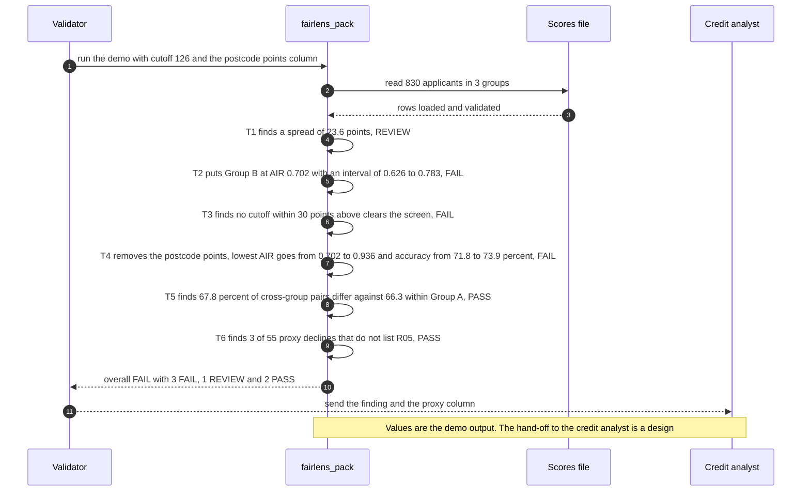

# 🔬 fairlens: a six-test pack for a scorecard, run from a scores file

**I wanted to know what a validator sees when the decline reasons on a scorecard look consistent across groups, and a feature inside the score still moves approvals by group. This is a command-line tool: give it a CSV of scores with a group column and it prints PASS, REVIEW or FAIL for six tests. On 36 synthetic portfolios, each with a planted mechanism, the reason-code check passed almost every planted proxy, and the proxy ablation caught about half of them.** It extends [17 FairLens](../17-fairlens-credit-model-fairness/): the six-test shape and the planted postcode proxy come from there, and the command line, the interval-based ratio test, the accuracy check on the ablation and the scored set with hard cases are new here.

**▶ Static demo, no install:** [open demo.html](./demo.html)

[](./demo.html)

## Executive summary (90 seconds)

**Problem.** A model risk analyst receives a scores file for a points scorecard from a credit team and has an afternoon to say whether it treats groups fairly. The decline reasons look consistent from one group to the next, and the model card shows accuracy and approval rate and nothing split by group. 🟢 On 36 synthetic portfolios of 760 to 830 applicants each, 14 with a planted proxy and 22 without, the model card runs 0 of 6 fairness tests, while the lowest group approves under 0.80 of the reference rate in 22 of 36 portfolios (`step_01_model_card_only.py`). A review of the decline reasons alone passes 13 of 14 planted proxies, because every group is scored by the same points (`step_02_reason_code_review.py`). A feature inside the score can move approvals by group, and neither view shows it.

**Product.** fairlens is a command that reads a CSV of scores with a group column and prints PASS, REVIEW or FAIL for six tests, then an overall verdict. `T1` approval gap: REVIEW when approval rates spread by 10 points or more, never FAIL alone. `T2` adverse impact ratio per group with a 95% bootstrap interval: FAIL when the whole interval is under 0.80. `T3` cutoff sweep: where the lowest ratio crosses the screen within 30 points either side. `T4` proxy ablation: replace the suspected column's points by their mean and re-run the decisions; FAIL when the lowest ratio lifts by 0.05 or more to the screen at a cost of at most 1 point of accuracy. `T5` reason pairs: declined applicants within 5 score points are matched, and the top reason is compared across groups against a control inside the reference group. `T6` reason naming: of the declines that turn on the proxy, how many list no reason naming it. The highest verdict wins. It exits 1 at the level you choose and 2 for malformed input. There is no model call; every test is a count, a ratio, a sort or a seeded resample.

**Measured and modeled performance.**

- 🟢 **The model card runs 0 of 6 fairness tests.** Mean accuracy is 73.3% with a planted proxy against 75.4% without, a gap of 2.1 points, which does not say which portfolios carry one (`step_01_model_card_only.py`).
- 🟢 **Reason-code review alone passes 13 of 14 planted proxies** and flags 4 of the 22 others, all four for too few matched pairs (`step_02_reason_code_review.py`).
- 🟢 **Each test alone misleads:** a point-estimate ratio under 0.80 flags 6 of 6 portfolios whose groups were drawn identically, where with the 95% interval T2 fails 0 of those 6 and sends 6 to review; ablation with no accuracy check calls 10 of 14 planted proxies, 5 of the 22 others, and 4 of 5 portfolios whose postcode points also predict default (`step_03_deficiencies_exposed.py`).
- 🟢 **Together: T4 marks 7 of 14 planted proxies FAIL and 1 of 22 others,** and the reason pairs pass on 6 of the 8 portfolios where it fails (`step_04_with_fairlens.py`).
- 🟢 **Overall FAIL on 10 of 14 planted-proxy portfolios and 2 of 22 others.** No portfolio reads PASS overall, 0 of 36, because T6 is FAIL on 4 and REVIEW on 25 of 36: the decline reasons rarely name the postcode points that decided (`step_04_with_fairlens.py`).
- 🟢 **Known misses: 7 of 14 planted proxies are not marked FAIL by T4** (three `two_proxies`, three `quiet_proxy` and one weak `proxy_gap`), and one portfolio with no proxy (C14, `small_group_noise`) is (`step_04_with_fairlens.py` prints each).
- 🟡 **Utility: (10/14 − 0/14) × 7 = 5.0 scorecard portfolios a year with a proxy marked overall FAIL that a reason-code review would pass,** assuming 7 such portfolios reach a validator each year.
- 🔴 **Design target: a verdict on a file of one million applicants within 15 minutes.** Designed in [`ARCHITECTURE.md`](./ARCHITECTURE.md), never built or timed.

**What I would ask a head of operations to decide.** Whether a scorecard whose decline reasons look consistent should still be sent back when removing one feature's points lifts the lowest approval ratio past the screen at no real cost in accuracy. I set that to FAIL as my policy. My recommendation is to adopt the ablation and the reason-pair test as a validation step, run them in advisory mode on one real scores file first, and treat the 0.80 ratio as a screen and not a legal finding, since I did not read the source of that convention.

**Call to action.** Fork the repo. Swap `data/case_scores.csv` for your own export and keep the columns `group`, `score` and `bad_outcome`, add the proxy's points column and `reason_1` to `reason_3` if you have them, then point `check` at the file with your `--cutoff`. To call it from code, import `load_scores` and `run_pack` from `src/fairlens_pack.py`. Edit the constants at the top of that file to change a threshold. Send findings by opening an issue: say which test fired and on how many portfolios, not applicant data.

_A portfolio prototype on synthetic data. Nothing here is deployed, load-tested, validated against a real scorecard or used by anyone._

## Run one now

```bash
cd 70-fairlens/src && python3 fairlens_pack.py --demo
```

It prints:

```text
fairlens: 830 applicants in 3 groups, cutoff 126, reference Group A
  T1 approval gap    REVIEW  approval Group A 79.3%, Group B 55.7%, Group C 70.0%, spread 23.6 points
  T2 AIR by group    FAIL    AIR Group B 0.702 (0.626 to 0.783) FAIL; Group C 0.882 (0.750 to 0.997) REVIEW
  T3 cutoff sweep    FAIL    lowest AIR 0.702 at cutoff 126; no cutoff within 30 points above clears the screen
  T4 proxy ablation  FAIL    lowest AIR 0.702 -> 0.936, accuracy 71.8% -> 73.9%, 55 decisions turn to approve and 48 to decline
  T5 reason pairs    PASS    101 of 149 cross-group pairs differ in top reason (67.8%) against 66.3% within Group A (+1.5 points)
  T6 reason naming   PASS    3 of 55 declines that turn on the proxy do not list R05 (5.5%)
overall: FAIL (3 FAIL, 1 REVIEW, 2 PASS)
```

The reason pairs pass: declined applicants with scores within 5 points of each other differ in their top reason about as often across groups (67.8%) as within Group A (66.3%). The ablation fails: take the postcode points out and the lowest ratio goes from 0.702 to 0.936 while accuracy rises. Standard library only, Python 3.9 or newer.

To check your own file:

```bash
python3 fairlens_pack.py check scores.csv --cutoff 126 --proxy-column postcode_points --proxy-code R05
```

The file needs `group`, `score` and `bad_outcome` (1 for a default). Optional: the proxy's points column, and `reason_1` to `reason_3` with the codes listed on the decline notice. A test that lacks its columns prints NOT RUN and the overall line says which. Exit 0 when the overall verdict is below `--fail-on` (default `fail`), 1 at or above it, 2 for malformed input with a one-line message. `--format github` prints annotations. Group labels are read from the `group` column and never inferred.

## What the numbers say

**What it shows** (🟢 measured on synthetic data: 36 planted portfolios of 760 to 830 applicants each, 14 with a planted proxy and 22 without; the script is named in brackets):

- 🟢 The model card runs 0 of 6 fairness tests. The lowest group approves under 0.80 of the reference rate in 22 of 36 portfolios, and mean accuracy is 73.3% with a planted proxy against 75.4% without (`step_01`)
- 🟢 The reason-code review alone passes 13 of 14 planted proxies, and flags 4 of the 22 others, all four for too few matched pairs (`step_02`)
- 🟢 A point-estimate ratio under 0.80 flags 22 of 36 portfolios, 10 of them with a planted proxy. It flags 6 of 6 portfolios whose groups were drawn identically; with the 95% interval, T2 fails 0 of those 6 and sends 6 to review (`step_03`)
- 🟢 Ablation alone, with no accuracy check, calls 10 of 14 planted proxies and 5 of the 22 others. It calls 4 of 5 portfolios whose postcode points also predict default; removing them there costs 3.3, 4.0, 5.1, 2.0 and 1.8 accuracy points (`step_03`)
- 🟢 The pack's ablation (T4) marks 7 of 14 planted proxies FAIL and 1 of 22 others. It marks 0 of 5 predictive-feature portfolios FAIL and 4 of 5 REVIEW (`step_04`)
- 🟢 Where the ablation fails a portfolio, the reason pairs pass on 6 of those 8 (`step_04`)
- 🟢 Overall FAIL: 10 of 14 planted-proxy portfolios and 2 of 22 others (`step_04`)

## What it still gets wrong

- 🟢 Seven of the 14 planted proxies are not marked FAIL by T4 (`step_04` prints each one). Three are `two_proxies` portfolios: the tool is pointed at the postcode column, removing it lifts the lowest ratio to 0.771, 0.783 and 0.797, and the region points that remain keep it under 0.80 (REVIEW). Three are `quiet_proxy` portfolios worth 8 to 12 points, where the lift is +0.005, +0.004 and -0.013 (PASS). One is a weak `proxy_gap` portfolio (C18, 0.818 to 0.861, PASS).
- 🟢 One of the 22 portfolios with no planted proxy is marked FAIL by T4, a `small_group_noise` portfolio (C14). A group of 30 applicants moves when you re-score it, and the ablation reads that movement as a proxy. The 1-point accuracy guard is an assumption 🟡 and I did not estimate how noisy the accuracy change is.
- 🟢 No portfolio reads PASS overall (0 of 36): T6 is FAIL on 4 and REVIEW on 25 of 36, and PASS on 7 (`step_04`). A decline reason list built from points lost rarely names the postcode points that tipped the decision. That is a finding about the notice, whatever the groups look like, and it keeps every clean portfolio at REVIEW. T6 can only FAIL when T4 did not pass.
- **The test set and the rules share an author.** I planted the mechanisms and wrote the tests, so 7 of 14 is what these rules do on what I planted, not a rate on a real portfolio. I also adjusted group sizes, proxy weights and coefficients after looking at earlier output (see [data/README.md](./data/README.md)). Treat every number as a ceiling.
- The reason lists here come from my own rule, the three components with the most points lost. A lender who ranks reasons another way changes T5 and T6. Three listed reasons is an assumption 🟡.
- 🔴 Real credit files rarely carry group labels. This tool reads a column. A group-inference step, with its own error check, would come first; [17 FairLens](../17-fairlens-credit-model-fairness/) stress-tests wrong labels, and this project does not.
- The ablation takes one column. It does not search for a second proxy or for a re-weighted scorecard. T1 never fails alone, and the cutoff sweep covers 30 points either side, a width that assumes a score scale of a few hundred.

## How the four steps fit

| Step | Question | Script |
|---|---|---|
| 1 | What does the model card show? | `step_01_model_card_only.py` |
| 2 | What does a review of the decline reasons catch? | `step_02_reason_code_review.py` |
| 3 | Where does each check fail alone? | `step_03_deficiencies_exposed.py` |
| 4 | What do the six tests catch together, and what gets through? | `step_04_with_fairlens.py` |

Run any of them from `src/`. Data is generated by [`data/_generate.py`](./data/README.md); `tools/check_repo.py` confirms that a rerun reproduces every file and that the green numbers above appear in a script's output. The tests (`tests/`, 41 in all) pin the numbers, bad input and hostile strings.

## Utility delivered

The way I price product impact: **utility = (my solution − current state of the art) × the number of people or items it affects.**

Here the item is a scorecard portfolio that carries a proxy. Each one lands on the model risk analyst who has to decide whether to escalate, the credit analyst who has to answer, and the applicants in the group that pays for it. The common basic approach is a review of the decline reasons; the table prices the pack against it.

| Term | Value | Where it comes from |
| --- | --- | --- |
| Current state of the art (reason-code review alone), planted-proxy portfolios marked FAIL | 🟢 **0 of 14** | `step_02_reason_code_review.py`; it passes 13 of 14, sends 1 to REVIEW, and marks 0 of the 22 others FAIL |
| My solution (the six tests), planted-proxy portfolios with overall FAIL | 🟢 **10 of 14** | `step_04_with_fairlens.py`; 2 of the 22 portfolios with no planted proxy are also FAIL |
| Lift per planted-proxy portfolio | 🟢 10 of 14 minus 0 of 14 | The other four stay at REVIEW: one weak `proxy_gap` and three `quiet_proxy` (`step_04_with_fairlens.py`) |
| Number it affects: scorecard portfolios a year that carry a proxy and reach a validator | 🟡 **7** | **Assumption, not a statistic.** Replace it with your own count of portfolios a year that carried a proxy |
| Assumption that makes the lift real | 🟡 The validator has group labels and points the tool at the column that carries the proxy | If the column is wrong, T4 and T6 do not run. I have not measured what the other tests give alone on overall FAIL; the point ratio alone flags 22 of 36 portfolios, 10 of them with a planted proxy (`step_03_deficiencies_exposed.py`) |
| **Utility** | 🟡 **(10/14 − 0/14) × 7 = 5.0 scorecard portfolios a year with a proxy marked overall FAIL that a reason-code review would pass** | Assumes the 7 behave like the 14 planted ones |

Sensitivity to the count assumption (🟡, same lift): 3 portfolios a year gives 2.1, 7 gives 5.0, 14 gives 10.0.

🔴 What I have not measured: what an overall FAIL costs a credit team on a clean portfolio (2 of 22 here), how long a validator takes to clear one, what a FAIL on a real portfolio leads to, whether a real proxy sits in a column the tool can be pointed at, or how often real scorecards carry one. The planted set is dense on purpose, 14 of 36 portfolios carry a proxy (`step_01_model_card_only.py`); a real book sees fewer. Treat the result as a property of this mix of cases, not a forecast.

---

## Architecture and call flow

Component names match [`ARCHITECTURE.md`](./ARCHITECTURE.md). GitHub renders the diagrams natively.


**System topology:**



**Per-run sequence** (the `--demo` run, portfolio C19):



**Interlocks (all red, designed, none built):**

- [17 FairLens](../17-fairlens-credit-model-fairness/) is where the six-test shape and the planted postcode proxy come from. It stress-tests wrong group labels, which this folder does not, and a group-inference step with its own error check would come first. This folder does not import or read its files.
- [09 LineageLog](../09-lineagelog-ai-decision-audit/) is a possible home for the run record (`fp-ledger`).
- [11 TierGate](../11-tiergate-ai-usecase-intake/) would hold the scorecard's risk tier, and an overall FAIL would reopen it.
- [02 DriftSentinel](../02-driftsentinel-model-drift-monitoring/) would raise the trigger to re-run the pack when a scorecard's score distribution moves. This pack looks at one scores file once.

---

## PM artifacts

The PM artifacts that show how I would run this product if I owned the seat. This README is the walkthrough; the rest of the folder holds:

- [`PRD.md`](./PRD.md): the product requirements doc, with users, backlog, KPIs, rollout and open questions.
- [`ARCHITECTURE.md`](./ARCHITECTURE.md): the systems doc, with components, data model, security, failure behavior and operations. A design, not deployed.
- [`demo.html`](./demo.html): clickable, no-install walkthrough, built from the step outputs by `src/_build_demo.py`.
- [`data/`](./data/): the 36 synthetic portfolios, the planted mechanism for each, the demo portfolio, and the seeded generator. `data/README.md` explains how the truth is set and which parameters I adjusted.
- [`src/`](./src/): `fairlens_pack.py`, `common.py`, the four step scripts and the demo builder.
- [`tests/`](./tests/): 41 unittest tests, including a golden test that pins the numbers above and tests for bad input and hostile strings.

Run the four steps end to end:

```bash
cd src
python3 step_01_model_card_only.py
python3 step_02_reason_code_review.py
python3 step_03_deficiencies_exposed.py
python3 step_04_with_fairlens.py
```

---

## Aligned to

I read two CFPB pages on 2026-10-24. The first is [12 CFR 1002.9 (Regulation B)](https://www.consumerfinance.gov/rules-policy/regulations/1002/9/): the statement of reasons for adverse action must be specific and indicate the principal reason or reasons, and the commentary says no particular number of reasons is mandated, and that more than four is not likely to help the applicant. The second is [Circular 2022-03](https://www.consumerfinance.gov/compliance/circulars/circular-2022-03-adverse-action-notification-requirements-in-connection-with-credit-decisions-based-on-complex-algorithms/), published 2022-05-26: specific reasons are still required when a creditor uses a complex algorithm. T5 and T6 are checks on whether the reasons a scorecard lists are consistent across groups and name the factor that decided. This is a prototype, aligned to that reading. It makes no claim of conformity to that guidance. I did not read the rules on disparate impact for this project, so nothing here tests for it. The 0.80 ratio is a screening convention from employment-selection practice that I did not read; it is an assumption 🟡 and a screening statistic, not a legal finding.

## Data and limits

Synthetic, seeded, byte-for-byte reproducible. Nothing comes from any employer, lender or real portfolio, and the group labels encode no real class. A prototype on synthetic data, not a production case study. Every threshold is an assumption 🟡 listed in [data/README.md](./data/README.md).

## Fork it

Swap `data/case_scores.csv` for your own export and keep the columns, or skip the data and point `check` at one scores file. Edit the constants at the top of `src/fairlens_pack.py` to change a threshold. Read the [PRD](./PRD.md) for the scope I held to.

## Prereqs to run this on your laptop

You need Python 3.9 or newer and nothing else. The pack, the four step scripts and the data generator use only the standard library, so there is nothing to install. There is no API key, no network call and no model call anywhere in the folder. To run the tests, use `python3 -m unittest discover -s tests` from this folder. The production pieces in [`ARCHITECTURE.md`](./ARCHITECTURE.md) (the reviewed thresholds, the intake with file hashes, the run record, telemetry) are a design, not something you need or can run.

## Author

**Vijay Saharan**, Sr Product / Program Manager · AI in BFSI · Enterprise AI Platforms

[LinkedIn](https://www.linkedin.com/in/vijaysaharan/)
