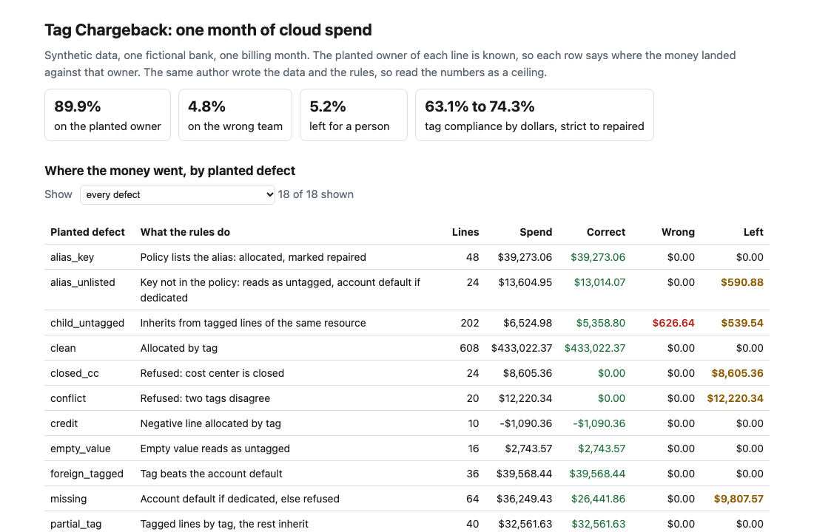
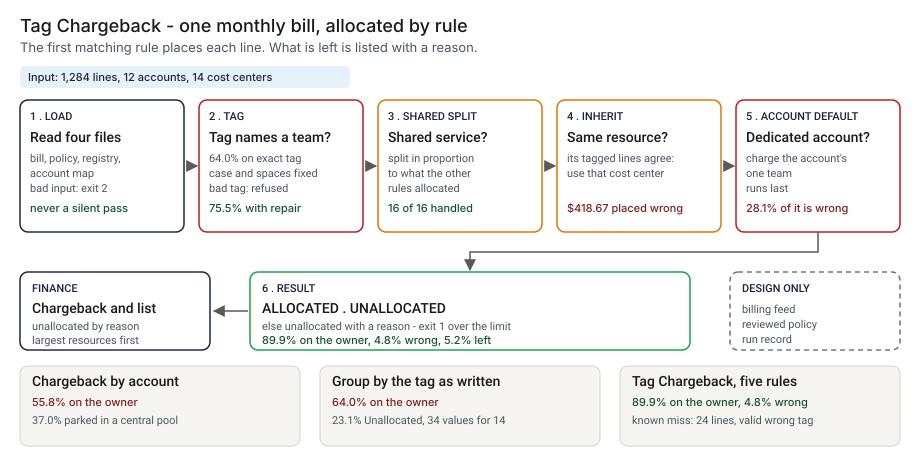
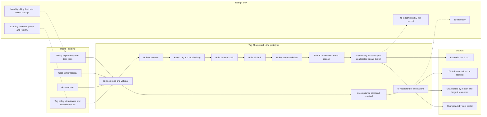
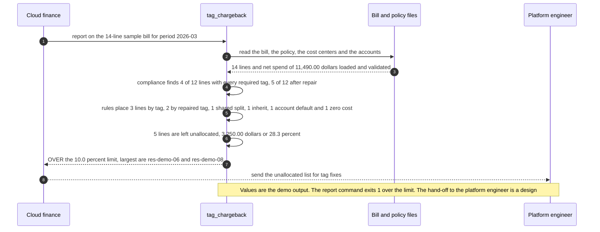

# 🏷️ Tag Chargeback: who pays for the cloud bill when the tags are typed by hand

**I wanted to know how much of a bank's monthly cloud bill can be charged to the team that caused it when the only evidence is tags that people typed, and what a tag check cannot see. This is a command-line tool: it reads a billing export, a cost-center registry, an account map and a tag policy, allocates each line by rule, reports tag compliance, and lists the spend nobody owns. It exits 1 when too much is unowned.** It extends the idea of per-owner spend attribution from [07 InferenceLens](../07-inferencelens-inference-finops/), which attributes inference cost to features; the code and the data here are new.

**▶ Static demo, no install:** [open demo.html](./demo.html)

[](./demo.html)

## Executive summary (90 seconds)

**Problem.** The person in cloud finance who produces the monthly chargeback, and the platform engineer who is asked to fix the tags, share one problem: a cloud bill arrives by account and by service, and the only evidence of who owns a line is a tag someone typed. A report that groups by the tag as written looks complete and leaves money with no one to bill. 🟢 On a synthetic month of 1,284 lines and $781,113.30 of net spend, chargeback by account puts 55.8% on the planted owner and 7.2% on another team, and parks 37.0% in a central pool (`step_01_no_allocation.py`). Grouping by the tag as written gives 34 distinct values for a registry of 14; 64.0% reaches the owner, 9.2% sits in buckets that are not cost centers and 23.1% is "Unallocated" (`step_02_exact_tag_report.py`).

**Product.** Tag Chargeback is a command that reads a billing export, a cost-center registry, an account map and a tag policy, and allocates each line by rule, first match wins. `zero_cost`: a line that costs nothing has nothing to allocate. `tag`: the cost-center tag, or a listed alias, names an active cost center; case and spaces are repaired and reported as `tag_repaired`, and a tag that is present but unknown, closed or contradictory is refused and never overridden by a later rule. `shared_split`: a listed shared service is split in proportion to what the other rules allocated. `inherit`: the same resource has tagged lines that agree. `account_default`: the account is dedicated to one active cost center. Otherwise the line is unallocated with a reason. It reports tag compliance twice, strict and after repair, lists the unallocated spend by reason, and exits 1 when the unallocated share is above the limit and 2 for malformed input. Money is held in integer millionths of a dollar, so allocated plus unallocated equals the bill. There is no model call.

**Measured and modeled performance.**

- 🟢 **Chargeback by account: 55.8% of net spend on the planted owner,** 7.2% on another team, 37.0% in a central pool with no owner (`step_01_no_allocation.py`).
- 🟢 **Grouping by the tag as written: 64.0% on the owner,** 3.7% on another cost center, 9.2% in phantom buckets and 23.1% "Unallocated" (`step_02_exact_tag_report.py`).
- 🟢 **Each rule adds correct spend:** exact tag 64.0%, alias and format repair 75.5%, inherit from the same resource 78.2%, account default 83.6%, shared split 89.9% (`step_03_deficiencies_exposed.py`).
- 🟢 **The full tool puts $702,526.86 (89.9%) on the planted owner,** $37,705.69 (4.8%) on the wrong team and leaves $40,880.75 (5.2%) for a person, inside the 10.0% limit; allocated plus unallocated equals the bill to the cent (`step_04_with_tool.py`).
- 🟢 **Coverage costs accuracy:** wrong spend rises from 3.7% to 4.8%, and the account default places $59,311.25, of which $16,668.39 (28.1%) belongs to another team (`step_02_exact_tag_report.py`, `step_03_deficiencies_exposed.py`).
- 🟢 **Known misses:** 24 lines ($20,618.63) carry a valid tag for the wrong cost center and are charged as tagged, and 36 lines ($16,460.42) belong to another team's untagged resource inside a dedicated account (`step_04_with_tool.py` prints each).
- 🟡 **Utility: (89.9% − 64.0%) × $10,000,000 = $2,590,000 a year of cloud spend placed on the owner that a plain tag report would not,** assuming $10,000,000 of annual cloud spend goes through the chargeback.
- 🔴 **Design target: a monthly allocation of a 100-million-line export within 30 minutes.** Designed in [`ARCHITECTURE.md`](./ARCHITECTURE.md), never built or timed.

**What I would ask a head of operations to decide.** Whether untagged spend should be charged to an account's default team at all, knowing that 28.1% of what that rule places belongs to another team here. My recommendation is to adopt allocation by rule with the refuse-a-bad-tag policy, run it next to the existing chargeback for one real month before it replaces anything, and treat the account default as the first rule to switch off if wrong-team charges cost more than unallocated spend. The 10.0% limit and the proportional split of shared services are my choices.

**Call to action.** Fork the repo. Swap `data/billing_export.csv`, `cost_centers.csv`, `accounts.csv` and `policy.json` for your own and keep the columns, and name your own tag keys and aliases in the policy. Run `report` on one billing month at a time. To call it from code, import `load_bill`, `load_policy`, `load_cost_centers`, `load_accounts` and `allocate` from `src/tag_chargeback.py`. Send findings by opening an issue: say which rule placed which kind of line, not the bill.

_A portfolio prototype on synthetic data. Nothing here is deployed, load-tested or used by anyone, and it has not been run on a real bill._

## Run one now

```bash
cd 71-tag-chargeback/src && python3 tag_chargeback.py --demo
```

It reads a 14-line sample bill and prints:

```text
bill: example_bill.csv   14 lines   period 2026-03   net spend $11,490.00
tag compliance: 4 of 12 lines that need tags carry every required tag (2 exempt: zero cost or shared service)
  after alias and format repair: 5 of 12; by dollars 24.8% strict, 59.1% repaired
allocation by rule      lines             usd    share
  tag                       3       $1,900.00    16.5%
  tag_repaired              2       $4,300.00    37.4%
  shared_split              1       $1,000.00     8.7%
  inherit                   1         $140.00     1.2%
  account_default           1         $900.00     7.8%
  zero_cost                 1           $0.00     0.0%
  unallocated               5       $3,250.00    28.3%
unallocated by reason   lines             usd
  no_owner_found            2       $1,150.00
  closed_cost_center        1       $1,100.00
  conflicting_tags          1         $700.00
  unknown_cost_center       1         $300.00
largest unallocated resources
  res-demo-06                  $1,100.00  closed_cost_center
  res-demo-08                    $700.00  conflicting_tags
  res-demo-05                    $650.00  no_owner_found
  res-demo-10                    $500.00  no_owner_found
  res-demo-07                    $300.00  unknown_cost_center
chargeback        direct  inherited  acct default     shared          total
  CC-1001      $1,100.00      $0.00         $0.00    $151.93      $1,251.93
  CC-1002        $800.00      $0.00         $0.00    $110.50        $910.50
  CC-1003          $0.00      $0.00       $900.00    $124.31      $1,024.31
  CC-1004      $2,500.00    $140.00         $0.00    $364.64      $3,004.64
  CC-1005      $1,800.00      $0.00         $0.00    $248.62      $2,048.62
result: unallocated 28.3% of net spend, limit 10.0%: OVER
```

Standard library only, Python 3.9 or newer. For your own export:

```bash
python3 tag_chargeback.py report bill.csv --policy policy.json --cost-centers cost_centers.csv \
  --accounts accounts.csv --max-unallocated-pct 10 --chargeback-csv chargeback.csv --lines-csv lines.csv
```

It exits 1 above the limit, so a pipeline step can fail on it, and 2 for malformed input with one line on stderr. `--format github` prints annotations; bill text is escaped before it is echoed. That path has not run on GitHub. The column layout is in [`data/README.md`](./data/README.md).

## What the numbers say

**What it shows** (🟢 measured on synthetic data: 1,284 billing lines, 12 accounts and 14 cost centers for one month; the script is named in brackets):

- 🟢 Chargeback by account puts $435,971.77 (55.8% of net spend) on the planted owner and $56,251.32 (7.2%) on another team, and parks $288,890.21 (37.0%) in a central pool (`step_01`)
- 🟢 Grouping by the tag as written gives 34 distinct values for a registry of 14, 20 of them not registry ids; $499,835.82 (64.0%) reaches the owner, $71,586.46 (9.2%) sits in buckets that are not cost centers and $180,467.03 (23.1%) is "Unallocated" (`step_02`)
- 🟢 Each rule adds correct spend: exact tag 64.0%, alias and format repair 75.5%, inherit from the same resource 78.2%, account default 83.6%, shared split 89.9% (`step_03`)
- 🟢 The full tool puts $702,526.86 (89.9%) on the planted owner, $37,705.69 (4.8%) on the wrong team and leaves $40,880.75 (5.2%) for a person; allocated plus unallocated equals the bill to the cent (`step_04`)
- 🟢 Tag compliance is 630 of 1244 lines written exactly (63.1% of dollars) and 694 of 1244 after alias and format repair (74.3%) (`step_04`)
- 🟢 Hard negatives handled correctly: 24 of 24 zero-cost untagged lines, 16 of 16 shared-service lines, 10 of 10 credit lines, 36 of 36 lines of resources tagged for their own team inside another team's account, 56 of 56 tags in another case or with spaces (`step_04`)

## What it still gets wrong

- 🟢 24 lines ($20,618.63) carry a valid tag for the wrong cost center. The tool charges all of them as tagged, and 20 of 24 pass the tag compliance check. This is the known limit left in on purpose (`step_03` prints it).
- 🟢 36 lines ($16,460.42) belong to an untagged resource of one team inside another team's dedicated account, so the account default charges the wrong team. The default placed $59,311.25 in all, and $16,668.39 (28.1%) of that belongs to another team (`step_03`). It runs last for that reason.
- 🟢 Coverage costs accuracy. The plain tag report charged $29,223.99 (3.7%) to the wrong cost center; the tool charges $37,705.69 (4.8%). It finds an owner for far more spend and is wrong about more of it (`step_02`, `step_04`).
- 🟢 24 lines use a key the policy does not list: $13,014.07 is recovered by the account default and $590.88 is left. 16 lines ($1,731.48) have the hyphen dropped from the value and are all left (`step_04`).
- 🟢 What is left for a person: conflicting_tags $12,362.31, no_owner_found $10,431.25, unknown_cost_center $9,320.29, closed_cost_center $8,766.90 (`step_04`). A present tag that is bad is refused, not overridden by the account default, so these need a human.
- **The data and the rules share an author.** I planted the defects and wrote the rules, so 89.9% is a ceiling for these rules on this mix, not a rate on a real bill. The mix itself is my guess. Four planted kinds are hard on purpose, and the rules miss all of them.
- Not covered: bills that span months, commitment amortization, tags on resources that bill under another resource id, and any cost center hierarchy. Matching ignores case and spaces and nothing else.

## Modeled and hypothetical

- 🟡 The required tags (`cost-center`, `app`, `env`), the alias spellings, the 10.0% unallocated limit and the proportional split of shared services are my choices. Change them in `data/policy.json`; the split basis changes who pays the shared pool.
- 🔴 Whether a real bank's tag errors look like this mix is hypothetical. I have not run this on a real bill.

## How the four steps fit

| Step | Question | Script |
|---|---|---|
| 1 | What does chargeback by account give today? | `step_01_no_allocation.py` |
| 2 | What does a report grouped by the tag as written give? | `step_02_exact_tag_report.py` |
| 3 | What does each rule add, and what does the account default cost? | `step_03_deficiencies_exposed.py` |
| 4 | What does the whole tool do, including the hard cases? | `step_04_with_tool.py` |

Run any of them from `src/`. Data is generated by [`data/_generate.py`](./data/README.md); `tools/check_repo.py` confirms that a rerun reproduces every file and that the green numbers above appear in a script's output. `python3 _build_demo.py` rebuilds the page from `src/out/`.

## Utility delivered

The way I price product impact: **utility = (my solution − current state of the art) × the number of people or items it affects.**

Here the item is a dollar of net cloud spend that has to land on the team that caused it. Each dollar lands on a cost-center owner who is charged for it, the cloud finance lead who has to defend the number, and the platform engineer who gets asked about the leftovers. The common basic approach is a report grouped by the tag as written; the table prices the tool against it.

| Term | Value | Where it comes from |
| --- | --- | --- |
| Current state of the art (group by the tag as written), spend on the planted owner | 🟢 **$499,835.82 (64.0%)** | `step_02_exact_tag_report.py`; it also puts 9.2% in buckets that are not cost centers and 23.1% in "Unallocated" |
| My solution (Tag Chargeback), spend on the planted owner | 🟢 **$702,526.86 (89.9%)** | `step_04_with_tool.py`; $37,705.69 (4.8%) lands on the wrong team and $40,880.75 (5.2%) is left for a person |
| Lift per dollar of net spend | 🟢 89.9% minus 64.0% | The cost is accuracy: wrong spend rises from 3.7% to 4.8% (`step_02_exact_tag_report.py`, `step_04_with_tool.py`) |
| Number it affects: annual cloud spend that goes through the chargeback | 🟡 **$10,000,000** | **Assumption, not a statistic.** Replace it with your own annual spend in scope |
| Assumption that makes the lift real | 🟡 Real tag errors look like the planted mix, and a person clears what is left | The mix is my guess: 608 of 1,284 lines are clean (`data/README.md`). If real tags are cleaner the lift shrinks. A real bill has no truth file, so the lift here is measured against planted owners |
| **Utility** | 🟡 **(89.9% − 64.0%) × $10,000,000 = $2,590,000 a year of cloud spend placed on the owner that a plain tag report would not** | Assumes the real bill behaves like the planted one |

Sensitivity to the spend assumption (🟡, same lift): $5,000,000 a year gives $1,295,000, $10,000,000 gives $2,590,000, $20,000,000 gives $5,180,000.

🔴 What I have not measured: what a wrong-team charge costs in disputes, how long a person takes to clear the unallocated list, how much of a real bill carries clean tags, or whether the planted tag defects resemble a real bank's. The planted set is dense in defects on purpose, 608 of 1,284 lines are clean (`data/README.md`); a real bill may be cleaner or dirtier. Treat the result as a property of this mix of cases, not a forecast.

---

## Architecture and call flow

Component names match [`ARCHITECTURE.md`](./ARCHITECTURE.md). GitHub renders the diagrams natively.



**System topology:**



**Per-run sequence** (the `--demo` run, the 14-line sample bill):



**Interlocks (all red, designed, none built):**

- [07 InferenceLens](../07-inferencelens-inference-finops/) is where the idea of per-owner spend attribution comes from, for inference cost by feature. This folder does not import or read its files.
- [12 ValueLedger](../12-valueledger-ai-benefit-tracking/) is the benefit side; the cost-center totals from this tool would be its cost side.
- [24 PortfolioBoard](../24-portfolioboard-ai-program-portfolio/) is where a program's allocated cloud cost would appear in a portfolio view.
- [09 LineageLog](../09-lineagelog-ai-decision-audit/) is a possible home for the monthly run record (`tc-ledger`).

---

## PM artifacts

The PM artifacts that show how I would run this product if I owned the seat. This README is the walkthrough; the rest of the folder holds:

- [`PRD.md`](./PRD.md): the product requirements doc, with users, backlog, KPIs, rollout and open questions.
- [`ARCHITECTURE.md`](./ARCHITECTURE.md): the systems doc, with components, data model, security, failure behavior and operations. A design, not deployed.
- [`demo.html`](./demo.html): clickable, no-install walkthrough, built from the step outputs by `src/_build_demo.py`.
- [`data/`](./data/): the synthetic billing export, the planted truth, the registry, the account map, the policy and the seeded generator. `data/README.md` explains how the truth is set.
- [`src/`](./src/): `tag_chargeback.py`, `common.py`, the four step scripts and the demo builder.
- [`tests/`](./tests/): 42 unittest tests, including a golden test that pins the numbers above and tests for bad input and hostile strings.

Run the four steps end to end:

```bash
cd src
python3 step_01_no_allocation.py
python3 step_02_exact_tag_report.py
python3 step_03_deficiencies_exposed.py
python3 step_04_with_tool.py
```

---

## Aligned to

Nothing published. I did not read a standard or a regulation for this project, so I claim no alignment. It is a prototype on synthetic data. It makes no claim of conformity to any standard or regulation.

## Data and limits

Synthetic, seeded, byte-for-byte reproducible. Nothing comes from any employer, customer or real cloud account. A prototype on synthetic data, not a production case study. The [PRD](./PRD.md) holds the scope.

## Fork it

Swap `data/billing_export.csv`, `cost_centers.csv`, `accounts.csv` and `policy.json` for your own and keep the columns. Name your own tag keys and aliases in the policy. Without a truth file, steps 1 to 4 will not run; the `report` command does not need one.

## Prereqs to run this on your laptop

You need Python 3.9 or newer and nothing else. The tool, the four step scripts and the data generator use only the standard library, so there is nothing to install. There is no API key, no network call and no model call anywhere in the folder. To run the tests, use `python3 -m unittest discover -s tests` from this folder. The production pieces in [`ARCHITECTURE.md`](./ARCHITECTURE.md) (the billing feed, the reviewed policy, the run record, telemetry) are a design, not something you need or can run.

## Author

**Vijay Saharan**, Sr Product / Program Manager · AI in BFSI · Enterprise AI Platforms

[LinkedIn](https://www.linkedin.com/in/vijaysaharan/)
