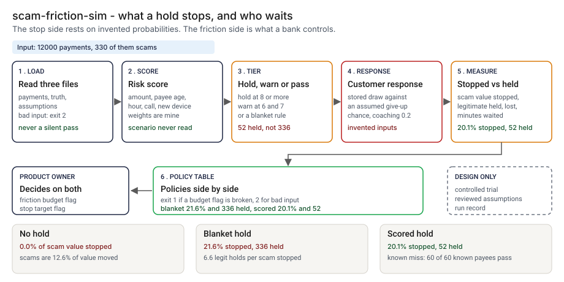

# Architecture: scam-friction-sim

> **Status.** This is the design for a production shape. The repo implements the product mechanic as a prototype: a simulator, `src/scam_friction_sim.py`, that replays 12000 synthetic payments against a hold policy and prints the scam value stopped next to the legitimate payments held, lost and delayed. Every customer response is an invented assumption. There is no model, no payment rail and no real customer. Nothing below is claimed as deployed or load-tested. Where a figure is a design target, it says so.

GCP is primary; AWS and Azure sit beside it.



---

## 1. Logical architecture

The simulator is an offline replay: a labeled payment history, a set of named assumptions and a policy in, a table of policies out. It does not sit in a payment path, call a model or decide whether a hold is permitted.

Eight components: four decide the outcome, four support or report.

| Component | Responsibility | Language or framework | Decides the outcome? | Stateful? |
| --- | --- | --- | --- | --- |
| `sf-ingest` | Loads payments, truth and assumptions. Rejects an empty file, a missing column, a wrong type, a duplicate or unmatched `payment_id`, a draw outside 0 to 1, an unknown key or an undefined scenario. | Python 3.9+, standard library. Prototype: `_read_csv`, `load_payments`, `check_assumptions`, `load_assumptions` in `src/scam_friction_sim.py` | Yes, by refusing: exit 2 | No |
| `sf-tier` | Scores a payment from its features alone and maps it to PASS, WARN or HOLD under a policy. It never reads the scenario. | Python. Prototype: `risk_score`, `WEIGHTS`, `policy_none`, `policy_blanket`, `policy_score`, `tier` | Yes | No |
| `sf-sim` | Decides what each customer does: a held scam payment is stopped when a stored draw falls under the assumed give-up probability, unless coaching cancels it; a held legitimate payment is lost under its own. | Python. Prototype: `simulate` | Yes | No |
| `sf-report` | Computes stopped value and friction, prints the policy table, and exits 1 when a budget flag is broken. | Python. Prototype: `metrics`, `policy_lines`, `demo_table`, `run_command` | Yes, as the exit code | No |
| `sf-policy` | Thresholds, score weights, friction budget and assumptions, each with an approver. | Reviewed files (design). Prototype: `data/assumptions.json` and the `run` flags | No | Stateful, in git |
| `sf-trial` | Controlled-trial results that replace invented probabilities (design). | Object storage files (design) | No | Stateful |
| `sf-ledger` | One run record per policy run (design). Prototype analog: `src/out/step_04_summary.json`. | PostgreSQL plus object storage with a retention lock (design) | No | Stateful |
| `sf-telemetry` | Counts runs, rejections and broken budgets, off the decision path (design). | OpenTelemetry to the platform's monitoring | No | No |

**What decides the outcome.** The input check, the score and tiers, the response model and the budget flags. Policy files, trial results, the ledger and telemetry supply or record them. The truth file is read only to score an outcome, never to choose a tier.

**Repo structure** (production shape):

```
scam-friction-sim/
├── sim/        # ingest.py, tier.py, simulate.py, report.py
├── policy/     # assumptions, thresholds, budgets, changed by pull request
├── trial/      # trial readout loader (design)
├── infra/      # terraform for gcp, aws, azure
└── tests/      # unit, golden, hostile strings
```

---

## 2. Physical and deployment architecture

One offline job in the fraud analytics project, where the sensitive payment histories already live.

| Component | GCP (primary) | AWS | Azure | Why |
| --- | --- | --- | --- | --- |
| Replay job (`sf-ingest` to `sf-report`) | Cloud Run job | ECS Fargate task | Container Apps job | Stateless, offline, no network needed |
| Labeled history and trial results | Cloud Storage, versioned, restricted project | S3, versioned | Blob Storage, versioned | The exact bytes a run used can be returned |
| `sf-policy` | Files in the repo | Same | Same | An assumption change lands in the same history as the code |
| `sf-ledger` | Cloud SQL for PostgreSQL | RDS for PostgreSQL | Azure Database for PostgreSQL | The platform team already runs it |
| `sf-telemetry` | OTel Collector to Cloud Monitoring | To CloudWatch | To Azure Monitor | Off the decision path |

**Failure behavior (the decision that matters most).** The simulator must never silently pass. A missing, empty or mistyped input ends the run with exit 2 and a one-line reason. A policy that holds nothing, or a file with no scams, says so in the output and is not printed as an empty success. A broken budget exits 1.

| Failure | Behavior | Alert |
| --- | --- | --- |
| Payments or truth file missing, empty, header only, truncated, extra values, wrong type, duplicate or unmatched `payment_id`, a draw outside range | Exit 2 naming the payment or line | P3 |
| Truth names a scam scenario the assumptions do not define; assumptions unreadable, unknown key, probability outside 0 to 1 | Exit 2 with the reason | P3 |
| Policy holds nothing, or the file has no scams | The report says so | None |
| A budget flag is broken | Exit 1 with a `budget broken` line | P4 |
| Ledger or telemetry down (design) | The result and exit code stand; the record queues locally | P3 |

**Latency.** The prototype replays 12000 payments; I have not timed it. 🔴 Design target: a replay of 50 million labeled payments within 60 minutes.

**If a tier is ever called in the payment path** (design, only after a trial): a stateless service the payments platform calls. What happens when it fails is a decision for the payments owner and the reviewer. My recommendation is to fail open, because holding every payment is a blanket hold with worse friction, but never silently: the payment goes through marked unscreened, and the count is an SLI and an alert. 🔴 Design target: a tier within 50 milliseconds at the 99th percentile.

---

## 3. Data architecture

| Entity | Key | What it holds | Real columns in the prototype |
| --- | --- | --- | --- |
| Payment | `payment_id` | The features a bank can see at the moment of payment | `data/payments.csv`: `payment_id`, `amount`, `usual_amount`, `payee_age_days`, `hour`, `call_active`, `device_new` |
| Truth | `payment_id` | Whether it was a scam, the scenario and two stored draws | `data/truth.csv`: `payment_id`, `is_scam`, `scenario`, `u_abandon`, `u_evade` |
| Assumption set | version | Response probabilities, coaching, minutes, one entry per scam scenario | `data/assumptions.json`: `coach_rate`, `hold_minutes`, `legit_abandon_on_hold`, `legit_abandon_on_warn`, `warn_factor`, `warn_minutes`, `scam_scenarios` |
| Run result | `run_id` | Policy, thresholds, assumption version, file hashes, the metrics (design adds hashes) | Prototype: `src/out/step_04_grid.csv`, `step_04_summary.json` |
| Trial result | arm, `payment_id` | Which hold length, whether the payment was released, abandoned or reported (design) | None |

**Retention** is a design choice; confirm each value against the bank's own schedule. 🔴 Design defaults: run records and assumption versions 7 years; the payment history a run used, as long as the evidence it supports, in the fraud analytics project only.

**Lineage.** The record names the file hashes, the assumption version, the policy and the tool version; the versioned store returns those files; and the run is deterministic (stored draws, no clock or random call, sorted output), so a re-run reproduces every column and two policies see the same customers. In the prototype the trace is a row of `step_04_grid.csv`.

**Deliberately not stored.** Customer identity, account numbers, payee names and message text. The simulator needs seven features and a pseudonymous `payment_id`.

---

## 4. Security architecture

**Identity and roles.** The job runs under the fraud analytics project's workload identity and has no user account of its own.

| Role | Can | Maps to |
| --- | --- | --- |
| `sf:runner` | Read a history and a policy, write a run record | The job identity |
| `sf:analyst` | Start a run, read results | Fraud analyst |
| `sf:approver` | Approve an assumption set, a threshold or a budget, never their own | Second-line reviewer |
| `sf:auditor` | Read run records and policy history | Internal audit |
| `sf:admin` | Manage roles, buckets and the ledger | Platform engineering lead |

**Secrets.** The simulator holds none and calls no model or rail. Storage and ledger access is by workload identity.

**Data classification and what leaves the boundary.** A history joined to fraud labels is restricted. In the prototype nothing leaves the machine and every payment is synthetic. In the design two things leave the job: the policy table and a run record, neither holding a payment row.

| Threat | Example | Mitigation in the design |
| --- | --- | --- |
| Hostile payment id, scenario or path echoed into a message | An id holding a newline and text that looks like a workflow command | `clean` writes control characters as escapes and caps a field at 60 characters. `tests/test_cli.py` covers a hostile id, scenario and path, and that output never carries an untrusted id |
| Assumptions edited to flatter a policy | `p_abandon` raised until the stop side looks good | Reviewed assumption set with a different approver; every run record stores the version; a report prints its assumption source |
| A stop rate quoted as a finding | A stopped percentage repeated without its assumptions | The README states the stop side is invented, and a sensitivity sweep travels with any quoted number |
| The labeled history copied outside the boundary | A file sent for a second opinion | The job runs in the restricted project with no network, and outputs carry aggregates only |

---

## 5. Operational architecture

**SLIs.** Legitimate payments held, lost and waiting minutes per policy (prototype baseline: 🟢 52 of 11670 (0.4%) held with the scored hold, `step_04_scored_hold.py`); holds per scam payment stopped; broken budgets; input rejections; the source of each assumption set, belief or trial; run time. In an in-path design, add payments passed unscreened.

**SLOs (all 🔴 design targets, none measured).**
- A replay of 50 million labeled payments within 60 minutes.
- Every quoted stop rate carries its assumption set and a sensitivity sweep.
- A tier within 50 milliseconds at the 99th percentile, if one is ever put in the payment path.

**Alerts.** P2: payments passing unscreened in an in-path design. P3: repeated input rejections, or a ledger gap. P4: a digest of runs that broke a budget.

**Runbooks** (one page each, in `docs/runbooks/`):
- `changing-the-assumptions.md`: propose, re-run the planted set, compare with the golden numbers, approve.
- `budget-broken.md`: read which budget, compare the policy table, change the threshold or the budget.
- `trial-readout.md`: load the trial results, replace the invented probabilities, re-run every policy.
- `switching-the-hold-off.md`: fall back to no hold or the blanket rule (design).

**On-call and ownership.** The payments product owner owns the job and the runbooks. The fraud operations lead owns the friction budget. The second-line reviewer approves assumption sets and budgets. Legal counsel approves any live hold.

**Change control.** Assumptions, thresholds and weights are versioned in the repo. A change needs a different approver, and the planted set is re-run against the pinned numbers in `tests/test_golden.py` before merge, so a change that moves a column shows in the diff. Rollout is replay, calibration, then a controlled trial, as the PRD lays out.

---

## 6. Alignment and posture

Alignment, not certification. The README's "Aligned to" section cites one source, restated with the same wording about what was read: Vice Chair for Supervision Michelle Bowman's speech on consumer fraud, ["A Coordinated Approach to Consumer Fraud Protection"](https://www.federalreserve.gov/newsevents/speech/bowman20260505a.htm), Federal Reserve Board, 2026-05-05 (read 2026-10-24). It treats fraud as a banking-system problem and describes a customer who goes ahead with a fraudulent transfer despite a bank employee's concern. I found no discussion of holding payments, hold lengths or customer friction in it, so the project borrows no parameter from it.

- **What the design does.** It tests one mechanism a bank might use in that situation and shows what it costs the customers who were not being scammed.
- **What it does not claim.** It makes no claim of conformity to that guidance. I read no rule that sets or limits a hold on a real-time payment and cite none, so nothing here says a 20-minute hold is permitted or advisable on any rail.

---

## 7. What is deliberately not here

- **A real stop rate.** Every probability is an assumption. 🟢 The blanket rule moves from 15.5% to 31.3% as the give-up probabilities are scaled by 0.5 and 1.5 (`step_03_deficiencies_exposed.py`).
- **A hold-length curve.** 🟢 Five, 20 and 60 minutes all stop 21.6% because the model says so (`step_03_deficiencies_exposed.py`). A real trial has to answer it.
- **A realistic share of scams.** 330 in 12000 is far above any real share, and the ratio of holds to stops scales with it.
- **Scams to a payee the customer has paid before.** 🟢 144 of 330 scam payments get neither a hold nor a warning, including all 60 to an established payee (`step_04_scored_hold.py`).
- **Behavior after the hold.** Repeat attempts, a payment moved to another rail, support calls, a scammer who adapts, recovery after money has left, and the cost of a scam beyond its dollars.
- **A fitted score.** The weights are mine, and the data and the rules share an author, so the numbers are a ceiling.
- **A permission to hold.** No rule on holding a real-time payment was read.
- **Model calls and hosting.**

---

## Appendix: sample contract

The bundled `--demo` run is under "Run one now" in the README.

```bash
python3 scam_friction_sim.py run --payments p.csv --truth t.csv --policy score --hold-score 8 --warn-score 6 --assumptions a.json --max-held-pct 0.5
```

`p.csv` has `payment_id`, `amount`, `usual_amount`, `payee_age_days`, `hour`, `call_active`, `device_new`; `t.csv` has `payment_id`, `is_scam`, `scenario`, `u_abandon`, `u_evade`. `a.json` carries the keys in `data/assumptions.json`. Exit: 0 inside any budget, 1 when `--max-held-pct` or `--min-stopped-pct` is broken, 2 for malformed input.
