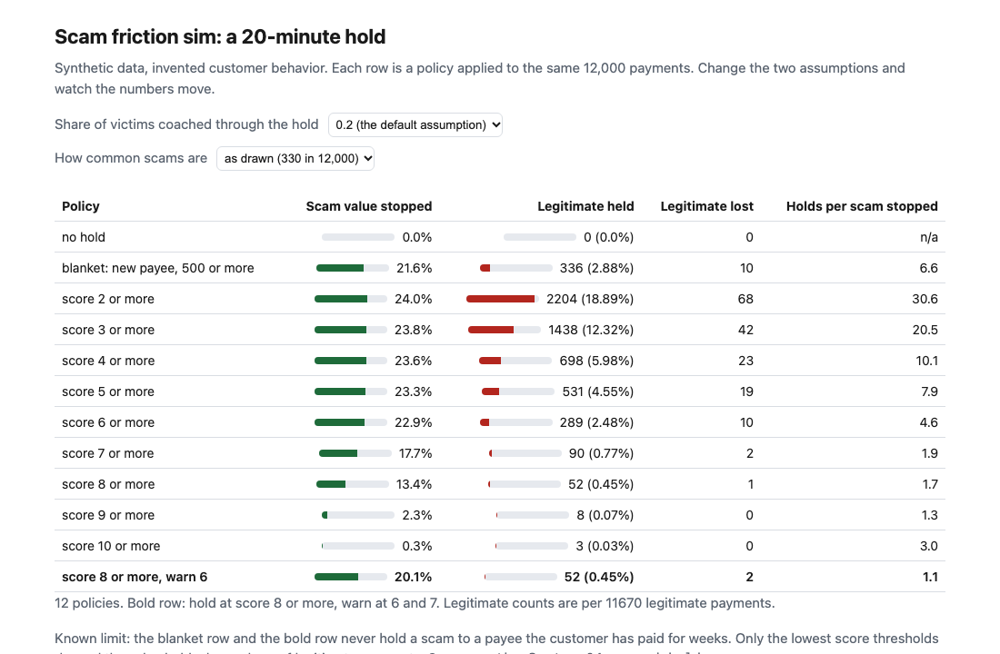
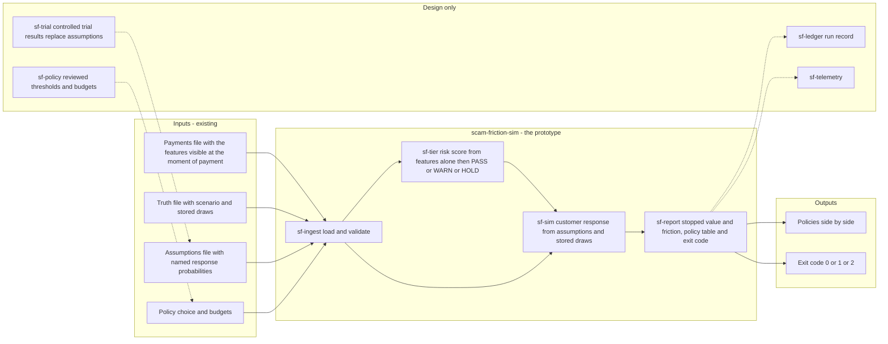
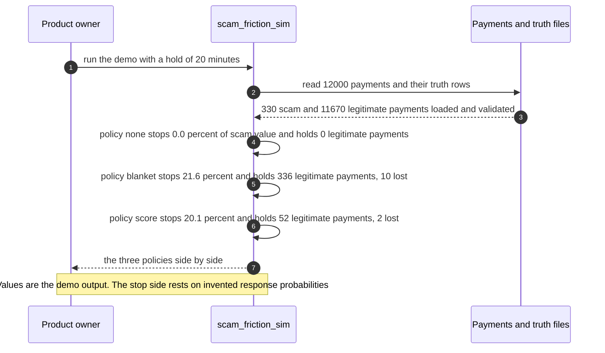

# ⏳ scam-friction-sim (real-time payments): what a 20-minute hold stops, and who waits

**I wanted to know what holding a suspicious real-time payment for 20 minutes would actually do: how much scam value it stops, and how many people who did nothing wrong have to wait for it. This is a small simulator with named assumptions. It replays 12,000 synthetic payments against a hold policy and prints both columns side by side. The stop side rests on what a held victim does, which I had to invent; the friction side is the part a bank controls, and it is where a blanket rule and a scored rule differ most.**

**▶ Static demo, no install:** [open demo.html](./demo.html)

[](./demo.html)

## Executive summary (90 seconds)

**Problem.** A payments product owner is deciding whether to build a hold on suspicious real-time payments, and a reviewer has to say how many legitimate customers it will touch. Teams usually price the stop side with a made-up stop rate and leave the friction side to a complaints report. 🟢 On 12000 synthetic payments, 330 of them scams, the scams are worth $403,678 of the $3,202,027 moved (12.6%); with no hold, none is stopped and nobody waits (`step_01_no_hold.py`). The rule most teams start with, a hold on every first payment to a new payee of 500 or more, stops 21.6% of scam value and holds 336 of 11670 legitimate payments (2.9%), 10 of whose customers give up (`step_02_blanket_hold.py`).

**Product.** scam-friction-sim is a simulator that replays a file of payments against a hold policy and prints both columns side by side. Each payment gets a tier from its features alone: PASS, WARN (an in-app warning, no wait) or HOLD (wait 20 minutes). The policies are none, a blanket hold, and a scored hold that holds at 8 or more and warns at 6 and 7, from a risk score whose weights are mine and not fitted. A held scam payment is stopped when the customer gives up, decided by a stored draw against an assumed probability for that scenario, unless a scammer in touch with the victim has coached them through the hold. A held legitimate payment is abandoned with an assumed probability of 0.03. Every response is a named assumption in a JSON file. It exits 1 when a friction budget or a stop target is broken and 2 for malformed input. There is no model call.

**Measured and modeled performance.**

- 🟢 **The ceiling comes from the customers, not the rule:** holding every payment would stop 29.7% of scam value with no coaching and 24.0% with coaching at 0.2 (`step_03_deficiencies_exposed.py`).
- 🟢 **The stop side moves with the invented probabilities:** scaling the give-up probabilities by 0.5, 1 and 1.5 gives 15.5%, 21.6% and 31.3% of scam value stopped for the blanket rule (`step_03_deficiencies_exposed.py`).
- 🟢 **Scams are far more common here than in life:** at one-tenth as common the blanket rule holds 65.9 legitimate payments per scam payment stopped, and at one-hundredth, 658.8 (`step_03_deficiencies_exposed.py`).
- 🟢 **Scored hold: 20.1% of scam value stopped against 21.6%,** with 52 legitimate payments held against 336, 2 lost against 10, and legitimate holds per scam payment stopped down from 6.6 to 1.1 (`step_04_scored_hold.py`).
- 🟢 **At near-equal friction the gain in value stopped is small:** holding only, at 289 legitimate payments held, the scored rule stops 22.9%, so most of the gain is the cut in friction (`step_04_scored_hold.py`).
- 🟢 **Known miss: 144 of 330 scam payments get neither a hold nor a warning** ($72,204), including all 60 payments to a payee the customer has paid before (`step_04_scored_hold.py`).
- 🟡 **Utility: (336/11670 − 52/11670) × 1,000,000 = 24,336 legitimate payments a year not held,** assuming 1,000,000 legitimate payments a year reach the screen. It prices the friction only.
- 🔴 **Design target: a replay of 50 million labeled payments within 60 minutes.** Designed in [`ARCHITECTURE.md`](./ARCHITECTURE.md), never built or timed.

**What I would ask a head of operations to decide.** Whether to build a hold at all, and if so, which payments it touches and what share of legitimate payments the bank will accept holding. I would decide on the friction column, because it is the part a bank controls, and treat every stopped percentage here as a placeholder. My recommendation is to adopt the scored hold with a warning band over the blanket rule, set the friction budget against the bank's own tolerance (0.5% here is my assumption), and run a controlled trial on one rail with the hold length as the variable before quoting any stop rate.

**Call to action.** Fork the repo. Replace `data/assumptions.json` with your own beliefs and rerun any step, or swap `data/payments.csv` and `data/truth.csv` for your own labeled history and keep the columns; the truth file needs an explicit `scenario` column for scams. To call it from code, import `load_payments`, `load_assumptions`, `policy_score` and `simulate` from `src/scam_friction_sim.py`. Send findings by opening an issue: say which policy and which scenario, not payment data.

_A portfolio prototype on synthetic data with invented customer behavior. Nothing here is deployed, load-tested or used by anyone, and no stopped percentage is a finding._

## Run one now

```bash
cd 72-scam-friction-sim/src && python3 scam_friction_sim.py --demo
```

It prints:

```text
payments: 12000 (330 scam, 11670 legitimate); hold 20 minutes
  none (no hold)                             stopped   0.0% of scam value, legit held    0 (0.0%), legit lost 0
  blanket (new payee, amount >= 500)         stopped  21.6% of scam value, legit held  336 (2.9%), legit lost 10
  score (hold >= 8, warn >= 6)               stopped  20.1% of scam value, legit held   52 (0.4%), legit lost 2
```

Standard library only, Python 3.9 or newer. To score your own files: `python3 scam_friction_sim.py run --payments p.csv --truth t.csv --policy score --hold-score 8 --warn-score 6 --assumptions a.json`. It exits 1 when `--max-held-pct` or `--min-stopped-pct` is broken, and 2 for malformed input.

## What the numbers say

**What it shows** (🟢 measured on synthetic data: 12000 payments, 330 of them scams; the script is named in brackets):

- 🟢 With no hold, the 330 scam payments are worth $403,678 of the $3,202,027 moved (12.6%), none is stopped and nobody waits (`step_01`)
- 🟢 A blanket hold on every first payment to a new payee of 500 or more stops 21.6% of scam value ($87,222 of $403,678) and holds 336 of 11670 legitimate payments (2.9%); 10 of those customers give up and 6720 minutes are spent waiting, or 6.6 legitimate holds for every scam payment stopped (`step_02`)
- 🟢 The blanket rule holds 262 of the 330 large legitimate first payments, which is the hard negative that makes it noisy (`step_02`)
- 🟢 Holding every payment would stop 29.7% of scam value with no coaching and 24.0% with coaching at 0.2, so the ceiling comes from what held victims do and not from the rule (`step_03`)
- 🟢 Scale the assumed give-up probabilities by 0.5, 1 and 1.5 and the same blanket rule stops 15.5%, 21.6% and 31.3% of scam value; coaching at 0, 0.2, 0.5 and 0.8 gives 26.2%, 21.6%, 15.5% and 9.4% (`step_03`)
- 🟢 If scams are one-tenth as common the blanket rule holds 65.9 legitimate payments per scam payment stopped, and at one-hundredth, 658.8 (`step_03`)
- 🟢 A scored hold (hold at 8 or more, warn at 6 and 7, chosen by a 0.5% friction budget) stops 20.1% of scam value, holds 52 legitimate payments and loses 2, against 21.6%, 336 and 10 for the blanket rule; legitimate holds per scam payment stopped fall from 6.6 to 1.1 (`step_04`)
- 🟢 Holding only, at the blanket rule's friction (289 legitimate payments held, score 6 or more), the scored rule stops 22.9% of scam value, so at near-equal friction (289 held against 336) the gain in value stopped is small, and the gain is mostly the cut in friction (`step_04`)
- 🟢 The scored rule holds 51 of the 330 large legitimate first payments, against 262 (`step_04`)
- 🟢 Under coaching at 0.5 the scored rule stops 14.2% and the blanket rule 15.5%; at 0.8, 8.3% and 9.4%. With scams one-tenth as common, the scored rule holds 10.8 legitimate payments per scam payment stopped, against 65.9 (`step_04`)

**What I assumed** (🟡 modeled: the values are invented and named in [`data/assumptions.json`](./data/README.md); the print-out of step 1 lists them):

- 🟡 A held victim gives up with probability 0.4 for a coached live scam, 0.1 for a slow-burn one, 0.35 for an account takeover (the owner sees the hold) and 0.15 for a payment to an established payee
- 🟡 A scammer in touch with the victim has coached them through the hold in 0.2 of cases; a held legitimate payment is abandoned in 0.03; a warning has 0.3 of a hold's effect
- 🟡 The 20 minutes comes from the project idea; the stop probability does not depend on length

**What I could not know** (🔴 hypothetical):

- 🔴 That a real hold changes a real victim's mind at any of these probabilities. I have no data on it, and the whole stop side depends on it

## What it still gets wrong

- 🟢 144 of 330 scam payments get neither a hold nor a warning from the scored rule ($72,204). All 60 payments to a payee the customer has paid before pass untouched, and the best score among them is 3; to hold half of them the threshold would drop to 1, which would hold 3973 of 11670 legitimate payments (34.0%) (`step_03`, `step_04`). That is the known miss, left in on purpose.
- **The test set and the rules share an author.** I planted the scenarios and wrote the score, so the result shows the rules cover what I planted. I included three hard negatives (large legitimate first payments, night payments from a new device, payments during a call) and one hard case (the established payee); the first are held more than I would like and the second is missed entirely. Treat the numbers as a ceiling for these rules, not a rate on real payments.
- **The stop side is invented.** Every probability is an assumption, and the sweeps above show the answer moves from 15.5% to 31.3% as they move. I would not quote any stopped percentage from this project as a finding.
- **The share of scams is far above any real share** (330 in 12000). The ratio of legitimate holds to scams stopped scales with it, which is why step 3 and step 4 print it at one-tenth as well.
- **No hold-length curve.** Five, 20 and 60 minutes stop the same share, because the model says so. Whether a shorter hold works as well is the question a real trial has to answer.
- Not modeled: repeat attempts after a release, a payment moved to another rail, support calls, a scammer who adapts to the hold, recovery after money has left, and the cost of a scam to the customer beyond its dollar value.
- I did not read any rule that sets or limits a hold on a real-time payment and I cite none. This project does not say a 20-minute hold is permitted or advisable on any rail.

## How the four steps fit

| Step | Question | Script |
|---|---|---|
| 1 | What passes when nothing is held, and what do the assumptions say? | `step_01_no_hold.py` |
| 2 | What does the rule most teams start with stop, and who does it hold? | `step_02_blanket_hold.py` |
| 3 | Where does that number stop being trustworthy? | `step_03_deficiencies_exposed.py` |
| 4 | What does a scored hold with a warning band change? | `step_04_scored_hold.py` |

Run any of them from `src/`. Data is generated by [`data/_generate.py`](./data/README.md); the check in `tools/check_repo.py` confirms that a rerun reproduces every file and that the green numbers above appear in a script's output. The scenario of each payment is drawn first and the rules never see it, so the labels do not come from the rules.

## Utility delivered

The way I price product impact: **utility = (my solution − current state of the art) × the number of people or items it affects.**

Here the item is a legitimate payment that reaches the hold screen. Each one belongs to a customer who is paying a solicitor or a seller and may have to wait 20 minutes or give up. The common basic approach is the blanket hold; the table prices the scored hold against it, on the friction side only. There is no measured lift on the stop side, because every stop probability is invented, so I do not price scam value stopped.

| Term | Value | Where it comes from |
| --- | --- | --- |
| Current state of the art (blanket hold), legitimate payments held | 🟢 **336 of 11670 (2.9%)** | `step_02_blanket_hold.py`; 10 give up and 6720 minutes are spent waiting |
| My solution (scored hold), legitimate payments held | 🟢 **52 of 11670 (0.4%)** | `step_04_scored_hold.py`; 2 give up and 1158.5 minutes are spent waiting |
| Lift per legitimate payment | 🟢 336 of 11670 minus 52 of 11670 | The price is 1.5 points of assumed scam value stopped: 21.6% down to 20.1% (`step_04_scored_hold.py`) |
| Number it affects: legitimate payments that reach the screen in a year | 🟡 **1,000,000** | **Assumption, not a statistic.** Replace it with your own count of legitimate payments a year in the screen's scope |
| Assumption that makes the lift real | 🟡 The score weights, which are mine and not fitted, separate real payments the way they separate the planted ones | The planted set holds 330 large legitimate first payments and the scored rule holds 51 of them against 262 (`step_04_scored_hold.py`). On real payments the weights could do worse |
| **Utility** | 🟡 **(336/11670 − 52/11670) × 1,000,000 = 24,336 legitimate payments a year not held** | Assumes the real legitimate payments behave like the 11670 planted ones |

Sensitivity to the count assumption (🟡, same lift): 100,000 payments a year gives 2,434, 1,000,000 gives 24,336, 10,000,000 gives 243,359.

🔴 What I have not measured: what a held legitimate payment costs a customer or the bank, how a real held victim behaves, what a hold does to complaints, or whether a hold is permitted on a real rail. The scam share is set far above a real share, 330 in 12000, which does not change the friction column but does change every ratio of holds to stops. Treat the result as a property of this mix of cases, not a forecast.

---

## Architecture and call flow

Component names match [`ARCHITECTURE.md`](./ARCHITECTURE.md). GitHub renders the diagrams natively.


**System topology:**



**Per-run sequence** (the `--demo` run):



**Interlocks (all red, designed, none built):**

- [08 OversightOps](../08-oversightops-hitl-workflow/) would be the place to review a held payment and release it, so a hold has a human path out. This folder models the wait, not the review.
- [25 KillSwitch](../25-killswitch-ai-fallback-drills/) is the pattern for switching the hold off at once and falling back to no hold or to the blanket rule.
- [17 FairLens](../17-fairlens-credit-model-fairness/) would ask who waits: whether the hold falls unevenly on groups of customers. The simulator has no customer group.
- [09 LineageLog](../09-lineagelog-ai-decision-audit/) is a possible home for the run record (`sf-ledger`).

---

## PM artifacts

The PM artifacts that show how I would run this product if I owned the seat. This README is the walkthrough; the rest of the folder holds:

- [`PRD.md`](./PRD.md): the product requirements doc, with users, backlog, KPIs, rollout and open questions.
- [`ARCHITECTURE.md`](./ARCHITECTURE.md): the systems doc, with components, data model, security, failure behavior and operations. A design, not deployed.
- [`demo.html`](./demo.html): clickable, no-install walkthrough, built from the step outputs by `src/_build_demo.py`.
- [`data/`](./data/): the synthetic payments, the planted truth and stored draws, the assumptions, and the seeded generator. `data/README.md` explains the planted scenarios and every assumption.
- [`src/`](./src/): `scam_friction_sim.py`, `common.py`, the four step scripts and the demo builder.
- [`tests/`](./tests/): 50 unittest tests, including a golden test that pins the numbers above and tests for bad input and hostile strings.

Run the four steps end to end:

```bash
cd src
python3 step_01_no_hold.py
python3 step_02_blanket_hold.py
python3 step_03_deficiencies_exposed.py
python3 step_04_scored_hold.py
```

---

## Aligned to

Vice Chair for Supervision Michelle Bowman's speech on consumer fraud, ["A Coordinated Approach to Consumer Fraud Protection"](https://www.federalreserve.gov/newsevents/speech/bowman20260505a.htm), Federal Reserve Board, 2026-05-05 (read 2026-10-24). It treats fraud as a banking-system problem and describes a customer who goes ahead with a fraudulent transfer despite a bank employee's concern. I found no discussion of holding payments, hold lengths or customer friction in it, so this project does not borrow a parameter from it. It tests one mechanism a bank might use in that situation. It is a prototype, aligned to that framing. It makes no claim of conformity to that guidance.

## Data and limits

Synthetic, seeded, byte-for-byte reproducible. Nothing comes from any employer, customer, payment rail or bank. A prototype on synthetic data with invented customer behavior, not a production case study. See [`data/README.md`](./data/README.md) for every assumption and the planted scenarios.

## Fork it

Replace `data/assumptions.json` with your own beliefs and rerun any step, or swap `data/payments.csv` and `data/truth.csv` for your own labeled history and keep the columns. The truth file needs an explicit `scenario` column for scams, and the stored draws can be any uniform numbers from 0 up to 1. Read the [PRD](./PRD.md) for the scope I held to.

## Prereqs to run this on your laptop

You need Python 3.9 or newer and nothing else. The simulator, the four step scripts and the data generator use only the standard library, so there is nothing to install. There is no API key, no network call and no model call anywhere in the folder. To run the tests, use `python3 -m unittest discover -s tests` from this folder. The production pieces in [`ARCHITECTURE.md`](./ARCHITECTURE.md) (the controlled-trial feed, the reviewed policy, the run record, telemetry) are a design, not something you need or can run.

## Author

**Vijay Saharan**, Sr Product / Program Manager · AI in BFSI · Enterprise AI Platforms

[LinkedIn](https://www.linkedin.com/in/vijaysaharan/)
