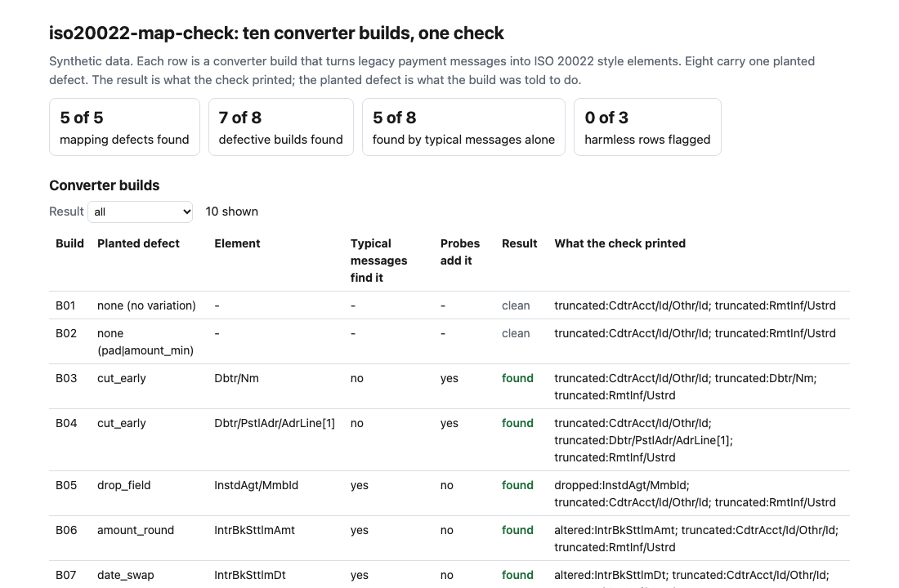
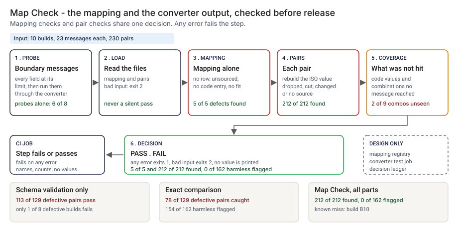
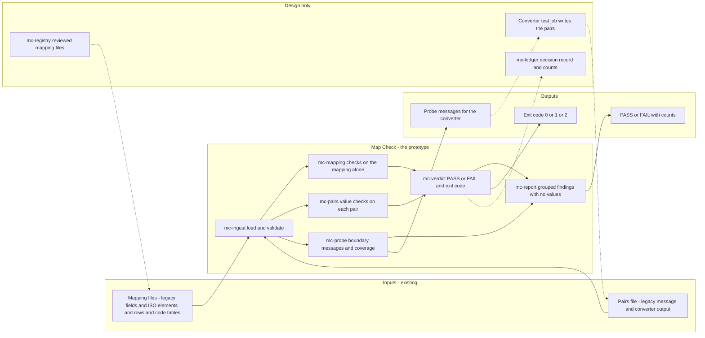
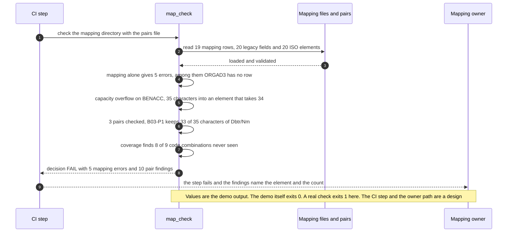

# 🔎 ISO 20022 Map Check: gaps and truncation in a legacy-to-ISO field mapping

**I wanted to know what a legacy-to-ISO 20022 conversion loses without anyone noticing, and how much of that a mapping review can catch before a payment goes out. This is a command-line check: it reads the field mapping, and optionally the pairs of legacy and ISO messages your converter produced, and reports fields with no home, values that cannot fit, and values that arrived cut short, dropped or changed.** Schema validation passes most of those cases, because a name cut to 33 characters is still a valid name.

**▶ Static demo, no install:** [open demo.html](./demo.html)

[](./demo.html)

## Executive summary (90 seconds)

**Problem.** A payments analyst or engineer owns the mapping from a legacy message format to ISO 20022, and a reviewer signs it off. The converter's output is then validated against the ISO element rules, and those rules accept a name cut short, a field never written and an amount that was rounded, because each is still a valid ISO value. 🟢 On 230 synthetic message pairs from 10 converter builds, schema validation passes 214 of 230, and 113 of the 129 pairs that carry a planted defect still pass it. Of the 8 builds with a planted defect, 1 fails schema validation even once (`step_01_schema_check_only.py`). The loss surfaces later, in a repair queue or a return, with nothing pointing back to the mapping row that caused it.

**Product.** Map Check is a command that reads the mapping (the legacy field list, the ISO element list, the mapping rows and the code tables) and, optionally, pairs of a legacy message and the ISO message the converter produced from it. On the mapping alone it reports a legacy field with no row (`legacy_unmapped`), a mandatory ISO element nothing fills (`iso_mandatory_unsourced`), a legacy code missing from its table (`code_not_covered`) and a field that cannot fit its element (`capacity_overflow`), plus a warning where the element takes more than the legacy field holds (`reverse_exposure`). On each pair it rebuilds the ISO value the mapping implies and reports a value dropped, cut short or changed, a populated legacy field no row carries (`unmapped_lost`) and an ISO value with no source (`untraced`), then adds the schema basics. It lists the code values and code combinations no message exercised, and `probe` prints legacy messages with every field at its limit so an early cut shows itself. It prints PASS or FAIL, exits 1 on any error and 2 on malformed input, and never prints a payment value. There is no model call; the rules are plain code you can read.

**Measured and modeled performance.**

- 🟢 **Schema validation alone leaves 113 of 129 defective pairs passing.** It passes 214 of 230 pairs and takes no mapping as input (`step_01_schema_check_only.py`).
- 🟢 **Exact comparison catches 78 of 129 defective pairs,** flags 154 of 162 harmless variations (padding, trailing zeros) and cannot see 99 of 212 planted defects, which sit on rows that change the value on the way (`step_02_exact_compare.py`).
- 🟢 **Each part alone leaves a hole:** the mapping checks find 5 of 5 planted mapping defects and no converter defect; typical messages alone find a defect in 5 of 8 defective builds; boundary probes alone find 6 of 8 (`step_03_deficiencies_exposed.py`).
- 🟢 **Together: 5 of 5 mapping defects and 212 of 212 planted converter defects found,** 0 of 3 harmless rows and 0 of 162 harmless variations flagged (`step_04_with_check.py`).
- 🟢 **Builds: 7 of 8 defective builds found with the probes, 5 of 8 on typical messages alone** (`step_04_with_check.py`).
- 🟢 **Known miss: build B10 is not found.** It drops the beneficiary account only when TYP is 16 and CHGS is S, the defect fired 0 times in the data, and 2 of 9 code combinations are in no message; the coverage line prints the gap (`step_04_with_check.py`).
- 🟡 **Utility: 99/212 × 40 = 18.7 converter defects a year that the check sees and an exact comparison cannot,** assuming 40 converter defects reach review each year.
- 🔴 **Design target: findings on a mapping change within 5 minutes of the pull request.** Designed in [`ARCHITECTURE.md`](./ARCHITECTURE.md), never built or timed.

**What I would ask a head of operations to decide.** Whether a mapping change or a new converter build may go toward release without a pairs run that includes boundary messages. My recommendation is to pilot the check on one real mapping and one build using test messages only, treat the mapping errors as blocking and the reverse-exposure warning as advisory, and have the mapping owner write down, for each capacity finding, whether to shorten the field, widen the element or accept the cut.

**Call to action.** Fork the repo. Replace the four files in `data/` (`legacy_fields.csv`, `iso_elements.csv`, `mapping.csv`, `code_tables.json`) with your own, keeping the columns in `data/README.md`. Run `python3 iso20022_map_check.py probe DIR`, push those messages through your converter in a test environment, write the output as a pairs file and call `check DIR --pairs`. To use it from code, import `load_bundle`, `check_mapping` and `check_pair` from `src/iso20022_map_check.py`. Send findings by opening an issue: name the finding kinds and the counts, not the values.

_A portfolio prototype on synthetic data. Nothing here is deployed, load-tested or used by anyone. The legacy format is invented, and no real converter or mapping has been checked._

## Run one now

```bash
cd 73-iso20022-map-check/src && python3 iso20022_map_check.py --demo
```

It prints:

```text
mapping: 19 rows | 20 legacy fields | 20 ISO elements | 1 dropped on purpose (INTNOTE)
  [error  ] legacy_unmapped          ORGAD3                   no mapping row, so a populated value is dropped
  [error  ] iso_mandatory_unsourced  GrpHdr/MsgId             mandatory element with no mapping row and no constant
  [error  ] code_not_covered         CHGS=O                   legacy code has no entry in table chgs
  [error  ] capacity_overflow        CdtrAcct/Id/Othr/Id      BENACC can hold 35 characters, the element takes 34
  [error  ] capacity_overflow        RmtInf/Ustrd             OBI1+OBI2+OBI3+OBI4 can hold 143 characters, the element takes 140
  [warning] reverse_exposure         10 rows                   the ISO element takes more than the legacy field holds, e.g. PmtId/InstrId: element takes 35 characters, SNDREF holds 16
pairs: 3 checked
  [error  ] altered                  IntrBkSttlmAmt           1 of 3 pairs (first B06-M01): the amount differs
  [error  ] truncated                CdtrAcct/Id/Othr/Id      1 of 3 pairs (first B03-P1): kept 34 of 35 characters
  [error  ] truncated                Dbtr/Nm                  1 of 3 pairs (first B03-P1): kept 33 of 35 characters
  [error  ] truncated                RmtInf/Ustrd             1 of 3 pairs (first B03-P1): kept 140 of 143 characters
  [error  ] unmapped_lost            ORGAD3                   3 of 3 pairs (first B03-P1): populated, but no mapping row carries it
  [error  ] untraced                 GrpHdr/MsgId             3 of 3 pairs (first B03-P1): a value is present but no mapping row writes this element
coverage: code values never seen: TYP=15, TYP=16, CHGS=B, CHGS=O
coverage: code combinations (TYP, CHGS) never seen: 8 of 9 (10/B, 10/O, 15/S, 15/B, 15/O, 16/S)
decision: FAIL (5 mapping errors, 10 pair findings)
```

Standard library only, Python 3.9 or newer. To check your own files: `python3 iso20022_map_check.py check DIR --pairs pairs.json`, where `DIR` holds `legacy_fields.csv`, `iso_elements.csv`, `mapping.csv` and `code_tables.json` (the columns are in [data/README.md](./data/README.md)). It exits 1 when it finds an error, 2 when an input file is malformed, so a CI step fails on a real problem and not on a typo. `python3 iso20022_map_check.py probe DIR` prints legacy messages with every field filled to its limit; run those through your converter and feed the output back as pairs. The check never prints a payment value, only field names, counts and lengths.

## What the numbers say

**What it shows** (🟢 measured on synthetic data: ten converter builds, 23 legacy messages each, 230 message pairs; the script is named in brackets):

- 🟢 Schema validation alone passes 214 of 230 pairs, and 113 of the 129 pairs that carry a planted defect still pass (`step_01`)
- 🟢 An exact field-by-field comparison catches 78 of those 129 defective pairs, flags 154 of 162 harmless variations (padding, trailing zeros), and cannot see 99 of 212 planted defects because they sit on rows that change the value on the way (`step_02`)
- 🟢 The mapping checks alone find 5 of 5 planted mapping defects and flag 0 of 3 harmless rows. On pairs, the ordinary messages alone find a defect in 5 of 8 builds that have one, and the boundary probes alone find 6 of 8 (`step_03`)
- 🟢 All together: 5 of 5 mapping defects, 212 of 212 planted converter defects in the pairs, 0 of 162 harmless variations flagged, and 7 of 8 defective builds found. 10 of 12 text rows could cut data on the way back to the legacy format, which the check reports as a warning (`step_04`)

**What I assumed** (🟡 modeled): the legacy format is invented; the ISO element names follow the pacs.008 naming in a flat path view, but the lengths and mandatory flags are my simplification, not read from any message specification; a constant `NOTPROVIDED` fills the end-to-end identifier; the generator's converters cut long values to the element limit, as a converter that must stay schema-valid would.

**What I could not test** (🔴 hypothetical): a real bank's mapping spreadsheet and converter. I would expect it to hold gap and capacity findings the first run, and defects I did not plant. I have not seen one.

## What it still gets wrong

- 🟢 Build B10 drops the beneficiary account only when TYP is 16 and CHGS is S, and it is not found (`step_04` prints it, with the defect firing 0 times). No message carries that pair of codes: 2 of 9 code combinations are absent (15/S, 16/S), and the probes cycle the code values together instead of crossing them. Crossing every coded field fixes this here and grows as the product of the code counts; the coverage line prints the gap so it is not silent.
- **Event-level results are complete by construction.** 212 of 212 with no false alarm looks better than it is: the generator and the check agree that padding is not a change and that amounts compare as numbers. I wrote both, so these numbers are a ceiling for these rules, not a rate on real converters. The build-level numbers (5 of 8 on ordinary messages, 7 of 8 with probes) carry the information: a defect is found only if some message reaches it.
- **The check shows that a converter follows the mapping on the messages it sees. It cannot show that the mapping is right.** If the spreadsheet sends the debtor name to the creditor element and the converter obeys it, every pair passes. The mapping checks look at lengths, coverage and codes, not meaning.
- The ISO side is a flat path-to-value view, not XML. Namespaces, repeated elements beyond indexed address lines, structured addresses and the real schemas are out of scope. The reverse direction (ISO to legacy) is checked by arithmetic only; no down-converted messages are tested.
- The `join_lines` transform, which joins several legacy lines into one ISO element, assumes one fixed separator. How a long ISO text is split back into legacy lines (word wrap or hard cut) is not modeled.
- Values are never printed, so a finding says "differs from character 12", not what the two values were. That is deliberate and slower to debug.

## How the four steps fit

| Step | Question | Script |
|---|---|---|
| 1 | What does ISO schema validation alone let through? | `step_01_schema_check_only.py` |
| 2 | What does a plain field-by-field comparison cost and miss? | `step_02_exact_compare.py` |
| 3 | Where does each part fail alone, and what stays hidden? | `step_03_deficiencies_exposed.py` |
| 4 | What do mapping checks, pair checks and probes catch together? | `step_04_with_check.py` |

Run any of them from `src/`. Data is generated by [`data/_generate.py`](./data/README.md); `tools/check_repo.py` confirms that a rerun reproduces every file and that the green numbers above appear in a script's output. The folder layout follows [28 Tool Schema Drift](../28-tool-schema-drift/); the check itself shares no code with it.

## Utility delivered

The way I price product impact: **utility = (my solution − current state of the art) × the number of people or items it affects.**

Here the item is a converter defect, a place where a build's output differs from the lossless value. Each one lands on the mapping owner, the reviewer who signs the mapping off, and whoever works the repair queue or the return later. The common basic approach is an exact field-by-field comparison of the two messages; the table prices the check against it.

| Term | Value | Where it comes from |
| --- | --- | --- |
| Current state of the art (exact comparison), planted defects it cannot see | 🟢 **99 of 212** | `step_02_exact_compare.py`; it also flags 154 of 162 harmless variations |
| My solution (Map Check), planted defects found | 🟢 **212 of 212** | `step_04_with_check.py`; 0 of 162 harmless variations flagged |
| Lift per planted defect | 🟢 the 99 of 212 that exact comparison cannot see, and 154 of 162 false alarms removed | The comparison reads 11 of 19 mapping rows; the rest change the value on the way (`step_02_exact_compare.py`) |
| Number it affects: converter defects reaching review in a year | 🟡 **40** | **Assumption, not a statistic.** Replace it with your own count of converter defects a year |
| Assumption that makes the lift real | 🟡 The pairs come from the converter that ships, built from the mapping under review, and a similar share of its defects sit on value-changing rows | If a real mapping is nearly all one-to-one copies, the blind share falls and the lift is mostly the false alarms removed |
| **Utility** | 🟡 **99/212 × 40 = 18.7 converter defects a year that the check sees and an exact comparison cannot** | Assumes the 40 behave like the 212 planted ones |

Sensitivity to the count assumption (🟡, same lift): 20 defects a year gives 9.3, 40 gives 18.7, 80 gives 37.4.

🔴 What I have not measured: what a missed defect costs in repair or returns, how long a finding takes to read and clear, what a false alarm costs a reviewer, or how often a real mapping changes. The planted set is dense on purpose, 129 of 230 pairs carry a planted defect (`step_01_schema_check_only.py`); a real converter sees far fewer. Treat the result as a property of this mix of cases, not a forecast.

---

## Architecture and call flow

Component names match [`ARCHITECTURE.md`](./ARCHITECTURE.md). GitHub renders the diagrams natively.



**System topology:**



**Per-run sequence** (the `--demo` run on the bundled mapping and three bundled pairs):



**Interlocks (all red, designed, none built):**

- [36 Payment Repair](../36-payment-repair/) works on pacs.008-style messages with missing fields. A mandatory element that no row fills (`iso_mandatory_unsourced`) is the upstream cause of one kind of its queue; the two would share a field list in a design. This folder does not import or read its files.
- [53 Feature Contract](../53-feature-contract/) checks a delivery against a contract before a model scores it. The same placement, a check on a change before it ships, would hold for a mapping change.
- [09 LineageLog](../09-lineagelog-ai-decision-audit/) is a possible home for the decision record (`mc-ledger`).

---

## PM artifacts

The PM artifacts that show how I would run this product if I owned the seat. This README is the walkthrough; the rest of the folder holds:

- [`PRD.md`](./PRD.md): the product requirements doc, with users, backlog, KPIs, rollout and open questions.
- [`ARCHITECTURE.md`](./ARCHITECTURE.md): the systems doc, with components, data model, security, failure behavior and operations. A design, not deployed.
- [`demo.html`](./demo.html): clickable, no-install walkthrough, built from the step outputs by `src/_build_demo.py`.
- [`data/`](./data/): the invented legacy format, the mapping under review, 23 legacy messages, the output of 10 converter builds, the planted truth and the seeded generator. `data/README.md` explains how the truth is set.
- [`src/`](./src/): `iso20022_map_check.py`, `common.py`, the four step scripts and the demo builder.
- [`tests/`](./tests/): 43 unittest tests, including a golden test that pins the numbers above and tests for bad input and hostile strings.

Run the four steps end to end:

```bash
cd src
python3 step_01_schema_check_only.py
python3 step_02_exact_compare.py
python3 step_03_deficiencies_exposed.py
python3 step_04_with_check.py
```

---

## Aligned to

The Federal Reserve moved the Fedwire Funds Service to ISO 20022. Its press release of July 15, 2025, announces the completed migration ([Federal Reserve Financial Services, read 2026-10-24](https://www.frbservices.org/news/press-releases/071525-iso20022-migration-announcement/)). That release is the only Fed source I read. I did not read the Fedwire message specification or any FedNow format document, so nothing here states what either service requires, and the element lengths are mine. This is a prototype that addresses a problem any move to ISO 20022 raises; the release does not discuss it. It makes no claim of conformity to that release.

## Data and limits

Synthetic, seeded, byte-for-byte reproducible. The legacy format, the messages, the names and the builds are invented; nothing comes from any employer, institution or real message. A prototype on synthetic data, not a production case study.

## Fork it

Replace the four mapping files in `data/` with your own (keep the columns) and write your converter's output as a pairs file, or run `probe` and convert what it prints. Read the [PRD](./PRD.md) for the scope I held to.

## Prereqs to run this on your laptop

You need Python 3.9 or newer and nothing else. The check, the four step scripts and the data generator use only the standard library, so there is nothing to install. There is no API key, no network call and no model call anywhere in the folder. To run the tests, use `python3 -m unittest discover -s tests` from this folder. The production pieces in [`ARCHITECTURE.md`](./ARCHITECTURE.md) (the reviewed mapping registry, the converter test job, the decision ledger) are a design, not something you need or can run.

## Author

**Vijay Saharan**, Sr Product / Program Manager · AI in BFSI · Enterprise AI Platforms

[LinkedIn](https://www.linkedin.com/in/vijaysaharan/)
