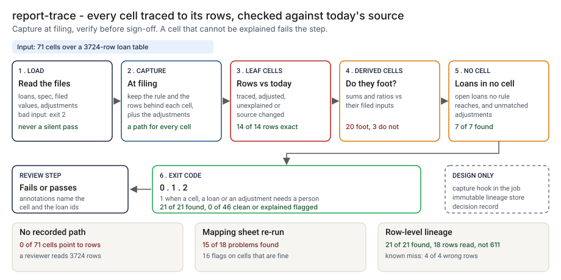

# Architecture: report-trace

> **Status.** This is the design for a production shape. The repo implements the product mechanic as a prototype: a command, `src/report_trace.py`, that captures the rule and the source rows behind every cell of a filed report into a lineage file, checks each cell against the source as it stands today and prints the path back, run here over a synthetic report of 71 cells. The capture is a reference implementation run after the fact on a snapshot, not a hook in a job. Nothing below is claimed as deployed or load-tested. Where a figure is a design target, it says so.

GCP is primary; AWS and Azure sit beside it.



---

## 1. Logical architecture

report-trace has two moments. At filing, `build` turns a spec, the source rows and the filed values into a lineage file. Later, `verify` and `trace` read that file and a current copy of the source. It does not run a report or join tables.

Eight components: five decide the outcome, three support or report.

| Component | Responsibility | Language or framework | Decides the outcome? | Stateful? |
| --- | --- | --- | --- | --- |
| `rt-ingest` | Loads the loans, adjustments, spec, filed values and lineage. Rejects empty, wrong-type, truncated or duplicate input in one line. | Python 3.9+, standard library. Prototype: `read_csv`, `load_loans`, `load_spec`, `load_lineage` and the other `load_` functions | Yes, by refusing: exit 2 | No |
| `rt-spec` | The report: cells, the product and bucket of each leaf, the explicit inputs of each derived cell. | A reviewed JSON file in the report repo (design). Prototype: `data/report_spec.json`, `check_derived`, `cell_order` | Yes, config | Stateful, in git |
| `rt-capture` | Applies each leaf rule to the source and keeps the rows behind it, the logged adjustments and the filed value. In production a hook in the reporting job (`rt-hook`, design). | Python. Prototype: `build_lineage`, `row_matches`, `row_of`, `write_lineage` | Yes: it fixes what is compared later | Writes the lineage file |
| `rt-verify` | One verdict per cell: TRACED, ADJUSTED, UNEXPLAINED or SOURCE_CHANGED for a leaf; FOOTS or DOES_NOT_FOOT for a derived cell. Finds loans in no cell. | Python. Prototype: `evaluate`, `apply_formula` | Yes | No |
| `rt-verdict` | Exit code: 0 nothing needs a person, 1 a cell, loan or adjustment does, 2 bad input. | Python. Prototype: `run_verify`, `main` | Yes | No |
| `rt-trace` | Prints the path from one cell to its rule, rows, adjustments and differences. | Python. Prototype: `render_trace`, `describe`, `change_lines` | No | No |
| `rt-report` | Text or GitHub annotations. Escapes untrusted strings. | Python. Prototype: `render_verify`, `summary_line`, `one_line`, `escape_annotation` | No | No |
| `rt-store` | Lineage files, source snapshots and one decision record per verify (design). Prototype analog: the files step 4 writes to `src/out/`. | Object storage with a retention lock plus PostgreSQL (design) | No | Stateful |

**What decides the outcome.** The input check, the spec, the capture, the verdict rules and the exit code. A wrong capture cannot be caught later, because later runs trust the lineage file. The trace and the report show the result. Lineage shows where a number came from, not whether the source row was right.

**Repo structure** (production shape):

```
report-trace/
├── trace/      # ingest, capture, verify, verdict, trace, report
├── specs/      # one reviewed spec per report, changed by pull request
├── hook/       # the capture hook for the reporting job
├── infra/      # terraform for gcp, aws, azure; bucket policies and IAM
├── docs/runbooks/
└── tests/      # unit, golden (planted-set numbers), hostile (injection strings)
```

---

## 2. Physical and deployment architecture

The capture runs inside the job that files the report. Verify is a short-lived process run before sign-off. There is no server to keep warm.

| Component | GCP (primary) | AWS | Azure | Why |
| --- | --- | --- | --- | --- |
| Capture hook | In the existing reporting job (Cloud Run job) | In the existing job (Fargate task) | In the existing job (Container Apps job) | It reads the aggregation the job already does |
| Verify and trace | Cloud Build step or Cloud Run job | CodeBuild step or ECS Fargate task | Azure Pipelines step or Container Apps job | Stateless, one pass, runs before sign-off |
| Lineage store, source snapshots, decision record | Cloud Storage with retention lock, Cloud SQL for PostgreSQL | S3 Object Lock, RDS for PostgreSQL | Blob immutability policy, Azure Database for PostgreSQL | The file and the source version cannot be replaced after filing |

**Failure behavior (the decision that matters most).** The tool must never silently pass. A missing, empty, truncated or mistyped input does not become "nothing needs a person": it ends the run with exit 2 and a one-line reason. A loan in no cell and an adjustment that matches no leaf cell are listed and fail the run.

| Failure | Behavior | Alert |
| --- | --- | --- |
| An input file is missing, empty, binary, a directory, has the wrong columns, a bad date or amount, or a duplicate id | Exit 2, one line on stderr naming the file | P2 if repeated on one report, else P3 |
| `build` finds no source row matching any leaf cell (wrong as-of date, status or product names) | Exit 2 with the reason | P3 |
| The source given to `verify` shares no row with the lineage | A note on stderr asks if it is the right file; cells flag and the run exits 1 | P3 |
| An adjustment targets a derived cell or no cell | Listed as unmatched, exit 1 | P3 |
| Lineage store or decision record unavailable (design) | The verdict and exit code stand; the record queues locally | P3 |

**Latency and size.** The prototype is one pass over a small table; I have not timed it or measured a lineage file on a real report. 🔴 Design target: a capture adds under 10 percent to the filing run time (planning estimate).

---

## 3. Data architecture

| Entity | Key | What it holds | Real columns in the prototype |
| --- | --- | --- | --- |
| Source row | `loan_id` | One loan: product, status, booked date, days past due, balance | `data/loans_filed.csv`, `data/loans_now.csv`: `loan_id`, `product`, `status`, `booked_date`, `days_past_due`, `balance_cents`, `servicer_note`. The lineage keeps the first six minus the note |
| Cell | `cell_id` | A leaf (product and bucket) or a derived cell (sum or ratio of explicit inputs) | `data/report_spec.json`; filed values in `data/report_filed.csv`: `cell_id`, `value` |
| Adjustment | `adj_id` | A top-side amount against a leaf cell, with a reason | `data/adjustments.csv`: `adj_id`, `cell_id`, `amount_cents`, `reason` |
| Lineage file | cell id | Per cell: rule, rows, adjustments, filed value; plus loans in no cell and unmatched adjustments | Format `report-trace-lineage/1`, written by `write_lineage` |
| Decision record | `decision_id` | Design: report, lineage hash, source snapshot hash, tool version, verdict counts, exit code, time | Prototype: `src/out/step_04_cells.csv`, `src/out/step_04_summary.json` |

**Retention** is a design choice, not a measurement: 🔴 7 years by default for the lineage file, its source snapshot and the decision record, with a retention lock. Confirm it against the bank's own schedule.

**Lineage.** A reported number traces back in three hops: the cell names its rule and its rows in the lineage file; each row names its loan id and the fields the rule read; and the snapshot named in the record returns the source as it stood. The rules are deterministic (no clock, locale or random draw, and ids are sorted), so re-running on the same hashes reproduces the verdicts.

**Deliberately not stored.** The servicer note, which no rule reads, and any loan field a rule does not use.

---

## 4. Security architecture

**Identity and roles.** The capture and verify run under the platform's workload identity and have no user account of their own.

| Role | Can | Maps to |
| --- | --- | --- |
| `rt:capturer` | Write a lineage file for one report, once | The reporting job's service identity |
| `rt:verifier` | Read lineage, source snapshot and spec; write a decision record | The CI service identity |
| `rt:approver` | Approve a spec change, never their own | Report reviewer |

**Secrets.** None. The tool never calls a model or a database; the job identity reaches the stores through workload identity with no static keys.

**Data classification and what leaves the boundary.** The lineage file and the output hold loan ids, balances and days past due, so I classify them confidential. In the prototype nothing leaves the machine. In the design three things leave the job: the exit code, annotations that name cells and loan ids, and the stores' writes.

| Threat | Example | Mitigation in the design |
| --- | --- | --- |
| Hostile string in a loan id, cell id or adjustment reason echoed into output | A reason holding a newline and text that looks like a workflow command | `one_line` flattens text and `escape_annotation` rewrites `%`, carriage return and newline. `tests/test_cli.py` covers hostile strings in annotations |
| The lineage file is edited so a cell traces | Rows or the filed value changed after filing | Written once under a retention lock; its hash is kept outside the file (for example in an audit chain, designed) |
| An adjustment is logged after the fact to turn UNEXPLAINED into ADJUSTED | A top-side entry added in the week of review | Append-only log with an author and a time, reviewed by another person (design) |
| The capture is rebuilt from a moved source | Lineage built months later from today's table | The job writes the lineage at filing and the record stores the source snapshot hash |

---

## 5. Operational architecture

**SLIs.** Verify runs per report; cells per verdict; loans in no cell; unmatched adjustments; input rejections; share of filed reports with a stored lineage file. Prototype baseline: 🟢 0 of 46 clean or explained cells flagged (`step_04_with_lineage.py`).

**SLOs (all 🔴 design targets, none measured).**
- Every recurring report is filed with a stored lineage file.
- Verify runs before sign-off on every filing.
- Every UNEXPLAINED or SOURCE_CHANGED cell is read by a named person before sign-off (planning estimate).
- A capture adds under 10 percent to the filing run time.

**Alerts.** P2: repeated input rejections on one report, or a filing with no lineage file. P3: a verify that exits 1 on a report awaiting sign-off, or a changed hash for a stored lineage. P4: a daily digest of loans in no cell.

**Runbooks** (one page each, in `docs/runbooks/`):
- `unexplained-cell.md`: find the amount, check the adjustment log, log it or correct the report.
- `source-changed.md`: read the named loans, decide whether the filing or the source is right.
- `loans-in-no-cell.md`: find why a loan matches no rule, such as a blank days past due.
- `changing-the-spec.md`: propose, re-run the planted set, compare with the golden numbers, approve.

**On-call and ownership.** The report owner owns the spec, the adjustment log and the runbooks. The data engineer owns the hook and the stores. The reviewer approves spec changes. Nobody is paged for a loan in no cell.

**Change control.** Specs and rules are versioned. A change needs a proposer and a different approver. Before merge the planted set is re-run and compared with `tests/test_golden.py`, so a change that moves the found count shows in the diff.

---

## 6. Alignment and posture

The README's "Aligned to" section cites nothing: I read no regulation or standard for this project and claim no alignment to one. The report is an invented loan schedule.

- **What the design does.** It keeps the rule, the rows and the adjustments behind each filed number, so a reviewer's question is answerable. That is an engineering property, not a claim about any rule.
- **What it does not claim.** It makes no claim of conformity to any standard or regulation, holds no certification, and I have not read or mapped any source.

---

## 7. What is deliberately not here

- **A check that the source row is right.** 🟢 4 of 4 cells that hold a wrong source row verify as TRACED (`step_04_with_lineage.py`). Lineage shows where a number came from, not whether the source was right.
- **A live, moving source.** The tool needs a position table corrected in place; a ledger that changes every day would flag every cell.
- **Counts, joins and rounding tolerance.** Cells are sums of balances and ratios in basis points, compared exactly. A join that double counts a loan is not modeled.
- **A row moved into another bucket.** It flags the cell it left and not the cell it joined; a unit test covers it, the planted set does not.
- **A capture inside a real job.** The capture is a reference implementation run after the fact; its cost on a real run is unknown.
- **Rates on a real report.** The data and the rules share an author, so the numbers are a ceiling. Hosting is not built.

---

## Appendix: sample contract

The calls are the prototype's own; the output for the bundled `--demo` run is under "Run one now" in the README.

```bash
python3 report_trace.py build --source loans_filed.csv --spec report_spec.json --filed report_filed.csv \
  --adjustments adjustments.csv --out lineage.json
python3 report_trace.py verify --lineage lineage.json --source loans_now.csv --format github
python3 report_trace.py trace --lineage lineage.json --cell auto.d60_89 --source loans_now.csv
```

The lineage file is JSON with `format`, `as_of`, `order`, `cells`, `orphans` and `unmatched_adjustments`. A leaf cell carries `rule`, `rows` (each `[loan_id, product, status, booked, days_past_due, balance]`), `adjustments` and `filed`. Exit status: 0 when nothing needs a person, 1 when a cell, a loan in no cell or an adjustment does, 2 for bad input.
