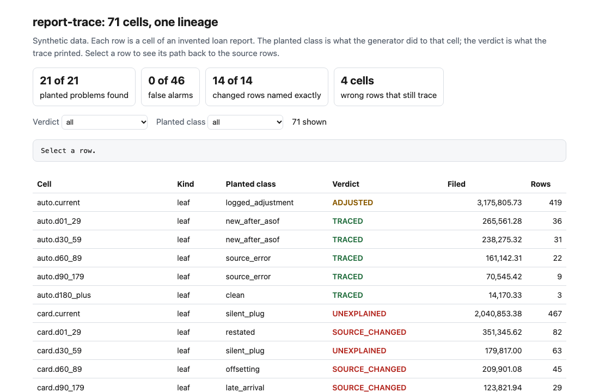
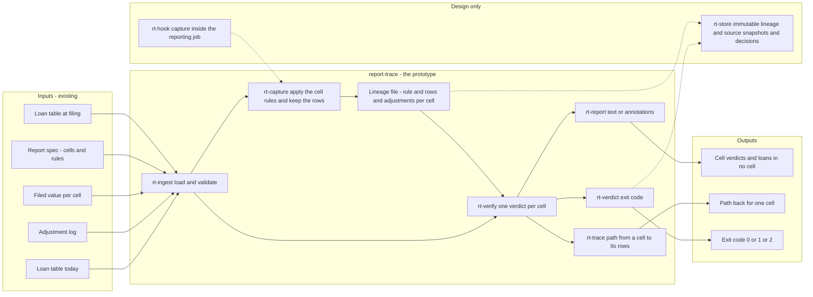
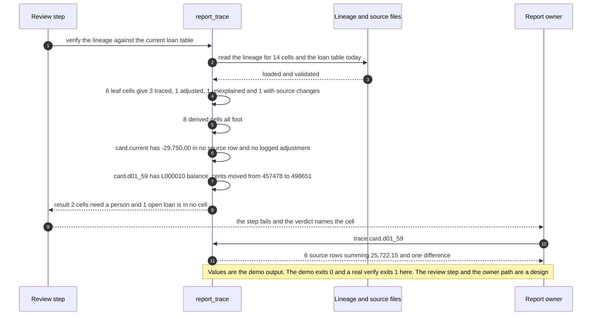

# 🧾 report-trace: lineage for report cells

**I wanted to know what it takes to answer "where does this number come from?" for one cell of a filed report, and which ways a number drifts away from its source rows after filing. This is a small command-line tool that records, for every cell, the rule and the exact source rows behind it, then checks each cell against the source as it stands today and prints the path back.** It extends the idea in [09 LineageLog](../09-lineagelog-ai-decision-audit/) from one AI decision to one reported number. Nothing is imported from that project.

**▶ Static demo, no install:** [open demo.html](./demo.html)

[](./demo.html)

## Executive summary (90 seconds)

**Problem.** The person who owns a recurring report has to answer "where does this number come from?" for any cell, and the reviewer has to believe the answer. 🟢 On a synthetic filed report of 71 cells (48 leaf, 23 derived) over a loan table, 0 of 71 cells carry a recorded path to source rows. A reviewer reads 3724 rows of the loan table to find the loans behind one cell, where a leaf cell has a median of 15.5 rows behind it and at most 467, and a first guess at the rule from the column label reproduces the filed value on 5 of 48 leaf cells (`step_01_no_trace.py`). The table has also moved since filing, so even a right guess can disagree with the filed number, and nothing tells a logged adjustment from an unlogged one.

**Product.** report-trace has three commands. `build` runs at filing: it applies the cell rules in the report spec to the source rows and writes a lineage file holding, for every cell, the rule, the source rows behind it with the fields the rule reads, the logged adjustments and the filed value. `verify` checks every cell against that file and a current copy of the source. A leaf cell gets one verdict: TRACED, ADJUSTED (the value is its rows plus a logged adjustment), UNEXPLAINED (an amount no row and no adjustment accounts for) or SOURCE_CHANGED (a row changed or vanished, or a row that fits the rule now exists that the filing never saw). Fields the rule does not read, such as a servicer note, and loans booked after the as-of date are not changes. A derived cell, a total or a ratio, is checked by footing its filed inputs: FOOTS or DOES_NOT_FOOT. It also lists open loans that sit in no cell and logged adjustments that match no leaf cell. `trace` prints the path from one cell to its rows. It exits 1 when a cell needs a person and 2 on malformed input. There is no model call; the rules are plain code you can read.

**Measured and modeled performance.**

- 🟢 **No recorded path: 0 of 71 filed cells point to a source row,** and a reviewer reads 3724 rows to find the loans behind one cell (`step_01_no_trace.py`).
- 🟢 **A mapping sheet re-run against today's table flags 31 of 48 leaf cells,** finds 15 of 18 planted problems, passes 3 of 3 offsetting changes, raises 16 flags on cells that are not problems and names no row (`step_02_mapping_sheet.py`).
- 🟢 **Comparing every column of every row to the filing snapshot,** the next fix people try, finds offsetting 3 of 3, restated 5 of 5 and removed 3 of 3, but finds 0 of 3 late arrivals, flags 4 of 4 cells where only a note changed, and leaves 7 open loans in no cell unflagged (`step_03_deficiencies_exposed.py`).
- 🟢 **Row-level lineage: 21 of 21 planted problems found, 0 false alarms on 46 cells** that are fine or only explained by the log (`step_04_with_lineage.py`).
- 🟢 **The rows it names are exactly the planted rows on 14 of 14 cells with a source change:** a reviewer reads 18 rows instead of 611, and all 7 open loans in no cell are found (`step_04_with_lineage.py`).
- 🟢 **Known miss: 4 of 4 cells holding a wrong source row verify as TRACED.** The row is real and unchanged, so nothing in the lineage disagrees (`step_04_with_lineage.py`).
- 🟡 **Utility: (611 − 18) / 14 × 100 = 4,236 rows a year a reviewer does not have to read,** assuming 100 cells a year need a source change explained.
- 🔴 **Design target: a lineage capture added to a filing run at under 10 percent of its run time.** Designed in [`ARCHITECTURE.md`](./ARCHITECTURE.md), never built or timed.

**What I would ask a head of operations to decide.** Whether a recurring report should write a lineage capture at filing, so that a cell with no flag can be accepted without re-deriving it. My recommendation is to pilot the capture on one recurring report with a frozen or versioned source, treat UNEXPLAINED, SOURCE_CHANGED and DOES_NOT_FOOT as the reasons to open a cell, and keep sampling the source rows themselves, because lineage cannot see a wrong source row.

**Call to action.** Fork the repo. Swap `data/loans_filed.csv`, `data/loans_now.csv`, `data/report_filed.csv`, `data/adjustments.csv` and `data/report_spec.json` for your own, keeping the columns (`loan_id, product, status, booked_date, days_past_due, balance_cents` for the loans; `adj_id, cell_id, amount_cents, reason` for the log; `cell_id, value` for the filed values). Run `build`, then `verify` and `trace`. To call it from code, import `build_lineage` and `evaluate` from `src/report_trace.py`. Send findings by opening an issue: say which verdict fired and on how many cells, not the loans.

_A portfolio prototype on synthetic data. Nothing here is deployed, load-tested or used by anyone, and the capture has never run inside a real reporting job._

## Run one now

```bash
cd 74-report-trace/src && python3 report_trace.py --demo
```

It prints:

```text
14 cells: 6 leaf (3 traced, 1 adjusted, 1 unexplained, 1 with source changes), 8 derived (8 foot, 0 do not)
  card.current         UNEXPLAINED              -29,750.00 of the filed value is in no source row and no logged adjustment
  card.d01_59          SOURCE_CHANGED           source changed since filing: L000010 balance_cents 457478 -> 498651
  open loans in no cell: 1, first L000029
result: 2 cells need a person; open loans in no cell: 1; logged adjustments that match no leaf cell: 0
cell card.d01_59   card / d01_59   leaf   filed 25,722.15
  rule: product card, status open, booked on or before 2026-06-30, days past due 1 to 59
  source rows at filing: 6, sum 25,722.15
  logged adjustments: 0, sum 0.00
  unexplained amount: 0.00
  against the current source: 1 difference(s)
    L000010 balance_cents 457478 -> 498651
  verdict: SOURCE_CHANGED
```

Standard library only, Python 3.9 or newer. On your own files: `build` captures the lineage from the source as it stood at filing, `verify` checks every cell against a current copy, `trace` prints one cell's path.

```bash
python3 report_trace.py build --source loans_filed.csv --spec report_spec.json --filed report_filed.csv \
  --adjustments adjustments.csv --out lineage.json
python3 report_trace.py verify --lineage lineage.json --source loans_now.csv
python3 report_trace.py trace --lineage lineage.json --cell auto.d60_89 --source loans_now.csv
```

`verify` exits 1 when a cell needs a person, 2 on malformed input, and `--format github` prints annotations. The report is an invented loan schedule, not any regulator's form.

## What the numbers say

**What it shows** (🟢 measured on synthetic data: a report of 71 cells over a loan table, with planted problems and planted hard negatives; the script is named in brackets):

- 🟢 No recorded path: 0 of 71 filed cells point to a source row. A reviewer reads 3724 rows of the loan table to find the loans behind one cell, where a leaf cell has a median of 15.5 rows behind it and at most 467. A first guess at the rule from the column label reproduces the filed value on 5 of 48 leaf cells (`step_01`)
- 🟢 A mapping sheet re-run against today's table flags 31 of 48 leaf cells. It finds 15 of 18 planted problems, passes 3 of 3 offsetting changes, raises 16 flags on cells that are not problems (4 logged adjustments, 12 cells where rows were booked after the as-of date), flags 23 of 23 derived cells, and names no row. A reviewer reads a median of 28 rows to explain a flagged cell (`step_02`)
- 🟢 The next fix people try, comparing every column of every row to the filing snapshot, finds offsetting 3 of 3, restated 5 of 5 and removed 3 of 3. It finds 0 of 3 late arrivals and flags 4 of 4 cells where only a note changed. 7 open loans with a blank days-past-due sit in no cell and nothing flags them. A cross-foot of the filed numbers finds the 3 footing errors that the live re-run buries among 23 flags (`step_03`)
- 🟢 Row-level lineage, checked against the source today: 21 of 21 planted problems found and 0 false alarms on 46 cells that are fine or only explained by the log. 12 of 12 cells with rows booked after the as-of date and 4 of 4 cells where only a note changed stay quiet. The rows it names are exactly the planted rows on 14 of 14 cells with a source change, so a reviewer reads 18 rows instead of 611. All 7 open loans that sit in no cell are found (`step_04`)

**Modeled and hypothetical**

- 🟡 Rows read stands in for reviewer effort. I did not time anyone, and a row is not a minute.
- 🔴 A production reporting job emitting this capture at acceptable cost and size is a design I reasoned about and did not test.

## What it still gets wrong

- 🟢 4 of 4 cells that hold a wrong source row still verify as TRACED (`step_04` prints each one, for example auto.d60_89 with a recorded days-past-due of 85 and a true value of 171). The row is real and unchanged, so nothing in the lineage disagrees. Lineage shows where a number came from, not whether the source was right.
- **The data and the rules share an author.** I planted the problems and wrote the checks, so 21 of 21 shows the rules cover what I planted. The set includes cases built to trip them (offsetting changes that keep the sum, a note edited on a reported row, rows booked after the as-of date, adjustments that are logged and exact) and one case built to beat them, the wrong source row. Treat the result as a ceiling for these rules, not a rate on a real report.
- **The source has to be a position table that is corrected in place, with later loans appended.** A live ledger that moves every day would flag every cell. Lineage needs a frozen or versioned source.
- A row whose days past due was corrected into another bucket flags the cell it left and not the cell it joined. That case is covered by a unit test, not by the planted set.
- Cells are sums of balances and ratios in basis points. No counts, no joins, no rounding tolerance. A join that double counts a loan is not modeled. An adjustment aimed at a derived cell is reported as unmatched.
- The capture here is a reference implementation of the aggregation, run after the fact on a snapshot. It has not been put inside a real job.

## How the four steps fit

| Step | Question | Script |
|---|---|---|
| 1 | What does a reviewer have when a filed number carries no path back? | `step_01_no_trace.py` |
| 2 | What does a mapping sheet re-run against today's table catch? | `step_02_mapping_sheet.py` |
| 3 | Where does it fail, and what does the next obvious fix cost? | `step_03_deficiencies_exposed.py` |
| 4 | What does row-level lineage catch, and what does it leave? | `step_04_with_lineage.py` |

Run any of them from `src/`. Step 4 writes `src/out/`, which `_build_demo.py` turns into `demo.html`. Data is generated by [`data/_generate.py`](./data/README.md); `tools/check_repo.py` confirms that a rerun reproduces every file and that the green numbers above appear in a script's output. The tests (`tests/`, 51 in all) pin the numbers, the exit codes on empty, wrong-type and truncated input, and hostile strings in loan ids and adjustment reasons.

## Utility delivered

The way I price product impact: **utility = (my solution − current state of the art) × the number of people or items it affects.**

Here the item is a cell with a source change that a reviewer has to explain. Each one lands on the report owner, the reviewer, and whoever is asked about the number later. The common basic approach is a mapping sheet re-run against today's table; the table prices the lineage against it in rows a reviewer reads, which is the only effort measure the scripts print.

| Term | Value | Where it comes from |
| --- | --- | --- |
| Current state of the art (mapping sheet), rows read to explain the 14 cells with a source change | 🟢 **611** | `step_04_with_lineage.py`; the sheet names no row and a reviewer reads a median of 28 rows per flagged cell (`step_02_mapping_sheet.py`) |
| My solution (row-level lineage), rows read for the same 14 cells | 🟢 **18** | `step_04_with_lineage.py`; the rows named are exactly the planted rows on 14 of 14 cells |
| Lift | 🟢 611 minus 18 rows over 14 cells | The sheet also raises 16 flags on cells that are not problems; the lineage raises 0 on 46 (`step_02_mapping_sheet.py`, `step_04_with_lineage.py`) |
| Number it affects: cells a year with a source change to explain | 🟡 **100** | **Assumption, not a statistic.** Replace it with your own count of cells a year where a reviewer has to find the cause of a difference |
| Assumption that makes the lift real | 🟡 The capture runs at filing from the same rules as the report, the source is frozen or versioned, and real source changes touch about as many rows as the planted ones | If the source moves every day, every cell flags and the lift is gone; if the capture is built after the fact, the rows are not the ones the report used |
| **Utility** | 🟡 **(611 − 18) / 14 × 100 = 4,236 rows a year a reviewer does not have to read** | Assumes the 100 behave like the 14 planted ones. A row is not a minute |

Sensitivity to the count assumption (🟡, same lift): 50 cells a year gives 2,118 rows, 100 gives 4,236, 200 gives 8,471.

🔴 What I have not measured: how long a reviewer takes per row or per cell, what a wrong filed number costs, how large the lineage file gets on a real report, or how often a real source changes after filing. The planted set is dense on purpose, 21 of its 71 cells carry a planted problem the lineage can see (`step_04_with_lineage.py`); a real report has far fewer. Treat the result as a property of this mix of cases, not a forecast.

---

## Architecture and call flow

Component names match [`ARCHITECTURE.md`](./ARCHITECTURE.md). GitHub renders the diagrams natively.


**System topology:**



**Per-run sequence** (the `--demo` run on the bundled 41-loan example):



**Interlocks (all red, designed, none built):**

- [09 LineageLog](../09-lineagelog-ai-decision-audit/) is where the idea comes from: lineage for one AI decision. This folder extends it to one reported number and imports nothing from it.
- [51 Memo Tieout](../51-memo-tieout/) ties the figures in a credit memo to a spread. In a design, a figure that traces to a report cell would call `trace` for the rows behind it. Nothing is wired.
- [34 Audit Chain](../34-audit-chain/) is a possible home for the lineage file's hash, kept outside the file it protects.

---

## PM artifacts

The PM artifacts that show how I would run this product if I owned the seat. This README is the walkthrough; the rest of the folder holds:

- [`PRD.md`](./PRD.md): the product requirements doc, with users, backlog, KPIs, rollout and open questions.
- [`ARCHITECTURE.md`](./ARCHITECTURE.md): the systems doc, with components, data model, security, failure behavior and operations. A design, not deployed.
- [`demo.html`](./demo.html): clickable, no-install walkthrough, built from the step outputs by `src/_build_demo.py`.
- [`data/`](./data/): the invented loan table at filing and today, the filed report, the spec, the adjustment log, the planted truth and the seeded generator. `data/README.md` explains how the truth is set.
- [`src/`](./src/): `report_trace.py`, `common.py`, the four step scripts and the demo builder.
- [`tests/`](./tests/): 51 unittest tests, including a golden test that pins the numbers above and tests for bad input and hostile strings.

Run the four steps end to end:

```bash
cd src
python3 step_01_no_trace.py
python3 step_02_mapping_sheet.py
python3 step_03_deficiencies_exposed.py
python3 step_04_with_lineage.py
```

---

## Aligned to

Nothing. I read no regulation or standard for this project and claim no alignment to one. The report is an invented schedule. It is a prototype on synthetic data. It makes no claim of conformity to any standard or regulation.

## Data and limits

Synthetic, seeded, byte-for-byte reproducible. Nothing comes from any employer, customer or real bank. A prototype on synthetic data, not a production case study.

## Fork it

Swap `data/loans_filed.csv`, `data/loans_now.csv`, `data/report_filed.csv`, `data/adjustments.csv` and `data/report_spec.json` for your own and keep the columns. The spec names every cell and its inputs explicitly; structure never comes from cell names. Read the [PRD](./PRD.md) for the scope I held to.

## Prereqs to run this on your laptop

You need Python 3.9 or newer and nothing else. The tool, the four step scripts and the data generator use only the standard library, so there is nothing to install. There is no API key, no network call and no model call anywhere in the folder. To run the tests, use `python3 -m unittest discover -s tests` from this folder. The production pieces in [`ARCHITECTURE.md`](./ARCHITECTURE.md) (the capture hook in the reporting job, the immutable lineage store, the decision record) are a design, not something you need or can run.

## Author

**Vijay Saharan**, Sr Product / Program Manager · AI in BFSI · Enterprise AI Platforms

[LinkedIn](https://www.linkedin.com/in/vijaysaharan/)
