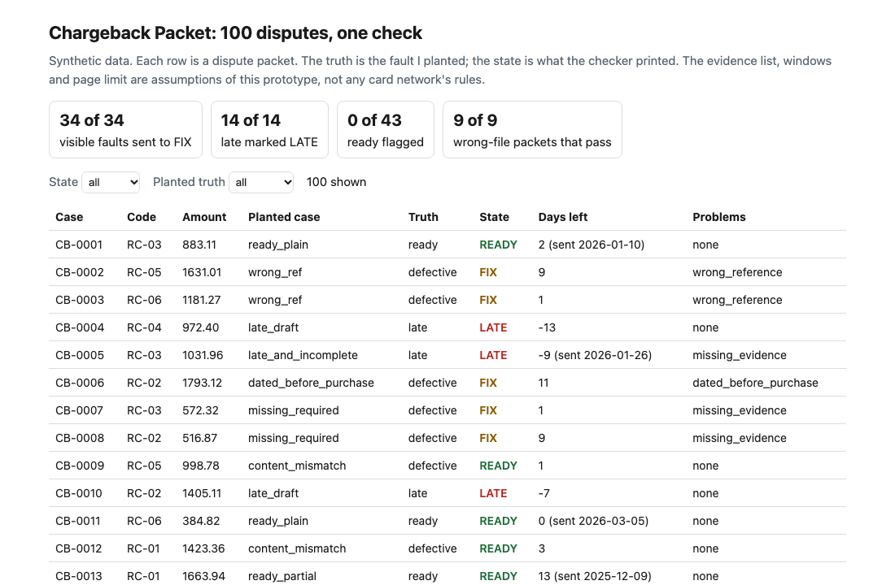
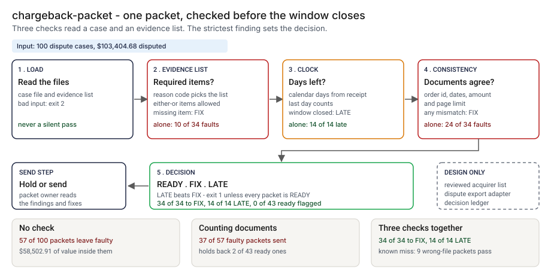
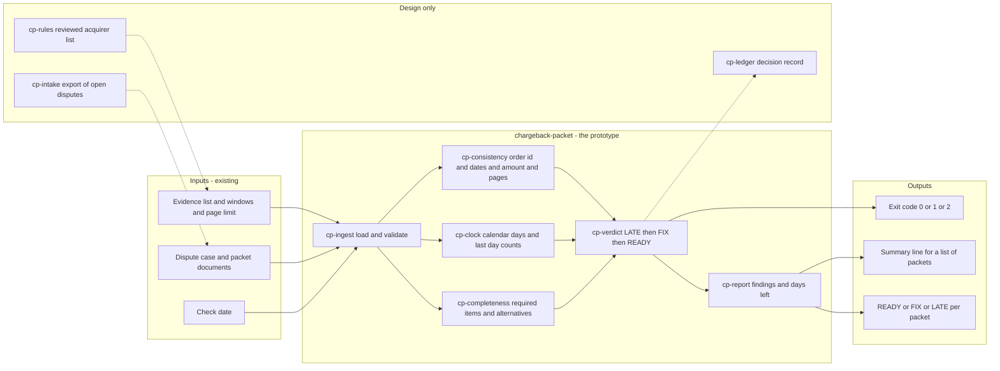
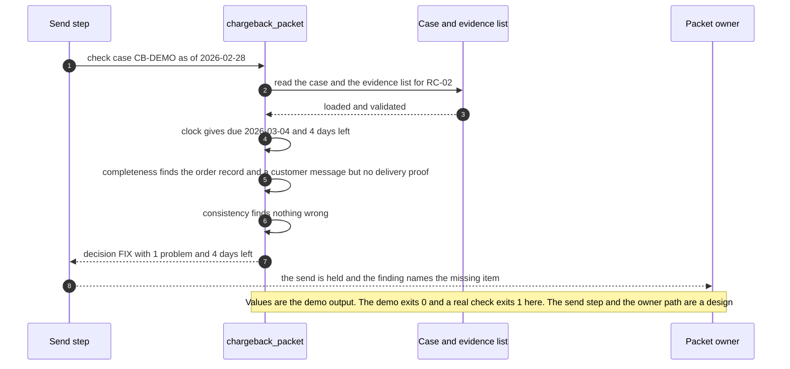

# 📎 chargeback-packet (merchant dispute evidence): the packet checked against the list before the clock runs out

**I wanted to know how many dispute response packets go out with a fault that a person could have caught while the window was still open, and what it takes to catch them. This is a command-line tool that takes a dispute case and its packet, looks up the evidence list for the reason code, runs the response clock, checks that the documents agree with the case, and prints READY, FIX or LATE.** It is built for the person who assembles the packet, and it is a different party from the bank-side clocks in [49 dispute-clock](../49-dispute-clock/).

**▶ Static demo, no install:** [open demo.html](./demo.html)

[](./demo.html)

The reason codes, evidence lists, response windows and the page limit are assumptions of a modeled network (🟡). I did not read any card network's rules for this project, so I claim no alignment with one. READY means the checker found nothing wrong that it can see. It does not predict whether a dispute is won.

## Executive summary (90 seconds)

**Problem.** A merchant that disputes a chargeback has one response window and one packet to send. The person who assembles it works from whatever evidence they can find, each reason code asks for a different list, and nothing compares the packet with that list or watches the clock until the answer comes back. 🟢 On 100 synthetic dispute cases worth $103,404.68, 57 of 100 packets go out with a planted fault, carrying $58,502.91 of that value. 43 of those faults had time left to fix, and 14 packets were already late (`step_01_no_check.py`). The fault is found by the other side, after the window has closed.

**Product.** chargeback-packet is a command that takes a dispute case and its packet and applies three checks, all plain rules read from a list. Completeness: the evidence list for the reason code has required items, some either-or, and a missing one is reported with its alternatives. Clock: the window runs in calendar days from the day the dispute was received, the last day counts, a draft is judged on the check date and a sent packet on its own sent date. Consistency: every document names this order, post-purchase documents are not dated before the purchase, none is dated after the check date, the order record covers the disputed amount, and the packet stays inside the page limit. It prints READY, FIX or LATE for each packet, LATE winning over FIX, and exits 1 when any packet is not READY and 2 when the input cannot be read. It reads labels, dates, references, amounts and page counts, and never opens a document. There is no model call. The reason codes, lists and windows are invented, so READY means nothing the checker can see is wrong, not that a dispute will be won.

**Measured and modeled performance.**

- 🟢 **No check: 57 of 100 packets go out with a planted fault,** carrying $58,502.91 of $103,404.68 in disputed value (`step_01_no_check.py`).
- 🟢 **Counting documents holds back 22 of 100** but sends 37 of 57 faulty packets anyway, holds back 2 of 43 ready ones and passes 8 of 14 late packets (`step_02_count_the_documents.py`).
- 🟢 **Each part alone leaves a hole:** the evidence list flags 10 of 34 visible faults, the clock flags 14 of 14 late packets and no defective one, the consistency checks flag 24 of 34 visible faults; none flags a ready packet (0 of 43) (`step_03_deficiencies_exposed.py`).
- 🟢 **Together: 34 of 34 visible faults go to FIX and 14 of 14 late packets are marked LATE,** with 0 of 43 ready packets flagged; the decision matches the planted truth in 91 of 100 (`step_04_with_check.py`).
- 🟢 **A person opens 48 of 100 packets instead of reading all 100,** and 7 of the 34 drafts to fix have 3 or fewer days left (`step_04_with_check.py`).
- 🟢 **Known miss: 9 of 57 faulty packets pass as READY.** 6 carry a document that belongs to another case and 3 an unreadable scan, and every one has the right label, reference, date and page count (`step_04_with_check.py`).
- 🟡 **Utility: (37/57 − 9/57) × 200 = 98.2 faulty packets a year that counting documents would send and the check holds,** assuming 200 faulty packets a year.
- 🔴 **Design target: a decision on every open dispute within 15 minutes of a case being created or changed.** Designed in [`ARCHITECTURE.md`](./ARCHITECTURE.md), never built or timed.

**What I would ask a head of operations to decide.** Whether a dispute packet may be sent without a check against the acquirer's list and the clock. My recommendation is to run the check as a shadow step on one reason code with the acquirer's published list loaded in place of my invented one, treat FIX as a stop and LATE as an escalation, and keep a person opening the packets the check cannot see into. It cannot tell a wrong file from a right one.

**Call to action.** Fork the repo. Replace `data/rules.json` with your acquirer's published list, keeping the shape (`reason_codes` with `window_days` and `slots` that hold `accept` lists, plus `max_pages`, `after_purchase_types` and `amount_types`), and export your open disputes with the columns in `data/README.md`. Run `check cases.json --rules my_rules.json --as-of YYYY-MM-DD`. To call it from code, import `load_rules` and `check_case` from `src/chargeback_packet.py`. Send findings by opening an issue: name the finding kinds and the counts, not the cases.

_A portfolio prototype on synthetic data. Nothing here is deployed, load-tested or used by anyone, and the evidence lists are not any card network's._

## Run one now

```bash
cd 75-chargeback-packet/src && python3 chargeback_packet.py --demo
```

It prints:

```text
case CB-DEMO  RC-02 Goods or services not received  amount 129.00  due 2026-03-04, 4 days left as of 2026-02-28
  [missing_evidence      ] delivery proof: need one of delivery_tracking, digital_access_log
decision: FIX (1 problem, 4 days left)
```

The dispute was received on 2 February with a 30-day window in the modeled list, so the last day is 4 March. The packet has the order record and a customer message and no proof of delivery, which is the one required item for this code. With four days left, that is a fix, not a loss.

Standard library only, Python 3.9 or newer. To check your own file: `python3 chargeback_packet.py check cases.json --rules my_rules.json --as-of 2026-03-31`. The file holds one case or a list of cases. It exits 1 when any packet is FIX or LATE and 2 when the input cannot be read. Text from the input is escaped before it is printed.

## What the numbers say

**What it shows** (🟢 measured on synthetic data: 100 planted dispute cases; the script is named in brackets):

- 🟢 No check: 57 of 100 packets go out with a planted fault, carrying $58,502.91 of $103,404.68 in disputed value; 43 of those faults had time left to fix and 14 packets were already late (`step_01`)
- 🟢 Counting documents (the order record plus at least two others) holds back 22 of 100, sends 37 of 57 faulty packets anyway, holds back 2 of 43 ready ones and passes 8 of 14 late packets (`step_02`)
- 🟢 Each part alone: the evidence list flags 10 of 34 visible faults, the clock flags 14 of 14 late packets and no defective one, the consistency checks flag 24 of 34 visible faults; none of them flags a ready packet (0 of 43) (`step_03`)
- 🟢 All three together: 34 of 34 visible faults go to FIX, 14 of 14 late packets are marked LATE, 0 of 43 ready packets are flagged, and the decision matches the planted truth in 91 of 100 (`step_04`)
- 🟢 A person opens 48 of 100 packets instead of reading all 100, and 7 of the 34 drafts to fix have 3 or fewer days left (`step_04`)
- 🟢 Hard negatives that stayed READY: 8 of 8 using the second option of an either-or item, 5 of 5 partial disputes, 5 of 5 sent on the last day, 5 of 5 drafts with the window open (2 of 2 due today), 3 of 3 with an extra document on no list (`step_04`)

## What it still gets wrong

- 🟢 Nine of the 43 defective packets pass: 6 carry a document that belongs to another case and 3 carry an unreadable scan, and every one has the right label, reference, date and page count (`step_04` prints each one). The checker never opens a file.
- **The data and the rules share an author.** I wrote the recipe for a good packet and the rules, in separate tables so that a mistake in one shows up as a false alarm, but I wrote both. 0 of 43 ready packets flagged shows they agree with each other. It does not show that they match any real network, and the numbers are a ceiling for these rules, not a rate on real disputes.
- 🟡 The evidence lists, the windows (14 to 30 days), the last-day-counts rule and the page limit are invented. The window is counted in calendar days. There is no weekend, holiday, time-zone or extension rule. Real lists differ by network and change over time; load the one your acquirer publishes into `data/rules.json` before relying on any output.
- Document types are a fixed vocabulary. A misspelled type shows up as a missing item and a note that the type is on no list; the checker does not guess what was meant.
- One reason code per case. No second presentment, no pre-arbitration stage, no partial evidence value: a packet with one weak document and a packet with a strong one are both READY.
- It checks page counts, not file size or format.

## How the four steps fit

| Step | Question | Script |
|---|---|---|
| 1 | What goes out when nobody checks the packet? | `step_01_no_check.py` |
| 2 | What does counting documents catch? | `step_02_count_the_documents.py` |
| 3 | Where does each part of the check fail alone? | `step_03_deficiencies_exposed.py` |
| 4 | What do the list, the clock and the consistency checks catch together? | `step_04_with_check.py` |

Run any of them from `src/`. Data is generated by [`data/_generate.py`](./data/README.md); the check in `tools/check_repo.py` confirms that a rerun reproduces every file and that the green numbers above appear in a script's output. The tests in `tests/` cover bad input, hostile strings and the boundary days of the clock, and a golden test pins the numbers above.

## Utility delivered

The way I price product impact: **utility = (my solution − current state of the art) × the number of people or items it affects.**

Here the item is a faulty packet. Each one lands on the person who assembles the packet, the reviewer who signs it off, and the merchant whose disputed value rides on it. The common basic approach is to count the documents (the order record plus at least two others); the table prices the check against it.

| Term | Value | Where it comes from |
| --- | --- | --- |
| Current state of the art (counting documents), faulty packets sent anyway | 🟢 **37 of 57** | `step_02_count_the_documents.py`; it also holds back 2 of 43 ready packets |
| My solution (list, clock and consistency), faulty packets that still pass | 🟢 **9 of 57** | `step_03_deficiencies_exposed.py`; the same 9 are listed as the known limit in `step_04_with_check.py` |
| Lift per faulty packet | 🟢 37 of 57 minus 9 of 57 | The check also marks 14 of 14 late packets LATE where counting passes 8 of 14 (`step_02_count_the_documents.py`, `step_04_with_check.py`) |
| Number it affects: faulty packets in a year | 🟡 **200** | **Assumption, not a statistic.** Replace it with your own count of packets a year that go out with a fault |
| Assumption that makes the lift real | 🟡 The evidence list loaded is the acquirer's own, someone acts on a FIX while days remain, and real faults are the kinds the rules read | If the list is wrong, the check passes what the other side rejects; 🟢 7 of the 34 drafts to fix have 3 or fewer days left (`step_04_with_check.py`) |
| **Utility** | 🟡 **(37/57 − 9/57) × 200 = 98.2 faulty packets a year that counting documents would send and the check holds** | Assumes the 200 behave like the 57 planted ones |

Sensitivity to the count assumption (🟡, same lift): 100 faulty packets a year gives 49.1, 200 gives 98.2, 400 gives 196.5.

🔴 What I have not measured: what a lost dispute costs, how long a FIX takes to clear, how many held packets would have won anyway, or how many of a real merchant's packets carry a fault. The planted set is dense on purpose, 57 of 100 packets carry a fault (`step_01_no_check.py`); a real queue sees far fewer. Treat the result as a property of this mix of cases, not a forecast.

---

## Architecture and call flow

Component names match [`ARCHITECTURE.md`](./ARCHITECTURE.md). GitHub renders the diagrams natively.



**System topology:**



**Per-run sequence** (the `--demo` run, a not-received dispute checked on 2026-02-28):



**Interlocks (all red, designed, none built):**

- [49 Dispute Clock](../49-dispute-clock/) puts the bank-side steps of a dispute on business-day clocks against a holiday file. The packet owner's window here is calendar days; a business-day option is the next item in the backlog and could share that calendar. This folder does not import or read its files.
- [68 KYB Packet Check](../68-kyb-packet-check/) has the same shape in another domain: check a packet against a list before a person signs off. Nothing is shared.
- [09 LineageLog](../09-lineagelog-ai-decision-audit/) is a possible home for the decision record (`cp-ledger`).

---

## PM artifacts

The PM artifacts that show how I would run this product if I owned the seat. This README is the walkthrough; the rest of the folder holds:

- [`PRD.md`](./PRD.md): the product requirements doc, with users, backlog, KPIs, rollout and open questions.
- [`ARCHITECTURE.md`](./ARCHITECTURE.md): the systems doc, with components, data model, security, failure behavior and operations. A design, not deployed.
- [`demo.html`](./demo.html): clickable, no-install walkthrough, built from the step outputs by `src/_build_demo.py`.
- [`data/`](./data/): the invented evidence list, 100 dispute cases, the planted truth and the seeded generator. `data/README.md` explains how the truth is set.
- [`src/`](./src/): `chargeback_packet.py`, `common.py`, the four step scripts and the demo builder.
- [`tests/`](./tests/): 61 unittest tests, including a golden test that pins the numbers above and tests for bad input, hostile strings and the boundary days of the clock.

Run the four steps end to end:

```bash
cd src
python3 step_01_no_check.py
python3 step_02_count_the_documents.py
python3 step_03_deficiencies_exposed.py
python3 step_04_with_check.py
```

---

## Aligned to

Nothing. I did not read any card network's rules, reason-code list or published deadlines for this build, so the codes RC-01 to RC-06 and everything attached to them are my own. This is a prototype. It makes no claim of conformity to any scheme.

## Data and limits

Synthetic, seeded, byte-for-byte reproducible. Nothing comes from any employer, merchant, customer, bank or card network. A prototype on synthetic data, not a production case study.

## Fork it

Replace `data/rules.json` with your acquirer's published list (keep the shape: reason codes, windows, slots with either-or `accept` lists) and point `check` at an export of your open disputes with the columns in [`data/README.md`](./data/README.md). Read the [PRD](./PRD.md) for the scope I held to.

## Prereqs to run this on your laptop

You need Python 3.9 or newer and nothing else. The checker, the four step scripts and the data generator use only the standard library, so there is nothing to install. There is no API key, no network call and no model call anywhere in the folder. To run the tests, use `python3 -m unittest discover -s tests` from this folder. The production pieces in [`ARCHITECTURE.md`](./ARCHITECTURE.md) (the reviewed acquirer list, the dispute export, the decision record) are a design, not something you need or can run.

## Author

**Vijay Saharan**, Sr Product / Program Manager · AI in BFSI · Enterprise AI Platforms

[LinkedIn](https://www.linkedin.com/in/vijaysaharan/)
