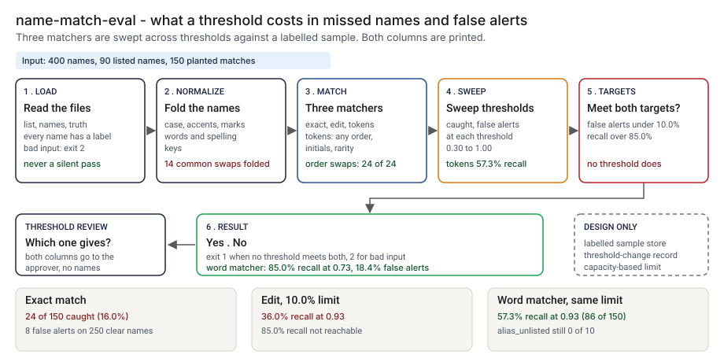

# Architecture: name-match-eval

> **Status.** This is the design for a production shape. The repo implements the product mechanic as a prototype: a command, `src/name_match_eval.py`, that scores customer names against a watchlist with three matchers, sweeps the alert threshold against a labelled truth file and prints how many planted matches each threshold catches and how many clear names it alerts on, run here over 400 synthetic names and a 90-name list. It is an evaluator for a threshold decision, not a screening engine. Nothing below is claimed as deployed or load-tested. Where a figure is a design target, it says so.

GCP is primary; AWS and Azure sit beside it.



---

## 1. Logical architecture

name-match-eval is a function between a labelled sample and a threshold decision: a watchlist, customer names and a truth file in, two threshold lines and a yes or no out. It does not screen live traffic, update a list or clear an alert.

Eight components: five decide the outcome, three support or report.

| Component | Responsibility | Language or framework | Decides the outcome? | Stateful? |
| --- | --- | --- | --- | --- |
| `nm-ingest` | Loads the three files. Rejects empty, wrong-column, ragged or mistyped files, a customer with no truth row, a truth row for no customer, and a match for an entity not on the list. | Python 3.9+, standard library. Prototype: `read_rows`, `load_watchlist`, `load_customers`, `load_truth`, `load_all`, `check_name` in `src/name_match_eval.py` | Yes, by refusing: exit 2 | No |
| `nm-normalize` | Folds case, accents and apostrophes, splits words, folds spelling-insensitive keys. The fold table is a rule. | Python. Prototype: `normalize`, `words`, `fold` | Yes | No |
| `nm-matchers` | Exact, edit and word-based scores for a pair of names. The word matcher aligns words in any order, credits initials and weights by rarity on the list. | Python. Prototype: `ExactMatcher`, `EditMatcher`, `TokenMatcher`, `make_matcher` | Yes | No |
| `nm-evaluate` | Best score per customer against the list, and for a match against its true entity; metrics at a threshold and by planted kind. | Python. Prototype: `evaluate`, `metrics_at`, `by_kind_at` | Yes | No |
| `nm-targets` | Lowest threshold under a false-alert limit, highest over a recall target, and whether one threshold meets both; maps that to an exit code. | Python. Prototype: `lowest_threshold_with_false_rate_at_most`, `highest_threshold_with_recall_at_least`, `run_sweep` | Yes | No |
| `nm-report` | Prints the sweep table and the threshold lines. Escapes untrusted strings. Prints the modeled false alerts per true hit. | Python. Prototype: `format_sweep`, `escape_log`, `false_alerts_per_true_hit` | No | No |
| `nm-labels` | The labelled sample: a random part and a reviewed-alert part, kept apart, with a list version (design). Prototype analog: `data/customers.csv` and `data/truth.csv`. | Object storage with access control (design) | No | Stateful |
| `nm-ledger` | One record per proposed threshold or matcher change, with both columns (design). Prototype analog: the files step 4 writes to `src/out/`. | PostgreSQL plus object storage with a retention lock (design) | No | Stateful |

**What decides the outcome.** The input check, the normalizer, the matchers, the evaluation and the target lines. The report, the sample store and the record carry the result. The evaluator reads the truth file as given: it cannot say whether the labels are right, and the sweep is only as good as the sample.

**Repo structure** (production shape):

```
name-match-eval/
├── eval/       # ingest, normalize, matchers, evaluate, targets, report
├── samples/    # pointers to labelled samples by list version, never the names
├── ledger/     # change record writer
├── infra/      # terraform for gcp, aws, azure; IAM and bucket policies
└── tests/      # unit, golden (planted-set numbers), hostile (injection strings)
```

---

## 2. Physical and deployment architecture

The evaluator is an offline job run when a threshold or matcher change is proposed. It compares every customer with every listed name, so it runs on a sample, not on the customer base.

| Component | GCP (primary) | AWS | Azure | Why |
| --- | --- | --- | --- | --- |
| Evaluation job | Cloud Run job | ECS Fargate task | Container Apps job | Stateless, one pass per matcher, run on demand |
| `nm-labels` | Cloud Storage, versioned, customer-managed keys | S3, versioned, KMS | Blob Storage, versioned, customer-managed keys | Real names stay inside the boundary and the exact bytes a decision used are kept |
| `nm-ledger` | Cloud SQL for PostgreSQL | RDS for PostgreSQL | Azure Database for PostgreSQL | The platform team already runs it |

**Failure behavior (the decision that matters most).** The evaluator must never silently pass. A missing, empty, truncated or mistyped input does not become "both targets met": it ends the run with exit 2 and a one-line reason. A target that cannot be reached is printed as such. A sweep with no matches or no clear names says the figure is not defined.

| Failure | Behavior | Alert |
| --- | --- | --- |
| A file is missing, empty, has the wrong columns, a ragged row or a bad value | Exit 2, one line on stderr naming the file | P3 |
| A customer has no truth row, a truth row names no customer, or a match names an entity not on the list | Exit 2 with the count and the first id | P3 |
| A name has no letters or digits, or is longer than 200 characters | Exit 2 | P3 |
| More than 2,000,000 customer-by-listed-name pairs | Exit 2: the prototype stops there; the design splits the sample | P3 |
| Truth holds no match rows or no clear rows | The output says recall or the false-alert rate is not defined; exit 1 | P3 |
| No threshold meets a target | Printed as "not reachable"; exit 1 | P4 |
| Ledger unavailable (design) | The result and exit code stand; the record queues locally | P3 |

**Latency.** The prototype compares every customer with every listed name; I have not timed it, and the cost grows with names times list size. 🔴 Design target: a threshold-change evidence report within 30 minutes of a labelled sample landing (planning estimate).

---

## 3. Data architecture

| Entity | Key | What it holds | Real columns in the prototype |
| --- | --- | --- | --- |
| Listed name | `entry_id` | A name for a listed entity, primary or alias | `data/watchlist.csv`: `entry_id`, `entity_id`, `listed_name`, `name_type`. The evaluator reads `entity_id` and `listed_name` |
| Customer name | `customer_id` | A name as recorded | `data/customers.csv`: `customer_id`, `name` |
| Truth row | `customer_id` | Match or clear, and the listed entity for a match | `data/truth.csv`: `customer_id`, `truth`, `entity_id`, `planted_as`. In production the label comes from review; `planted_as` exists only because the data is synthetic |
| Sweep result | threshold, matcher | Caught, recall, false alerts, false rate, alerts | Prototype: `src/out/step_04_sweep.csv`, `src/out/step_04_summary.json` |
| Change record | `change_id` | Design: matcher and version, list version, sample hash, both columns, targets, approver, time | None in the prototype |

**Retention** is a design choice, not a measurement: 🔴 7 years by default for change records, with a retention lock. The labelled sample is kept only as long as the change needs it; confirm both against the bank's own schedule.

**Lineage.** A threshold in production traces back in three hops: the change record names the sweep, the list version and the sample hash; the versioned store returns the sample; and the matchers are deterministic (no clock, locale or random draw), so re-running `sweep` reproduces the table.

**Deliberately not stored.** Names in the change record or the logs. The sweep prints counts, thresholds and planted kinds, never a customer's name.

---

## 4. Security architecture

**Identity and roles.** The job runs under the platform's workload identity and has no user account of its own.

| Role | Can | Maps to |
| --- | --- | --- |
| `nm:runner` | Read the sample, the list and the truth; write a change record | The evaluation job's service identity |
| `nm:labeller` | Write labels, never for a threshold they proposed | Alert reviewer |
| `nm:approver` | Approve a threshold change, never their own | Model-risk or compliance reviewer |

**Secrets.** None. The evaluator never calls a model or a list vendor; the job identity reaches the stores through workload identity with no static keys.

**Data classification and what leaves the boundary.** A real watchlist and real customer names are personal data and confidential; the labelled sample is the most sensitive file in the design. In the prototype everything is synthetic and nothing leaves the machine. In the design three things leave the job: the exit code, the sweep counts and the change record.

| Threat | Example | Mitigation in the design |
| --- | --- | --- |
| Hostile string in a name, path or id echoed into output | A name holding a newline and a fake result line | `escape_log` writes `%`, carriage return, newline and other control characters as escapes and cuts long text. `tests/test_cli.py` covers hostile input |
| A threshold moved to hide misses | A limit raised or a sample swapped after a bad sweep | Change record with the sample hash and a different approver; the golden test shows a moved count |
| An unrepresentative sample | Labels only from names that alerted | A random part kept apart from the reviewed-alert part, with each reported separately |
| Real names leak into an issue or a ticket | A finding pasted with a customer name | The README asks for kinds and counts, not names; outputs hold none |

---

## 5. Operational architecture

**SLIs.** Evaluations run per week; input rejections; recall and false-alert rate per matcher at the limit; share of threshold changes with a record; sample age; time to a report. Prototype baseline: 🟢 the word matcher reaches 57.3% recall at the 10.0% limit (`step_04_token_matcher.py`).

**SLOs (all 🔴 design targets, none measured).**
- A threshold-change evidence report within 30 minutes of a labelled sample landing.
- Every threshold or matcher change in production has a change record.
- Every "not reachable" result is read by the program lead before approval (planning estimate).
- 99.9 percent of change records written to the ledger.

**Alerts.** P2: repeated input rejections, or the ledger down for more than a day. P3: a threshold in production with no record. P4: a sample older than the review cycle.

**Runbooks** (one page each, in `docs/runbooks/`):
- `no-threshold-meets-both.md`: read both columns, set the limit from review capacity, decide which number gives.
- `labelling-a-sample.md`: draw the random part, take the reviewed alerts, keep them apart.
- `changing-a-matcher.md`: propose, re-run the planted set, compare with the golden numbers, run in shadow, approve.
- `input-rejected.md`: read the one-line reason, fix the file.

**On-call and ownership.** The screening program lead owns the evaluator, the targets and the runbooks. The list owner owns the list and the alias findings. The reviewer labels. The approver signs a change.

**Change control.** Matchers, the fold table and targets are versioned. A change needs a proposer and a different approver. Before merge the planted set is re-run and compared with `tests/test_golden.py`, so a change that moves recall or false alerts shows in the diff.

---

## 6. Alignment and posture

The README's "Aligned to" section cites no source: it describes name screening against sanctions lists in outline, and I did not read any regulator's or list publisher's text for this project.

- **What the design does.** It prints what a threshold costs in missed names and false alerts, on a labelled sample, before the threshold moves, and records the decision.
- **What it does not claim.** It takes no threshold, score scale or rule from any text, makes no claim of conformity to any regulation, list or standard, holds no certification, and I have not read or mapped any source.

---

## 7. What is deliberately not here

- **A party known by a name that is not on the list.** 🟢 alias_unlisted is caught 0 of 10 by the word matcher (`step_04_token_matcher.py`). The fix is a list that carries the alias.
- **A different person with a listed name.** 🟢 namesake alerts 8 of 8 at 1.00 under all three matchers (`step_04_token_matcher.py`). It needs a second identifier, which is not modeled.
- **A one-letter-different surname.** It looks like a typo; no name-only score separates the two.
- **Phonetic codes and non-Latin scripts.** Names in other scripts are compared letter by letter, never transliterated.
- **A complete fold table.** It covers 14 common spelling swaps and none of the 12 rare ones, so some misses are built in and the translit numbers are flattered.
- **A screening engine.** It compares every customer with every listed name; a live system needs indexing and blocking, which are not designed here.
- **Rates on a real file.** The data and the rules share an author, so the numbers are a ceiling.

---

## Appendix: sample contract

The call is the prototype's own. Its output for the bundled `--demo` run is under "Run one now" in the README.

```bash
python3 name_match_eval.py sweep watchlist.csv customers.csv truth.csv --matcher tokens --min-recall 0.85 --max-false-alerts 0.10
```

The three files are CSV: `entity_id, listed_name` (plus any other columns), `customer_id, name`, and `customer_id, truth, entity_id` where `truth` is `match` or `clear`. The output is a table of threshold, caught, recall, false alerts, false rate and alerts, then the two threshold lines and `both targets met at one threshold: yes` or `no`. Exit status: 0 when a threshold meets both targets, 1 when none does, 2 for bad input.
