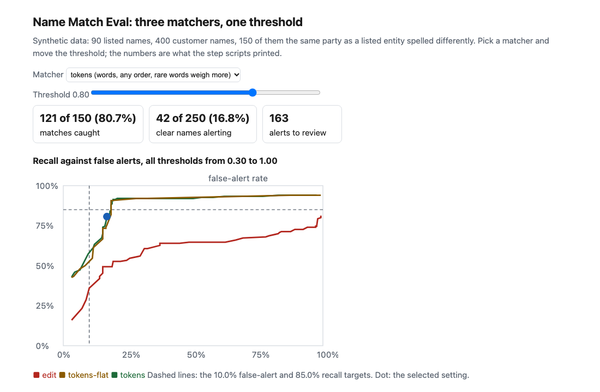
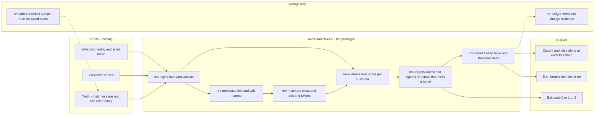
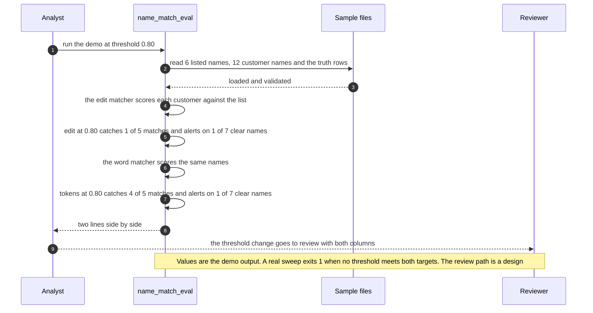

# 🔎 name-match-eval: what a screening threshold costs in missed names and false alerts

**I wanted to know what a name-screening threshold actually trades, so I planted the answer and measured it. This is a command-line evaluator and a synthetic set of 400 customer names planted against a 90-name watchlist: it runs three matchers (exact, character edit similarity, and a word-based matcher), sweeps the alert threshold, and prints how many planted matches each one catches and how many clear names it alerts on.** It is a prototype for thinking about the threshold, not a screening product.

**▶ Static demo, no install:** [open demo.html](./demo.html)

[](./demo.html)

## Executive summary (90 seconds)

**Problem.** An analyst or program lead owns a name-screening step and has to defend its threshold, and nobody prints what the threshold costs. A strict match misses reordered, shortened and respelled names; a loose one floods reviewers with clear names that resemble a listed one. 🟢 On 400 synthetic customer names, of which 150 are planted matches against a 90-name list for 60 entities, matching only the exact normalized name catches 24 of 150 (16.0%) and misses 126 of 150, and still raises 8 false alerts on 250 clear names (3.2%), all of them namesakes (`step_01_exact_match.py`). The team that loosens the match learns what it costs from the size of the review queue.

**Product.** name-match-eval is a command and a synthetic set that plant the answer and measure it. It runs three matchers, none a model: exact (the normalized names are equal), edit (character edit similarity of the whole name) and tokens (names split into words, each folded to a spelling-insensitive key, aligned in any order, initials credited, each word weighted by how rare it is on the list). `sweep` runs one matcher over a watchlist, a customer file and a truth file, prints planted matches caught and clear names alerted at each threshold, finds the lowest threshold that keeps false alerts under a limit and the highest that keeps recall over a target, and says whether one threshold meets both. It exits 1 when none does and 2 for malformed input. `score` scores two names with all three matchers. Results break down by the kind of change that was planted.

**Measured and modeled performance.**

- 🟢 **Exact match: 24 of 150 planted matches caught (16.0%), 8 false alerts on 250 clear names (3.2%),** all namesakes, and no threshold to tune (`step_01_exact_match.py`).
- 🟢 **Edit similarity at a 10.0% false-alert limit needs threshold 0.93 and recalls 36.0%.** Recall of 85.0% is not reachable at any threshold from 0.30 to 1.00 (`step_02_edit_similarity.py`).
- 🟢 **Edit similarity fails by kind:** it catches no more than 4 of 24 order swaps or 5 of 14 initials at the three thresholds printed, and going from 0.60 to 0.93 takes shared_given alerts from 47 of 56 to 0 of 56 while translit hits fall from 22 of 22 to 14 of 22 (`step_03_deficiencies_exposed.py`).
- 🟢 **The word matcher at the same 10.0% limit: threshold 0.93, recall 57.3% (86 of 150)** with 24 false alerts, where edit gets 54 of 150 with 25; order swaps go from 3 of 24 to 24 of 24 (`step_04_token_matcher.py`, `step_03_deficiencies_exposed.py`).
- 🟢 **No threshold meets both targets.** The word matcher reaches 85.0% recall at 0.73 (128 of 150) with 46 false alerts on 250 clear names (18.4%) (`step_04_token_matcher.py`).
- 🟢 **Built-in misses stay:** alias_unlisted is caught 0 of 10, namesake alerts 8 of 8 at 1.00 under all three matchers, and the word matcher is worse than edit on a particle joined to its surname (2 of 8 against 8 of 8 at 0.75) (`step_04_token_matcher.py`).
- 🟡 **Utility: (86/150 − 54/150) × 500 = 106.7 more listed-party matches a year caught at the same false-alert limit,** assuming 500 true matches a year reach screening.
- 🔴 **Design target: a threshold-change evidence report within 30 minutes of a labelled sample landing.** Designed in [`ARCHITECTURE.md`](./ARCHITECTURE.md), never built or timed.

**What I would ask a head of operations to decide.** Which of two numbers the screening step is allowed to give up, since no threshold met both here: the share of clear names that alert, or the share of listed parties caught. My recommendation is to set the false-alert limit from what the review team can actually clear, run the word matcher in shadow beside the current one on a labelled sample from one real list, and treat the unlisted alias and the namesake as list and identifier decisions, because no score fixes them.

**Call to action.** Fork the repo. Swap `data/watchlist.csv`, `data/customers.csv` and `data/truth.csv` for your own, keeping the columns (`entity_id, listed_name`; `customer_id, name`; `customer_id, truth, entity_id`). Run `sweep` with each matcher and read the two threshold lines. To try another matcher, add a class with a `score(a, b)` method and register it in `make_matcher`; to call it from code, import `make_matcher`, `evaluate` and `metrics_at` from `src/name_match_eval.py`. Send findings by opening an issue: say which planted kind moved and by how many, not the names.

_A portfolio prototype on synthetic data. Nothing here is deployed, load-tested or used by anyone, and it is not a screening product._

## Run one now

```bash
cd 76-name-match-eval/src && python3 name_match_eval.py --demo
```

It prints:

```text
sample: 12 names screened against 6 listed names; 5 are the same party as a listed entity, 7 are not
edit   at 0.80: caught 1 of 5, false alerts 1 of 7
tokens at 0.80: caught 4 of 5, false alerts 1 of 7
```

Standard library only, Python 3.9 or newer. To score two names: `python3 name_match_eval.py score "Hasan Karimov" "Karimov, Hassan"`. To sweep your own files: `python3 name_match_eval.py sweep watchlist.csv customers.csv truth.csv --matcher tokens`. It exits 1 when no threshold meets both targets, and 2 for malformed input.

## What the numbers say

**What it shows** (🟢 measured on synthetic data: 90 listed names for 60 entities, 400 customer names of which 150 are planted matches and 250 are different people; the script is named in brackets):

- 🟢 Exact match on the normalized name catches 24 of 150 (16.0%) and raises 8 false alerts on 250 clear names (3.2%); all 8 are namesakes. It has no threshold to tune (`step_01`)
- 🟢 Character edit similarity on the whole name: to keep false alerts on at most 10.0% of clear names the threshold has to be 0.93, and recall is then 36.0%. Recall of 85.0% is not reachable at any threshold from 0.30 to 1.00; at 0.30 recall is 81.3% and 99.2% of clear names alert (`step_02`)
- 🟢 The edit matcher catches no more than 4 of 24 order swaps or 5 of 14 initials at the three thresholds I printed (0.60, 0.75, 0.93), and going from 0.60 to 0.93 takes shared_given alerts from 47 of 56 to 0 of 56 while translit hits fall from 22 of 22 to 14 of 22 (`step_03`)
- 🟢 The word-based matcher at the same 10.0% limit: threshold 0.93, recall 57.3% (86 of 150) with 24 false alerts; edit similarity gets 54 of 150 with 25 false alerts. Order swaps go from 3 of 24 to 24 of 24 (`step_04`, `step_03`)
- 🟢 Weighting words by rarity on the list matters at the strict end: at the 10.0% limit the unweighted word matcher reaches 50.0% recall (threshold 0.94) against 57.3% weighted. At the 85.0% recall target both land on 18.4% false alerts (`step_04`)
- 🟢 No threshold meets both targets. The word matcher reaches 85.0% recall at 0.73 (128 of 150) with 46 false alerts on 250 clear names (18.4%) (`step_04`)
- 🟡 Modeled, with the base rate as my assumption of 1 real match in every 10,000 customers: the edit matcher at its 10.0% limit gives about 2,778 false alerts for each true hit, the word matcher about 1,674 (`step_02`, `step_04`). The 150 of 400 in the synthetic set is not a base rate; use the false-alert rate, not the alert count, when you read across

## What it still gets wrong

- 🟢 A party known by a name that is not on the list is not found: `alias_unlisted` is caught 0 of 10 at 0.50 by the word matcher (1 of 10 by edit). The fix is a list that carries the alias, not a better score (`step_03`, `step_04`).
- 🟢 A different person with a listed party's exact name always alerts: `namesake` 8 of 8 at 1.00 under all three matchers. Separating them takes a second identifier such as a date of birth, which I did not model (`step_03`, `step_04`).
- 🟢 A surname one letter from a listed one looks like a typo: `near_name` 30 of 30 alert at 0.85, while the word matcher keeps 14 of 14 typo hits at 0.73. No name-only score separates the two (`step_04`).
- 🟢 The word matcher is worse than edit on two planted kinds. A particle joined to its surname ("Altavari" for "Al Tavari") is caught 2 of 8 at 0.75 against 8 of 8 for edit, and `translit_heavy` (three spelling changes my fold table does not know) is caught 5 of 10 against 10 of 10 (`step_04`).
- **The data and the rules share an author.** I wrote the generator that plants the variants and the matcher that folds them. Its fold table covers the 14 common spelling swaps the generator uses and none of the 12 rare ones, so some misses are built in, but the overlap flatters the translit numbers. Treat every figure as a ceiling for this data, not a rate on a real customer file, which I have not tested.
- 🟡 The mix of variants (24 order swaps, 22 transliterations, 8 namesakes and so on) and the two targets (10.0% false alerts, 85.0% recall) are my assumptions. A different mix moves every number.
- Not covered: names in non-Latin scripts (compared letter by letter, never transliterated), phonetic codes such as Soundex, secondary identifiers, and any commercial screening product. A swap of two letters costs two edits.

## How the four steps fit

| Step | Question | Script |
|---|---|---|
| 1 | What does matching only exact names catch? | `step_01_exact_match.py` |
| 2 | What does a threshold on whole-name edit similarity cost? | `step_02_edit_similarity.py` |
| 3 | Where does that approach break, and what no matcher fixes? | `step_03_deficiencies_exposed.py` |
| 4 | What do folded words, any order and rarity weights buy? | `step_04_token_matcher.py` |

Run any of them from `src/`. Data is generated by [`data/_generate.py`](./data/README.md); `tools/check_repo.py` confirms that a rerun reproduces every file and that the green numbers above appear in a script's output.

## Utility delivered

The way I price product impact: **utility = (my solution − current state of the art) × the number of people or items it affects.**

Here the item is a listed party that reaches screening under a name that is not an exact spelling. Each one lands on the analyst who owns the threshold, the reviewer who clears the queue, and the compliance lead who answers for a miss. The common basic approach is whole-name edit similarity at the strictest threshold the false-alert limit allows; the table prices the word matcher against it at that same limit.

| Term | Value | Where it comes from |
| --- | --- | --- |
| Current state of the art (edit similarity at the 10.0% false-alert limit), planted matches caught | 🟢 **54 of 150** (recall 36.0% at threshold 0.93) | `step_02_edit_similarity.py` prints 36.0% at 0.93; `step_04_token_matcher.py` prints 54 of 150 with 25 false alerts |
| My solution (word matcher at the same limit), planted matches caught | 🟢 **86 of 150** (recall 57.3% at threshold 0.93) | `step_04_token_matcher.py`; 24 false alerts, one fewer than edit |
| Lift per planted match | 🟢 86 of 150 minus 54 of 150 | Order swaps go from 3 of 24 to 24 of 24; initials 9 of 14; the unlisted alias stays at 0 of 10 (`step_03_deficiencies_exposed.py`, `step_04_token_matcher.py`) |
| Number it affects: true matches reaching screening in a year | 🟡 **500** | **Assumption, not a statistic.** Replace it with your own count of true listed-party matches a year |
| Assumption that makes the lift real | 🟡 The real name variants look like the planted mix, the word matcher's fold table covers the real spelling swaps, and the false-alert limit is the team's real one | The fold table here covers 14 common swaps and none of the 12 rare ones, so the translit numbers are flattered (`data/README.md`) |
| **Utility** | 🟡 **(86/150 − 54/150) × 500 = 106.7 more listed-party matches a year caught at the same false-alert limit** | Assumes the 500 behave like the 150 planted ones |

Sensitivity to the count assumption (🟡, same lift): 250 true matches a year gives 53.3, 500 gives 106.7, 1000 gives 213.3.

🔴 What I have not measured: what a missed match costs, how long a reviewer takes to clear an alert, how many true matches a real customer file holds, or how a real list's names are spelled. The planted set is dense on purpose, 150 of 400 names are matches (`step_01_exact_match.py`), which is not a base rate; the modeled line in step 4 uses 1 real match in every 10,000 customers. Treat the result as a property of this mix of names, not a forecast.

---

## Architecture and call flow

Component names match [`ARCHITECTURE.md`](./ARCHITECTURE.md). GitHub renders the diagrams natively.


**System topology:**



**Per-run sequence** (the `--demo` run on the bundled sample of 12 names and 6 listed names):



**Interlocks (all red, designed, none built):**

- [50 Review Capacity](../50-review-capacity/) sizes a review queue from arrivals and handling time. In a design, its answer would set the false-alert limit that `sweep` takes, and the alert counts here would feed its arrivals. Nothing is wired.
- [72 Scam Friction Sim](../72-scam-friction-sim/) prints a similar trade, value stopped against people held for no reason. The two would sit side by side in a threshold review. This folder does not import or read its files.
- [09 LineageLog](../09-lineagelog-ai-decision-audit/) is a possible home for the threshold-change record (`nm-ledger`).

---

## PM artifacts

The PM artifacts that show how I would run this product if I owned the seat. This README is the walkthrough; the rest of the folder holds:

- [`PRD.md`](./PRD.md): the product requirements doc, with users, backlog, KPIs, rollout and open questions.
- [`ARCHITECTURE.md`](./ARCHITECTURE.md): the systems doc, with components, data model, security, failure behavior and operations. A design, not deployed.
- [`demo.html`](./demo.html): clickable, no-install walkthrough, built from the step outputs by `src/_build_demo.py`.
- [`data/`](./data/): the invented watchlist, 400 customer names, the planted truth and the seeded generator. `data/README.md` explains how the truth is set.
- [`src/`](./src/): `name_match_eval.py`, `common.py`, the four step scripts and the demo builder.
- [`tests/`](./tests/): 46 unittest tests, including a golden test that pins the numbers above and tests for bad input and hostile strings.

Run the four steps end to end:

```bash
cd src
python3 step_01_exact_match.py
python3 step_02_edit_similarity.py
python3 step_03_deficiencies_exposed.py
python3 step_04_token_matcher.py
```

---

## Aligned to

Name screening against sanctions lists, where the practical question is how loosely to match a name and what the review queue costs. I did not read any regulator's or list publisher's published text for this project, so it cites none and takes no threshold, score scale or rule from one. Every threshold here is a value I swept, not a rule parameter. It is a prototype, aligned to that practice in outline. It makes no claim of conformity to that practice, to any regulation or to any list.

## Data and limits

Synthetic, seeded, byte-for-byte reproducible. Given names are common first names; surnames are invented from syllables. Nothing comes from any employer, customer, list publisher or real person, and any resemblance to a real name is chance. A prototype on synthetic data, not a production case study.

## Fork it

Swap `data/watchlist.csv`, `data/customers.csv` and `data/truth.csv` for your own and keep the columns (`entity_id, listed_name`; `customer_id, name`; `customer_id, truth, entity_id`). To try another matcher, add a class with a `score(a, b)` method to `src/name_match_eval.py` and register it in `make_matcher`. Read the [PRD](./PRD.md) for the scope I held to.

## Prereqs to run this on your laptop

You need Python 3.9 or newer and nothing else. The evaluator, the four step scripts and the data generator use only the standard library, so there is nothing to install. There is no API key, no network call and no model call anywhere in the folder. To run the tests, use `python3 -m unittest discover -s tests` from this folder. The production pieces in [`ARCHITECTURE.md`](./ARCHITECTURE.md) (the labelled sample store, the threshold-change record) are a design, not something you need or can run.

## Author

**Vijay Saharan**, Sr Product / Program Manager · AI in BFSI · Enterprise AI Platforms

[LinkedIn](https://www.linkedin.com/in/vijaysaharan/)
