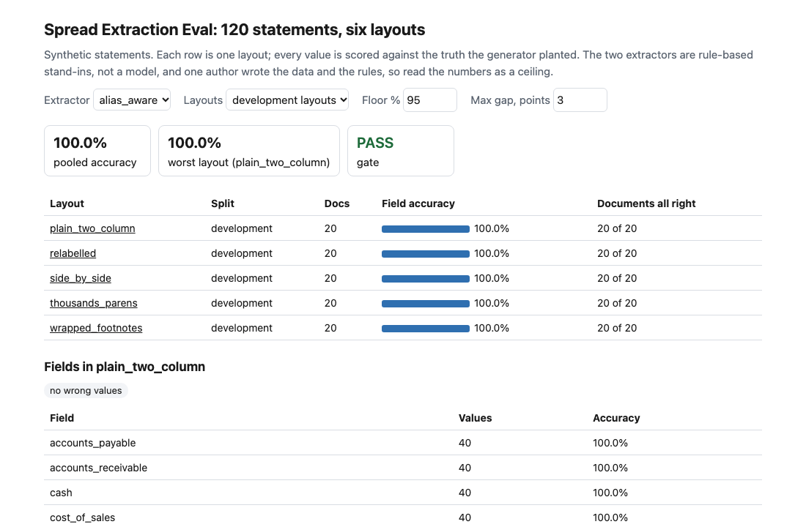
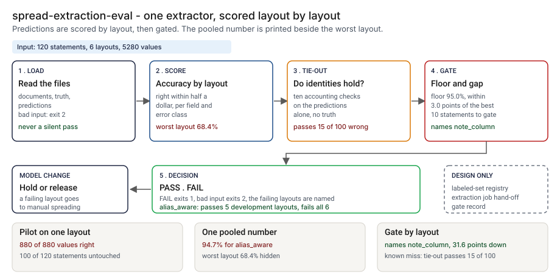
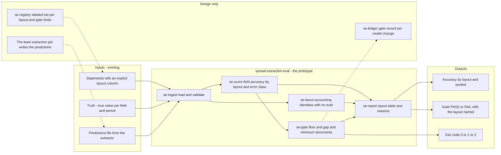
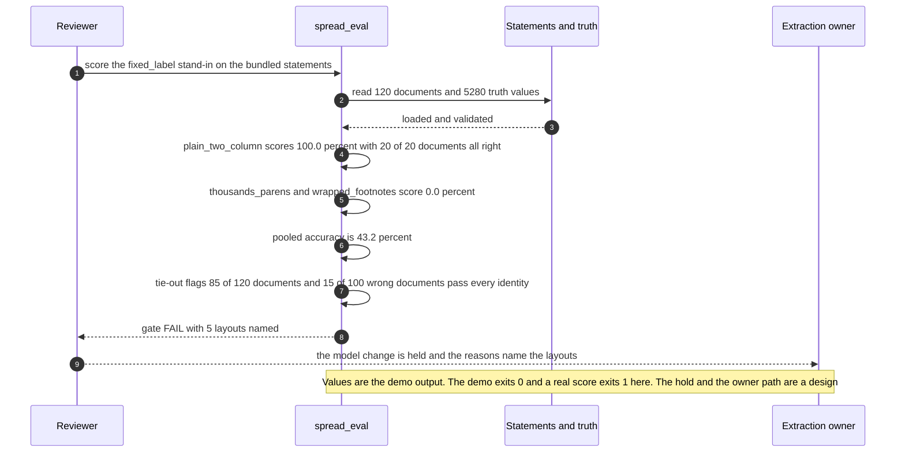

# 📑 spread-extraction-eval (synthetic statements): where extraction drifts across layouts

**I wanted to know what happens when the financial statements a credit analyst spreads arrive in a layout the extractor was not written for, and whether the usual single accuracy number would tell me. This is a seeded generator of 120 statements in six layouts, a field-level scorer and a drift gate that names the layout that slipped.** It scores two rule-based stand-ins, not a model. The point is the harness: the same documents, the same scoring, one gate. Swap in a model's output file and keep the rest.

**▶ Static demo, no install:** [open demo.html](./demo.html)

[](./demo.html)

## Executive summary (90 seconds)

**Problem.** The owner of an extraction step in a lending workflow, and the reviewer who decides whether a new model or prompt may replace the old one, are asked to trust an accuracy number. The extractor was tuned and tested on the layouts someone had to hand, and statements arrive in others: figures in thousands, parentheses for losses, relabelled lines, a balance sheet printed in two halves, a column of note numbers. 🟢 On 120 synthetic statements in 6 layouts, a pilot on the layout the extractor was written against finds 880 of 880 values right, and 100 of 120 statements (83.3%) sit in layouts the pilot never touched (`step_01_pilot_only.py`). The failure arrives as a wrong figure in a spread, found by a person later.

**Product.** spread-extraction-eval is a seeded generator and a scorer, with a gate, that run the same documents and the same scoring on any extractor. The generator writes 120 statements (an income statement and a balance sheet as plain text) in six layouts with the true value of 22 fields in 2 periods. The scorer reads a predictions file, marks each value right within half a dollar, groups the result by an explicit layout column and names the class of each wrong value (missing, scale, sign, wrong period, compound, wrong line, other). A tie-out check needs no truth: it tests ten accounting identities on the predictions alone. The gate fails a layout that sits under a floor, or too far under the best layout, and ignores a layout with too few statements. It exits 1 when the gate fails and 2 for malformed input. It scores two rule-based stand-ins, not a model, and there is no model call.

**Measured and modeled performance.**

- 🟢 **A pilot on one layout reads 880 of 880 values right** while 100 of 120 statements (83.3%) sit in layouts it never touched (`step_01_pilot_only.py`).
- 🟢 **One pooled number: `fixed_label` 43.2%, `alias_aware` 94.7%,** a gain of 51.5 points (`step_02_pooled_accuracy.py`).
- 🟢 **Behind the 94.7%: best layout 100.0%, worst 68.4% (`note_column`), a spread of 31.6 points.** A random audit of 10 statements holds no `note_column` statement in 146 of 1000 draws (`step_03_deficiencies_exposed.py`).
- 🟢 **The gate passes `alias_aware` on the 5 development layouts and fails it on all 6,** naming `note_column`, where 7 of 22 fields fall below 100.0%. `fixed_label` fails 4 of the 5 development layouts: 0.0% on `thousands_parens` and `wrapped_footnotes`, 18.2% on `relabelled`, 72.7% on `side_by_side` (`step_04_layout_scorer.py`).
- 🟢 **Hard negatives stay quiet:** 24 development statements carry a negative value, `alias_aware` reads all 24 with every field right, and the tie-out check raises 0 false alarms (`step_04_layout_scorer.py`).
- 🟢 **Known limit: the tie-out check passes 15 of the 100 statements `fixed_label` reads wrong,** all in `thousands_parens`, because that extractor ignores the "in thousands" header and swaps the columns and both mistakes keep every identity true (`step_03_deficiencies_exposed.py`).
- 🟡 **Utility: (136 + 142) / 20 × 600 = 8,340 wrong values a year held out of the spread by a layout-level gate,** assuming 600 statements a year arrive in a layout that has drifted.
- 🔴 **Design target: a gate result within 10 minutes of a predictions file landing.** Designed in [`ARCHITECTURE.md`](./ARCHITECTURE.md), never built or timed.

**What I would ask a head of operations to decide.** Whether a new extraction model or prompt may replace the current one on a pooled accuracy number, or only after a layout-level gate passes. My recommendation is to gate by layout, set the floor and the gap from the error the spreading step can absorb (my 95.0% and 3.0 points are assumptions), keep a labeled sample in every layout including one held out, and route statements in a failing layout to manual spreading until it passes.

**Call to action.** Fork the repo. Replace `data/statements.csv` and `data/truth.csv` with your own labeled statements, keeping the columns (`doc_id, layout` and `text` for `predict`; `doc_id, field, period, value` for the truth). Write your extractor's output as a predictions file in the truth shape and run `score`; group by whatever `layout` means to you, a template, a vendor or a country. To call it from code, import `evaluate` and `gate` from `src/spread_eval.py`. Send findings by opening an issue: say which layout and which error class, not the statements.

_A portfolio prototype on synthetic data. Nothing here is deployed, load-tested or used by anyone, and no model has been scored._

## Run one now

```bash
cd 77-spread-extraction-eval/src && python3 spread_eval.py --demo
```

It prints:

```text
extractor: fixed_label (a rule-based stand-in, not a model)
documents 120, truth values 5280, no prediction 1848, extra prediction rows 0
layout              docs  values  correct   accuracy  documents all right
plain_two_column      20     880      880     100.0%             20 of 20
side_by_side          20     880      640      72.7%              0 of 20
note_column           20     880      602      68.4%              0 of 20
relabelled            20     880      160      18.2%              0 of 20
thousands_parens      20     880        0       0.0%              0 of 20
wrapped_footnotes     20     880        0       0.0%              0 of 20
all layouts pooled    120    5280     2282      43.2%
wrong values by class: missing 1848, scale 2, wrong_period 136, compound 870, other 142
tie-out, no truth needed: flags 85 of 120 documents; 15 of 100 documents with a wrong value pass every identity
gate (floor 95.0%, max gap 3.0 points, at least 10 documents per layout): FAIL
  thousands_parens: 0.0% is below the floor of 95.0% and 100.0 points below plain_two_column
  wrapped_footnotes: 0.0% is below the floor of 95.0% and 100.0 points below plain_two_column
  relabelled: 18.2% is below the floor of 95.0% and 81.8 points below plain_two_column
  note_column: 68.4% is below the floor of 95.0% and 31.6 points below plain_two_column
  side_by_side: 72.7% is below the floor of 95.0% and 27.3 points below plain_two_column
```

Standard library only, Python 3.9 or newer. To score your own extractor: `python3 spread_eval.py score --docs statements.csv --truth truth.csv --predictions mine.csv`. It exits 1 when the gate fails and 2 for malformed input. `python3 spread_eval.py predict --extractor alias_aware --docs statements.csv` prints a predictions file in the format `score` reads.

## What the numbers say

**What it shows** (🟢 measured on synthetic data: 120 statements, 6 layouts, 5,280 field values; the script is named in brackets):

- 🟢 A pilot on the layout the extractor was written against finds 880 of 880 values right, and 100 of 120 statements (83.3%) sit in layouts the pilot never touched (`step_01`)
- 🟢 One pooled number: `fixed_label` 43.2% (2282 of 5280 values), `alias_aware` 94.7% (5002 of 5280), a gain of 51.5 points (`step_02`)
- 🟢 Behind the 94.7%: best layout 100.0%, worst 68.4% (`note_column`), a spread of 31.6 points, and 100 of 120 statements (83.3%) with every field right (`step_03`)
- 🟢 A random audit of 10 statements holds no `note_column` statement in 146 of 1000 draws (`step_03`)
- 🟢 The gate passes `alias_aware` on the 5 development layouts and fails it on all 6. In `note_column`, 7 of 22 fields fall below 100.0%; the wrong values are 136 `wrong_period` and 142 `other` (`step_04`)
- 🟢 `fixed_label` fails the gate on 4 of the 5 development layouts: 0.0% on `thousands_parens` and `wrapped_footnotes`, 18.2% on `relabelled`, 72.7% on `side_by_side` (`step_04`)
- 🟢 Hard negatives: 24 development statements carry a negative value (a loss or a deficit); `alias_aware` reads all 24 with every field right and the tie-out check raises 0 false alarms (`step_04`)
- 🟡 Modeled, with the share of incoming statements assumed: if `note_column` were 5% of traffic the same extractor would pool at 98.4%, at 30% 90.5%, at 60% 81.0% (`step_03` prints them)
- 🟡 The gate limits (floor 95.0%, gap 3.0 points, at least 10 statements per layout) are my assumptions. Set your own on the command line.
- 🔴 Hypothetical: a real model would show a spread like this. I have not run one.

## What it still gets wrong

- 🟢 The tie-out check passes 15 of the 100 statements `fixed_label` reads wrong, all in `thousands_parens` (`step_03` and `step_04` print it). That extractor ignores the "in thousands" header and swaps the two columns, and both mistakes keep every accounting identity true. Only a labeled sample sees it. I left this in on purpose.
- **The data and the rules share an author.** I wrote the generator and both extractors. `alias_aware` reaches 100.0% on five layouts because I fixed it against the error classes `fixed_label` printed on them. `note_column` was held out in the sense that no rule was written for it; I still designed it knowing what the rules look like. Treat every number as a ceiling for these rules, not a rate on real statements.
- **The stand-ins are rules, not a model.** A model drifts for other reasons: it can invent a figure, it can differ between runs, it can read a scanned page worse than a clean one. Nothing here measures any model. What carries over is the scoring and the gate.
- 20 statements per layout is thin. The 880 values in a layout come from 20 documents and are not independent, so the gate also prints how many statements are right in full.
- A value is right when it is within half a dollar of the truth. A wrong tax line counts the same as a wrong revenue line; there is no materiality weighting. The tie-out check uses the same half-dollar tolerance, so statements that "may not sum due to rounding" would raise false alarms.
- **Left out to fit the build:** scanned or noisy input, multi-page statements, a cash-flow statement, consolidated against parent accounts, multiple currencies, labels in other languages, restated prior-year figures, confidence intervals on the accuracies, and a hosted app. The generator has 22 fields in 2 statements and 6 layouts, which is the part that fit.

## How the four steps fit

| Step | Question | Script |
|---|---|---|
| 1 | What does a pilot on one layout tell you? | `step_01_pilot_only.py` |
| 2 | What does one pooled accuracy say? | `step_02_pooled_accuracy.py` |
| 3 | What does the pooled number hide, and what does the tie-out check miss? | `step_03_deficiencies_exposed.py` |
| 4 | What do layout-level scoring and a gate catch? | `step_04_layout_scorer.py` |

Run any of them from `src/`. Data is generated by [`data/_generate.py`](./data/README.md); `tools/check_repo.py` confirms that a rerun reproduces every file and that the green numbers above appear in a script's output. `src/_standins.py` holds the two stand-in extractors and is the only place their rules live. [`PRD.md`](./PRD.md) holds the scope.

## Utility delivered

The way I price product impact: **utility = (my solution − current state of the art) × the number of people or items it affects.**

Here the item is a statement that arrives in a layout the extractor has drifted on. Each one lands on the analyst who spreads it, the reviewer who signed off the model, and the credit decision that reads the spread. The common basic approach is one pooled accuracy number; the table prices a layout-level gate against it. The scripts print no count of errors prevented in use, so the lift below is modeled from printed rates and an assumed volume, not measured.

| Term | Value | Where it comes from |
| --- | --- | --- |
| Current state of the art (one pooled number), what it shows | 🟢 **94.7% pooled** for `alias_aware`, with the worst layout at 68.4% hidden behind it | `step_02_pooled_accuracy.py`, `step_03_deficiencies_exposed.py`; at an assumed 5% share of `note_column` the pooled figure reads 98.4% |
| My solution (layout-level gate), what it shows | 🟢 **FAIL on all 6 layouts, naming `note_column`** with 136 `wrong_period` and 142 `other` wrong values | `step_04_layout_scorer.py`; the same extractor passes the 5 development layouts |
| Lift | 🟢 a spread of 31.6 points between the best and worst layout that the pooled number does not show | `step_03_deficiencies_exposed.py` |
| Number it affects: statements a year in a drifted layout | 🟡 **600** | **Assumption, not a statistic.** Replace it with your own count of statements a year that arrive in a layout the extractor is weak on |
| Assumption that makes the lift real | 🟡 A statement in a failing layout is held for manual spreading until the layout passes, and its wrong-value rate matches `note_column`'s | If nobody acts on a FAIL, the lift is zero; if the real layout is worse or better than `note_column`, so is the saving |
| **Utility** | 🟡 **(136 + 142) / 20 × 600 = 8,340 wrong values a year held out of the spread** | 278 wrong values over 20 statements is 13.9 per statement. Assumes the 600 behave like the 20 planted ones |

Sensitivity to the count assumption (🟡, same lift): 300 statements a year gives 4,170, 600 gives 8,340, 1,200 gives 16,680.

🔴 What I have not measured: what a wrong figure in a spread costs, how long manual spreading takes, how a real model fails, or how often a real extractor meets a new layout. The planted set is dense on purpose, one layout in six is held out and fails (`step_04_layout_scorer.py`); a real stream has far fewer. Treat the result as a property of these layouts, not a forecast.

---

## Architecture and call flow

Component names match [`ARCHITECTURE.md`](./ARCHITECTURE.md). GitHub renders the diagrams natively.



**System topology:**



**Per-run sequence** (the `--demo` run: the `fixed_label` stand-in on the 120 bundled statements):



**Interlocks (all red, designed, none built):**

- [51 Memo Tieout](../51-memo-tieout/) ties the figures in a credit memo to a spread exported as CSV. In a design, the spread it reads would come from an extractor that passed this gate. Nothing is wired.
- [40 Eval Gate](../40-eval-gate/) is a CI gate on probe-set regression with a pinned snapshot. The two would sit side by side in a model-change pipeline: one checks which snapshot answered, this one checks which layouts slipped. Neither imports the other.
- [68 KYB Packet Check](../68-kyb-packet-check/) checks a model's extraction of a document with cheap rules. The same layout-level scoring could apply to its extractions. This folder does not read its files.

---

## PM artifacts

The PM artifacts that show how I would run this product if I owned the seat. This README is the walkthrough; the rest of the folder holds:

- [`PRD.md`](./PRD.md): the product requirements doc, with users, backlog, KPIs, rollout and open questions.
- [`ARCHITECTURE.md`](./ARCHITECTURE.md): the systems doc, with components, data model, security, failure behavior and operations. A design, not deployed.
- [`demo.html`](./demo.html): clickable, no-install walkthrough, built from the step outputs by `src/_build_demo.py`.
- [`data/`](./data/): 120 invented statements in six layouts, 5,280 true values and the seeded generator. `data/README.md` explains how the truth is set.
- [`src/`](./src/): `spread_eval.py`, `_standins.py` (the two rule-based extractors), `common.py`, the four step scripts and the demo builder.
- [`tests/`](./tests/): 71 unittest tests, including a golden test that pins the numbers above and tests for bad input and hostile strings.

Run the four steps end to end:

```bash
cd src
python3 step_01_pilot_only.py
python3 step_02_pooled_accuracy.py
python3 step_03_deficiencies_exposed.py
python3 step_04_layout_scorer.py
```

---

## Aligned to

Nothing. No published standard or regulation is cited and none is claimed. The one idea borrowed is ordinary model evaluation practice: score by slice, because a pooled number depends on the mix of inputs. This is a prototype on synthetic data.

## Data and limits

Synthetic, seeded, byte-for-byte reproducible. Company names are invented. Nothing comes from any employer, customer or real filing. The statements are plain text, which is what an extractor would see after text recognition; no image is involved. A prototype on synthetic data, not a production case study.

## Fork it

Replace `data/statements.csv` and `data/truth.csv` with your own labeled statements, keeping the columns (`doc_id`, `layout`, and `text` for `predict`; `doc_id`, `field`, `period`, `value` for truth). Write your extractor's output as a predictions file in the same shape as truth and run `score`. Group by whatever `layout` means to you: a template, a vendor, a country. Read the [data notes](./data/README.md) before you change the field list; the tie-out check expects the 22 field names.

## Prereqs to run this on your laptop

You need Python 3.9 or newer and nothing else. The scorer, the two stand-in extractors, the four step scripts and the data generator use only the standard library, so there is nothing to install. There is no API key, no network call and no model call anywhere in the folder. To run the tests, use `python3 -m unittest discover -s tests` from this folder. The production pieces in [`ARCHITECTURE.md`](./ARCHITECTURE.md) (the labeled-set registry, the extraction job's hand-off, the gate record) are a design, not something you need or can run.

## Author

**Vijay Saharan**, Sr Product / Program Manager · AI in BFSI · Enterprise AI Platforms

[LinkedIn](https://www.linkedin.com/in/vijaysaharan/)
