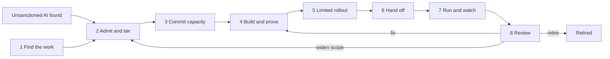

# 🏛️ An AI Operating Model for Bank Operations, Built from the 27 Projects

**Status: 🔴 hypothetical.** This is a design document. No bank, employer or program has run it. It describes the function I would set up to get GenAI, agents and models into a bank's operations queues and keep them under control, built from the 27 prototypes in this repo. It is written for an operations executive or the lead of an AI Center of Excellence (CoE).

## How to read this

- **Tags.** 🟢 measured: a script in the repo prints it, on synthetic data. 🟡 modeled: an assumption is named. 🔴 hypothetical: designed, never tested.
- **Sources.** A bracket such as (11, step_04) names the project and script behind a number, copied from that README with its tag. All data is synthetic: the numbers show a mechanism working, not how a real bank behaves.
- **What is mine.** Roles, forums, cadences, RACI cells, the gate pairing and the 30/60/90 plan are my design (🔴). Where the repo has no number I give none; assumed values need calibrating on your data.
- **Frameworks.** SR 11-7, SR 26-2, NIST AI RMF, OWASP LLM Top 10 and the EU AI Act appear as design basis or comparison only. SR 26-2 (April 17, 2026) replaced SR 11-7. It sets no enforceable standards, is aimed mainly at banks with over $30 billion in assets, and puts generative AI and agentic AI models outside its scope, leaving a bank's own governance to guide their controls. This model is a design for that governance, not mapped clause by clause to SR 26-2.

## Design spine

I use the tier from [11 TierGate](./11-tiergate-ai-usecase-intake/) as the spine: it sets the evidence owed, the review depth and who may approve. Three habits come from the prototypes: compute status from evidence, not the owner's report; read evidence where it is produced (call logs, usage logs, gate records); print the known miss beside every number and name a person who restores every automatic stop.

## 1. Lifecycle: eight stages from finding the work to retiring it

|Stage|Question|Exit evidence|Gates (my pairing, 🔴)|Projects|
|---|---|---|---|---|
|1 Find the work|Which steps can an agent take over?|Build brief with control screen|Feeds G0|26, 22|
|2 Admit and tier|Which tier, evidence, vendor, obligations?|Tier record; evidence READY or HOLD; vendor rating|PB 1 Intake; G0|11, 18, 16|
|3 Commit capacity|Are reviewers and a benefit owner available?|Board status; capacity row; benefit baseline|PB 2 Discovery entry|24, 12|
|4 Build and prove|Do controls hold offline, and how does shadow differ from people?|Permissions record; offline report; shadow scorecard with known misses|PB 3 Build entry; G1 to G4|27, 23, 04, 01, 14, 13, 15, 17, 06, 20|
|5 Limited rollout|Does it hold live with people at both gates?|Weekly rollout report|PB 4 Pilot entry; G5|27, 08, 09|
|6 Hand off|Can the owning team run, stop and restore it?|Signed hand-off; rehearsed runbook|PB 5 Scale entry; G6|27, 25, 05|
|7 Run and watch|Is it drifting, leaking, over-permissioned, unused?|Control evidence on schedule|None|02, 05, 06, 20, 23, 25, 19, 07, 21, 09|
|8 Review|Widen, fix, hold or retire?|Review record; next brief version|G7|12, 21, 07, 23, 24|

PB means a PortfolioBoard gate, G an AgentKit gate. The repo does not align the two ladders; the pairing is mine. Stage 8 is the thinnest: the [playbook](./27-agentkit-reference-agent-and-playbook/playbook/DELIVERY_PLAYBOOK.md) lists retiring as one review outcome, and no project prototypes decommissioning.

## 2. Roles and who decides what

|Role|Line (as PRDs state it)|Holds|Source|
|---|---|---|---|
|CoE lead (head of the AI program office)|1|Lifecycle, monthly board, pause and fund calls|24|
|Sponsor and process owner, later owning team lead|1|Declares the case, signs golden cases, owns the pager after hand-off|11, 27|
|Platform and on-call engineer|1|Builds to the brief, holds scoped credentials, engages the kill switch|27, 23|
|AI governance lead|2 in 11; 1 in 16, 22|Rubric and checklist; can hold an approval|11|
|Model risk reviewer|2|Validation, risk-review attestation, tolerances|11, 13|
|CRO and delegate|not stated|Delegate approves rubric versions; CRO signs tier 4|11|
|Security and access-governance reviewer|not stated|Permission changes; controllers that move traffic|23, 25|
|Third-party risk manager|1|Vendor rating, cadence, exit readiness|18|
|Resilience lead; AI incident manager|not stated; 1|Fallback policy and drills; incident record and clocks|25, 19|
|Counsel, compliance, regulatory liaison, privacy officer|not stated|Clock hours; ingestion policy|19, 20|
|Reviewer operations director; finance partner|not stated|Queue thresholds and SLA floors; hard benefit column|08, 12|
|AI enablement program lead|1|Adoption funnel and unit response|21|
|Internal audit|3|Reads immutable records; approves nothing|08, 09|

The PRDs disagree on the governance lead's line. I put policy ownership in line 2 and the operating work in the CoE.

**RACI (all cells 🔴, one accountable role per row).**

|Activity|Accountable|Responsible|Consulted|Informed|
|---|---|---|---|---|
|Screen a candidate|CoE lead|Process owner|Engineer, security, privacy officer|Governance lead|
|Own rubric and checklist|CRO delegate|Governance lead|Model risk, security, third-party risk|CoE, audit|
|Admit tier 3 or 4|Governance lead|CoE intake desk|Sponsor, model risk, counsel|Audit|
|Rate a vendor|Third-party risk manager|Third-party risk|Sponsor, security, counsel|Model risk|
|Fund, pause, defer|CoE lead|Program office|Sponsor, model risk, security|Finance|
|Approve a permission|Agent owner|Platform engineer|Security|Model risk, audit|
|Pass offline tests, shadow|Process owner|Engineer|Model risk, security|CoE|
|Open limited rollout|Governance lead at tier 3 or 4, else process owner|Engineer|Model risk, security|CoE, audit|
|Engage a kill switch|Owning team lead|On-call engineer|Resilience lead|Governance lead|
|Restore after a trip|Owning team lead|On-call engineer proposes|Model risk, resilience|Audit|
|Declare incident, notify|Incident manager|Incident manager, liaison|Counsel, owner|Executive on call|
|Report benefit|CoE lead|Program office|Finance partner|Sponsor|
|Retire|Owning team lead|Engineer|Governance, security, finance|CoE, audit|

## 3. Forums and cadence (🔴)

|Forum|Cadence|Decides, from what|Chair|
|---|---|---|---|
|Intake review|Weekly|Admit, hold, re-tier; clear flags. From register, flags, evidence status (11), vendor rating (18), obligation view (16)|Governance lead|
|Release readiness|At each gate|Open G4, G5, G6; accept the known-miss list with an owner. From scorecard and rehearsal (27)|Governance lead at tier 3 or 4, else process owner|
|Portfolio board|Monthly|Fund, pause, defer. From status, capacity grid, dependencies (24)|CoE lead|
|Control health review|Monthly|Owner and date for every stale or failed control. From section 5 evidence|Governance lead|
|Incident review|Weekly and on any S1 or S2|Determination, clocks, follow-ups with evidence (19)|Incident manager|
|Executive AI report|Quarterly|Capacity, appetite, tier 4 exceptions. From section 8|CRO or COO delegate|

Drills run on the resilience lead's cadence. The modeled bank in 25 assumes 45 days (🟡, 25, `data/policy.csv`).

## 4. Tiering policy and the evidence each tier requires (stage 2)

The tier is arithmetic: points from six form questions (customer-facing, decision autonomy, data class, vendor model, regulatory scope, financial exposure), then tier = min(4, 1 + points // 4) (11). The sponsor's declared tier is a claim to check, not an input to trust.

|Tier|Evidence owed (cumulative)|Review depth|Who may approve|Run-time controls attached (🔴)|
|---|---|---|---|---|
|1|E01 use-case card with named line-1 owner; E02 data-source attestation|🟡 1.5 h (11, step_01)|Sponsor's unit, intake desk; governance lead advisory|Register entry; unregistered use found by 22|
|2|Adds E03 evaluation plan and results (04); E04 privacy and data-handling review|🟡 3.0 h|As tier 1|Eval gate on each model, prompt or tool change (04, 13, 15); permission review (23)|
|3|Adds E05 independent validation with effective challenge; E06 human review design (08); E07 decision logging and lineage plan (09); E08 vendor due diligence (18)|🟡 8.0 h|Governance lead, blocking|Routed human review (08); lineage on every decision (09); vendor class on cadence (18); drilled fallback (25)|
|4|Adds E09 regulatory-scope legal review; E10 fallback and exit plan; E11 CRO sign-off|🟡 14.0 h|Governance lead, blocking, plus CRO|Fallback drilled before launch; automatic trip only after a passed drill|

The checklist is TierGate's sample (`data/evidence_checklist.csv`: 2, 4, 8 and 11 items for tiers 1 to 4), a design input and not a finding; calibrate items and counts to your policy. Per the 11 PRD recommendation, approval is blocking at tier 3 and 4 and advisory at tier 1 and 2, every override recorded with a named approver. The governance lead proposes rubric changes and the CRO's delegate approves each new version.

What the prototype printed, on 150 synthetic submissions where the reference tier is true by construction:

- 🟢 Declared tier equals the reference on 104 of 150 (69.3%, 11, step_02); the recomputed tier on 129 of 150 (86.0%, 11, step_04). Tier 3-4 recall rises from 75.7% to 100.0%.
- 🟢 Approvals missing required evidence: 32 of 116 with the declared tier, 3 of 76 with the check (11, step_02, step_04).
- 🟢 Known limit: 6 submissions where form and catalog both understate the data class, 2 ending at the wrong tier; 13 tiered above the reference (11, step_04).
- 🟡 Ordering the queue by tier moves tier 3-4 wait from 2.9 to 1.2 business days and tier 1-2 wait from 3.4 to 9.7 (11, step_04). The aging cap that bounds this is a 🔴 design item.

I re-tier on four triggers (🔴): wider scope, a new data class, a new vendor model or upstream provider, or a flag from the unsanctioned-AI scan.

**Vendor class, separate from the use-case tier.** 18 VendorLens rates each vendor HIGH, MEDIUM or LOW from an evidence-adjusted control score, exit readiness, contract gaps and upstream concentration, scaled by criticality and data access. Review cadence follows criticality: critical 12 months, important 24, standard 36, and HIGH vendors are reviewed twice as often. The cadences, HIGH at a score of 45 or more, and the flag for one upstream provider above 40% of critical use cases are the author's assumptions (🟡, 18, step_04). 🟢 It rated 8 vendors HIGH, 5 of them truly high risk (precision 62.5%, recall 50.0%) (18, step_04).

## 5. Control catalog

The number before each control is its lifecycle stage. Owners and frequencies are my design (🔴) unless the project's PRD sets them.

|Control|Project|Evidence artifact|Frequency|Owner|
|---|---|---|---|---|
|1 Candidate screen, worker-data limits|[26 StepScout](./26-stepscout-task-mining-agent-candidates/)|Build brief: steps classed AGENT, AGENT_HITL, HUMAN_JUDGMENT or HUMAN_CONTROL; control screen|Per candidate|Process owner|
|1 Unsanctioned AI discovery|[22 ShadowScan](./22-shadowscan-unsanctioned-ai-discovery/)|Ranked domains: block, sanction or coach|Monthly review|Governance lead, information security|
|2 Tier recompute, evidence gate|[11 TierGate](./11-tiergate-ai-usecase-intake/)|Tier decision record; READY or HOLD|Each submission, scope change|Governance lead|
|2 Vendor rating, concentration, exit|[18 VendorLens](./18-vendorlens-ai-vendor-due-diligence/)|Scored decision with reasons; exit score|Onboarding, then tier cadence|Third-party risk manager|
|2 Obligation crosswalk, evidence freshness|[16 ControlMap](./16-controlmap-ai-obligation-crosswalk/)|Status table (COVERED, STALE, PARTIAL, UNCOVERED); orphan-control list|Monthly, before an exam|Governance lead|
|3 Status from gate evidence|[24 PortfolioBoard](./24-portfolioboard-ai-program-portfolio/)|Board status with reasons; capacity grid|Monthly|CoE lead|
|3 Benefit statement, hard and soft|[12 ValueLedger](./12-valueledger-ai-benefit-tracking/)|Ledger with holdout, interval, hard column|Quarterly|CoE lead, finance partner|
|4 Eval gate|[04 EvalForge](./04-evalforge-llm-eval-platform/)|PASS, REVIEW or FAIL; probe-set version|Each change|Platform lead|
|4 Grounding and abstention|[01 HalluGuard](./01-halluguard-bank-chatbot-safety/)|Abstention log; probe results|Each release|Chatbot product owner|
|4 Long-context probes|[14 PolicyNeedle](./14-policyneedle-long-context-fidelity/)|Per-slice pass matrix|Each launch|Platform lead, policy owner|
|4 Model migration brief|[13 SwapBrief](./13-swapbrief-model-migration/)|GO, GO WITH GUARDRAILS or NO-GO; rollback triggers|Each model swap|Platform lead; model risk sets tolerances|
|4 Tool-schema release gate|[15 SchemaWatch](./15-schemawatch-tool-schema-drift/)|BLOCK, REVIEW or ALLOW with replay|Each tool release|Agent platform lead, tool owners|
|4 Fairness test pack|[17 FairLens](./17-fairlens-credit-model-fairness/)|Six-test verdict file|Each release, cutoff change|Model risk lead|
|4 Injection and egress defense|[06 PromptShield](./06-promptshield-prompt-injection-defense/)|Attack log; red-team result|Continuous|Head of AI platform, CISO|
|4 Retrieval entitlements|[20 CorpusGate](./20-corpusgate-rag-entitlements/)|Canary result; ACL drift check|Each index build, ACL change|Retrieval platform owner|
|4 Permission review by usage|[23 ScopeKeeper](./23-scopekeeper-agent-permission-review/)|Removal proposal, replay, owner attestation|Nightly diff; cycle by tier|Agent platform owner|
|4 Scope, approval, audit in code|[27 AgentKit](./27-agentkit-reference-agent-and-playbook/)|Hash-chained audit log; pinned brief|Every run|Engineer, then owning team|
|5 Human review routing|[08 OversightOps](./08-oversightops-hitl-workflow/)|Routing rationale; floor breaches|Per case; weekly calibration|Reviewer operations director|
|5 Decision lineage|[09 LineageLog](./09-lineagelog-ai-decision-audit/)|Evidence pack per decision: prompt version, retrieval set, model snapshot, features, reviewer, outcome|Continuous|Platform owner|
|7 Drift monitoring|[02 DriftSentinel](./02-driftsentinel-model-drift-monitoring/)|Bundle with RETAIN, SHADOW, RETRAIN or ROLLBACK|Per model, scheduled|Operations lead; validator attests|
|7 Run observability, spend cap|[05 AgentWatch](./05-agentwatch-agent-observability/)|Incident pack to on-call and owner|Continuous|SRE on-call, agent owner|
|7 Fallback trigger, return, drills|[25 KillSwitch](./25-killswitch-ai-fallback-drills/)|Path-transition record; drill scorecard|Continuous; drills|Service owner, resilience lead|
|7 Incident severity and clocks|[19 IncidentLedger](./19-incidentledger-ai-incident-response/)|Clock table; follow-ups with evidence|Each incident|Incident manager|
|7 Spend per feature|[07 InferenceLens](./07-inferencelens-inference-finops/)|Cost view; runaway, dead-feature flags|Monthly|Head of FinOps|
|7 Adoption funnel|[21 AdoptionPulse](./21-adoptionpulse-ai-enablement-funnel/)|Weekly stage report by unit|Weekly|Enablement program lead|

## 6. What the prototypes printed, and what each still misses

|Control|Printed|Known miss, printed by the same project|
|---|---|---|
|26 StepScout|🟢 A volume-first top 10 holds 6 agent-ready steps (counted separately, 4 of the 10 touch restricted data or a four-eyes control); StepScout's holds 9 (26, step_03, step_04)|S14 hides a phone call, is classed AGENT, ranks #10|
|22 ShadowScan|🟢 A blocklist finds 2,275 of 4,200 sessions; ShadowScan finds 3,948 (recall 94.0%, precision 87.9%) (22, step_02, step_04)|600 off-network sessions sit in no log (22, step_03)|
|01 HalluGuard|🟢 11 of 30 correct, 19 wrong reach the customer; with containment 0 wrong ship and 19 go to a banker (01, step_02, step_04)|Verifier scores are fixed values on hand-picked failures|
|13 SwapBrief|🟢 False-GO over 200 simulated scenarios: 96.9% headline rule, 67.0% aggregate test, 8.2% SwapBrief (13, step_04)|5 of 75 true slice regressions inconclusive, 6 missed|
|08 OversightOps|🟢 125 of 146 private-banking reviews finished under the 60-second floor; 73 of 138 hard cases went to junior reviewers (08, step_03)|The 0 left after the blocker is set in the script by design|
|04 EvalForge|🟢 Both silent vendor-snapshot updates in the 50-run dataset were blocked on the first eval run (04, step_04)|The under-5% false-positive rate is a 🟡 design target; no sign-off outcomes are recorded|
|20 CorpusGate|🟢 291 of 1,000 results go to a user who may not read them; the relevance eval scores 283 as correct (20, step_02); 11 leak after the gate (20, step_04)|All 11 come from 3 ACL changes after the last sync|

## 7. Decision rights and escalation

Rows cite their source where the repo has one. The rest is my design (🔴).

|Decision|Who decides|Conditions|
|---|---|---|
|Approve admission|Tier 1-2: sponsor's unit with intake desk. Tier 3-4: governance lead, who can hold. Tier 4 also CRO (E11)|Overrides recorded with a named approver (11 PRD)|
|Approve a write or resubmit|A person in the gate's role, not the person who judged the match, for that exact correction|The registry checks again at the payments gateway (27)|
|Open a stage gate|The named attester per criterion|Attesters set their own freshness rules; sample audit of "met" flags (24 PRD)|
|Pause or defer|Head of the AI program office|Pull rule only suggests. Advisory for two cycles, then a named approver decides within the cycle. Programs others depend on are never suggested (24)|
|Switch off|Automatic per-segment trip only where the rules path passed its last drill and the policy marks the segment eligible, else warn and page (25 PRD). Manual: on-call engineer|No role may move every segment alone (25). Agent spend cap defaults to a hard kill; override needs the line-1 owner and a line-2 attestation (05 PRD)|
|Restore|Automatic, with hysteresis: score under the clear level for 4 hours running and at least 6 hours on the rules path (🔴 design values, 25). Manual: proposer plus a different approver|Model risk approves any policy version and any override of a trip (25). 🟢 0 of 17 returns re-tripped within 6 hours; the price is a median 14 hours on the rules path after an event ends (25, step_04)|
|Roll back to human-only|Owning team lead|Rehearsed by someone other than the builder (27, RB-07)|
|Retire|Owning team lead, recorded by governance lead|🔴 Not prototyped. Remove access with 23; check for traffic after shutdown with 07's dead-feature flag|

A kill switch stops new work and sends open cases to the human queue. It does not undo a write (27). When a signal cannot be read, the controller holds its current state (25).

**Escalation (🔴).** KillSwitch has two response tiers. A warn tells the on-call engineer and switches nothing. A trip tells the owner and the resilience lead. An incident the owner judges real goes to the incident manager, who records the determination. The notification clocks start there.

IncidentLedger rates S1 to S4 from customers affected, regulated decision, personal data, financial impact band and duration (19). Clock hours are a modeled bank's assumptions, to confirm with counsel (🟡, 19, `data/policy.csv`):

|Clock|Applies to|Hours after determination|
|---|---|---|
|Internal executive notice|S1|4|
|Regulator notice|Notification incident|36|
|Serious-incident report|Serious incident|360|
|Customer notice|Personal data exposed|720|

- 🟢 39 of 87 deadlines were missed, 17 late and 22 never sent, and the queue showed none (19, step_02, step_04). Starting every clock at detection counts 65 missed (19, step_03): the anchor is policy, not arithmetic.
- 🟢 Determination is a human call: 5 incidents had none at the read date, so 8 deadlines had not started (19, step_04). I name a role and a maximum time from detection (19 PRD).

## 8. Metrics for executives (stages 7 and 8)

Report each number with its tag, its slice and its known miss.

|Metric|Definition|Reading|Not this|
|---|---|---|---|
|Intake quality|Approvals with every checklist item on file; tier agreement with the rubric on a labeled sample|🟢 Approvals missing evidence 32 of 116 to 3 of 76; tier agreement 104 of 150 to 129 of 150 (11, step_02, step_04)|Forms completed|
|Status by evidence|Programs whose reported status equals the status from gate criteria and evidence age|🟢 7 of 30 reported against 27 of 30 on the board (24, step_04); 10 of 30 carry stale evidence (24, step_04)|Owner-picked colors|
|Reviewer demand|Planned demand over supply per scarce team and quarter; weeks waiting at heavy gates|🟢 6 of 16 team-quarters over; model risk review 4 of 4, 161.9% worst; 12.7 weeks waiting after build and pilot against 3.1; 2 of 5 stages above their work-in-progress limit (24, step_03)|Headcount|
|Obligations with fresh evidence|Obligations at COVERED over obligations in scope; fresh means the latest item is no older than 1.5 times the control's test cycle (🟡 assumption, 16)|🟢 Right status on 46 of 48 obligations (four frameworks, 20 themes such as human oversight, record-keeping and vendor model oversight) against 23 of 48 for a keyword sheet (16, step_04, step_02)|A covered tick|
|Unneeded access removed|Grants with no call in the window that were removed, over grants with no call; approval-required calls made without approval|🟢 Annual recertification approved 182 of 184 grants and removed 2 while 69 of 184 had no call in 90 days (23, step_02, step_03). The usage review removes 61 of 71 unneeded grants (85.9%) against 1 of 71 (1.4%) (23, step_04). 118 of 1,243 calls lacked approval (23, step_03)|Grants approved at recertification|
|Deadlines missed|Clocks late or never sent over clocks that applied|🟢 39 of 87 (19, step_04)|Ticket priority|
|Fallback readiness|Scenarios whose last drill worked, was fast enough and used a fresh rules version|🟢 0 of 7 scenarios ready; 4 of 10 drills failed, 3 on a stale rules version; trips on 4 of 5 held-out events (25, step_03, step_04)|A runbook exists|
|Adoption funnel|By unit: licensed; activated (a session in the first 14 days); habitual (sessions in at least 4 of the last 6 weeks); proficient (habitual, plus advanced-feature use and an accepted-output rate of at least 0.60, a proxy for skill). Thresholds are policy-file values (🟡, 21, `data/funnel_policy.csv`)|🟢 800 licensed, 558 activated, 221 habitual (27.6%), 80 proficient (21, step_04) against 88.0% logged in (21, step_01). Logins rose from 83.2% to 88.0% while activated users with a session fell from 51.6% to 36.4% (21, step_03)|Logins|
|Benefit that is cash|Hours freed net of rework against a holdout. Hard cash only where a cost center has a cash lever, up to the addressable spend; the rest is soft capacity|🟢 Vendor-style claim +152%, before-and-after +111%, ValueLedger +5% (12, step_04); hard cash is $34,231, 22% of the $153,590 ledger value (12, step_04); 9% of the claimed value is cash, $33,706 of $372,329 (12, step_03)|Usage times an assumed saving|
|Agent shadow agreement|Agreement where the agent proposed an outcome; auto-finished cases that differ from the human outcome|🟢 522 of 548 (95.26%); 15 of 134 auto-finished cases differ against a limit of 1%, so AC-06 fails (27, step_04)|Agreement alone|
|Vendor concentration|Share of critical use cases on one upstream provider; exit readiness|🟢 One provider carries 42.9% of 56 critical use cases (18, step_03); 9 of 10 critical vendors not ready to exit (18, step_04)|A questionnaire pass: 29 of 40 pass (18, step_02)|

Owner-estimated benefit, such as the $60.35M in 24, is shown as an estimate (🟡), never as measured benefit.

## 9. Hand-off pack to production ownership (stage 6)

Ownership moves at AgentKit gate G6, from the builder to the team that carries the pager. Rows 1 to 6 follow the [playbook](./27-agentkit-reference-agent-and-playbook/playbook/DELIVERY_PLAYBOOK.md). Rows 7 to 10 gather items from the playbook and other projects into one pack, my arrangement (🔴).

|#|Item|Pass test|
|---|---|---|
|1|Signed hand-off record, validated build brief|Signed by the owning team lead, names the brief version; validation passes; thresholds change only by brief change|
|2|Permissions record, tool inventory|Each tool maps to a least-privilege credential and owner; each out-of-scope action fails at the system|
|3|Reviewed code, offline test report, stub list|Two reviewers on the core modules; suite passes from a clean checkout; business owner signs golden cases|
|4|Shadow scorecard, known-miss list|Each failing acceptance test has an owner and a decision; audit hash chain verifies|
|5|Rollout reports, change log|Exit criteria held for the stated period; no scope violation or unapproved resubmit|
|6|Runbook, rehearsed|A person other than the builder engaged the kill switch (RB-01) and rolled back to human-only (RB-07), with audit trace|
|7|Monitors wired|Queue depth, tool errors, queue returns, scope blocks, kill-switch state and weekly agreement sample alert into platform monitoring (05)|
|8|Tier record and evidence|Every checklist item present and fresh: vendor rating (18), lineage (09), review design (08)|
|9|Drill record, incident policy file|Last drill worked, was fast enough, used a fresh rules version (25); counsel confirmed hours, determination role named (19)|
|10|Calendar|Recertification, usage review, post-launch review (30 days live, a 🔴 design value, 27); finance partner named for the hard column (12)|

## 10. The first 30, 60 and 90 days (🔴)

|Window|Do|Exit test|
|---|---|---|
|Days 1 to 30|Name roles and forums. Put rubric and checklist in versioned configuration. Run the tier recompute in shadow beside the declared tier (11). Scan logs against the catalog to size unregistered use (22). Confirm clock hours with counsel and name the determination role (19). Baseline logins against habitual use (21) and reviewer demand (24).|Every known use case has a tier and an owner; policy file dated; baselines tagged|
|Days 31 to 60|Send flags to sponsors, then gate evidence at tier 3 and 4 (11). Publish the board beside the monthly report, advisory (24). Rate critical vendors (18). Run the permission usage diff on the agent estate (23). Give each catalog row an owner and an evidence location.|Color-versus-status differences counted; every tier 3 and 4 use case shows an evidence status; first control health review held|
|Days 61 to 90|Take one screened candidate (26) through G0 to G4 into shadow (27). Drill the kill switch with someone who did not build it (25). Name an approver for pull-rule suggestions (24). Issue the first executive report. Recalibrate the assumed values: clock hours, freshness factor, work-in-progress limits, drill target and cadence.|One shadow scorecard with known misses; executive report issued; assumed-value list closed or re-dated|

The PRDs for 11 and 24 plan rollouts longer than 90 days (🔴 estimates). These 90 days reach the register, the flags, the first evidence gate and one shadow run, not the full ladder.

## 11. What this model does not cover

- **Real data.** Nothing here is validated at a bank. Many numbers agree with their answer key by construction, and no project calls a model: drafting and classifier steps are stubs or rules. No cost to run is estimated.
- **Regulation.** No clause-level mapping to SR 26-2. The four tiers are not EU AI Act categories; that mapping needs legal review (11). Clock hours are not legal advice.
- **Worker data.** Task mining and shadow comparisons touch data about people. Pseudonymous ids, aggregate-only views and a privacy and works-council read come first (26, 27; 🔴 designed, not built).
- **Other domains.** [03 LeaseGuard](./03-leaseguard-cre-lease-verification/) and [10 DealSentry](./10-dealsentry-cre-underwriting/) apply the same verify-before-use pattern to commercial real estate, outside bank operations.

**Where the controls are blind.** Each is printed by the project that owns the control.

|Blind spot|Printed|
|---|---|
|Silent errors|🟢 3 never trip; 340 bad decisions served (25, step_04)|
|False attestations|🟢 3 programs show AMBER and are truly RED (24, step_04)|
|Periodic scopes|🟢 8 quarterly grants removed; 51 legitimate calls denied next quarter (23, step_04)|
|Undisclosed providers|🟢 5 of 40 vendors; one provider shown at 42.9% is really 53.6% (18, step_04)|
|Reviewer catch rate|🔴 Not measured; 🟢 6 wrong proposals reach a reviewer (27, step_04)|
